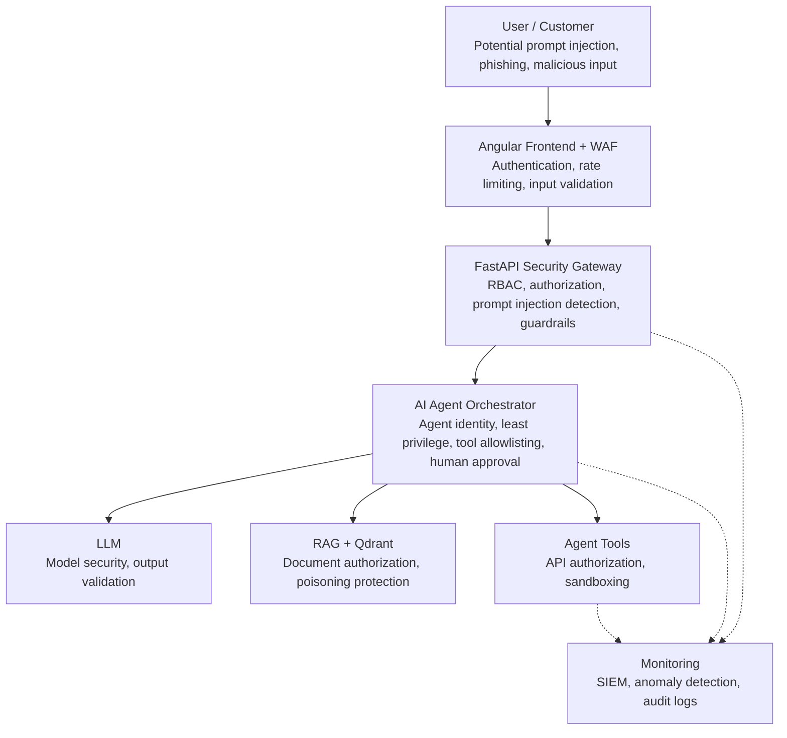

# AI Security – Complete Learning Roadmap

## Foundation

- Prompt injection (direct, indirect, RAG, tool injection)
- Data exfiltration risks
- Context window, context compaction and context rot
- Securing enterprise AI agents (foundational controls)
- Confused deputy problem
- Authentication and authorization for AI agents
- Excessive agency and privilege escalation
- Insecure tool execution and MCP security
- RAG poisoning and vector database security
- Sensitive information disclosure
- Model denial of service and resource exhaustion
- Output handling and insecure generated code
- AI supply chain security
- Model theft and model extraction
- AI red teaming and security evaluation

---

## 1. AI security fundamentals

| #   | Topic                       | What you need to understand                          |
|-----|-----------------------------|------------------------------------------------------|
| 1   | Authentication vs Authorization | Who is calling the AI, and what can they access? |
| 2   | Excessive Agency            | What happens when an AI agent has too much power?    |
| 3   | Privilege Escalation        | Can an agent obtain higher permissions?              |
| 4   | Confused Deputy             | Can an agent misuse its own permissions?             |
| 5   | Non-human Identity Security | How do we manage agent/service identities?           |

**Practical banking example:** An AI assistant should be allowed to view account balances but must not independently approve high-value transfers.

---

## 2. LLM-specific security vulnerabilities

*Some already covered.*

| #   | Topic                         | Example                                             |
|-----|-------------------------------|-----------------------------------------------------|
| 1   | Direct Prompt Injection       | User manipulates system instructions                |
| 2   | Indirect Prompt Injection     | Malicious instructions hidden in PDFs               |
| 3   | RAG Poisoning                 | Attacker inserts malicious documents into knowledge base |
| 4   | Sensitive Information Disclosure | AI reveals another customer's information        |
| 5   | Insecure Output Handling      | AI-generated SQL executes without validation        |
| 6   | System Prompt Leakage         | Attacker extracts hidden instructions               |
| 7   | Model Denial of Service       | Expensive prompts consume excessive resources       |
| 8   | Unbounded Consumption         | Unlimited tokens or tool calls increase costs       |

You have studied prompt injection, but the other vulnerabilities deserve individual practical exercises.

---

## 3. AI Agent and Tool Security

**High priority.** This is particularly important for your Agentic AI architecture.

Learn these concepts:

1. Tool permission boundaries
2. MCP server security
3. Tool poisoning
4. Unauthorized tool execution
5. Agent-to-agent trust boundaries
6. Human-in-the-loop approval
7. Secure memory management
8. Sandboxing and code execution isolation
9. Agent identity and delegated authorization
10. Audit trails and action traceability

**Example:** A banking agent receives a malicious instruction to transfer ₹5 lakh. The agent must not execute the transfer without independent authorization and required approval.

---

## 4. RAG and Vector Database Security

**High priority.** Since you're learning FastAPI, Qdrant, Ollama and RAG, don't skip this section.

| Topic                  | What can go wrong?                                         |
|------------------------|------------------------------------------------------------|
| RAG Poisoning          | Malicious documents enter the knowledge base              |
| Tenant Isolation       | Customer A retrieves Customer B's documents               |
| Embedding Leakage      | Sensitive information may be exposed through embeddings   |
| Metadata Manipulation  | Incorrect document ownership or permissions               |
| Retrieval Manipulation | Malicious content ranks higher than trusted content       |
| Document Access Control | Unauthorized users retrieve confidential documents       |
| Vector DB Security     | Unprotected Qdrant APIs expose stored information         |

**Practical exercise:** Build a multi-tenant banking RAG system where each customer can retrieve only their own documents, even when using the same Qdrant collection.

---

## 5. Infrastructure and AI Supply Chain Security

Learn how to secure everything outside the LLM itself.

- Model download and integrity verification
- Malicious or compromised model files
- Dependency vulnerabilities
- Container security
- API key and secret management
- Encryption at rest and in transit
- Network isolation
- Model endpoint security
- Logging and monitoring

**Example:** Someone replaces your trusted Ollama model with a compromised model artifact. Your application might still work, but its behavior and security could be compromised.

---

## 6. AI Security Testing and Governance

**Production readiness**

| Topic                          | Why it matters                                   |
|--------------------------------|--------------------------------------------------|
| AI Red Teaming                 | Simulate attacks against AI systems              |
| Adversarial Testing            | Test malicious inputs and documents              |
| Guardrail Evaluation           | Verify that safety controls actually work        |
| AI Observability               | Track suspicious agent activity                  |
| DLP                            | Prevent sensitive data leakage                   |
| Explainability and Auditability | Understand why an agent performed an action     |
| Risk Assessment                | Identify and prioritize AI risks                 |
| Incident Response              | Handle AI security breaches                      |

---

## Recommended learning sequence

Learn in this order rather than jumping between unrelated topics.

### AI Security Mastery Roadmap

1. **Phase 1 – Identity and Access Security**
   Authentication, authorization, RBAC, ABAC, OAuth2, token scopes, privilege escalation and confused deputy.
2. **Phase 2 – LLM Security**
   Prompt injection, system prompt leakage, sensitive information disclosure, insecure output handling and denial of service.
3. **Phase 3 – Agent Security**
   Excessive agency, tool poisoning, MCP security, sandboxing, agent identity, delegated permissions and human approvals.
4. **Phase 4 – RAG Security**
   RAG poisoning, tenant isolation, retrieval access control, embedding leakage and vector database security.
5. **Phase 5 – Infrastructure Security**
   Model supply chain, Docker security, secrets, API security, network isolation and dependency scanning.
6. **Phase 6 – AI Security Testing**
   Red teaming, adversarial testing, guardrail evaluation, monitoring, DLP and incident response.

---

## 7. Important security frameworks to study

These will help you connect individual vulnerabilities to industry standards.

| Framework | What to learn |
|-----------|---------------|
| **OWASP Top 10 for LLM Applications** | Common LLM vulnerabilities and mitigation strategies. ([Official OWASP GenAI project](https://genai.owasp.org/)) |
| **MITRE ATLAS** | Real-world adversarial tactics against AI systems. ([Official MITRE ATLAS](https://atlas.mitre.org/)) |
| **NIST AI Risk Management Framework** | AI risk identification, measurement and governance. ([Official NIST framework](https://www.nist.gov/itl/ai-risk-management-framework)) |

---

## Recommendation: Build one practical security project

Instead of only studying definitions, apply all these concepts to one project:

**Secure Enterprise Banking AI Agent**

Your security requirements should include:

- Authentication and customer identity propagation.
- Role-based and resource-level authorization.
- Prompt injection protection.
- Secure RAG with tenant isolation.
- MCP tool authorization.
- Confused deputy prevention.
- Human approval for sensitive transactions.
- DLP and sensitive information masking.
- Audit logging and monitoring.
- AI red-team testing.

> **One important distinction:** A guardrail or prompt instruction is not a security boundary. Enforce critical security policies in trusted backend services.

---

# AI Hacking – Complete List of Threats & Defenses

The goal is to build a comprehensive AI Security / AI Hacking knowledge checklist covering threats, attack techniques, vulnerabilities, defensive strategies, and enterprise security controls.

> **Note:** The 55 individual video titles of the referenced YouTube playlist could not be retrieved. This is therefore **not** a verified video-by-video extraction. It is a consolidated AI security syllabus covering the major topics relevant to that playlist.

It is organized into two major areas:

1. **AI Hacking Threats** – How attackers compromise AI systems.
2. **AI Hacking Defenses** – How developers and security teams protect AI systems.

---

## Part 1. AI Hacking Threats

### A. Prompt-based attacks

| #  | Threat                     | What happens                                                          |
|----|----------------------------|-----------------------------------------------------------------------|
| 1  | Prompt Injection           | Attacker manipulates AI instructions.                                 |
| 2  | Direct Prompt Injection    | Malicious instructions are directly entered by the user.              |
| 3  | Indirect Prompt Injection  | Malicious instructions are hidden in documents, websites or emails.   |
| 4  | Jailbreaking               | Attacker bypasses AI safety restrictions.                             |
| 5  | System Prompt Leakage      | Attacker extracts hidden system instructions.                         |
| 6  | Prompt Extraction          | Attacker tries to reveal internal prompts and templates.              |
| 7  | Role-play Attacks          | AI is tricked into adopting an unrestricted persona.                  |
| 8  | Instruction Override       | Malicious instructions attempt to override trusted instructions.      |
| 9  | Context Manipulation       | Attacker manipulates conversation history or retrieved context.       |
| 10 | Multimodal Prompt Injection | Malicious instructions are embedded in images, audio or other media. |

### B. Data and privacy attacks

| #  | Threat                       | What happens                                                         |
|----|------------------------------|----------------------------------------------------------------------|
| 11 | Data Poisoning               | Malicious data contaminates training or knowledge sources.           |
| 12 | Training Data Extraction     | Sensitive information is extracted from model outputs.               |
| 13 | Data Leakage                 | AI reveals confidential information.                                 |
| 14 | PII Exposure                 | Personal information is disclosed.                                   |
| 15 | Membership Inference         | Attacker determines whether particular data was used for training.   |
| 16 | Model Inversion              | Attacker attempts to reconstruct sensitive training information.     |
| 17 | RAG Poisoning                | Malicious documents manipulate retrieval results.                    |
| 18 | Cross-Tenant Data Leakage    | One customer accesses another customer's information.                |
| 19 | Embedding Leakage            | Sensitive information is exposed through vector representations or retrieval. |
| 20 | Conversation History Leakage | Private conversation data becomes accessible to unauthorized users.  |

### C. Model-level attacks

| #  | Threat                     | What happens                                                           |
|----|----------------------------|------------------------------------------------------------------------|
| 21 | Adversarial Attacks        | Carefully crafted inputs cause incorrect model predictions.            |
| 22 | Model Theft                | Attackers copy or replicate a model.                                   |
| 23 | Model Extraction           | Attackers approximate a model through repeated queries.                |
| 24 | Model Backdoors            | A hidden trigger causes malicious model behavior.                      |
| 25 | Model Poisoning            | The model is manipulated through malicious training or fine-tuning.    |
| 26 | Model Evasion              | Attackers craft inputs to evade detection.                             |
| 27 | Model Supply Chain Attacks | Compromised models, datasets or dependencies introduce vulnerabilities. |
| 28 | Malicious Fine-tuning      | Fine-tuning introduces unsafe or manipulated behavior.                 |

### D. AI Agent and tool-based attacks

| #  | Threat                         | What happens                                                      |
|----|--------------------------------|-------------------------------------------------------------------|
| 29 | Tool Abuse                     | AI invokes tools for unauthorized operations.                     |
| 30 | Excessive Agency               | Agent receives more autonomy than necessary.                      |
| 31 | Unauthorized API Calls         | Agent accesses restricted backend services.                       |
| 32 | Privilege Escalation           | Agent gains permissions beyond its authorization.                 |
| 33 | Agent Hijacking                | Attacker manipulates an agent's behavior or objectives.           |
| 34 | Memory Poisoning               | Attacker inserts malicious information into agent memory.         |
| 35 | Goal Hijacking                 | Agent is redirected from its original objective.                  |
| 36 | Multi-Agent Exploitation       | Malicious instructions propagate between agents.                  |
| 37 | MCP Security Attacks           | Malicious or compromised MCP servers and tools manipulate agents. |
| 38 | Zero-Click Attacks             | Malicious content triggers an attack without a direct user prompt. |
| 39 | Unauthorized Data Exfiltration | Agent sends confidential information to an external destination.  |
| 40 | Autonomous Agent Misuse        | An agent performs harmful actions without appropriate supervision. |

### E. Application and infrastructure attacks

| #  | Threat                                      | What happens                                                        |
|----|---------------------------------------------|---------------------------------------------------------------------|
| 41 | LLM Denial of Service                       | Excessive requests exhaust model resources.                         |
| 42 | Resource Exhaustion                         | Large prompts or expensive operations consume resources.            |
| 43 | API Key Theft                               | Attackers steal credentials used to access AI services.             |
| 44 | LLM Jacking                                 | Stolen cloud credentials are used to access AI models at someone else's expense. |
| 45 | Insecure Output Handling                    | AI-generated output is executed or processed unsafely.              |
| 46 | SSRF                                        | An attacker exploits server-side requests through an AI application. |
| 47 | Insecure Plugin Design                      | Vulnerable plugins expose systems to unauthorized actions.          |
| 48 | Authentication and Authorization Weaknesses | Unauthorized users gain access to AI capabilities.                  |
| 49 | Dependency and Software Supply Chain Attacks | Vulnerable libraries or compromised packages affect AI applications. |
| 50 | Cloud Misconfiguration                      | Improper cloud permissions or exposed storage leak AI data.         |

### F. AI-enabled cybercrime

| #  | Threat                        | What happens                                              |
|----|-------------------------------|-----------------------------------------------------------|
| 51 | AI-powered Phishing           | AI creates convincing phishing messages.                  |
| 52 | Deepfake Attacks              | Synthetic audio or video impersonates real people.        |
| 53 | AI-generated Malware          | AI assists in producing malicious code.                   |
| 54 | Automated Vulnerability Discovery | AI helps identify exploitable weaknesses.             |
| 55 | AI-powered Social Engineering | AI automates targeted manipulation of people.             |

---

## Part 2. AI Hacking Defenses

These are the security controls to implement when developing production-grade LLM applications, RAG systems and autonomous AI agents.

### A. Prompt injection and jailbreak protection

| #  | Defense                    | How it protects                                            |
|----|----------------------------|------------------------------------------------------------|
| 1  | Input Validation           | Reject malformed or unexpected input.                      |
| 2  | Prompt Injection Detection | Detect suspicious instructions in user input.              |
| 3  | Indirect Injection Scanning | Inspect external documents and retrieved content.         |
| 4  | Prompt Isolation           | Separate trusted instructions from untrusted data.         |
| 5  | System Prompt Protection   | Avoid exposing internal prompts and secrets.               |
| 6  | Instruction Hierarchy      | Give trusted instructions higher priority than untrusted content. |
| 7  | Jailbreak Detection        | Identify attempts to bypass safety controls.               |
| 8  | Context Sanitization       | Remove or neutralize unsafe retrieved content.             |
| 9  | Output Validation          | Check generated responses before displaying or processing them. |
| 10 | Adversarial Testing        | Test the model against known attack patterns.              |

### B. Data and privacy protection

| #  | Defense                          | How it protects                                                  |
|----|----------------------------------|------------------------------------------------------------------|
| 11 | Data Encryption                  | Protect data at rest and in transit.                             |
| 12 | PII Detection and Masking        | Hide sensitive personal information.                             |
| 13 | Data Access Control              | Restrict access to authorized information.                       |
| 14 | RAG Document-level Authorization | Ensure users retrieve only permitted documents.                  |
| 15 | Tenant Isolation                 | Prevent cross-customer data access.                              |
| 16 | Data Provenance                  | Track where knowledge and training data originate.               |
| 17 | Data Poisoning Detection         | Identify suspicious or manipulated data.                         |
| 18 | Retention Policies               | Limit unnecessary storage of conversations and sensitive information. |
| 19 | Secure Vector Database           | Protect embeddings, metadata and retrieval operations.           |
| 20 | Privacy Auditing                 | Monitor and audit access to sensitive information.               |

### C. AI agent security

| #  | Defense                 | How it protects                                              |
|----|-------------------------|--------------------------------------------------------------|
| 21 | Least Privilege         | Give agents only the permissions they need.                  |
| 22 | Zero Trust Architecture | Verify every access request.                                 |
| 23 | Human-in-the-Loop       | Require human approval for sensitive actions.                |
| 24 | Tool Allowlisting       | Permit only approved tools.                                  |
| 25 | API Authorization       | Validate every agent API request.                            |
| 26 | Agent Identity Management | Give each agent a controlled identity.                     |
| 27 | Sandboxing              | Execute untrusted operations in isolated environments.       |
| 28 | Agent Memory Validation | Validate information before storing it in memory.            |
| 29 | Execution Limits        | Limit agent steps, tokens, time and resource usage.          |
| 30 | Kill Switch             | Immediately stop a compromised or malfunctioning agent.      |

### D. Model and application security

| #  | Defense                      | How it protects                                         |
|----|------------------------------|---------------------------------------------------------|
| 31 | Secure Model Selection       | Use trusted models and verified sources.                |
| 32 | Model Integrity Verification | Verify model artifacts and checksums.                   |
| 33 | Dependency Scanning          | Detect vulnerable libraries and packages.               |
| 34 | API Rate Limiting            | Prevent excessive API usage.                            |
| 35 | Authentication               | Verify user identity.                                   |
| 36 | RBAC / ABAC                  | Enforce role- and attribute-based access control.       |
| 37 | Secrets Management           | Secure API keys, tokens and credentials.                |
| 38 | Secure Output Encoding       | Prevent XSS, injection and unsafe execution.            |
| 39 | Network Segmentation         | Restrict access between services.                       |
| 40 | Secure Logging               | Record security events without exposing secrets.        |

### E. Monitoring, testing and governance

| #  | Defense                        | How it protects                                       |
|----|--------------------------------|-------------------------------------------------------|
| 41 | AI Red Teaming                 | Simulate attacks against AI applications.             |
| 42 | LLM Penetration Testing        | Identify AI-specific vulnerabilities.                 |
| 43 | Continuous Security Monitoring | Detect suspicious behavior.                           |
| 44 | Anomaly Detection              | Identify unusual agent or model activity.             |
| 45 | Guardrails                     | Enforce input, output and action policies.            |
| 46 | SIEM Integration               | Centralize and correlate security events.             |
| 47 | Incident Response              | Investigate and contain AI security incidents.        |
| 48 | Model Evaluation               | Test reliability, safety and robustness.              |
| 49 | AI Risk Assessment             | Identify and prioritize security risks.               |
| 50 | AI Governance                  | Establish accountability, policies and compliance.    |

---

## Part 3. Important AI Security frameworks and standards

These should be part of your AI security learning checklist.

| #  | Framework                            | What it covers                                                                                                                      |
|----|--------------------------------------|-------------------------------------------------------------------------------------------------------------------------------------|
| 1  | **OWASP Top 10 for LLM Applications** | Prompt injection, sensitive information disclosure, supply chain vulnerabilities, improper output handling, excessive agency and other LLM risks. ([Official OWASP resource](https://genai.owasp.org/llm-top-10/)) |
| 2  | **MITRE ATLAS**                      | Knowledge base of adversarial tactics and techniques targeting AI systems. ([Official MITRE ATLAS](https://atlas.mitre.org/))        |
| 3  | **NIST AI Risk Management Framework** | Framework for governing, mapping, measuring and managing AI risks. ([Official NIST resource](https://www.nist.gov/itl/ai-risk-management-framework)) |
| 4  | **ISO/IEC 42001**                    | AI management systems, organizational controls and governance. ([Official ISO standard](https://www.iso.org/standard/42001))         |

---

## Part 4. How everything fits together in a real enterprise AI application

Consider a banking AI assistant built using Angular, FastAPI, an LLM, Qdrant and an agent orchestrator.

### Example: Banking AI security architecture

### Example attack and defense mapping

| Attack                | Corresponding defense                           |
|-----------------------|-------------------------------------------------|
| Prompt injection      | Input scanning + instruction isolation          |
| Jailbreak             | Safety evaluation + guardrails                  |
| RAG poisoning         | Document validation + provenance                |
| Data leakage          | RBAC + tenant isolation                         |
| Agent hijacking       | Least privilege + human approval                |
| MCP tool abuse        | Tool allowlisting + authorization               |
| API key theft         | Secrets management + credential rotation        |
| LLM denial of service | Rate limiting + resource quotas                 |
| System prompt leakage | Prompt minimization + secret separation         |
| Model theft           | Access controls + query monitoring              |
