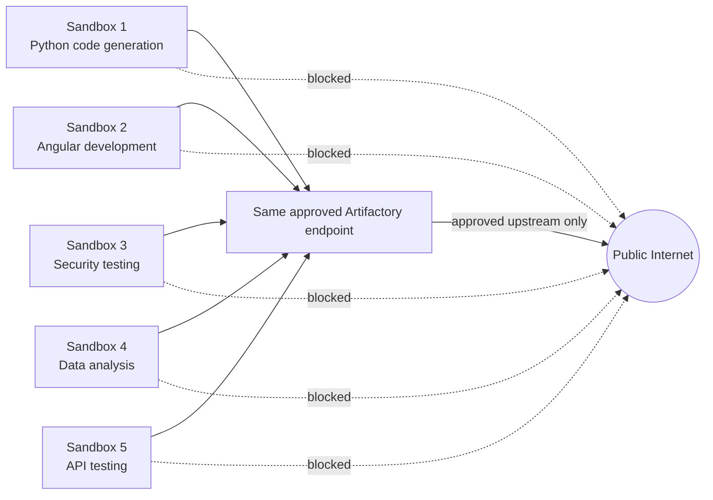
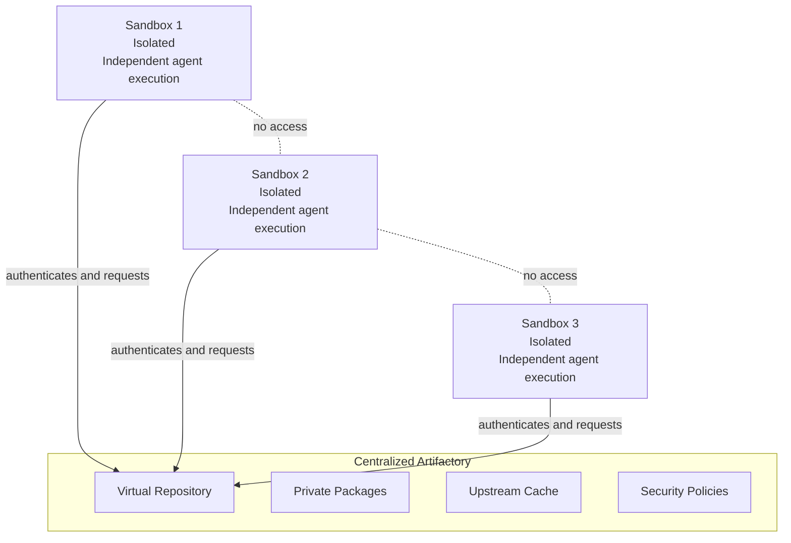
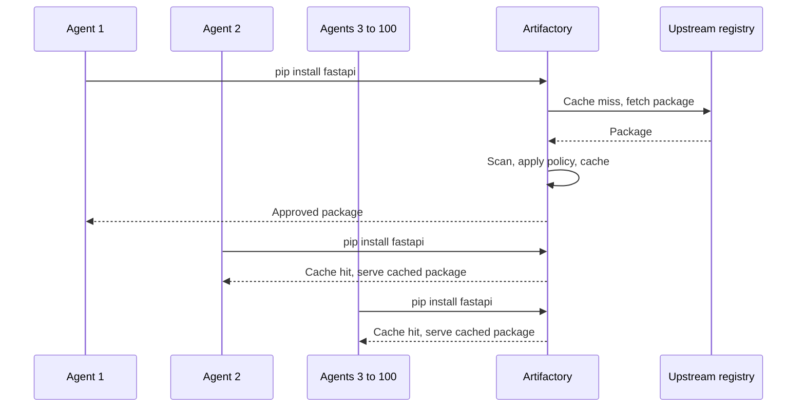
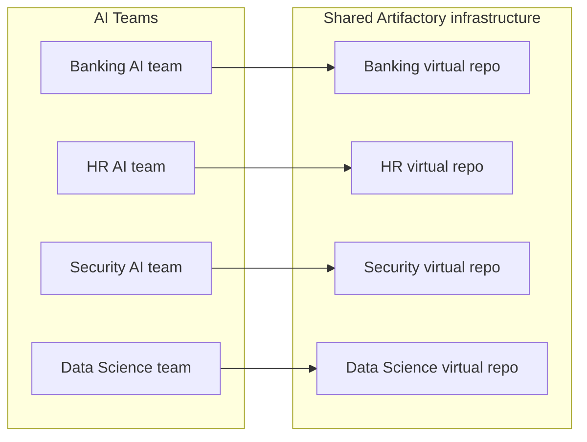

# Different Sandboxes Use the Same Artifactory: When & Why?

Multiple isolated AI agent sandboxes can use the same centralized Artifactory because Artifactory is an enterprise-wide software distribution and security gateway.

The key idea is:

> Isolation of execution does not mean duplication of software repositories.

Let's understand when and why this architecture is used.

## 1. Real-world enterprise scenario

Imagine an organization running 100 AI agents simultaneously.

| Sandbox | AI agent task | Required dependencies |
|---|---|---|
| Sandbox 1 | Python code generation | FastAPI, NumPy |
| Sandbox 2 | Angular development | Angular, RxJS |
| Sandbox 3 | Security testing | Bandit, Semgrep |
| Sandbox 4 | Data analysis | Pandas, Matplotlib |
| Sandbox 5 | API testing | Requests, Pytest |

Each sandbox is isolated:

- Separate filesystem.
- Separate process environment.
- Separate execution context.
- No direct Internet access.
- No direct communication with other sandboxes.

However, all five can communicate with the same approved Artifactory endpoint.




Dotted lines are blocked direct Internet connections.

## 2. Why use one Artifactory?

There are five major reasons.

### 1. Centralized security

Suppose an organization discovers that a particular version of a Python library has a critical vulnerability.

- Without centralized control, administrators might need to update package restrictions across 100 different sandboxes.
- With Artifactory, they can enforce the package policy centrally.

### 2. Dependency caching

Imagine 50 agents request:

```bash
pip install fastapi==0.120.0
```

- The first request causes Artifactory to retrieve the package from the upstream registry, subject to its policies.
- The package is cached.
- Subsequent requests can reuse the cached artifact rather than downloading it repeatedly from the Internet.

### 3. Consistent dependencies

An organization can enforce approved package versions across multiple agents. For example:

- Agent 1 uses FastAPI 0.120.0.
- Agent 2 uses FastAPI 0.120.0.
- Agent 3 uses FastAPI 0.120.0.

This improves reproducibility and reduces unexpected dependency differences.

### 4. Cost and bandwidth optimization

Instead of 100 sandboxes downloading the same package independently, Artifactory can reuse cached packages.

### 5. Centralized auditing

Security teams can monitor:

- Which agent requested a package.
- Which package and version were requested.
- Whether the package was approved or blocked.
- Which repository served it.
- When the download happened.

## 3. Important: Does sharing Artifactory break sandbox isolation?

**No, if correctly configured.**

Consider this architecture:



Dotted lines show that sandboxes cannot communicate with each other.

Each sandbox independently authenticates and requests approved packages. Sharing a repository does not mean sharing execution environments. For example:

- Sandbox 1 cannot read Sandbox 2's files.
- Sandbox 1 cannot execute commands inside Sandbox 2.
- Sandbox 1 cannot access Sandbox 2's memory.
- Both can download approved dependencies from Artifactory.

However, Artifactory itself must be secured with authentication, authorization, tenant isolation where required, and network controls.

## 4. What happens when 100 agents request packages simultaneously?

Suppose 100 agents request the same package.

| Request | Artifactory behavior |
|---|---|
| Agent 1 | Cache miss → upstream download |
| Agent 2 | Cache hit → serve cached package |
| Agent 3 | Cache hit → serve cached package |
| Agent 4–100 | Reuse cached package |

The actual behavior depends on caching configuration and concurrent request handling.




## 5. What if different organizations or teams use the same Artifactory?

This is where enterprise access control becomes important. For example:

| Team | Repository access |
|---|---|
| Banking AI team | Banking-approved packages |
| HR AI team | HR-approved packages |
| Security AI team | Security-approved packages |
| Data Science team | Data Science-approved packages |

They may share the same Artifactory infrastructure but use different virtual repositories, permissions, and policies.




## 6. Remember this distinction

| Concept | Purpose |
|---|---|
| Sandbox isolation | Protects agent execution environments |
| Centralized Artifactory | Controls software distribution |
| Package caching | Reduces repeated downloads |
| Security scanning | Detects vulnerable or malicious packages |
| Access control | Controls which agents can access which packages |

## Key takeaway

You don't need one Artifactory per AI agent. You need **isolated sandboxes for execution** and a **centrally managed, securely configured Artifactory for dependency distribution**.

This is a common enterprise architecture pattern for running large numbers of autonomous AI agents safely.
