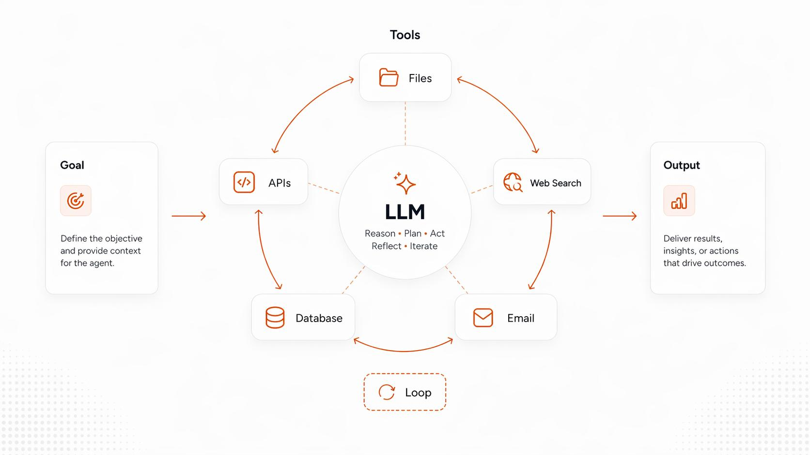
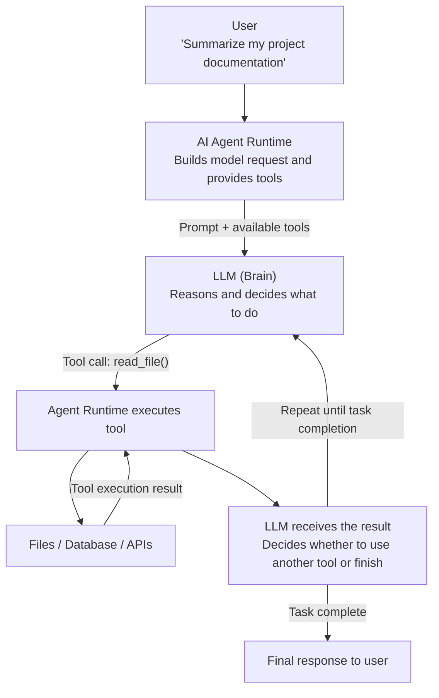

# LLM vs AI Agent – What Exactly Is an AI Agent?

An LLM is the brain. An AI agent is the complete software system that uses that brain to perform tasks.

Let's break it down from a software architect's perspective, using a practical example.

## 1. What exactly is an AI agent?

An AI agent is a software system that combines:

1. **LLM (Brain):** Understands instructions, reasons, and makes decisions.
2. **Tools:** Functions the agent can use, such as reading files, calling APIs, querying databases, or sending emails.
3. **Agent Runtime (Executor):** Executes the tool calls requested by the LLM.
4. **Context:** Provides the LLM with the user's instructions, available tools, and previous results.
5. **Control Loop:** Repeatedly sends information to the LLM, executes its requested actions, and returns results until the task is completed.

```text
AI Agent = LLM + Tools + Orchestration + Execution Loop
```

*Conceptual architecture of an AI agent.*



## 2. How does an AI agent actually work?

Imagine you ask:

> "Read my project documentation and summarize the architecture."

Here is what happens behind the scenes.

1. **User sends a request**

   "Summarize project documentation."

2. **Agent sends information to the LLM**
   - User prompt
   - Available tools
   - Tool descriptions
   - Previous conversation context

3. **LLM decides which tool to use**

   It generates a tool call such as:

   ```text
   read_file("architecture.md")
   ```

4. **Agent executes the tool**

   The agent runtime invokes the actual file-reading function and retrieves the content.

   > **Important:** The LLM does not directly open the file. The agent software executes that operation.

5. **Tool result goes back to the LLM**

   The agent sends the retrieved file content to the LLM.

6. **LLM makes its next decision**

   It may:
   - Read another file.
   - Retrieve additional information.
   - Generate the final summary.

7. **Agent returns the final response**

   The user receives the architecture summary.

## 3. Understand the architecture visually

This is the interaction loop you should remember.



## 4. Let's connect this to a local AI development stack

Suppose you build an AI agent using these technologies:

| Component | Technology | Responsibility |
|-----------|------------|----------------|
| Frontend | Angular 19 | Chat interface |
| Backend | FastAPI | Agent runtime |
| LLM | Ollama + Phi-3 | Reasoning and decisions |
| Agent framework | LangChain / LangGraph | Tool orchestration |
| Vector database | Qdrant | Semantic retrieval |
| Tools | Python functions | File reading, APIs, database queries |
| Containerization | Docker | Running services |

For example, you could build an agent that can:

- Read uploaded PDF documents.
- Search internal documentation using RAG.
- Query PostgreSQL.
- Call external APIs.
- Generate reports.

> **Important distinction:** RAG retrieves relevant information for an LLM. An agent can decide when to use RAG, which tools to invoke, and whether additional information is required.

## 5. AI Agent vs LLM vs RAG

These three concepts are related but different.

| Concept | What it does |
|---------|--------------|
| LLM | Understands, reasons and generates responses |
| RAG | Retrieves relevant external knowledge and provides it to the LLM |
| AI Agent | Uses an LLM to decide and execute multi-step tasks through tools |

For example:

- **LLM:** Answers a question.
- **RAG:** Answers a question using your company's documents.
- **AI Agent:** Decides to search company documents, query a database, call an API, and prepare a report.

An agent can use RAG as one of its tools.

## 6. Important concepts to learn next

I recommend following this sequence:

1. AI Agent Architecture
2. Tool Calling / Function Calling
3. Agent Execution Loop
4. Agent Memory and Context Management
5. Single-Agent vs Multi-Agent Architecture
6. LangGraph and State Management
7. MCP (Model Context Protocol)
8. Agent Guardrails and Human-in-the-Loop
9. Production Agent Observability and Evaluation

## Test your understanding

**1. Who actually executes a tool call when an LLM requests `read_file()`?**

- The LLM itself
- **The AI agent runtime** ✅
- The vector database

*The agent runtime executes the function. The LLM only decides to request it.*

**2. What happens after a tool returns its result?**

- **The result is sent back to the LLM** ✅
- The agent must immediately stop
- The LLM is retrained

*The agent sends the tool result back to the LLM so it can decide the next action.*

**3. Can an AI agent use RAG?**

- No, they are competing technologies
- **Yes, RAG can be one of its tools** ✅
- Only if the LLM is trained again

*An agent can invoke a RAG retrieval tool whenever it needs external knowledge.*

## Next step

The next particularly important practical lesson is **Tool Calling / Function Calling**. Once you understand how an LLM requests a tool and how FastAPI executes it, you'll understand the foundation of building your own AI agent with Ollama and Docker.

---

# AI AGents Decision Models

These will make or break your AI agents, must know.

I've explained in a very simple way.

1. 𝗖𝗵𝗮𝗶𝗻-𝗼𝗳-𝗧𝗵𝗼𝘂𝗴𝗵𝘁
-----------------------------------------------------------------
The method that 𝗯𝗿𝗲𝗮𝗸𝘀 𝗽𝗿𝗼𝗯𝗹𝗲𝗺𝘀 𝗶𝗻𝘁𝗼 𝘀𝘁𝗲𝗽-𝗯𝘆-𝘀𝘁𝗲𝗽 𝗿𝗲𝗮𝘀𝗼𝗻𝗶𝗻𝗴.

Understand problem → Break into steps → Solve sequentially → Build intermediate logic → Combine results → Generate final answer

𝗨𝘀𝗲𝗱 𝗳𝗼𝗿: math, coding, and structured problem solving

2. 𝗥𝗲𝗮𝘀𝗼𝗻 + 𝗔𝗰𝘁 (𝗥𝗲𝗔𝗰𝘁)
-----------------------------------------------------------------
The framework that 𝗰𝗼𝗺𝗯𝗶𝗻𝗲𝘀 𝗿𝗲𝗮𝘀𝗼𝗻𝗶𝗻𝗴 𝘄𝗶𝘁𝗵 𝘁𝗼𝗼𝗹 𝘂𝘀𝗮𝗴𝗲.

Observe input → Analyze need → Select tool → Execute action → Update context → Repeat loop → Produce output

𝗨𝘀𝗲𝗱 𝗳𝗼𝗿: real-time tasks, API usage, and tool-based workflows

3. 𝗧𝗿𝗲𝗲-𝗼𝗳-𝗧𝗵𝗼𝘂𝗴𝗵𝘁
-----------------------------------------------------------------
The approach that 𝗲𝘅𝗽𝗹𝗼𝗿𝗲𝘀 𝗺𝘂𝗹𝘁𝗶𝗽𝗹𝗲 𝗿𝗲𝗮𝘀𝗼𝗻𝗶𝗻𝗴 𝗽𝗮𝘁𝗵𝘀.

Define problem → Create branches → Explore possibilities → Evaluate each path → Compare outcomes → Select best answer

𝗨𝘀𝗲𝗱 𝗳𝗼𝗿: complex decision-making, planning, and strategy problems

4. 𝗦𝗲𝗹𝗳-𝗖𝗼𝗻𝘀𝗶𝘀𝘁𝗲𝗻𝗰𝘆
-----------------------------------------------------------------
The method that 𝗶𝗺𝗽𝗿𝗼𝘃𝗲𝘀 𝗮𝗰𝗰𝘂𝗿𝗮𝗰𝘆 𝗯𝘆 𝗺𝘂𝗹𝘁𝗶𝗽𝗹𝗲 𝗮𝘁𝘁𝗲𝗺𝗽𝘁𝘀.

Take input → Generate multiple responses → Compare outputs → Identify patterns → Select majority answer → Return final result

𝗨𝘀𝗲𝗱 𝗳𝗼𝗿: improving accuracy, reducing errors, and reliable reasoning

5. 𝗣𝗹𝗮𝗻-𝗮𝗻𝗱-𝗘𝘅𝗲𝗰𝘂𝘁𝗲
-----------------------------------------------------------------
The system that 𝗽𝗹𝗮𝗻𝘀 𝗳𝗶𝗿𝘀𝘁 𝗮𝗻𝗱 𝘁𝗵𝗲𝗻 𝗲𝘅𝗲𝗰𝘂𝘁𝗲𝘀.

Define goal → Break into tasks → Create plan → Execute steps → Collect results → Deliver final output

𝗨𝘀𝗲𝗱 𝗳𝗼𝗿: long tasks, multi-step workflows, and autonomous agents

6. 𝗙𝗲𝗲𝗱𝗯𝗮𝗰𝗸-𝗗𝗿𝗶𝘃𝗲𝗻 (𝗥𝗲𝗳𝗹𝗲𝘅𝗶𝗼𝗻)
-----------------------------------------------------------------
The loop that 𝗹𝗲𝗮𝗿𝗻𝘀 𝗳𝗿𝗼𝗺 𝗲𝗿𝗿𝗼𝗿𝘀 𝗮𝗻𝗱 𝗶𝗺𝗽𝗿𝗼𝘃𝗲𝘀.

Receive task → Attempt solution → Evaluate result → Reflect on mistakes → Adjust strategy → Retry → Improve output

𝗨𝘀𝗲𝗱 𝗳𝗼𝗿: learning from mistakes, iterative improvement, and debugging

7. 𝗔𝗜 𝗧𝗼𝗼𝗹 𝗥𝗼𝘂𝘁𝗶𝗻𝗴 (𝗠𝗥𝗞𝗟)
-----------------------------------------------------------------
The architecture that 𝗿𝗼𝘂𝘁𝗲𝘀 𝘁𝗮𝘀𝗸𝘀 𝘁𝗼 𝘀𝗽𝗲𝗰𝗶𝗮𝗹𝗶𝘇𝗲𝗱 𝘁𝗼𝗼𝗹𝘀.

Receive input → Identify task type → Route to expert tool → Execute function → Merge outputs → Generate response

𝗨𝘀𝗲𝗱 𝗳𝗼𝗿: multi-tool systems, expert routing, and hybrid AI architectures

8. 𝗣𝗿𝗼𝗴𝗿𝗮𝗺-𝗼𝗳-𝗧𝗵𝗼𝘂𝗴𝗵𝘁
-----------------------------------------------------------------
The approach that 𝘂𝘀𝗲𝘀 𝗰𝗼𝗱𝗲 𝘁𝗼 𝘀𝗼𝗹𝘃𝗲 𝗽𝗿𝗼𝗯𝗹𝗲𝗺𝘀.

Understand problem → Generate code → Execute program → Analyze results → Refine logic → Return final answer


𝗨𝘀𝗲𝗱 𝗳𝗼𝗿: data analysis, calculations, and logic-heavy problem solving

Most people only focus on models, not how they think.

If you want your AI agents to actually reason, act, and scale properly, choosing the right decision model is critical.


