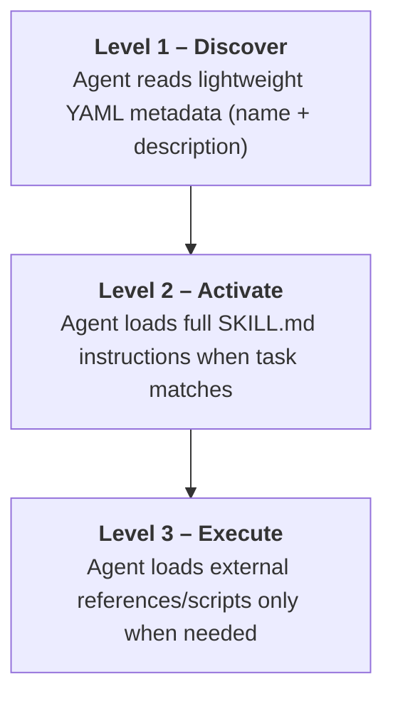
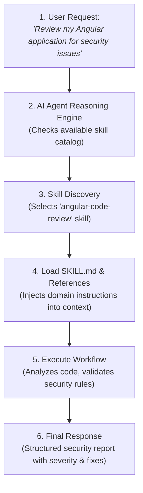

# Agent Skills – Complete Learning Guide

> **Study notes + Practical implementation + Architecture guide**  
> Agent Skills are a way to extend AI agents with reusable instructions, specialized knowledge, and repeatable workflows.

Think of them as giving an AI agent a collection of **professional playbooks** that it can discover and use whenever a particular task requires them.

For example, imagine building a banking AI agent that can perform several tasks:
* Explain banking transactions.
* Review API security.
* Generate Angular components.
* Analyze application logs.
* Review pull requests.
* Prepare technical documentation.

Instead of putting all these instructions into every prompt, you create separate, modular **Agent Skills**.

---

## Part 1. Detailed Study Notes

### 1. What Exactly are Agent Skills?

An **Agent Skill** is a reusable package of instructions that teaches an AI agent how to perform a particular task.

At its simplest, a Skill contains a Markdown file called `SKILL.md`.

```text
skills/
│
├── banking-support/
│   └── SKILL.md
│
├── angular-development/
│   └── SKILL.md
│
├── api-security/
│   └── SKILL.md
│
└── code-review/
    └── SKILL.md
```

Each Skill describes:
* **What** the task is about.
* **When** the agent should use it.
* **Which workflow** it should follow.
* **Which rules and constraints** it must respect.
* **Which tools or resources** may be useful.

> ⚠️ **Important:** Agent Skills are **not** themselves AI models. They provide instructions, domain rules, and supporting resources to an existing AI agent.

---

### 2. Agent Skills = Reusable Prompts

Consider a normal prompt you might paste repeatedly:

```text
Whenever you review Angular code:
1. Check security vulnerabilities.
2. Check performance.
3. Check accessibility.
4. Check coding standards.
5. Suggest improvements.
```

With Agent Skills, you save those instructions once in a structured file. The agent discovers the Skill and loads its instructions on demand.

| Normal Prompting | Agent Skills |
| :--- | :--- |
| Repeat instructions in every session | Reuse instructions across all tasks |
| Instructions stuffed inside each prompt | Instructions cleanly organized in dedicated files |
| Manual copying and repetition | Discovered and loaded automatically by the agent |
| Difficult to maintain across teams | Centralized, version-controlled in Git |
| Bloats context with unnecessary guidelines | Relevant instructions loaded only when triggered |

---

### 3. The Most Important Concept: Progressive Disclosure

Suppose your AI agent has **100+ Skills**. Loading all 100 complete instruction files into the context window for every request would instantly blow up token limits and cause **Context Rot**.

Instead, Agent Skills use **progressive disclosure** across three distinct levels:



#### Level 1 – Discover (Initially Available)
The agent only loads the name and short description of available Skills:
```yaml
name: api-security
description: Review REST APIs for authentication, authorization, injection, and security issues.
```

#### Level 2 – Activate (Relevant Skill Selected)
User asks: *"Review my banking API for security vulnerabilities."*  
The agent matches `api-security` and loads its full `SKILL.md` instructions into active context.

#### Level 3 – Execute (Additional Resources on Demand)
The agent follows the workflow and accesses supporting resources only when required:
* Reference checklists (`references/`)
* Helper scripts (`scripts/`)
* Output report templates (`assets/`)

---

### 4. How Does an Agent Skill Work Internally?



---

### 5. Agent Skills vs System Prompts vs Tools vs MCP vs RAG

| Concept | Purpose | Role in Architecture |
| :--- | :--- | :--- |
| **System Prompt** | Defines the agent's general persona and behavior | *"You are a banking security assistant."* |
| **Agent Skills** | Provides reusable task-specific instructions & SOPs | *"Follow OWASP API security review procedures."* |
| **Tools / Functions** | Allows the agent to perform actions | Read source files, run linters, query DB |
| **MCP** | Standardizes connection to external tools/data | Standardized protocol to GitHub / PostgreSQL |
| **RAG** | Retrieves unstructured external knowledge | Retrieve banking policy documents from Qdrant |
| **LLM** | Core reasoning and language generation engine | Llama-3, Phi-3, Claude, GPT-4 |

---

### 6. Advantages of Agent Skills
1. **Reusability:** Write procedural instructions once, use infinitely.
2. **Consistency:** Enforce standardized engineering and audit workflows across teams.
3. **Context Efficiency:** Load instructions on demand, avoiding context bloating and rot.
4. **Maintainability:** Update a procedure in Git without rewriting application code or prompts.
5. **Specialization:** Equip generalist LLMs with deep domain-specific procedures.
6. **Extensibility:** Bundle executable scripts, checklists, and document templates.
7. **Portability:** Standardized format compatible across modern AI coding agents.

---

### 7. Limitations and Security Considerations
* **No Intelligence Guarantee:** A skill provides guidelines; it cannot fix underlying LLM reasoning deficiencies.
* **Instruction Quality:** Incorrect instructions lead to incorrect results.
* **No Built-in Authorization:** Skills tell the agent *how* to perform a task; they do **not** grant authorization. Sensitive operations still require strict backend RBAC.
* **Clear Descriptions Required:** Ambiguous YAML descriptions lead to missed skill activations.
* **Sanitize External Resources:** Treat external scripts and file inputs as untrusted.

---

## Part 2. Practical Implementation – Build Your First Agent Skill

Let's build an **Angular Code Review Skill** for an enterprise banking environment.

### 1. Folder Structure

```text
agent-skills/
│
└── angular-code-review/
    │
    ├── SKILL.md                          <-- (Mandatory) Main instructions
    │
    ├── references/                       <-- (Optional) Deep checklists
    │   ├── security-checklist.md
    │   └── accessibility-checklist.md
    │
    ├── scripts/                          <-- (Optional) Helper scripts
    │   └── check-dependencies.sh
    │
    └── assets/                           <-- (Optional) Templates
        └── review-template.md
```

| File / Folder | Responsibility |
| :--- | :--- |
| `SKILL.md` | Main entry point: YAML frontmatter + structured Markdown instructions |
| `references/` | In-depth technical guidelines, security standards, and rules |
| `scripts/` | Executable helper scripts and automation |
| `assets/` | Reusable output templates, report formats, and boilerplates |

---

### 2. Create `SKILL.md`

```markdown
---
name: angular-code-review
description: Review Angular applications for security vulnerabilities, performance problems, accessibility issues, and coding standards. Use when reviewing Angular components, services, routing, authentication, or frontend pull requests.
---

# Angular Code Review Skill

## Objective
Perform a production-quality code review for Angular applications.

## Review Workflow

### Step 1: Understand the Code
- Identify Angular version.
- Understand component architecture and standalone components.
- Review services and dependency injection.
- Understand routing and state management.

### Step 2: Security Review
Check:
- XSS vulnerabilities.
- Unsafe DOM manipulation.
- Authentication and authorization.
- Token handling and storage.
- Sensitive information exposure.
- API security and route guards.

Read: `references/security-checklist.md`

### Step 3: Performance Review
Check:
- Unnecessary change detection cycles.
- Signal usage vs RxJS subscriptions.
- Lazy loading configuration.
- Memory leaks and unhandled subscriptions.
- Bundle sizes and rendering performance.

### Step 4: Accessibility Review
Check:
- Semantic HTML.
- Keyboard navigation & visible focus.
- ARIA attributes & form labels.
- Color contrast.

Read: `references/accessibility-checklist.md`

### Step 5: Generate Review Report
For every finding provide:
1. Issue title.
2. Severity: `Critical` / `High` / `Medium` / `Low`.
3. File and line number.
4. Explanation of root cause.
5. Recommended solution.
6. Example corrected code snippet.

## Important Rules
- Do not invent vulnerabilities.
- Explain why an issue is problematic.
- Do not modify code without authorization.
- If information is missing, state the limitation clearly.
- Prioritize security and correctness.
```

---

### 3. Create Supporting Reference Files

#### `references/security-checklist.md`
```markdown
# Angular Security Checklist

## XSS Protection
- Avoid direct `innerHTML` or `outerHTML` manipulation.
- Avoid `DomSanitizer.bypassSecurityTrustHtml` unless strictly necessary and validated.
- Do not trust user-generated HTML.
- Prefer standard Angular template data binding (`{{ value }}`).

## Authentication & Tokens
- Avoid storing sensitive JWTs or refresh tokens in `localStorage`.
- Prefer secure, `HttpOnly`, `Secure`, `SameSite` cookies for refresh tokens.
- Keep short-lived access tokens in application memory.
- Always validate authorization on backend services; never rely solely on frontend route guards.

## API Security
- Enforce HTTPS across all endpoints.
- Avoid hardcoding secrets or API keys in frontend code.
- Handle authentication errors (401/403) with interceptors gracefully.
```

#### `references/accessibility-checklist.md`
```markdown
# Accessibility Checklist (WCAG 2.1)

- Use semantic HTML tags (`<main>`, `<nav>`, `<button>`, `<header>`).
- Every form input must have an associated `<label>` or `aria-label`.
- Full keyboard navigation support (Tab, Enter, Escape, Space).
- Ensure visible focus indicator rings (`:focus-visible`).
- Color contrast ratio of at least 4.5:1 for normal text.
- Use valid ARIA attributes where semantic HTML is insufficient.
```

---

### 4. How the AI Agent Uses This Skill

1. **Discovery:** User prompts: *"Review my Angular authentication service."*
2. **Matching:** Agent discovers `angular-code-review` via its YAML description.
3. **Context Loading:** Agent loads `SKILL.md` into context.
4. **Reference Resolution:** When entering Step 2, the agent reads `references/security-checklist.md`.
5. **Code Inspection:** Agent analyzes `auth.service.ts` against the rules.
6. **Report Generation:** Agent produces a structured, actionable report.

---

### 5. Example Expected Output

```markdown
### 🛡️ Angular Code Review Report

#### 1. Refresh Token Exposure in LocalStorage
- **Severity:** High
- **Location:** `src/app/core/services/auth.service.ts:42`
- **Issue:** Refresh tokens stored in browser `localStorage` are vulnerable to XSS credential theft.
- **Recommendation:** Store refresh tokens in `HttpOnly`, `Secure` cookies and keep access tokens in memory.

#### 2. Missing Accessible Form Label
- **Severity:** Medium
- **Location:** `src/app/features/login/login.component.html:15`
- **Issue:** `<input type="password">` lacks an associated `<label>` or `aria-label`.
- **Recommendation:** Add `<label for="password">Password</label>` to satisfy WCAG 2.1 standards.
```

---

### 6. Validating Your Skill

You can validate skill formatting using the reference tool:

```bash
# Install the reference CLI
pip install skills-ref

# Validate the skill folder
skills-ref validate ./angular-code-review
```

---

### 7. Useful Enterprise Skills Catalog

| Skill | What it Teaches the Agent |
| :--- | :--- |
| `angular-code-review` | Angular coding, signals, performance, and review standards |
| `api-security` | REST/GraphQL API security audit and OWASP validation |
| `banking-domain` | Banking workflows, terminology (NEFT/RTGS/IMPS), and rules |
| `docker-deployment` | Container build optimization and Dockerfile hardening |
| `kubernetes-operations`| K8s cluster troubleshooting and manifest validation |
| `rag-evaluation` | RAG groundness, context relevance, and hallucination metrics |
| `system-design` | Architecture review, caching, and resiliency patterns |
| `accessibility-audit` | WCAG 2.1 compliance and screen-reader accessibility review |

---

## Part 3. Enterprise Banking AI Architecture

```text
                 Angular Chatbot Frontend
                            │
                            ▼
           FastAPI Backend / Agent Orchestrator
                            │
              ┌─────────────┴─────────────┐
              ▼                           ▼
        ┌───────────┐               ┌───────────┐
        │ AI Agent  │               │    RAG    │
        │ (Ollama)  │               │ (Qdrant)  │
        └─────┬─────┘               └─────┬─────┘
              │                           │
              ├───────────────────────────┤
              ▼                           ▼
     ┌─────────────────┐         ┌─────────────────┐
     │  Agent Skills   │         │   MCP / Tools   │
     │  (SKILL.md)     │         │ (PostgreSQL/Git)│
     └─────────────────┘         └─────────────────┘
              │                           │
              └─────────────┬─────────────┘
                            ▼
                   Enterprise Services
       (Core Banking APIs · Auth · Transaction DB)
```

> 🔒 **Banking Safeguard:** Never use Agent Skills as an authorization mechanism. Transaction execution, customer identity validation, and access controls must be enforced by backend security layers.

---

## Part 4. Deep Dive: Authoring & File Formats

### 1. Who Creates Agent Skill Files?

You, your development team, or an AI agent can create them. There is no central authority required.

* **Option 1: Developer creates manually** — Writes `SKILL.md` in VS Code.
* **Option 2: AI generates the skill** — Prompts an LLM to generate `SKILL.md` + checklists.
* **Option 3: Organization standardizes skills** — Shared repository of corporate SOPs.

---

### 2. Why Markdown (`.md`) Instead of TXT, DOCX, PDF, or Excel?

| Format | Suitable for Skills? | Reason |
| :--- | :--- | :--- |
| **.md** | **Yes (Standard)** | Structured text, headings, lists, code blocks, and YAML frontmatter |
| **.txt** | Not as standard entry file | Plain text without standardized Markdown syntax |
| **.docx** | Supporting resource | Requires document parsing and carries formatting overhead |
| **.pdf** | Supporting resource | Static binary layout; difficult to diff and maintain in Git |
| **.xlsx** | Supporting resource | Structured tabular data, not ideal for procedural guidelines |
| **.json** | Supporting resource | Machine-readable, but tedious for humans to author complex procedures |

#### Core Advantages of Markdown:
1. **Human & Machine Readable:** Editable in any text editor.
2. **Hierarchical Structure:** `#`, `##`, `- [ ]`, ```` ``` ```` provide clear semantic hierarchy.
3. **YAML Frontmatter:** Enables progressive disclosure (`name`, `description`).
4. **Git Version Control:** Line-by-line diffs, pull request reviews, and auditing.
5. **Lightweight:** No document parsing libraries required.

---

### 3. Using Supporting PDF, DOCX, and Excel Files

`SKILL.md` acts as the **instruction manual**, while large documents live in `references/` or `assets/`:

```text
banking-security/
│
├── SKILL.md                          <-- Entry point & instructions
│
├── references/                       <-- Supporting domain resources
│   ├── banking-security-policy.pdf
│   ├── OWASP-checklist.xlsx
│   └── API-guidelines.docx
│
└── assets/                           <-- Report templates
    └── security-report-template.docx
```

---

### 4. Real-World Analogy: The Job Instruction Manual

```text
┌────────────────────────────────────────────────────────┐
│ SKILL.md = Job Instruction Manual                      │
│ Explains what to do, step-by-step procedures, and      │
│ decision logic for completing the task.                │
└────────────────────────────────────────────────────────┘
                           │
                           ▼
┌────────────────────────────────────────────────────────┐
│ PDF / DOCX / Excel = Reference Materials               │
│ Detailed policy booklets, reference tables, data       │
│ sheets, and regulatory checklists.                     │
└────────────────────────────────────────────────────────┘
                           │
                           ▼
┌────────────────────────────────────────────────────────┐
│ Scripts & MCP Tools = Practical Instruments            │
│ Compilers, linters, API clients, and database queries  │
│ used by the agent to execute actions.                  │
└────────────────────────────────────────────────────────┘
```

---

### 5. Architectural Recommendation

| Component | Purpose |
| :--- | :--- |
| **Agent Skill (`SKILL.md`)** | Tells the agent **how** to perform a task (SOP) |
| **Reference Files (`.pdf`, `.xlsx`)** | Gives the agent **detailed domain knowledge** |
| **Tools (MCP / APIs)** | Allows the agent to **perform actions** |

1. **Keep `SKILL.md` as the lightweight entry point:** Focus on workflows and rules.
2. **Store reference documents modularly:** Place spreadsheets and policy PDFs in `references/`.
3. **Combine with RAG when scale demands:** When reference documentation exceeds hundreds of pages, use vector search (Qdrant) instead of loading full static files into context.

---

## Part 5. Knowledge Check (Test Your Understanding)

### 1. What is the primary purpose of Agent Skills?
* [ ] Train a new LLM
* [x] **Provide reusable task-specific instructions** *(Correct: Skills package reusable knowledge, SOPs, and workflows for an existing AI agent).*
* [ ] Replace MCP
* [ ] Increase context-window size

### 2. Which file is the required entry point of a Skill?
* [ ] `agent.json`
* [ ] `config.yaml`
* [x] **`SKILL.md`** *(Correct: `SKILL.md` contains the mandatory YAML frontmatter metadata and Markdown instructions).*
* [ ] `prompt.txt`

### 3. What happens during Level 1 discovery?
* [ ] All scripts execute
* [ ] Full Skill files load
* [x] **Names and descriptions are discovered** *(Correct: The lightweight catalog helps the agent identify relevant Skills without context bloat).*
* [ ] The LLM is retrained

### 4. What does MCP primarily provide?
* [x] **External tool and data connectivity** *(Correct: MCP standardizes how AI applications connect with external tools, APIs, and databases).*
* [ ] Reusable Markdown instructions
* [ ] Model training
* [ ] Context compression

### 5. Does an Agent Skill automatically authorize a banking transaction?
* [ ] Yes
* [x] **No, backend authorization is still required** *(Correct: Skills guide agent behavior; security permissions and RBAC must be independently enforced).*

---

### Suggested Next Practical Exercise
Build three modular Skills:
1. `angular-code-review`
2. `api-security`
3. `rag-evaluation`

Integrate them into your local AI orchestrator using **Python**, **FastAPI**, and **Ollama**.
