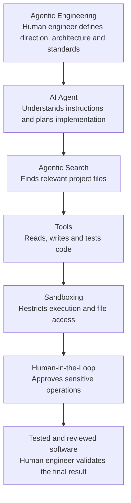

# Agentic Engineering – Combining Software Engineering Skills with AI Agents

**Agentic Engineering** is an approach to software development where a human software engineer combines their technical knowledge, architectural decisions, engineering principles, and guidelines with the speed and capabilities of AI agents to build software.

The most important idea:

> AI writes and executes much of the work, but the human engineer provides direction, judgment, architecture, and control.

You are not replacing your software engineering knowledge with AI. You are using AI to **amplify** that knowledge.

---

## 1. Traditional Software Engineering vs Agentic Engineering

Imagine you need to build an enterprise banking application.

### Traditional Software Engineering

- Developer analyzes requirements.
- Developer designs architecture.
- Developer writes code.
- Developer writes tests.
- Developer debugs issues.
- Developer reviews and deploys the application.

### Agentic Engineering

- Developer defines requirements and architecture.
- Developer gives AI coding instructions and guidelines.
- AI agent explores the codebase.
- AI agent generates code and tests.
- AI agent investigates errors and suggests fixes.
- Developer reviews, validates and approves important changes.

Notice that the developer is still responsible for engineering decisions. The difference is that the AI agent can perform many implementation tasks much faster.

---

## 2. What exactly does the software engineer do in Agentic Engineering?

There are five important responsibilities.

### 1. Architecture and design

Decide how the application should be structured.

*Example:* Angular frontend, FastAPI backend, PostgreSQL database, Redis caching.

### 2. Define instructions and guidelines

Tell the agent which coding standards, frameworks, patterns and conventions it must follow.

### 3. Establish guardrails

Define what the agent can and cannot do.

*Example:* Never expose access tokens, never bypass authentication, never modify production databases without approval.

### 4. Delegate implementation

Ask the agent to generate components, APIs, tests, documentation and fixes.

### 5. Review and validate

Check the generated code, architecture, security, performance, test results and maintainability.

---

## 3. Practical example: Building a banking application

Suppose you want to build a banking application using Angular 19 and FastAPI. You could use an AI coding agent such as Claude Code or another coding agent.

Instead of asking:

> "Build me a banking application."

You provide engineering instructions.

### Step 1 – You define the architecture

```text
Frontend:       Angular 19 (standalone components)
Backend:        FastAPI
Database:       PostgreSQL
Authentication: OAuth2 / OIDC
Authorization:  RBAC
API:            REST
Testing:        Unit + Integration + E2E
Deployment:     Docker
```

### Step 2 – You establish engineering guidelines

1. Follow clean architecture principles.
2. Use Angular standalone components.
3. Use typed reactive forms.
4. Never store access tokens in `localStorage`.
5. Implement backend authorization.
6. Validate all API inputs.
7. Never expose sensitive banking data.
8. Write unit tests for business logic.
9. Follow WCAG accessibility guidelines.
10. Do not introduce unnecessary dependencies.

### Step 3 – You delegate tasks to the AI agent

- **Task 1:** Create the Angular login feature.
- **Task 2:** Implement the FastAPI authentication endpoints.
- **Task 3:** Implement role-based authorization.
- **Task 4:** Write unit and integration tests.
- **Task 5:** Review the implementation for security vulnerabilities.

### Step 4 – The AI agent performs the implementation

The agent can:

- Explore the existing project.
- Create and modify files.
- Generate code.
- Run tests.
- Analyze failures.
- Suggest improvements.
- Iterate on the implementation.

### Step 5 – You review the results

You verify whether the implementation follows your architecture and engineering standards.

**You remain accountable for the final software.**

---

## 4. Where do Guardrails and Agentic Engineering fit together?

This is particularly important.

An AI agent may generate working code that is technically incorrect, insecure or inconsistent with your architecture. Guardrails help prevent that.

| Engineering requirement | Example guardrail |
|---|---|
| Security | Never expose credentials |
| Architecture | Follow clean architecture |
| Coding standards | Use TypeScript strict mode |
| Testing | Tests must pass before merging |
| Accessibility | Follow WCAG 2.1 AA |
| Database | No destructive production migrations without approval |
| Code quality | Require linting and static analysis |

You can enforce these rules through:

- `AGENTS.md` or other agent instruction files.
- Repository documentation.
- Automated tests.
- Linters and static analysis.
- CI/CD pipeline checks.
- Tool permissions and human approval.

> **Remember:** merely telling an LLM to follow a rule is not sufficient for critical requirements. Enforce important rules through automated checks and runtime permissions wherever possible.

---

## 5. How do Agentic Engineering and related concepts connect?

You've been learning several AI agent concepts. They fit together naturally.



---

## 6. The biggest misconception about Agentic Engineering

Some developers think:

> "If AI can generate code, I don't need to understand software engineering anymore."

That is **incorrect**.

Consider these two developers:

| Developer A | Developer B |
|---|---|
| Gives AI vague instructions | Provides detailed requirements |
| Accepts generated code | Reviews generated code |
| Doesn't understand architecture | Defines architecture |
| Trusts AI-generated tests blindly | Validates test coverage |
| Depends entirely on AI | Uses AI as an engineering accelerator |

Developer B is practising the principles of agentic engineering.

---

## Key takeaway

**Agentic Engineering = Human Engineering Expertise + AI Agent Capabilities**

The human provides:

- Architectural knowledge.
- Engineering judgment.
- Requirements and constraints.
- Security and quality standards.
- Final validation.

The AI agent provides:

- Faster code generation.
- Codebase exploration.
- Automated implementation.
- Test generation.
- Debugging assistance.

> **Recommendation:** As a software engineer, don't focus only on learning how to write prompts for AI coding tools. Learn how to design systems, define engineering constraints, review AI-generated code, and enforce quality through automation.
>
> That is the real engineering skill behind agentic engineering.
