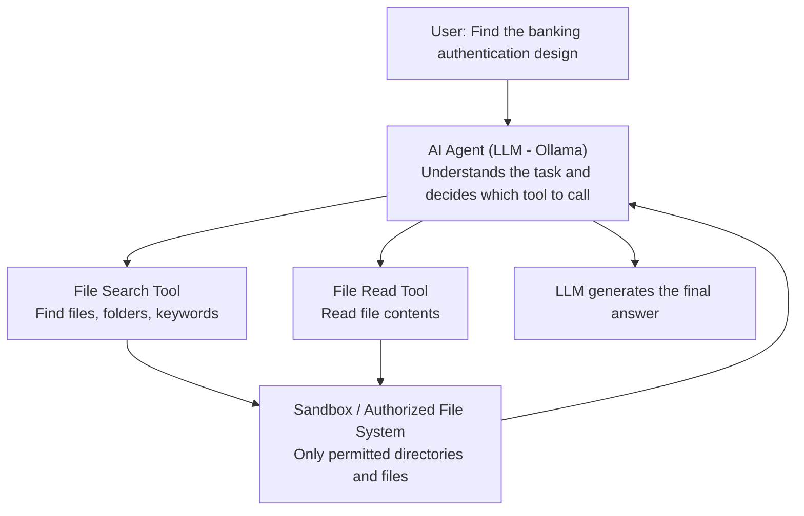

# Agentic Search in AI Agents

**Agentic Search** is the process in which an AI agent autonomously searches through files and folders to find information relevant to a user's request.

The key idea:

> Instead of a human manually searching for files, the AI agent decides which files to search, which files to open, and which information to extract.

---

## 1. How does Agentic Search work?

Imagine you have 1,000 files on your computer, and you ask an AI agent:

> "Find the document that explains our banking application's authentication flow."

The agent doesn't necessarily open all 1,000 files. It follows an intelligent search process.

### Step-by-step workflow

1. **User provides a request**
   Find information about the authentication flow.
2. **Agent analyzes the request**
   It identifies relevant keywords: `authentication`, `login`, `OAuth`, `JWT`, `MFA`.
3. **Agent uses file-search tools**
   It searches accessible directories for matching filenames and content.
4. **Agent decides which files look promising**
   It might identify `auth-design.md`, `login-flow.pdf`, and `security-architecture.docx`.
5. **Agent requests files to be read**
   It opens relevant files and extracts useful information.
6. **Agent generates an answer**
   It combines the extracted information and responds to the user.

The important part is that **the LLM decides what to investigate next based on the results it receives**.

---

## 2. Agentic Search vs Traditional Search

| Traditional search | Agentic search |
|---|---|
| User enters keywords | User describes a goal |
| Search engine finds matches | Agent decides what to search |
| Returns matching files | Can open and investigate files |
| User examines results | Agent examines results |
| Mostly predefined search | Iterative, tool-driven search |

For example:

- **Traditional:** Search for `authentication` and display matching files.
- **Agentic:** Find how authentication works, identify relevant files, read them, connect the information, and explain the complete authentication flow.

---

## 3. Agentic Search vs RAG

This is an important distinction, especially when designing enterprise AI systems.

| Agentic Search | RAG |
|---|---|
| Searches files using tools | Retrieves relevant document chunks |
| LLM can decide what to investigate | Retriever searches indexed data |
| Can perform multiple search iterations | Usually retrieves context for a query |
| Can explore folders and files | Typically uses a vector or hybrid search index |
| May not require a vector database | Usually requires an indexing and retrieval pipeline |

> **Important:** Agentic search and RAG are not mutually exclusive.

An AI agent can use both:

1. Search the file system to discover relevant documents.
2. Use RAG to retrieve relevant chunks from those documents.
3. Read additional files if necessary.
4. Generate a grounded answer.

---

## 4. How does Agentic Search work technically?

Consider an architecture using a local AI stack:



Possible tools exposed to the agent:

| Tool | Purpose |
|---|---|
| `list_directory(path)` | List files and folders |
| `search_files(query)` | Search filenames or contents |
| `read_file(path)` | Read a particular file |
| `get_file_metadata(path)` | Inspect file metadata |

These tools are implemented by the application or agent runtime. The LLM decides **when and how** to request them.

---

## 5. Is Agentic Search safe?

**Not automatically.**

If an agent has access to your entire hard drive, it could potentially discover sensitive files.

Production systems should implement:

- Sandbox isolation
- Directory-level permissions
- Read/write restrictions
- File access allowlists
- Audit logging
- Protection against path traversal
- Human approval for sensitive operations

For example, an agent might be allowed to read:

```
/workspace/project-documents/
```

But not:

```
/workspace/secrets/
```

The agent should only be able to access resources explicitly authorized by the application.

---

## 6. Real-world banking example

Imagine an enterprise banking chatbot. A developer asks:

> "Find the existing implementation of MFA and explain how it works."

The agent could:

1. Search the banking application's source code.
2. Identify authentication-related files.
3. Read the MFA service implementation.
4. Find configuration files and API definitions.
5. Examine related documentation.
6. Explain the MFA implementation with references to the relevant files.

This is agentic search in practice.

---

## Key takeaway

**Agentic Search = AI-powered autonomous file discovery and investigation.**

- The user specifies what information they need.
- The LLM decides where and what to search.
- Tools interact with the file system.
- The LLM examines the results and decides what to investigate next.
- The agent returns the relevant information.

Remember these three terms:

| Term | Meaning |
|---|---|
| **Web Search** | Agent searches the internet |
| **Agentic Search** | Agent searches accessible files and folders |
| **RAG** | Agent/application retrieves relevant information from an indexed knowledge base |

These are different information-retrieval approaches, and an enterprise AI agent can combine all three.
