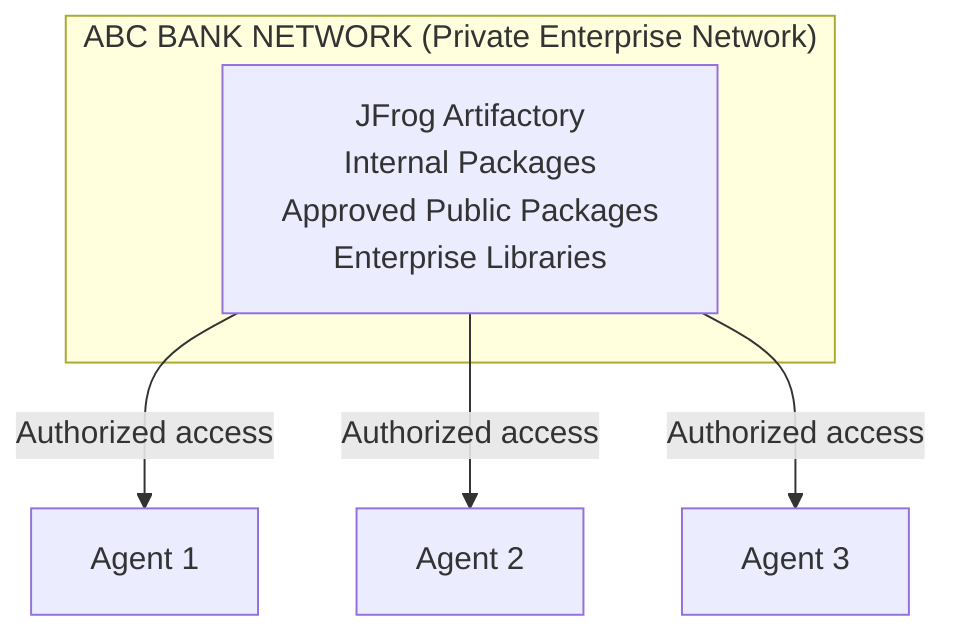
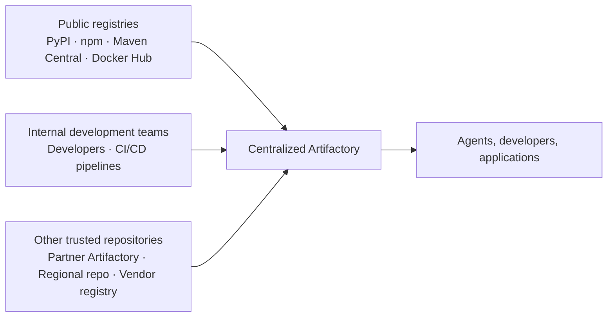
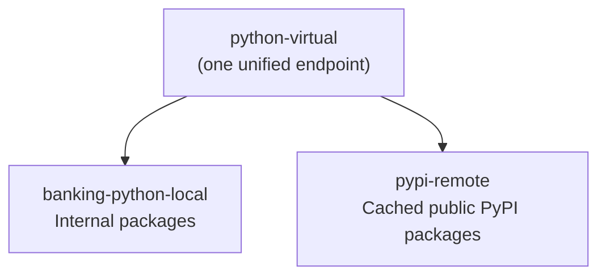
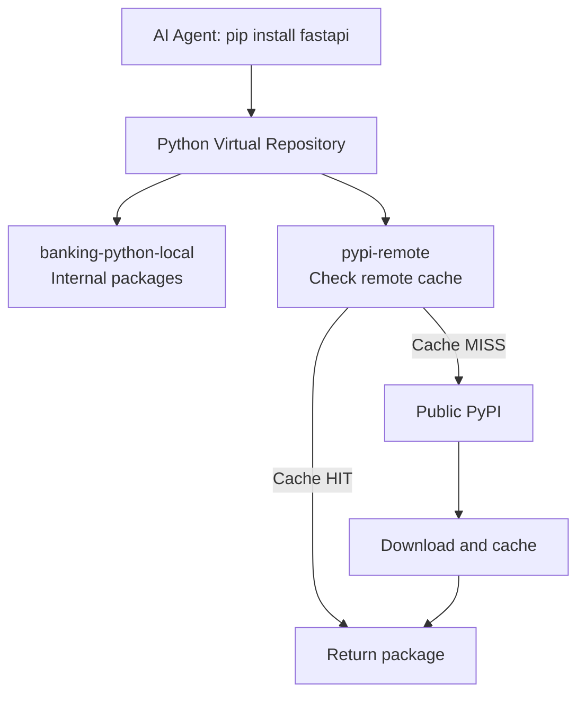
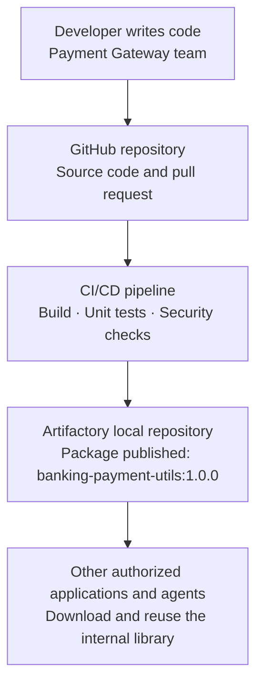
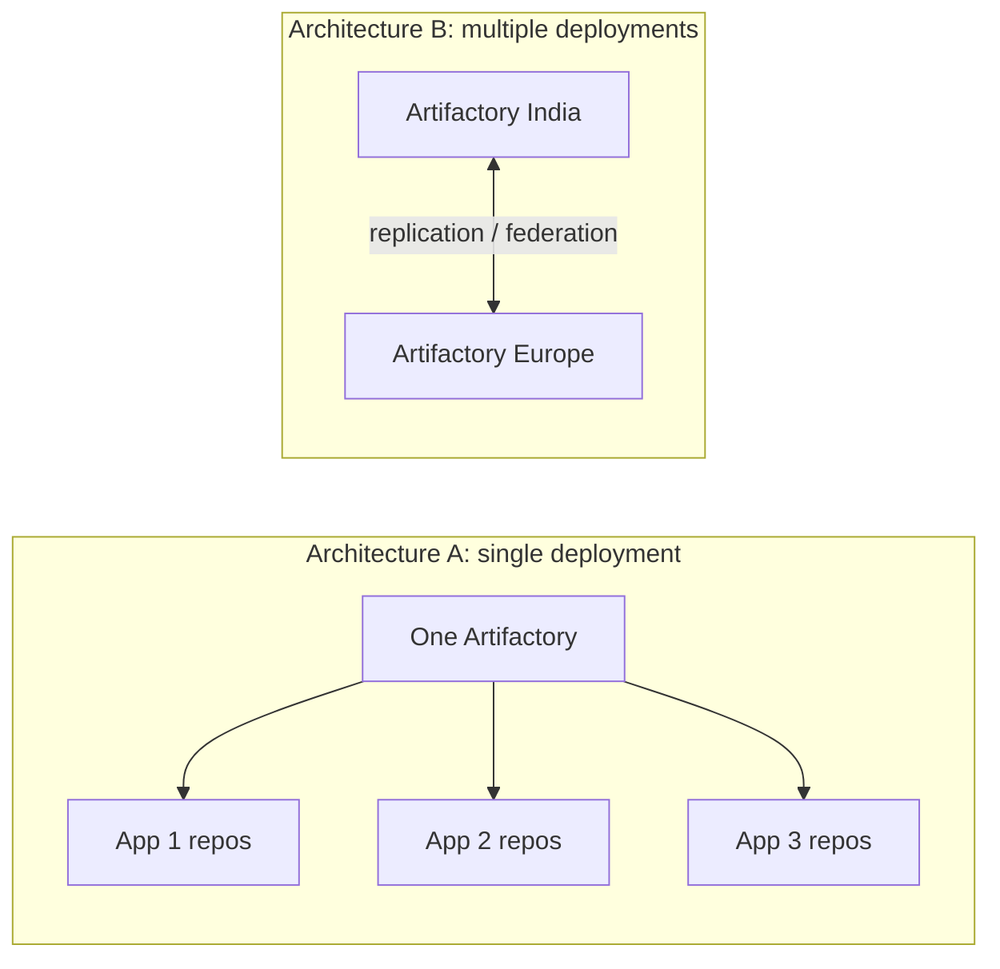
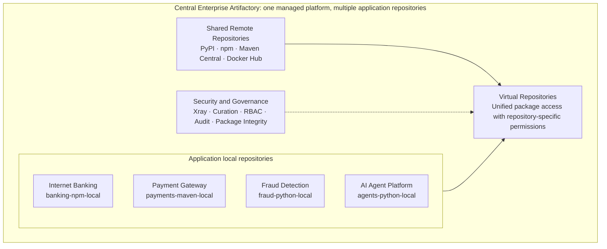

# Centralized Artifactory: Private or Public? Who Owns It, Where Do Packages Come From, and Who Can Publish?

This tutorial answers four questions:

- Is a centralized Artifactory private or public?
- Is a centralized Artifactory separate for each enterprise application?
- From where does a centralized Artifactory get its packages?
- Who can publish packages in a centralized Artifactory?

## 1. Is centralized Artifactory private or public?

**Typically private in enterprise deployments.**

A centralized Artifactory is generally an enterprise-managed private service, not a public website accessible to everyone.

For example, imagine ABC Bank deploys its own Artifactory server.



Only authorized developers, CI/CD pipelines, applications and AI agents can access it.

There are three possible deployment models:

| Deployment | Accessibility |
|---|---|
| Private Artifactory | Accessible only through authorized private network access |
| Publicly reachable Artifactory | Internet-reachable, but should still require authentication and authorization |
| SaaS Artifactory | Hosted by JFrog, accessed through authenticated connections |

> **Important:** Private does not necessarily mean physically hosted inside the company's data center. An enterprise can host Artifactory in its private cloud or use JFrog's cloud service with appropriate access controls.

## 2. Is centralized Artifactory separate for each enterprise application?

**No.** Usually, one enterprise can have a shared centralized Artifactory platform serving multiple applications and teams.

For example, ABC Bank has these applications:

- Internet Banking
- Mobile Banking
- Payment Gateway
- Fraud Detection
- AI Agent Platform
- Customer Management

It does not necessarily need six independent Artifactory installations. Instead, it can operate one centralized Artifactory service with separate repositories and permissions.

### Example: one Artifactory, multiple applications

| Enterprise application | Dependencies |
|---|---|
| Internet Banking | Angular, RxJS, Spring Boot |
| Mobile Banking | React Native, Node.js |
| Payment Gateway | Java, Spring Security |
| Fraud Detection | Python, Pandas, NumPy |
| AI Agent Platform | FastAPI, LangChain, Ollama integrations |

All these applications can use the same centralized Artifactory infrastructure. However, they can have separate repositories, access permissions, and package policies.

### Visual: one central Artifactory instead of many scattered sources

Before, each developer resolves dependencies from every public registry separately and stores artifacts in S3, local storage or Google Drive. After, a single Artifactory resolves and caches dependencies and stores the locally developed artifacts.


### Visual: where Artifactory fits in the JFrog platform

Artifactory is the system of record at the center of the JFrog Software Supply Chain Platform. Curation, Xray, Advanced Security and Runtime provide end-to-end security around it, while Distribution, Connect and ML move software and models to cloud, data centers and IoT devices.


The JFrog Platform UI lists every package stored in Artifactory with its type, latest version, number of versions, download count and security scan status.


## 3. From where does centralized Artifactory get packages?

This is the most important part to understand. Artifactory gets packages from three main sources.

### Source 1: Public package registries

Examples:

- Python → PyPI
- JavaScript → npm
- Java → Maven Central
- Docker → Docker Hub

Artifactory connects to these external registries through **Remote Repositories**.

### Source 2: Internal enterprise development teams

Developers and CI/CD pipelines publish internally developed packages. Examples:

- Banking authentication library.
- Payment processing library.
- Enterprise logging library.
- Internal Angular component library.
- Shared Python utility library.

### Source 3: Other trusted repositories

Artifactory can retrieve packages from:

- Another company's Artifactory instance.
- An internal repository in another region.
- An approved vendor's package registry.
- Another trusted artifact repository.



## 4. How does Artifactory actually retrieve packages?

JFrog provides three important repository types.

The diagram below shows how a client talks only to the virtual repository, which combines local and remote repositories (here, a remote repository proxying a Helm repository).


### 1. Remote Repository

Connects to external package sources.

- Example: `pypi-remote`
- It is configured with the upstream PyPI URL.
- When an authorized client requests FastAPI, Artifactory can retrieve it from PyPI and cache it.

### 2. Local Repository

Stores internally published packages.

- Example: `banking-python-local`
- The bank's developers and CI/CD pipelines publish their own approved libraries here.

### 3. Virtual Repository

Provides one unified endpoint.

- Example: `python-virtual`
- It combines `pypi-remote` and `banking-python-local`.
- Agents use one URL instead of knowing where each package is physically stored.



### Real-life example: agent requests FastAPI



The agent never needs direct Internet access.

> **Important:** A remote repository does not mean that all public packages are automatically copied into Artifactory. Packages are typically fetched on demand and cached. A virtual repository is an access layer, not a separate physical package store.

## 5. Who can publish packages in centralized Artifactory?

This is controlled by the enterprise administrator through repository permissions.

There are typically four types of publishers:

| Publisher | What can they publish? |
|---|---|
| Developers | Internally developed libraries, if authorized |
| CI/CD pipelines | Build artifacts and release packages |
| Release engineers | Approved release versions |
| Repository administrators | Manage repositories and authorized package operations |

### Example: Payment Gateway application

Suppose the Payment Gateway team develops an internal library:

```text
banking-payment-utils
Version: 1.0.0
```

The development workflow looks like this:



The CI/CD pipeline uses a service identity with permission to deploy packages into the designated local repository. For example, an authorized Maven deployment might look like:

```bash
mvn deploy
```

The pipeline authenticates to Artifactory using its configured credentials.

### Should every AI agent be allowed to publish packages?

**No, not by default.** I recommend the following permission model:

| Identity | Download | Publish | Delete |
|---|---|---|---|
| Python AI Agent | Yes | No | No |
| Angular AI Agent | Yes | No | No |
| Security AI Agent | Yes | No | No |
| Developer | Yes | Authorized repos | No by default |
| CI/CD service account | Yes | Designated repos | No by default |
| Release engineer | Yes | Release repos | Controlled |
| Artifactory administrator | According to role | Controlled | Controlled |

An AI agent can generate code and even build a package, but publishing it into a shared enterprise repository should require a separate, authorized workflow.

JFrog supports repository-level permissions, including Read, Deploy/Cache, and Delete/Overwrite.

## 6. Is there one Artifactory for the entire enterprise or multiple Artifactory instances?

There are two possible architectures.

### Architecture A: One centralized Artifactory

Good starting point for many enterprises.

- One centrally managed Artifactory deployment.
- Separate repositories for different applications.
- Different permissions for different teams.
- Shared package caching.
- Centralized security and auditing.

A centralized deployment is usually run as a highly available cluster. A load balancer distributes requests from REST API / CLI / Terraform clients, browsers and CI/CD build nodes across multiple Artifactory server nodes. The nodes share storage and work with other JFrog services such as Xray, Mission Control and Distribution.


### Architecture B: Multiple Artifactory deployments

For complex enterprise requirements.

- Separate deployments for different regions or environments.
- Independent deployments for highly isolated business units.
- Package replication or federation between deployments.
- Greater operational complexity.

For example, a global bank might have one Artifactory deployment in India and another in Europe, with controlled synchronization between them.

The diagram below shows the same idea with two sites (Amsterdam and Bangkok). Each site has its own version control, CI and Artifactory, and their federated repositories mirror each other bidirectionally.




JFrog supports self-managed, SaaS, hybrid and multi-site deployment architectures.

## 7. Recommended architecture for an AI agent platform

For an enterprise banking environment, start with this. The overview image summarizes the whole platform: who can publish packages, how isolated agent sandboxes consume packages, the external package sources, key capabilities, benefits and security best practices.


The same architecture as a Mermaid diagram:



## Remember these four answers

| Your question | Answer |
|---|---|
| Is centralized Artifactory private or public? | Typically private and enterprise-controlled; SaaS is also possible. |
| Is it separate for every application? | Not necessarily. One platform can serve many applications through separate repositories. |
| Where does it get packages? | Public registries, internal development teams and trusted external repositories. |
| Who publishes packages? | Authorized developers, CI/CD pipelines and release engineers, not every agent. |

One important architectural principle:

> Artifactory should be a centralized enterprise software distribution platform, but package ownership, publishing permissions and access should remain separated by application and team.

This lets 100 AI agents and multiple enterprise applications reuse approved software without giving everyone unrestricted access to modify the organization's software supply chain.
