# What is Artifactory? Why do we need it? What happens without it?

This tutorial covers eight questions:

- What is Artifactory?
- Why do we need Artifactory?
- What issues come up without Artifactory?
- Can AI agents send messages to each other through Artifactory?
- Is a centralized Artifactory private or public?
- Is a centralized Artifactory separate for each enterprise application?
- From where does a centralized Artifactory get its packages?
- Who can publish packages in a centralized Artifactory?

## 1. What is Artifactory?

Artifactory is a centralized **software package repository manager**.

In simple words, Artifactory is a secure storage and distribution system where an organization stores, manages, scans, and distributes software packages and dependencies.

It is developed by **JFrog**.

Think of it as an **enterprise software warehouse**.


Just as Amazon has a warehouse from which products are distributed to customers, Artifactory has a repository from which software packages are distributed to applications, developers, CI/CD pipelines, and AI agents.

### Examples of software packages stored in Artifactory

| Ecosystem | Example packages |
|---|---|
| Python | FastAPI, NumPy, Pandas |
| JavaScript | Angular, React, Express |
| Java | Spring Boot, Hibernate |
| Docker | Nginx, PostgreSQL images |
| .NET | NuGet packages |
| Internal software | Organization-developed libraries |

For example, when an AI agent executes:

```bash
pip install fastapi
```

It needs to download the FastAPI package and potentially other dependencies.

Instead of downloading directly from public PyPI, the agent can download it from the organization's Artifactory repository.

### Where Artifactory fits in the JFrog platform

Artifactory is the system of record at the center of the JFrog Software Supply Chain Platform. Curation, Xray, Advanced Security and Runtime provide end-to-end security around it, while Distribution, Connect and ML move software and models to cloud, data centers and IoT devices.


### What the JFrog Platform looks like

The JFrog Platform UI lists every package stored in Artifactory with its type, latest version, number of versions, download count and security scan status.


## 2. Why do we need Artifactory?

Imagine an enterprise has 100 AI agents, 50 developers, and 20 CI/CD pipelines. All of them need software dependencies.

Without a centralized repository, every application or agent independently downloads packages from external sources. This creates several problems.

### Five major reasons to use Artifactory

#### 1. Centralized package management

Instead of downloading packages from different public repositories, applications use a centrally managed endpoint.

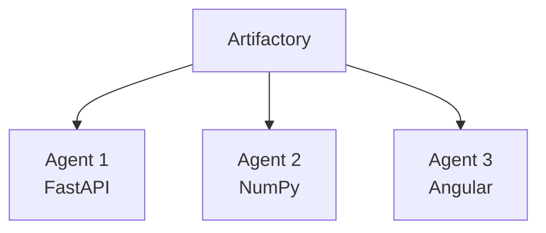

Benefits:

- One central package repository.
- Easier dependency management.
- Internal and external packages in one managed environment.
- Centralized administration.

#### 2. Security against malicious packages

Suppose an AI agent downloads a malicious Python package. That package could execute harmful installation scripts, steal secrets, or compromise the agent's environment.

Artifactory can work with security products such as **JFrog Xray** and **JFrog Curation** to detect vulnerabilities and enforce package policies.

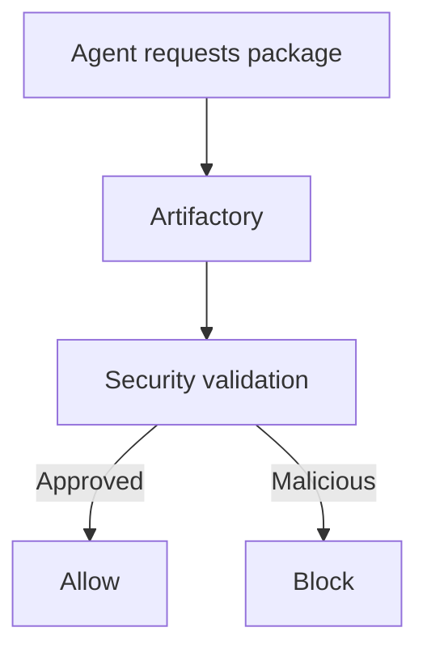

#### 3. Dependency caching

Suppose 100 agents request the same FastAPI version. Without caching, all 100 might download the package independently from PyPI.

With Artifactory:

- First request: cache miss; retrieve from upstream.
- Subsequent requests: cache hit; reuse the cached package.

This reduces repeated external downloads, bandwidth usage, and upstream dependency.

#### 4. Consistent software versions

Suppose three agents need FastAPI. Without centralized dependency policies:

- Agent 1 downloads version 0.120.0.
- Agent 2 downloads version 0.121.0.
- Agent 3 downloads version 0.122.0.

This can create inconsistent behavior. With Artifactory, an organization can control which versions are approved and available to its agents.

#### 5. Audit and compliance

Security teams can monitor:

- Which agent downloaded which package.
- Which package version was requested.
- Whether access was permitted or denied.
- Which user or service identity made the request.
- Whether packages were uploaded or modified.

This is particularly important in enterprise banking applications.

## 3. What happens WITHOUT Artifactory?

Artifactory is not mandatory for every software project. However, in a large enterprise environment, removing it means losing centralized package governance and distribution.

### Without Artifactory: every agent independently downloads dependencies

- Agents access public package registries directly, if network policy permits.
- No single enterprise package gateway.
- Harder to enforce consistent package policies.
- Repeated downloads and less centralized caching.
- Harder to audit dependency usage centrally.
- Greater risk of supply-chain attacks if controls are missing.

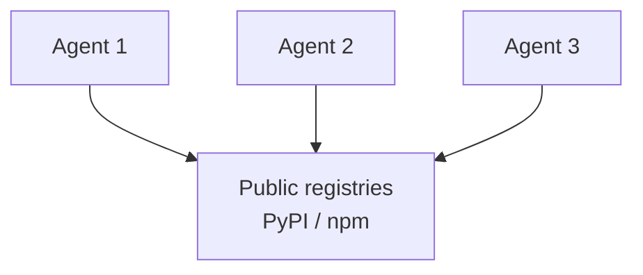

### With Artifactory: all agents use a centrally managed package gateway

- Centralized package access.
- Approved dependencies and versions.
- Reusable package cache.
- Centralized security policies.
- Better traceability and auditing.
- Controlled access to internal packages.

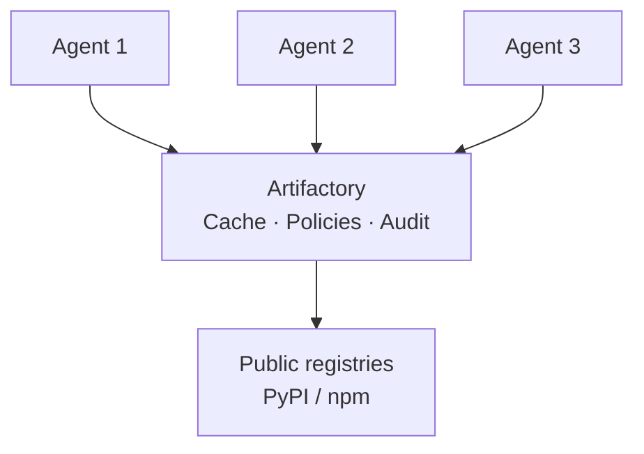

### Visual comparison: before and after Artifactory

Before, developers resolve dependencies from each public registry separately and store their own artifacts in S3, local storage or Google Drive. After, Artifactory resolves and caches dependencies and stores locally developed artifacts in one place.


### Real-life example: three AI agents need FastAPI

| Scenario | Without Artifactory | With Artifactory |
|---|---|---|
| Agent 1 requests FastAPI | Downloads from PyPI | Requests from Artifactory |
| Agent 2 requests FastAPI | Downloads again | Reuses cached package |
| Agent 3 requests FastAPI | Downloads again | Reuses cached package |
| Vulnerable package | Requires separate controls | Centralized policy enforcement |
| Version governance | Must configure separately | Centrally managed |
| Audit | Distributed logs | Centralized repository audit |

> **Important:** You can still secure an architecture without Artifactory using other package mirrors, prebuilt images, internal registries and security tooling. Artifactory makes centralized management easier; it is not the only way to achieve it.

JFrog's documentation describes local, remote and virtual repositories and how they work together.

## 4. Can AI agents send messages to each other through Artifactory?

**No, not as a messaging system.**

This is a very important architectural distinction. Artifactory is designed to **store and distribute artifacts**, not to provide real-time communication between running AI agents.

Suppose you have three AI agents:

- Agent 1: Research Agent
- Agent 2: Coding Agent
- Agent 3: Testing Agent

Agent 1 researches a requirement and wants to send the result to Agent 2. Can it send a message through Artifactory?

Technically, it could upload a file containing the result, and Agent 2 could later download that file if it has permission. But that is **file-based artifact sharing**, not proper agent-to-agent messaging.

### Example: using Artifactory for file sharing

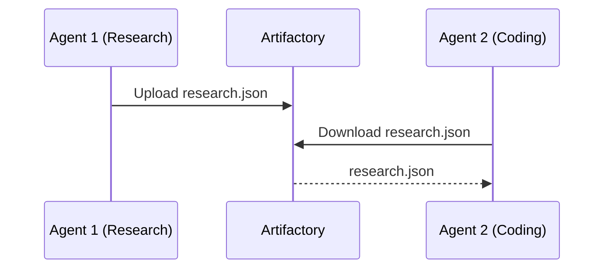

Example file:

```json
{
  "task_id": "TASK-101",
  "agent": "research-agent",
  "status": "completed",
  "result": "Use FastAPI for the backend"
}
```

Agent 2 could retrieve this file from Artifactory. But consider the problems:

- No native real-time message delivery.
- No native message queue.
- No built-in consumer acknowledgment and redelivery workflow.
- No native agent coordination.
- No convenient publish/subscribe messaging.
- Polling for new files would be inefficient.

Artifactory can store the file as an artifact, but it should not replace a messaging platform.

## 5. Then how should AI agents communicate with each other?

Use a **message broker** or an **agent orchestrator**, depending on the architecture.

Common technologies:

| Technology | Best for |
|---|---|
| Apache Kafka | Enterprise-scale asynchronous communication, event streaming, durable events and high-throughput workloads |
| RabbitMQ | Task queues, work distribution, acknowledgments and retries |
| Redis Streams | Lightweight event communication, consumer groups and message processing |
| NATS | Lightweight, low-latency messaging and distributed agent communication |

## 6. Complete architecture: Artifactory + Kafka + AI agents

This is how I would design an enterprise AI-agent platform.

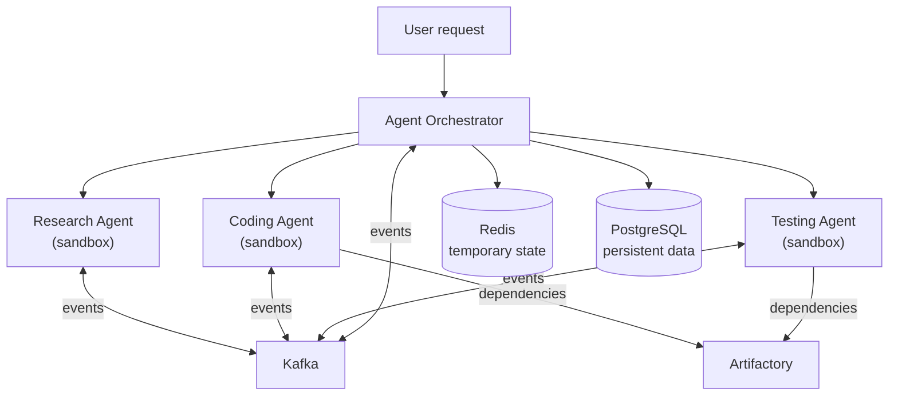

Each component has a separate responsibility:

| Component | Responsibility |
|---|---|
| AI Agent Sandbox | Executes an individual AI agent |
| Artifactory | Supplies approved software dependencies |
| Kafka | Transfers messages and events between agents |
| Agent Orchestrator | Assigns tasks and coordinates agent workflows |
| Redis | Stores temporary state and frequently accessed data |
| PostgreSQL | Stores persistent task and business data |

### Real-life execution example

Suppose a user requests: *"Build a banking transaction API and test it."*

1. **Orchestrator assigns tasks**
   - Research Agent
   - Coding Agent
   - Testing Agent
2. **Agents obtain dependencies**
   - Coding Agent requests FastAPI from Artifactory.
   - Testing Agent requests Pytest from Artifactory.
3. **Research Agent publishes an event to Kafka**

   ```json
   {
     "event": "research.completed",
     "task_id": "BANK-101"
   }
   ```

4. **Coding Agent consumes the event.** It retrieves the research output and generates the API.
5. **Coding Agent publishes another event**

   ```json
   {
     "event": "code.completed",
     "task_id": "BANK-101"
   }
   ```

6. **Testing Agent consumes the event.** It executes automated tests and publishes the test results.
7. **Orchestrator collects the results.** It determines whether the complete workflow succeeded.

## 7. Final comparison: don't confuse these three technologies

| Technology | Analogy | Role |
|---|---|---|
| Artifactory | Software warehouse | Where agents get software, packages, libraries, plugins and other managed artifacts |
| Kafka | Communication highway | Where agents publish and consume messages, events and task notifications |
| Agent Orchestrator | Project manager | Decides which agent performs which task, manages dependencies and coordinates execution |

The most important takeaway:

- Artifactory answers: *Where can I get approved software?*
- Kafka answers: *How can I communicate with other agents?*
- Orchestrator answers: *Which agent should do what, and when?*

For your enterprise AI-agent architecture, use **isolated sandboxes + centralized Artifactory + Kafka + an Agent Orchestrator**. These components solve different problems and complement each other.

## 8. Is a centralized Artifactory private or public?

**Typically private in enterprise deployments.**

A centralized Artifactory is generally an enterprise-managed private service, not a public website accessible to everyone.

For example, imagine ABC Bank deploys its own Artifactory server.

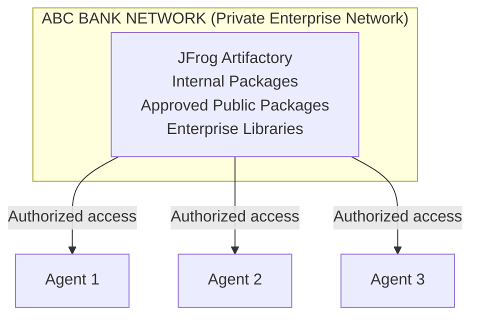

Only authorized developers, CI/CD pipelines, applications and AI agents can access it.

There are three possible deployment models:

| Deployment | Accessibility |
|---|---|
| Private Artifactory | Accessible only through authorized private network access |
| Publicly reachable Artifactory | Internet-reachable, but should still require authentication and authorization |
| SaaS Artifactory | Hosted by JFrog, accessed through authenticated connections |

> **Important:** Private does not necessarily mean physically hosted inside the company's data center. An enterprise can host Artifactory in its private cloud or use JFrog's cloud service with appropriate access controls.

## 9. Is a centralized Artifactory separate for each enterprise application?

**No.** Usually, one enterprise has a shared centralized Artifactory platform serving multiple applications and teams.

For example, ABC Bank has these applications:

- Internet Banking
- Mobile Banking
- Payment Gateway
- Fraud Detection
- AI Agent Platform
- Customer Management

It does not necessarily need six independent Artifactory installations. Instead, it can operate one centralized Artifactory service with separate repositories and permissions.

### Example: one Artifactory, multiple applications

| Enterprise application | Dependencies |
|---|---|
| Internet Banking | Angular, RxJS, Spring Boot |
| Mobile Banking | React Native, Node.js |
| Payment Gateway | Java, Spring Security |
| Fraud Detection | Python, Pandas, NumPy |
| AI Agent Platform | FastAPI, LangChain, Ollama integrations |

All these applications can use the same centralized Artifactory infrastructure. However, they can have separate repositories, access permissions, and package policies.

## 10. From where does a centralized Artifactory get packages?

This is the most important part to understand. Artifactory gets packages from three main sources.

### Source 1: Public package registries

Examples:

- Python → PyPI
- JavaScript → npm
- Java → Maven Central
- Docker → Docker Hub

Artifactory connects to these external registries through **Remote Repositories**.

### Source 2: Internal enterprise development teams

Developers and CI/CD pipelines publish internally developed packages. Examples:

- Banking authentication library.
- Payment processing library.
- Enterprise logging library.
- Internal Angular component library.
- Shared Python utility library.

### Source 3: Other trusted repositories

Artifactory can retrieve packages from:

- Another company's Artifactory instance.
- An internal repository in another region.
- An approved vendor's package registry.
- Another trusted artifact repository.

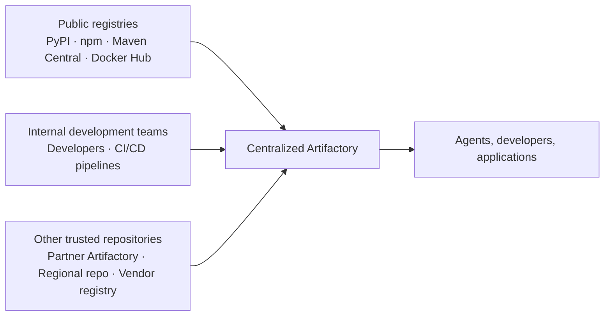

## 11. How does Artifactory actually retrieve packages?

JFrog provides three important repository types. See the official explanation in the JFrog repository management documentation.

The diagram below shows how a client talks only to the virtual repository, which combines local and remote repositories (here, a remote repository proxying a Helm repository).


### 1. Remote Repository

Connects to external package sources.

- Example: `pypi-remote`
- It is configured with the upstream PyPI URL.
- When an authorized client requests FastAPI, Artifactory can retrieve it from PyPI and cache it.

### 2. Local Repository

Stores internally published packages.

- Example: `banking-python-local`
- The bank's developers and CI/CD pipelines publish their own approved libraries here.

### 3. Virtual Repository

Provides one unified endpoint.

- Example: `python-virtual`
- It combines `pypi-remote` and `banking-python-local`.
- Agents use one URL instead of knowing where each package is physically stored.

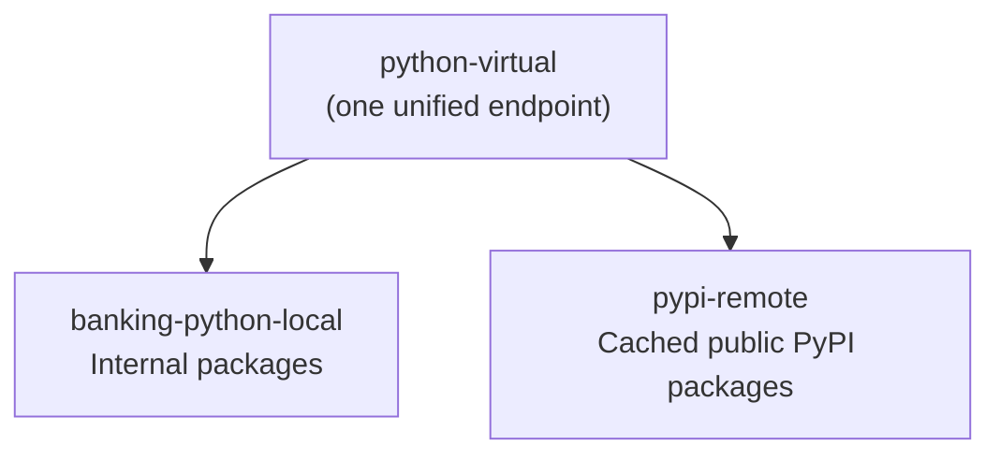

### Real-life example: agent requests FastAPI

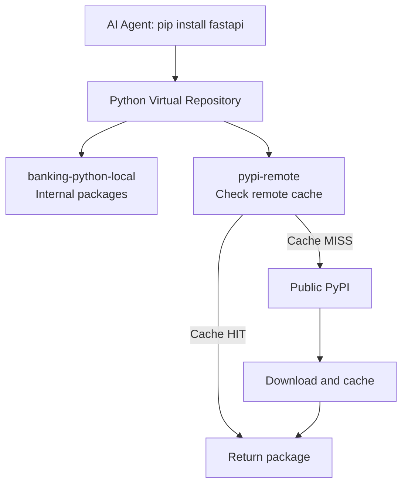

The agent never needs direct Internet access.

> **Important:** A remote repository does not mean that all public packages are automatically copied into Artifactory. Packages are typically fetched on demand and cached. A virtual repository is an access layer, not a separate physical package store.

## 12. Who can publish packages in a centralized Artifactory?

This is controlled by the enterprise administrator through repository permissions.

There are typically four types of publishers:

| Publisher | What can they publish? |
|---|---|
| Developers | Internally developed libraries, if authorized |
| CI/CD pipelines | Build artifacts and release packages |
| Release engineers | Approved release versions |
| Repository administrators | Manage repositories and authorized package operations |

Let's understand with a banking example.

### Example: Payment Gateway application

Suppose the Payment Gateway team develops an internal library:

```text
banking-payment-utils
Version: 1.0.0
```

The development workflow looks like this:

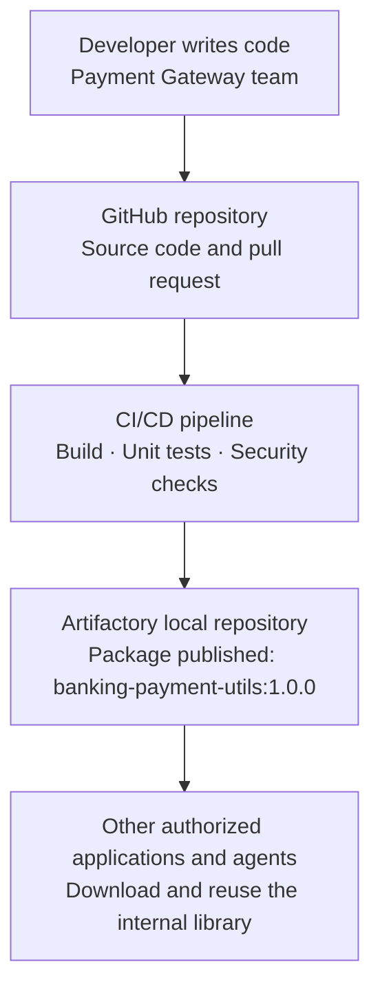

The CI/CD pipeline uses a service identity with permission to deploy packages into the designated local repository. For example, an authorized Maven deployment might look like:

```bash
mvn deploy
```

The pipeline authenticates to Artifactory using its configured credentials.

### Should every AI agent be allowed to publish packages?

**No, not by default.** I recommend the following permission model:

| Identity | Download | Publish | Delete |
|---|---|---|---|
| Python AI Agent | Yes | No | No |
| Angular AI Agent | Yes | No | No |
| Security AI Agent | Yes | No | No |
| Developer | Yes | Authorized repos | No by default |
| CI/CD service account | Yes | Designated repos | No by default |
| Release engineer | Yes | Release repos | Controlled |
| Artifactory administrator | According to role | Controlled | Controlled |

An AI agent can generate code and even build a package, but publishing it into a shared enterprise repository should require a separate, authorized workflow.

JFrog supports repository-level permissions, including Read, Deploy/Cache, and Delete/Overwrite.

## 13. One Artifactory for the entire enterprise, or multiple instances?

There are two possible architectures.

### Architecture A: One centralized Artifactory

Good starting point for many enterprises.

- One centrally managed Artifactory deployment.
- Separate repositories for different applications.
- Different permissions for different teams.
- Shared package caching.
- Centralized security and auditing.

A centralized deployment is usually run as a highly available cluster. A load balancer distributes requests from REST API / CLI / Terraform clients, browsers and CI/CD build nodes across multiple Artifactory server nodes. The nodes share storage and work with other JFrog services such as Xray, Mission Control and Distribution.


### Architecture B: Multiple Artifactory deployments

For complex enterprise requirements.

- Separate deployments for different regions or environments.
- Independent deployments for highly isolated business units.
- Package replication or federation between deployments.
- Greater operational complexity.

For example, a global bank might have one Artifactory deployment in India and another in Europe, with controlled synchronization between them.

The diagram below shows the same idea with two sites (Amsterdam and Bangkok). Each site has its own version control, CI and Artifactory, and their federated repositories mirror each other bidirectionally.


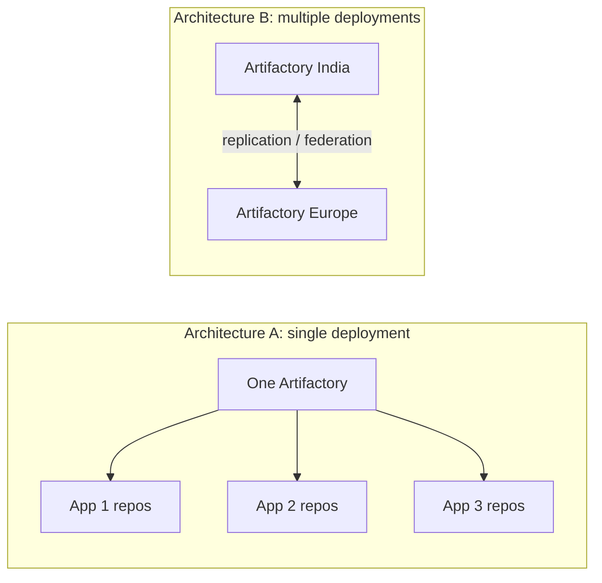

JFrog supports self-managed, SaaS, hybrid and multi-site deployment architectures.

## 14. Recommended architecture for an AI agent platform

For an enterprise banking environment, start with this. The overview image summarizes the whole platform: who can publish packages, how isolated agent sandboxes consume packages, the external package sources, key capabilities, benefits and security best practices.


The same architecture as a Mermaid diagram:

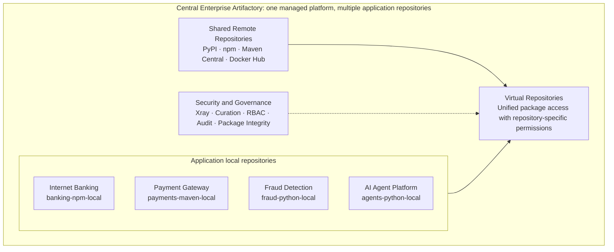

### Remember these four answers

| Your question | Answer |
|---|---|
| Is a centralized Artifactory private or public? | Typically private and enterprise-controlled; SaaS is also possible. |
| Is it separate for every application? | Not necessarily. One platform can serve many applications through separate repositories. |
| Where does it get packages? | Public registries, internal development teams and trusted external repositories. |
| Who publishes packages? | Authorized developers, CI/CD pipelines and release engineers, not every agent. |

One important architectural principle:

> Artifactory should be a centralized enterprise software distribution platform, but package ownership, publishing permissions and access should remain separated by application and team.

This lets 100 AI agents and multiple enterprise applications reuse approved software without giving everyone unrestricted access to modify the organization's software supply chain.


## Official documentation

- JFrog Artifactory Overview
- Artifactory Repository Management
- Artifactory Package Management
