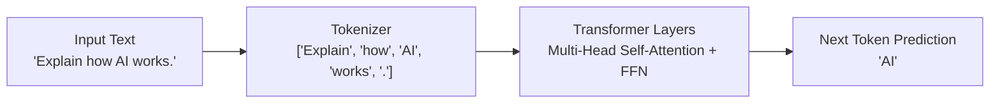
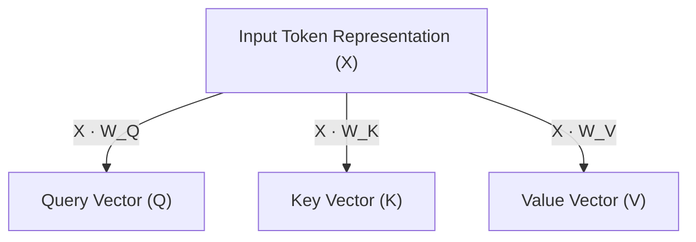
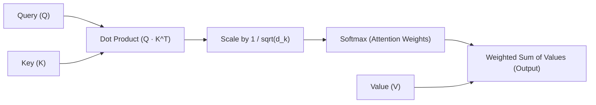
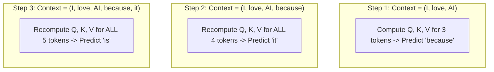
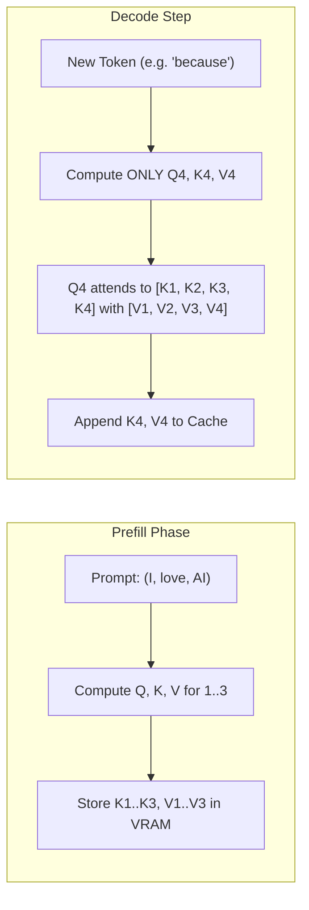
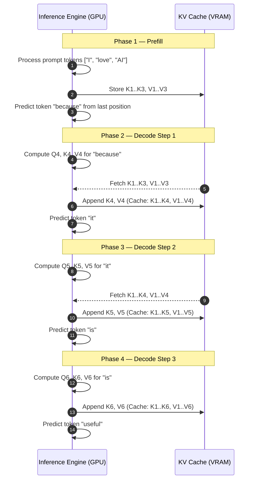
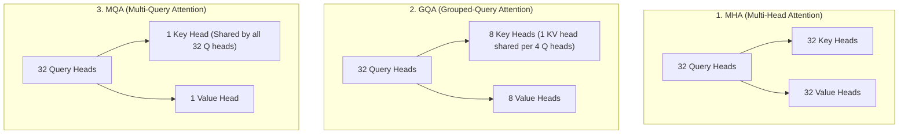
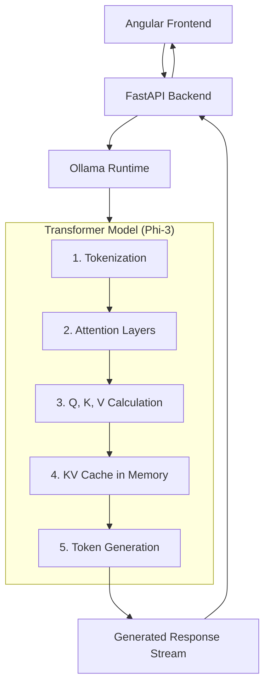

# How KV Cache Works Internally in Transformers

Understanding how **Key-Value (KV) Cache** works internally is essential for understanding LLM inference performance, GPU memory consumption, and latency optimization during autoregressive generation.

---

## 1. Core Foundational Concepts

To understand KV Cache, we first need to understand five core concepts:

1. **Tokens** — Numerical representations of sub-word text units.
2. **Query, Key, and Value ($Q, K, V$)** — Vector projections created inside each attention layer.
3. **Self-Attention** — The mechanism computing relevance scores across all tokens.
4. **Autoregressive Token Generation** — Generating output sequentially, one token at a time.
5. **KV Cache Optimization** — Reusing previously computed Key and Value tensors across decoding steps.

> **Core Idea:** KV Cache stores the **Key** and **Value** tensors calculated for previously processed tokens so that the Transformer doesn't have to recalculate them at every single step when generating the next token.

---

## 2. How an LLM Generates Text (Autoregressive Generation)

Suppose you send the prompt:

> *"Explain how AI works."*



An autoregressive LLM generates text one token at a time:

- **Step 1:** Predict `"AI"`
- **Step 2:** Predict `"is"`
- **Step 3:** Predict `"powerful"`
- **Step 4:** Predict `"technology"`

Each newly generated token is appended to the input sequence and becomes part of the context for subsequent token predictions.

---

## 3. What are Query, Key, and Value ($Q, K, V$)?

$Q, K,$ and $V$ are mathematical vector representations generated inside every attention head of every Transformer layer.


### The Library Analogy

| Component | Analogy | Meaning in Attention |
|---|---|---|
| **Query ($Q$)** | What information am I looking for? | The current token's search intent |
| **Key ($K$)** | What information does each book contain? | The index/label of every token in context |
| **Value ($V$)** | What actual information does each book provide? | The actual semantic content to extract |



### Mathematical Formulation

Inside each attention layer, each token's hidden representation $X$ is multiplied by learned projection matrices:

$$Q = X \cdot W_Q$$
$$K = X \cdot W_K$$
$$V = X \cdot W_V$$

Where:
- $X$ = Input token representation
- $W_Q$ = Query weight matrix
- $W_K$ = Key weight matrix
- $W_V$ = Value weight matrix

> **Important:** $Q, K,$ and $V$ are **not three separate models**. They are vector representations generated inside each self-attention layer.

---

## 4. How Self-Attention Works

Self-Attention allows each token to evaluate which other tokens in the context are relevant to it.

#### Example:
> *"The bank approved the loan because it verified the documents."*

- `"approved"` strongly attends to `"bank"`.
- `"verified"` strongly attends to `"it"`.
- `"documents"` strongly attends to `"verified"`.

### The Scaled Dot-Product Attention Formula

$$\text{Attention}(Q, K, V) = \text{Softmax}\left(\frac{Q K^T}{\sqrt{d_k}}\right) V$$



| Component | Meaning |
|---|---|
| $Q$ | Query vectors (what we are looking for) |
| $K$ | Key vectors (what tokens contain) |
| $Q K^T$ | Similarity / raw attention scores |
| $\sqrt{d_k}$ | Scaling factor to prevent vanishing gradients |
| $\text{Softmax}$ | Normalizes scores into probabilities (sum to 1) |
| $V$ | Feature values blended according to attention weights |


---

## 5. What Happens During Token Generation? (Without vs. With KV Cache)

Suppose the prompt contains three tokens: `[ "I", "love", "AI" ]`

### Without KV Cache (Redundant Recomputation)

At every decoding step, the entire sequence is passed through all layers again:




### With KV Cache (Optimal Reuse)

1. **Prefill Phase:** Process prompt tokens (`"I"`, `"love"`, `"AI"`), compute and store $K_1, K_2, K_3$ and $V_1, V_2, V_3$.
2. **Decode Phase:**
   - For new token `"because"`, compute only $Q_4, K_4, V_4$.
   - $Q_4$ attends to cached keys $[K_1, K_2, K_3, K_4]$.
   - Append $K_4, V_4$ to the cache.
   - Repeat for each subsequent token.



---

## 6. Computational Comparison

Suppose the model starts with a 3-token prompt and generates 5 new tokens:

### Without KV Cache
| Generation Step | Tokens in Context | K/V Calculations |
|:---:|:---:|:---:|
| 1 | 3 | 3 tokens |
| 2 | 4 | 4 tokens |
| 3 | 5 | 5 tokens |
| 4 | 6 | 6 tokens |
| 5 | 7 | 7 tokens |
| **Total** | | **25 token positions computed** |

### With KV Cache
| Generation Step | Tokens in Context | New K/V Calculations |
|:---:|:---:|:---:|
| 1 (Prefill) | 3 | 3 tokens (one-time) |
| 2 (Decode 1) | 4 | 1 new token |
| 3 (Decode 2) | 5 | 1 new token |
| 4 (Decode 3) | 6 | 1 new token |
| 5 (Decode 4) | 7 | 1 new token |
| **Total** | | **7 token positions computed** |

> **Summary:** Instead of projecting $K$ and $V$ for 25 positions, only 7 positions are calculated—a **72% reduction in projection operations**.

---

## 7. Step-by-Step Lifecycle Example

Prompt: `"I love AI"` $\rightarrow$ Target: `"I love AI because it is useful"`



---

## 7. Where is KV Cache Stored in Hardware?

KV Cache is stored directly in **GPU High-Bandwidth Memory (VRAM)** during inference.


### Why in GPU VRAM?
Because the model needs to access these tensors repeatedly while generating tokens. Keeping them in GPU memory avoids data-transfer latency between system RAM and the GPU cores.

### Layer-by-Layer Storage Architecture

```
             User Prompt
                  │
                  ▼
            Tokenization
                  │
                  ▼
         Transformer Layer 1  ◄───► [ Layer 1 K & V Cache in VRAM ]
                  │
                  ▼
         Transformer Layer 2  ◄───► [ Layer 2 K & V Cache in VRAM ]
                  │
                  ▼
         Transformer Layer N  ◄───► [ Layer N K & V Cache in VRAM ]
                  │
                  ▼
          Next Token Output
                  │
                  ▼
         Continue Generation
```

> **Important Detail:** Each Transformer layer has its own Key and Value cache. In multi-head attention, these tensors are also organized across attention heads (or key-value heads).

---

## 8. Why Does KV Cache Matter for Performance?

KV Cache significantly improves inference efficiency, particularly during autoregressive generation.

| Metric | Without KV Cache | With KV Cache |
|---|---|---|
| **Previous K/V Calculations** | Repeated | Reused |
| **GPU Computation** | More redundant work | Less redundant work |
| **Memory Usage** | Lower cache memory | Higher cache memory |
| **Generation Efficiency** | Less efficient | More efficient |

---

### The Memory Trade-off

However, KV Cache introduces a **memory trade-off**. As the conversation grows, the cache grows because more tokens need to be retained. For large models, this can become a significant GPU memory requirement.

### What Determines KV Cache Memory Consumption?

Four major factors dictate the size of the KV Cache:

1. **Number of layers ($L$)** in the Transformer.
2. **Number of Key-Value heads ($H_{\text{KV}}$)**.
3. **Sequence length ($S$)** (number of context + generated tokens).
4. **Precision ($\text{Bytes}$)** used to store cache values (FP16, BF16, FP8, INT4, etc.).

### Simplified Memory Formula

$$M_{\text{KV}} = 2 \times L \times B \times S \times H_{\text{KV}} \times D_H \times \text{Bytes}$$

Where:
- $2$ = Key and Value tensors ($1 \text{ Key} + 1 \text{ Value}$)
- $L$ = Number of Transformer layers
- $B$ = Batch size (number of concurrent requests)
- $S$ = Sequence length (context window + generated tokens)
- $H_{\text{KV}}$ = Number of Key-Value heads
- $D_H$ = Dimension per attention head
- $\text{Bytes}$ = Precision in bytes (FP16/BF16 = $2$ bytes, 8-bit = $1$ byte, 4-bit = $0.5$ bytes)

---

### Example Calculation: KV Cache Memory

Consider a model with the following configuration:
- **Transformer Layers ($L$):** $32$
- **KV Heads ($H_{\text{KV}}$):** $8$
- **Head Dimension ($D_H$):** $128$
- **Context Tokens ($S$):** $4,096$
- **Batch Size ($B$):** $1$

| Cache Precision | Bytes / Element | Estimated KV Cache Memory |
|---|:---:|:---:|
| **FP16 / BF16** | 2 Bytes | **512.00 MB** |
| **8-bit (FP8 / INT8)** | 1 Byte | **256.00 MB** |
| **4-bit (INT4)** | 0.5 Bytes | **128.00 MB** |

$$\text{Calculation (FP16)}: 2 \times 32 \times 1 \times 4096 \times 8 \times 128 \times 2 = 536,870,912 \text{ Bytes} = \mathbf{512 \text{ MB}}$$

> **Key Insight:** This calculation explains why **long-context conversations and concurrent users consume substantial GPU memory**, even when the model weights themselves remain completely unchanged.

---

## 9. KV Cache and Multi-Head Attention (MHA vs. GQA vs. MQA)

Modern Transformers don't usually have just one Query, Key, and Value set—they use multiple attention heads.

For example, a model might have:
- **32 Query heads**
- **8 Key heads**
- **8 Value heads**

This arrangement is called **Grouped-Query Attention (GQA)**.




### Why is this useful?
Multiple Query heads share fewer Key-Value heads. This reduces KV Cache memory consumption while retaining almost all of the multi-head attention capability.

### Summary of KV Optimizations:
- **MQA (Multi-Query Attention):** All Query heads share one Key-Value head.
- **GQA (Grouped-Query Attention):** Groups of Query heads share Key-Value heads (e.g., Llama 3, Mistral).
- **Quantized KV Cache:** Store cache values using lower precision (FP8 / INT4).
- **PagedAttention (vLLM):** Manage KV Cache in non-contiguous virtual memory blocks (like OS paging) to eliminate internal fragmentation and optimize serving many concurrent users.

---

## 10. How Does This Relate to Ollama and Your Local AI Setup?

When running local models like **Phi-3** or **Llama 3** using Ollama:



- **Runtime Managed:** Ollama manages model inference, and the underlying engine (`llama.cpp`) handles attention, KV tensor allocation, and cache management automatically.
- **No Manual Implementation Needed:** You don't need to write KV caching code manually when building standard applications with Ollama.

---

## 11. Knowledge Check & Quiz

1. **What does KV Cache store?**
   - [ ] Complete user prompts and answers
   - [x] **Previously calculated Key and Value tensors** ✅
   - [ ] Model weights
   - [ ] Only Query vectors
   *Explanation: KV Cache stores Key and Value tensors from previous tokens at each attention layer.*

2. **When generating a new token, what happens?**
   - [ ] All previous K and V are recalculated
   - [ ] The model retrieves the final answer from cache
   - [x] **Previous K/V are reused and new token K/V are calculated** ✅
   - [ ] The Transformer skips attention
   *Explanation: The new token is processed, its K/V are appended to the cache, and its Query attends to cached keys.*

3. **What happens to KV Cache memory as context grows?**
   - [ ] It always decreases
   - [x] **It generally increases** ✅
   - [ ] It stays constant
   - [ ] It replaces model weights
   *Explanation: More retained tokens mean more cached Key and Value tensors in GPU memory.*

4. **Which technique reduces KV Cache memory through shared Key-Value heads?**
   - [ ] RAG
   - [x] **GQA (Grouped-Query Attention)** ✅
   - [ ] Tokenization
   - [ ] Softmax
   *Explanation: Grouped Query Attention allows multiple Query heads to share fewer Key-Value heads.*

---

## 12. Final Summary: Five Things to Remember

| Concept | What It Does |
|---|---|
| **Query ($Q$)** | Represents what a token is looking for |
| **Key ($K$)** | Represents what a token can match against |
| **Value ($V$)** | Carries the actual information used by attention |
| **Attention** | Determines which token information is relevant |
| **KV Cache** | Reuses previous Key and Value computations to avoid redundant work |

---

## 13. The 30-Second Interview Explanation

> *"KV Cache is an inference optimization used in autoregressive Transformer models. During the prefill phase, the model processes the input prompt and stores Key and Value tensors for each attention layer. During subsequent decoding steps, it reuses those cached tensors and calculates K and V only for the newly generated token. This avoids redundant computation, improves generation efficiency, but increases memory consumption as the context grows."*
