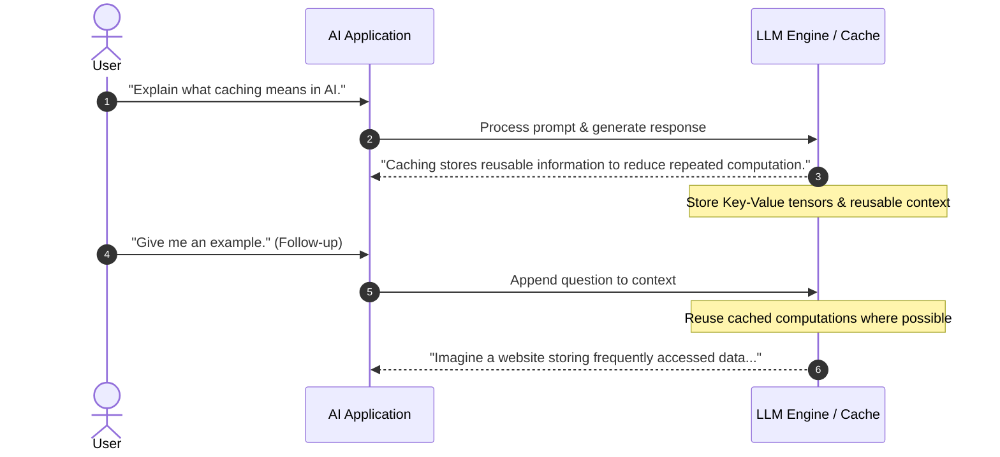
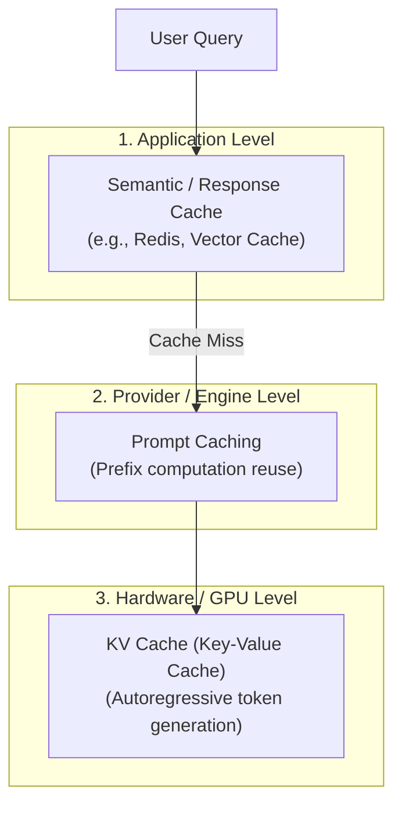
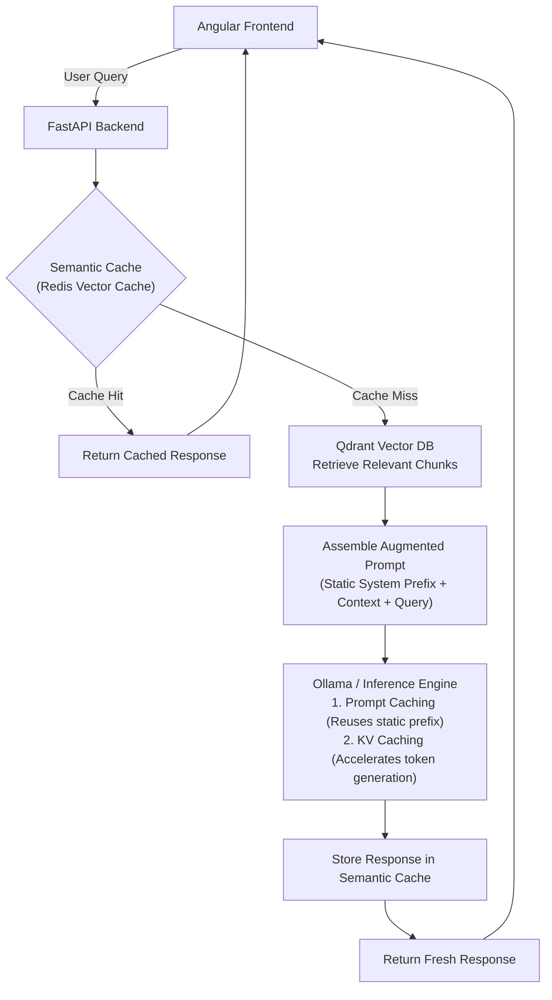

# Caching in Large Language Models (LLMs)

Caching is a fundamental optimization technique in LLM inference and AI application development. An important technical distinction to understand is that **LLM caching is not simply storing raw input and output strings**—there are multiple distinct layers of caching across the hardware, model, and application tiers.

---

## 1. Why is Caching Needed in LLMs?

LLM inference is computationally intensive and resource-heavy due to several factors:

- **Massive Parameter Scale:** Models contain billions of parameters that must be loaded and processed for every token.
- **Hardware Bottlenecks:** Modern models demand high-end GPUs, high tensor-memory bandwidth, and substantial VRAM.
- **Quadratic Attention Cost:** Processing input tokens and autoregressively generating output tokens consumes heavy compute.
- **Redundant Context Processing:** Re-evaluating the same system prompts, conversation histories, or repeated user queries from scratch wastes resources and drives up latency and API costs.

> **The Solution — Caching:** Store and reuse intermediate computations, representations, or completed answers so the model and infrastructure do not need to recalculate everything from scratch.

---

## 2. How Does LLM Caching Work in Multi-Turn Conversations?

Consider a standard multi-turn conversation:



1. **First Request:** The LLM processes the full prompt, computes representations, generates the answer, and stores reusable computation in cache.
2. **Follow-Up Request:** Rather than recalculating attention across all previous tokens from scratch, the engine reuses cached computation where possible and only computes new tokens.

---

## 3. Three Important Types of LLM Caching

In modern AI engineering, caching operates at three distinct levels:



---

### A. KV Cache (Key-Value Cache)

The **KV Cache** is one of the most critical low-level inference optimizations inside transformer architectures.

> 📖 **Deep Dive:** For an in-depth breakdown of Query, Key, Value, Self-Attention, memory formulas, and internal token lifecycle, see [How KV Cache Works Internally in Transformers](./How_KV_Cache_Works_Internally_in_Transformers.md).


- During self-attention, the transformer computes **Key ($K$)** and **Value ($V$)** tensor representations for every token.
- In autoregressive generation, each new token attends to all previous tokens.
- **Without KV Cache:** The model would have to recompute $K$ and $V$ matrices for all preceding tokens at every single generation step ($O(N^2)$ redundant compute).
- **With KV Cache:** Computed $K$ and $V$ tensors are stored in GPU memory. When generating the next token, the model simply appends its new $K$ and $V$ vectors to the cache.

```
Prompt: "Explain caching in AI."
Step 1: Compute and store K, V representations for all prompt tokens.
Step 2: Generate token 1 -> append K1, V1 to KV cache.
Step 3: Generate token 2 -> reuse cached K, V tensors, append K2, V2.
```

---

### B. Prompt Caching

**Prompt Caching** optimizes repeated prompt prefixes (e.g., static system instructions, few-shot examples, large repository context, or base document templates).


#### Example: Banking Chatbot System Prompt
```text
"You are an enterprise banking assistant. Follow strict security protocols. 
Never reveal internal customer account numbers or confidential records.
Operate strictly within regulatory compliance guidelines..."
```

Instead of re-encoding and computing attention over this identical prefix for thousands of separate user requests, the inference provider reuses the precomputed attention state of the prefix.

#### Key Benefits:
- **Significantly Reduced Time-to-First-Token (TTFT).**
- **Lower Input Token Costs** on supporting cloud providers.
- **Higher Throughput** for agentic and chat workflows.

---

### C. Semantic / Response Caching

**Semantic Caching** operates at the application layer. It identifies whether an incoming query is semantically equivalent to a previously answered question.


#### Example:
Users asking different variations of the same underlying intent:
- *"What is a savings account?"*
- *"Explain savings accounts."*
- *"Tell me about a savings account."*

A semantic cache converts the prompt into an embedding vector, performs a similarity search against previously cached queries (e.g., in Redis or a vector database), and returns the stored answer if the similarity score exceeds a defined threshold.

#### Key Benefits & Considerations:
- **Bypasses LLM Call Entirely:** Near-zero latency and zero LLM compute cost on cache hits.
- **Threshold Sensitivity:** Requires precise cosine similarity thresholds. Questions that look similar might have critical nuance differences.

---

## 4. Comparison of Caching Mechanisms

| Feature | KV Cache | Prompt Cache | Semantic Cache |
|---|---|---|---|
| **What it Stores** | Attention Key/Value tensors | Reusable prefix attention states | Complete prompt-response pairs |
| **Primary Purpose** | Fast token-by-token generation | Reuse static prompt prefixes | Avoid redundant LLM invocations |
| **Storage Location** | GPU / Accelerator VRAM | Inference engine / Provider cache | App-level cache (e.g., Redis, Vector DB) |
| **New LLM Computation?** | Yes (computes new tokens) | Yes (for uncached suffix tokens) | No (skipped on cache hit) |
| **Granularity** | Token level | Prompt prefix level | Query/Response level |

---

## 5. Integrating Caching into a Production RAG Architecture

Here is how all caching tiers fit into an enterprise architecture (e.g., **Angular Frontend + FastAPI Backend + Redis + Qdrant + Ollama**):



### Production & Security Best Practices (e.g., Banking Chatbots)
When implementing semantic caching in enterprise systems, ensure strict isolation:
- **Tenant & User Boundaries:** Never return a cached answer containing Customer A's data to Customer B.
- **Authorization & Permissions:** Check ACLs before returning cached document-derived responses.
- **Data Freshness / TTL:** Invalidate cache entries when source documents or regulatory policies are updated.

---

## 6. Interview Key Takeaways & Technical Summary

| Concept | Core Definition |
|---|---|
| **Caching (General)** | Reusing previously stored data or intermediate computation to save resources. |
| **KV Cache** | Retains attention Key and Value representations in GPU memory to prevent quadratic recalculation during token generation. |
| **Prompt Cache** | Reuses precomputed attention states for identical prompt prefixes across requests. |
| **Semantic Cache** | Uses vector similarity at the application layer to return stored responses for equivalent user intents. |

> **Technical Nuance:** A follow-up question in chat does **not** mean the entire previous input and output are simply loaded as static text without computation. The exact speedup depends on which caching layer is active (KV cache for generation speed vs. prompt cache for prefix reuse).
