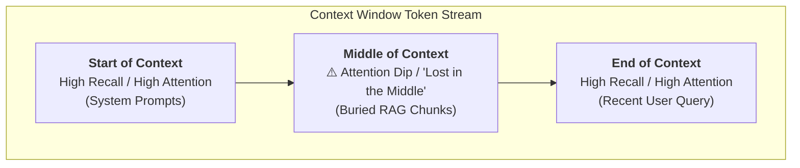
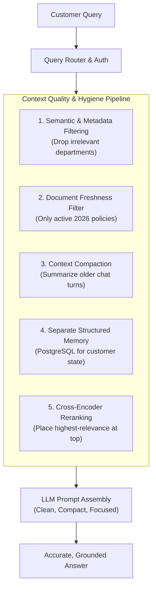

# Context Rot in LLMs – Explained with Real-Life Examples

> **Understanding how long, noisy, and conflicting context degrades LLM output quality in enterprise RAG systems.**  
> An essential architectural concept for building production AI applications, especially enterprise banking chatbots and knowledge retrieval systems.

---

## Quick Recap

* **Context Window** = Maximum information capacity (token limit).
* **Context Compaction** = Summarizing and shrinking older conversation history to save tokens.
* **Context Rot** = Degradation of response quality caused by excessive, noisy, irrelevant, or conflicting information in the active context.

---

## 1. What is Context Rot?

**Context rot** occurs when the quality, precision, and reliability of an LLM's responses deteriorate as its active context becomes excessively long, noisy, cluttered with irrelevant details, or contaminated with conflicting facts.

> 💡 **Key Takeaway:** *More information does not always mean better answers.*

### Real-Life Analogy: The Loan Officer

Imagine you ask a loan officer to evaluate a customer's loan eligibility. You place a massive folder on their desk containing:
* **10** relevant financial documents
* **50** irrelevant documents (promotional brochures, unrelated forms)
* **20** outdated reports from previous years
* **5** incorrect or superseded statements
* **10** conflicting internal guidelines

Will the officer make the best, fastest, and most accurate decision?

**Probably not.** They will spend time sifting through clutter, may get confused by outdated rules, and might make mistakes. 

**LLMs suffer from the exact same problem.**

---

## 2. Real-Life Example: Banking Chatbot

Imagine you are building an enterprise banking chatbot. A customer interacts with the assistant over time, and information accumulates in the active context.

### Accumulated Context Breakdown

#### 1. Relevant Information
* Customer monthly income: `₹80,000`
* Existing EMI: `₹15,000`
* Active personal loan policy: `Minimum monthly income ₹30,000`

#### 2. Irrelevant Information
* Customer previously asked about opening a savings account.
* Customer uploaded an unrelated credit card brochure.
* Customer discussed an old car insurance policy earlier in the chat.

#### 3. Conflicting Information
* **Old policy document (2024):** Minimum monthly income `₹25,000`.
* **Updated policy document (2026):** Minimum monthly income `₹30,000`.

---

### The Problem

Now the customer asks:
> **"Can I get a personal loan?"**

When the model receives all of this unstructured context together:
* ⚠️ It might focus on the **outdated 2024 eligibility threshold** (`₹25,000`) instead of the active one.
* ⚠️ It might pull in **irrelevant credit card terms or car insurance clauses**.
* ⚠️ It might confuse older user statements with current requests.
* ⚠️ It produces a **hallucinated or factually incorrect answer**, even while remaining technically within the token limit.

---

## 3. Context Rot is NOT Just Reaching the Token Limit

A common misconception is that context problems only occur when the token limit is reached. **Context rot happens even when you have plenty of available tokens.**

Suppose your model supports a **100K-token context window**:

```text
┌────────────────────────────────────────────────────────┐
│ Scenario A: Small but Relevant Context                 │
│ [██░░░░░░░░░░░░░░░░░░░░░░░░░░░░░░░░░░░░] 10K / 100K     │
│ Status: FOCUSED                                        │
│ • Relevant banking policy                              │
│ • Current verified customer facts                     │
│ • Recent relevant conversation turns                   │
│ • Clear, targeted prompt                               │
└────────────────────────────────────────────────────────┘

┌────────────────────────────────────────────────────────┐
│ Scenario B: Large and Noisy Context                    │
│ [████████████████████████████████░░░░░░] 80K / 100K    │
│ Status: NOISY (Context Rot Risk)                       │
│ • Full raw multi-session chat history                  │
│ • Irrelevant PDF brochures                             │
│ • Duplicate & unparsed tables                          │
│ • Outdated policies & superseded guidelines            │
│ • Conflicting system & user instructions               │
│ • Relevant information buried in the middle            │
└────────────────────────────────────────────────────────┘
```

Even though **Scenario B** fits comfortably within the 100K token budget, its answer accuracy, faithfulness, and reasoning ability can be significantly worse than **Scenario A**.

> **Important Distinction:** A large context window does not automatically cause hallucinations. However, irrelevant, conflicting, duplicate, or poorly positioned context makes retrieval and reasoning far less reliable.

---

## 4. Why Does Context Rot Happen?

| Cause | What Happens | Impact on LLM Output |
| :--- | :--- | :--- |
| **Irrelevant Information** | Clutters the attention mechanism with non-essential tokens | Distracts model from the core question; pulls unrelated details into the answer |
| **Outdated Information** | Context contains legacy facts alongside current facts | Model cannot reliably determine temporal validity and may cite obsolete rules |
| **Conflicting Information** | Contradictory statements or instructions exist in context | Model generates ambiguous, mixed, or self-contradictory answers |
| **Excessive Context** | Too many chunks retrieved in RAG (e.g., top-k = 25) | Critical facts become harder for attention heads to attend to reliably |

### The "Lost in the Middle" Phenomenon

Research (*"Lost in the Middle: How Language Models Use Long Contexts"* by Liu et al.) shows that LLMs are most effective at accessing information placed at the **very beginning** (primacy effect) or the **very end** (recency effect) of the context window.



When relevant RAG chunks are buried in the middle of tens of thousands of tokens, retrieval accuracy inside the model drops noticeably.

---

## 5. How to Prevent Context Rot in RAG Applications

For a modern production architecture (**Angular 19 + FastAPI + Ollama / Cloud LLM + Qdrant + PostgreSQL**), apply these context hygiene techniques:



### 1. Context Filtering
* Retrieve only chunks directly relevant to the current query intent.
* Apply strict metadata filtering (e.g., filter by department `Retail Banking` and doc type `Loan Policy`).
* Never dump entire unsegmented PDFs or cross-department knowledge into the prompt.

### 2. Remove Outdated Information
* Maintain strict document versioning (`status: "ACTIVE"`, `version: "2026-11"`).
* Deactivate or purge deprecated policy chunks from the vector database.
* Ensure temporal metadata is indexed and filtered during search.

### 3. Context Compaction
* Summarize older dialogue turns into concise bullet points.
* Preserve key decisions, constraints, and active goals rather than raw verbatim messages.
* Keep only the last 2–3 raw conversation turns verbatim.

### 4. Separate Memory from Conversation History
* Store authoritative customer state (e.g., verified income, active loans, KYC status) in **PostgreSQL**.
* Inject structured facts directly into the prompt rather than relying on the LLM to recall them from previous chat messages.

### 5. Start a Fresh Context When Appropriate
* Detect intent shifts (e.g., customer switching from "Car Insurance" to "Personal Loan Application").
* Start a fresh task context rather than carrying forward unrelated conversational baggage.

---

## 6. Context Window vs Context Compaction vs Context Rot

| Concept | Question It Answers | What Problem Does It Solve? |
| :--- | :--- | :--- |
| **Context Window** | *"How much data can fit?"* | Defines the theoretical maximum token capacity of the model. |
| **Context Compaction** | *"How do we keep history small?"* | Compresses past conversation turns so you stay within token and cost budgets. |
| **Context Rot** | *"Why is response quality degrading?"* | Explains and mitigates answer degradation caused by noisy, conflicting, or excessive context. |

---

### The Office Desk Analogy

* 🗄️ **Context Window:** The physical surface area of your office desk.
* 🧹 **Context Compaction:** Filing away, organizing, and shredding old paperwork so the desk isn't overloaded.
* 📉 **Context Rot:** Your desk becoming so cluttered with outdated drafts, irrelevant files, and contradictory notes that you can no longer find the correct document or make the right decision.

---

## 7. Interview Takeaway

> **Context rot** is the degradation of LLM answer accuracy and reasoning quality caused by bloated, noisy, irrelevant, or conflicting information in the active context. It is an information quality and attention problem, not merely a token capacity problem. Mitigating context rot in production RAG systems requires strict metadata filtering, document freshness validation, prompt compaction, structured external state storage, and reranking.
