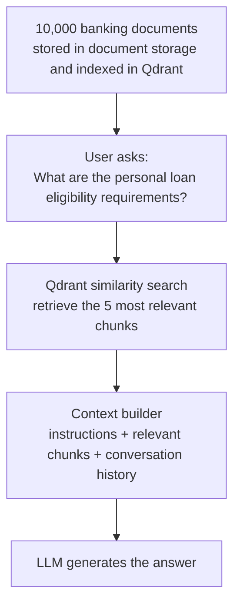

# Context Window in LLMs: Explained with Real-Life Examples

Think of a context window as the **working desk** of an LLM.

A person can work with only a limited amount of information on their desk at one time. If the desk becomes full, they must remove, organize or summarize some information before continuing.

Similarly, an LLM has a limited context window. It determines how much information the model can process in a single request.

Five practical examples follow, plus one on how a chat product reacts to oversized input.

---

## 1. Example: Simple ChatGPT conversation

```text
You:     What is RAG?
ChatGPT: RAG stands for Retrieval-Augmented Generation. It retrieves relevant
         information from external sources and provides it to an LLM.

You:     What is a vector database?
ChatGPT: A vector database stores vector embeddings and enables similarity searches.

You:     How does RAG use a vector database?
```

To answer the third question, the model may need:

- Your current question
- Your previous questions
- Previous ChatGPT answers
- System instructions

All this information forms the **context**.

| Part of a 10,000-token window | Tokens |
|---|---|
| System instructions | 500 |
| Earlier questions and answers | 600 |
| Current question | 50 |
| Remaining space | 8,850 |

> Illustrative token allocation, not actual ChatGPT usage.

**Key point:** The model doesn't just receive your latest question. It may also receive relevant earlier conversation history.

---

## 2. Example: Pasting a large PDF

Suppose you upload a 100-page banking policy PDF containing:

- Account opening procedures
- Savings account rules
- Loan eligibility
- Credit card policies
- Transaction dispute procedures

Imagine the extracted content is **40,000 tokens**, and the model has a hypothetical **32,000-token** context window.

The entire extracted PDF plus instructions, conversation history and output budget cannot fit into that request.

### Solution A: Use RAG

Instead of passing the entire PDF, retrieve only the relevant sections.

```text
User question:
What is the minimum balance for a savings account?

Retrieved document:
Savings Account Policy - Section 4
Minimum balance: ₹10,000
```

The LLM receives the relevant information instead of the entire document.

### Solution B: Summarization or compaction

Summarize older conversation information to free up context space.

> RAG and compaction solve different problems. RAG limits what **external** information enters the context; compaction shrinks the **existing conversation**.

---

## 3. Example: Banking chatbot with a long conversation

A customer has been chatting with a banking assistant for hours.

```text
Customer (Q1):   I want to open a savings account.
Assistant:       You can choose from regular and zero-balance savings accounts.

Customer (Q2):   What is the minimum balance?
Assistant:       The regular savings account requires ₹10,000.

Customer (Q3):   I also want a personal loan. Am I eligible?
Assistant:       Eligibility depends on income, credit history and existing liabilities.

...

Customer (Q100): Can I get a loan without changing my existing savings account?
```

By now the conversation may contain thousands of tokens. Suppose the context window is 10,000 tokens and the conversation requires 12,000 tokens. The application needs to manage the context.

Possible actions:

1. Summarize older conversation turns.
2. Keep recent messages.
3. Retrieve the relevant savings account information.
4. Fetch current loan information from the authorized banking service.
5. Send the optimized context to the LLM.

The chatbot can keep answering without needing the entire original conversation.

---

## 4. Example: Why the context window matters when building RAG

Suppose you have 10,000 banking PDF documents stored in Qdrant.

A common misconception is that you should send all 10,000 documents to the LLM. You should not.



| Information | Tokens |
|---|---|
| System instructions | 1,000 |
| Conversation history | 2,000 |
| Five retrieved chunks | 3,000 |
| Current question | 500 |
| Other context | 500 |
| Reserved output | 3,000 |
| **Total** | **10,000** |

This is how **context budgeting** helps production RAG applications.

---

## 5. Example: What happens when you exceed the context window?

A model has a 10,000-token limit. You try to send:

| Item | Tokens |
|---|---|
| Required by the request | 12,000 |
| Supported | 10,000 |
| Over the limit | 2,000 |

Possible outcomes:

- The API rejects the request with a context-length error.
- The application compacts or truncates older context before retrying.
- The application reduces retrieved documents or the output budget.

The LLM cannot magically process unlimited information just because you paste more text.

---

## 6. Real-time example: how ChatGPT reacts to a context bigger than its window

The exact behavior depends on the product, model and settings, and it changes over time. The scenario below is **illustrative**. It shows the typical patterns, not a guaranteed ChatGPT response.

### Scenario: a long RAG design chat that keeps growing

Imagine a hypothetical model with a **32,000-token** window. Over one long session you:

| Step | What you do | Approx. tokens in the chat |
|---|---|---|
| 1 | Ask about RAG and vector databases | 2,000 |
| 2 | Paste a 5,000-word FastAPI + Qdrant design doc | 8,500 |
| 3 | Paste a 10,000-word banking policy document | 21,500 |
| 4 | Ask 20 follow-up questions, with answers | 30,000 |
| 5 | Ask: "Summarize the Step 2 design and compare it with the policy from Step 3" | 30,500 + reserved output |

At step 5 the request would need more than 32,000 tokens once the answer space is reserved. A chat product has several ways to handle this.

| Reaction | What you would see | What happened behind the scenes |
|---|---|---|
| Reject | An error such as "message too long" or "context length exceeded" | The request is refused because it can't fit |
| Drop older content | The answer ignores or forgets the Step 2 design doc | Oldest messages were truncated to make room |
| Compact | The answer is based on a short recap of Step 2 and misses fine details | Older turns were summarized and replaced |
| Retrieve (files) | The answer quotes only parts of the uploaded document | Only relevant chunks were pulled in, not the whole file |

### What the user might notice

```text
You (Step 5): Compare the Step 2 design with the policy from Step 3.

ChatGPT:      Based on the design you shared earlier, ... (generic answer)
              I don't have the exact section on transaction disputes in front
              of me. Could you paste it again?
```

That reply is a typical symptom of context loss. The model never saw those sections in the final request, so it can't quote them.

### How to avoid it

1. Start a new chat for a new topic.
2. Paste only the relevant sections, not the full document.
3. Ask the model to summarize decisions periodically, then continue from that summary.
4. In your own application, count tokens, reserve output space and compact before the limit is hit (see [`README.md`](README.md)).

---

## 7. Context window vs tokens vs parameters

These three terms are often confused.

| Term | Meaning | Example |
|---|---|---|
| Tokens | Units of text processed by the model | 1,000 tokens |
| Context window | Maximum context capacity | 128K tokens |
| Parameters | Learned numerical values inside the neural network | 7 billion parameters |

A restaurant analogy:

| Concept | Restaurant analogy |
|---|---|
| Tokens | Ingredients |
| Context window | Kitchen workspace |
| Parameters | The chef's learned knowledge and skills |

### Interview Takeaway

> The context window is the maximum number of tokens an LLM can handle in one request, covering instructions, history, retrieved documents and the output budget. When it is exceeded, the request fails or older content is truncated or compacted, so production RAG apps use token budgeting, retrieval and compaction instead of sending everything.
