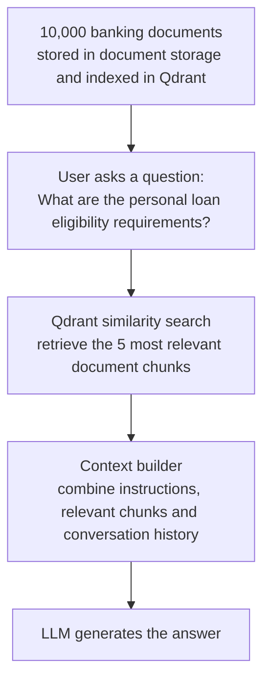

# Context Window in LLMs: Explained with Real-Life Examples

Think of a context window as the **working desk** of an LLM.

A person can work with only a limited amount of information on their desk at one time. If the desk becomes full, they must remove, organize or summarize some information before continuing.

Similarly, an LLM has a limited context window. It determines how much information the model can process in a single request.

Let's understand this through five practical examples.

---

## 1. Example: Simple ChatGPT conversation

Imagine you ask ChatGPT:

```text
You:     What is RAG?
ChatGPT: RAG stands for Retrieval-Augmented Generation. It retrieves relevant
         information from external sources and provides it to an LLM.

You:     What is a vector database?
ChatGPT: A vector database stores vector embeddings and enables similarity searches.

You:     How does RAG use a vector database?
```

To answer your third question, the model may need:

- Your current question
- Your previous questions
- Previous ChatGPT answers
- System instructions

All this information forms the **context**.

Example context window: 10,000 tokens

| Part of the context | Tokens |
|---|---|
| System instructions | 500 |
| Earlier questions and answers | 600 |
| Current question | 50 |
| Remaining space | 8,850 |

> Illustrative token allocation, not actual ChatGPT usage.

**Key point:** The model doesn't just receive your latest question. It may also receive relevant earlier conversation history.

---

## 2. Example: Pasting a large PDF into ChatGPT

Suppose you upload a 100-page banking policy PDF containing:

- Account opening procedures
- Savings account rules
- Loan eligibility
- Credit card policies
- Transaction dispute procedures

Imagine the extracted content represents **40,000 tokens**, and your model has a hypothetical **32,000-token** context window.

**What happens?** The entire extracted PDF plus instructions, conversation history and output budget cannot fit into that request.

There are two important solutions.

### Solution A: Use RAG

Instead of passing the entire PDF, retrieve only the relevant sections.

```text
User question:
What is the minimum balance for a savings account?

Retrieved document:
Savings Account Policy - Section 4

Minimum balance:
₹10,000
```

The LLM receives the relevant information instead of the entire document.

### Solution B: Summarization or compaction

Summarize older conversation information to free up context space.

> Remember: RAG and compaction solve different problems.

---

## 3. Example: Banking chatbot with a long conversation

Imagine a customer has been chatting with a banking assistant for several hours.

```text
Customer (Question 1):   I want to open a savings account.
Assistant:               You can choose from regular and zero-balance savings accounts.

Customer (Question 2):   What is the minimum balance?
Assistant:               The regular savings account requires ₹10,000.

Customer (Question 3):   I also want a personal loan. Am I eligible?
Assistant:               Eligibility depends on income, credit history and existing liabilities.

...

Customer (Question 100): Can I get a loan without changing my existing savings account?
```

By now, the conversation may contain thousands of tokens. Suppose the context window is 10,000 tokens and the conversation requires 12,000 tokens. The application needs to manage the context.

Possible actions:

1. Summarize older conversation turns.
2. Keep recent messages.
3. Retrieve the relevant savings account information.
4. Fetch current loan information from the authorized banking service.
5. Send the optimized context to the LLM.

This allows the chatbot to continue answering without requiring the entire original conversation.

---

## 4. Example: Why context window matters when building RAG

Suppose you have 10,000 banking PDF documents stored in Qdrant.

A common misconception is that you should send all 10,000 documents to the LLM. **You should not.**

Instead:



For example:

| Information | Tokens |
|---|---|
| System instructions | 1,000 |
| Conversation history | 2,000 |
| Five retrieved chunks | 3,000 |
| Current question | 500 |
| Other context | 500 |
| Reserved output | 3,000 |
| **Total** | **10,000** |

This is how **context budgeting** helps production RAG applications.

---

## 5. Example: What happens when you exceed the context window?

Imagine a model with a 10,000-token limit. You attempt to send:

| Item | Tokens |
|---|---|
| Required by the request | 12,000 |
| Supported | 10,000 |
| Over the limit | 2,000 |

Possible outcomes:

- The API rejects the request with a context-length error.
- The application compacts or truncates older context before retrying.
- The application reduces retrieved documents or the output budget.

The LLM cannot magically process unlimited information just because you paste more text.

---

## 6. Context window vs tokens vs parameters

These three terms are often confused.

| Term | Meaning | Example |
|---|---|---|
| Tokens | Units of text processed by the model | 1,000 tokens |
| Context window | Maximum context capacity | 128K tokens |
| Parameters | Learned numerical values inside the neural network | 7 billion parameters |

Think of a restaurant:

| Concept | Restaurant analogy |
|---|---|
| Tokens | Ingredients |
| Context window | Kitchen workspace |
| Parameters | The chef's learned knowledge and skills |
