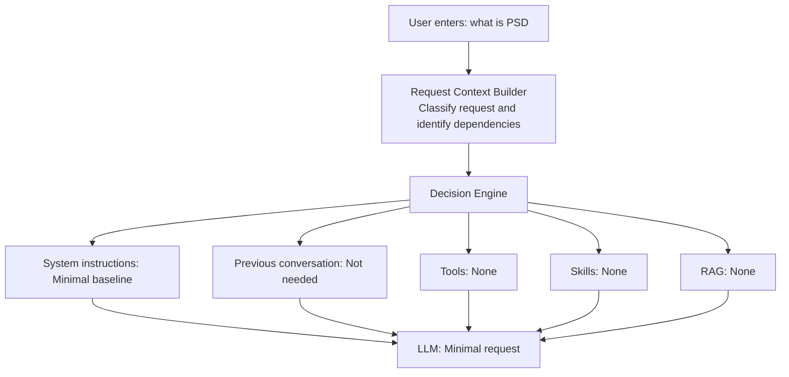
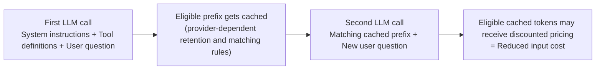
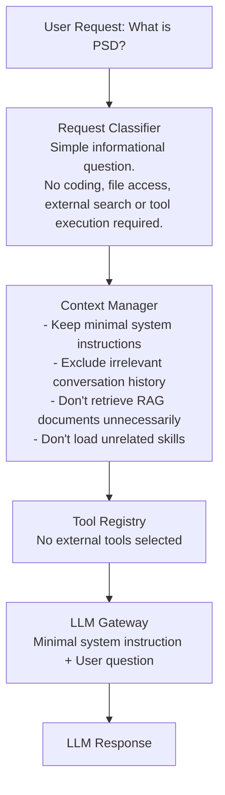

# Controlling the LLM Request Payload

**Question:** Suppose I type `what is PSD` in the prompt window. When I submit, the application triggers the LLM with system prompts, tools, skills, cache, messages, etc. How do I restrict the request so only `what is PSD` is sent to the LLM?

This is really a question about controlling the **actual payload sent to the LLM**, not just reducing the context window.

Why AI Agents Cost More Than You Think : https://www.youtube.com/watch?v=7oS4sQe15Po

---

## Table of Contents

1. [Desired LLM Input](#1-desired-llm-input)
2. [Two Scenarios: Existing Assistant vs Your Own Application](#2-two-scenarios-existing-assistant-vs-your-own-application)
3. [Automating the Decision: Request Context Builder](#3-automating-the-decision-request-context-builder)
4. [What If the Next Request Needs Previous Conversation?](#4-what-if-the-next-request-needs-previous-conversation)
5. [Recommended Implementation Architecture](#5-recommended-implementation-architecture)
6. [Test Your Understanding](#6-test-your-understanding)
7. [What You Type vs What the LLM Receives](#7-what-you-type-vs-what-the-llm-receives)
8. [Do You Pay for All Those Tokens?](#8-do-you-pay-for-all-those-tokens)
9. [Can You Prevent This in an Existing Coding Assistant?](#9-can-you-prevent-this-in-an-existing-coding-assistant)
10. [Architectural Distinction: Two Levels of Control](#10-architectural-distinction-two-levels-of-control)
11. [Review of the Explanation: What It Gets Right](#11-review-of-the-explanation-what-it-gets-right)
12. [Important Nuances](#12-important-nuances)
13. [Hidden Context Overhead Explained](#13-hidden-context-overhead-explained)
14. [Accurate Token Math](#14-accurate-token-math)
15. [Prompt Caching Lowers Real Cost](#15-prompt-caching-lowers-real-cost)
16. [Custom Apps Still Need Minimal Instructions](#16-custom-apps-still-need-minimal-instructions)
17. [Putting It All Together](#17-putting-it-all-together)
18. [Comparison: Three Ways to Optimize LLM Cost](#18-comparison-three-ways-to-optimize-llm-cost)
19. [Key Takeaways](#19-key-takeaways)

---

## 1. Desired LLM Input

User enters:

```
what is PSD
```

You want the LLM to receive only this (about **3 tokens**):

```
what is PSD
```

> Illustrative token count; actual tokenization depends on the model.

Instead of sending:

- System prompts
- Tool definitions
- Skills
- Previous conversation
- Old tool results
- Unnecessary instructions

---

## 2. Two Scenarios: Existing Assistant vs Your Own Application

### 2.1 Using an existing AI coding assistant

Examples: Claude Code, Cursor, GitHub Copilot, or another managed coding agent.

You generally **cannot control the complete internal LLM request payload** from the prompt window.

The application manages:

- System instructions
- Tool definitions
- Skills and rules
- Conversation history
- Context compaction
- Tool selection

You can reduce unnecessary context using the application's supported commands and settings, but you cannot necessarily force it to send only your latest message.

### 2.2 Building your own AI application

You have **full control** over what goes into each LLM request.

Suppose your FastAPI application receives:

```json
{
  "user_message": "what is PSD"
}
```

Your backend can call the LLM with a minimal request. Example using Python:

```python
from openai import OpenAI

client = OpenAI()

def ask_llm(user_message):

    response = client.chat.completions.create(
        model="your-model",
        messages=[
            {
                "role": "user",
                "content": user_message
            }
        ],
        # No tools parameter
    )

    return response.choices[0].message.content


answer = ask_llm("what is PSD")
print(answer)
```

Here, you are not explicitly adding:

- Your application's system prompt
- Previous conversation
- Tool definitions
- RAG documents
- Skills

The model receives the user message as the application-provided conversational input.

> **Note:** The provider may still apply its own infrastructure-level processing or policies. Also, the example uses an OpenAI-compatible API; other providers have different request formats.

---

## 3. Automating the Decision: Request Context Builder

Implement a **Request Context Builder**. Instead of blindly sending everything, classify the incoming request first.



**Important correction:** in a production application, retain a **small baseline system instruction** where needed, rather than always removing it. You may need it for response format, application behavior, or safety requirements.

---

## 4. What If the Next Request Needs Previous Conversation?

Consider this interaction:

| Request | Context required |
|---|---|
| What is PSD? | Current question |
| Explain it with an example | Previous answer |
| Compare it with RAG | Previous answer + relevant RAG knowledge |
| Create a diagram | Previous context + image-generation capability |

Your Context Builder should **dynamically construct the request** for each invocation.

---

## 5. Recommended Implementation Architecture

For an Agentic AI platform built with **FastAPI, LangChain, Ollama and Qdrant**:

| Component | Responsibility |
|---|---|
| Request Classifier | Identify the type of request |
| Context Manager | Select relevant conversation history |
| Tool Registry | Select required tools |
| Skill Loader | Load only relevant skills |
| RAG Retriever | Retrieve relevant documents |
| Token Budget Manager | Enforce context limits |
| LLM Gateway | Construct and send the final request |

**Most important architectural principle:**

> Don't send the entire application context to the LLM by default. Build the LLM request dynamically for every invocation.

---

## 6. Test Your Understanding

**Scenario:** A user enters *"What is Docker?"*. Your application has 20 MCP tools, 10 skills and 100 previous conversation messages. What should the Context Builder do?

- A. Send all 20 tools, 10 skills and 100 messages.
- B. Send the current question and minimal required baseline instructions; no unnecessary tools, skills or history.
- C. Always send the previous 100 messages to preserve context.

**Answer: B.**

**One final distinction:** You control the application-level request payload when building your own agent. You generally do **not** control all internal context assembly in a managed coding assistant.

---

## 7. What You Type vs What the LLM Receives

Even though `what is PSD` is about 3 tokens, an existing AI coding assistant may send significantly more tokens, because the LLM receives more than just your latest question.

| Component | Tokens (illustrative) |
|---|---|
| System instructions | 4,400 |
| Tool definitions | 6,900 |
| Rules and skills | 967 |
| Previous messages | 20,000 |
| Your latest question | 3 |
| **Total** | **32,270** |

> Illustrative example only. Actual payload depends on the coding assistant, model, caching, and request implementation. It is not an actual measured request from Cursor, Copilot or Claude Code.

So your 3-token question can be part of a much larger LLM request.

---

## 8. Do You Pay for All Those Tokens?

Potentially, yes. For a paid API-based coding assistant:

| Component | Potential cost |
|---|---|
| System instructions | Input-token billing |
| Tool definitions | Input-token billing |
| Previous messages | Input-token billing |
| Skills and rules | Input-token billing |
| Latest question | Input-token billing |
| Cached portions | Usually discounted input billing |
| Generated response | Output-token billing |

Subscription-based coding assistants may use different pricing and usage models, so don't assume every token translates directly into an additional charge to you.

---

## 9. Can You Prevent This in an Existing Coding Assistant?

You generally cannot force the application to send only your 3 tokens, but you can **reduce unnecessary context**. For example, in Claude Code:

| Action | Purpose |
|---|---|
| `/context` | Inspect context consumption |
| `/compact` | Summarize and compress conversation history |
| `/clear` | Start a fresh conversation |
| Use targeted MCP tools | Reduce unnecessary tool availability |
| Avoid unnecessary skills | Reduce additional instructions |

Reference: Claude Code official documentation.

---

## 10. Architectural Distinction: Two Levels of Control

| | Existing AI coding assistant | Your own AI application |
|---|---|---|
| Level of control | Limited | Full application-level control |
| Context assembly | Managed by the application | You select the conversation history |
| System instructions | Managed by the application | You write them |
| Tool definitions | Managed by the application | You select the tools |
| Skills | Managed by the application | You select the skills |
| RAG documents | N/A | You select the RAG documents |
| Final request | Built by the application | You construct it |
| Your influence | Through supported settings and commands | Complete |

**Recommendation:** When learning AI agent architecture, distinguish between **user input tokens** and **total LLM input tokens**. They are not the same. This distinction is fundamental to understanding context tax, prompt caching, and production LLM cost optimization.

---

## 11. Review of the Explanation: What It Gets Right

- **Hidden context overhead.** Existing AI coding assistants (Cursor, GitHub Copilot, Claude Code) wrap every prompt with system instructions, tool/MCP definitions, project rules, and chat history so the model understands your codebase and available actions.
- **Accurate token math.** The breakdown adds up properly (4,400 + 6,900 + 967 + 20,000 + 3 = 32,270 tokens), and `"what is PSD"` is roughly 3 tokens in standard tokenizers.
- **Valid mitigation strategies.** Commands like `/clear` or `/compact` in existing tools, or a routing/context manager in a custom app that strips unnecessary tools and history for simple queries, are standard best practices for reducing latency and token costs.

---

## 12. Important Nuances

- **Prompt caching lowers real cost.** While 32,270 input tokens are sent to the model, modern LLM APIs can cache static prefixes (system instructions, tool definitions). Cached input tokens typically cost 50% to 90% less than uncached tokens, so the financial impact isn't always as steep as raw token counts suggest.
- **Custom apps still need minimal instructions.** In a real production app, you rarely send *literally* just the raw user string without at least a brief system prompt to guide tone, safety, or output formatting. Keeping it minimal still saves thousands of tokens.

---

## 13. Hidden Context Overhead Explained

Suppose you open Cursor, GitHub Copilot or Claude Code and type `what is PSD`. You might expect the LLM to receive only those three tokens, but an AI coding assistant is more than a simple chatbot. It must:

- Understand your project structure
- Follow coding instructions
- Read and modify files
- Execute terminal commands
- Interact with MCP servers
- Remember previous conversations
- Follow security and organizational rules

To do this, the application may construct a larger request (see the [token table in section 7](#7-what-you-type-vs-what-the-llm-receives)).

**Why does this happen?** The application wants the LLM to understand the environment in which it is working. For example, for *"Fix the authentication issue."* the LLM might need:

- Your authentication-related source files
- Project coding rules
- Available file-editing tools
- Previous error messages
- Relevant conversation history

Without this context, the LLM may not perform the task correctly. But for a simple question like *"What is PSD?"*, most of that information is unnecessary. That is the **hidden context overhead**.

---

## 14. Accurate Token Math

$$
4400 + 6900 + 967 + 20000 + 3 = 32270
$$

Two important details:

1. The three-token count is an approximation. Tokenization depends on the specific model's tokenizer.
2. 32,270 is an illustrative payload, not a guarantee that every coding assistant sends all those components on every request.

Different applications dynamically manage their context. Some may:

- Send all available tool definitions
- Select only relevant tools
- Summarize older messages
- Include project files only when relevant

---

## 15. Prompt Caching Lowers Real Cost

Recall the earlier discussion of *Context Tax*. Suppose an LLM receives 10,000 input tokens:

- 8,000 are new, uncached input tokens.
- 2,000 are previously cached input tokens.

The provider may charge different rates for these two categories.

| Category | Tokens |
|---|---|
| Normal input (billed at normal input rate) | 8,000 |
| Cached input (billed at discounted cache rate, if eligible) | 2,000 |
| **Total input processed** | **10,000** |

### 15.1 Illustrative pricing

| Token category | Price per 1M tokens |
|---|---|
| Normal input | $2.00 |
| Cached input | $0.50 |

Calculation:

Normal input:

$$
8000 \times \frac{2}{1000000} = \$0.016
$$

Cached input:

$$
2000 \times \frac{0.5}{1000000} = \$0.001
$$

Total:

$$
\$0.016 + \$0.001 = \$0.017
$$

Without caching, 10,000 tokens at the normal rate would cost **$0.020**, so caching gives roughly **15% lower input cost** in this example.

> These are hypothetical rates to demonstrate the calculation, not current provider prices.

### 15.2 How prompt caching works

Suppose your coding assistant sends the same system instructions repeatedly.



**Important:**

- Prompt caching does **not** automatically cache every previous conversation.
- It generally works with **matching, reusable prompt prefixes**. The provider's caching mechanism, cache lifetime, minimum token requirements and pricing determine what qualifies.
- Cached tokens still occupy context capacity. **Caching reduces cost; it doesn't necessarily reduce the number of tokens in the request.**

Remember:

- **Context filtering** reduces the number of tokens sent.
- **Prompt caching** reduces the cost of eligible repeated tokens.
- These are two different optimizations.

### 15.3 Worked example: enterprise banking chatbot

Prompt caching is a technique LLM providers use to reduce the cost of repeatedly sending the same input instructions.

#### The problem without prompt caching

Every time a customer sends a message, the application sends the following to the LLM:

| Input component | Tokens |
|---|---|
| System instructions | 3,000 |
| Banking security rules | 2,000 |
| Tool definitions | 3,000 |
| Customer conversation history | 1,000 |
| New user question | 1,000 |
| **Total** | **10,000** |

The customer asks three questions:

| LLM call | Customer question |
|---|---|
| Call 1 | What is my account balance? |
| Call 2 | Show my last five transactions. |
| Call 3 | How can I download my statement? |

The following is **identical in all three requests**:

- System instructions
- Banking security rules
- Tool definitions

Why should the LLM process the same 8,000 instruction tokens from scratch every time? That's what prompt caching addresses.

> For simplicity, this example treats the 9,000 tokens of instructions, rules, tools and history as the reusable prefix. In practice, conversation history grows and changes with each turn, so only the part that stays identical qualifies.

#### How prompt caching changes the processing

Prompt caching lets the provider reuse **eligible, previously processed prompt prefixes**.

| | Call 1 | Call 2 | Call 3 | Total input |
|---|---|---|---|---|
| **Without caching** | 10,000 normal | 10,000 normal | 10,000 normal | 30,000 normal |
| **With caching** | 10,000 normal (prefix gets cached) | 9,000 cached + 1,000 normal | 9,000 cached + 1,000 normal | 12,000 normal + 18,000 cached |

The total is still 30,000 input tokens. But 18,000 of them are eligible for **discounted cached-input pricing**.

> **Important:** Prompt caching does **not** mean the LLM receives only 1,000 tokens on calls 2 and 3. The full prefix is still part of the request and still occupies the context window. The provider simply reuses its cached processing state instead of processing that prefix in the usual way.

#### Calculating the actual cost savings

Hypothetical pricing:

| Token category | Price per 1M tokens |
|---|---|
| Normal input | $2.00 |
| Cached input | $0.50 |
| Output | $8.00 |

> These are example prices, not current vendor pricing. Many providers also charge extra for cache *writes*; that is ignored here to keep the example simple.

Assumptions across the three calls:

- 9,000 reusable tokens per call, 1,000 new tokens per call.
- 1,500 output tokens per call (4,500 in total).

**Scenario A: without caching**

$$
30000 \times \frac{\$2}{1000000} = \$0.060 \quad \text{(input)}
$$

$$
4500 \times \frac{\$8}{1000000} = \$0.036 \quad \text{(output)}
$$

$$
\text{Total} = \$0.060 + \$0.036 = \mathbf{\$0.096}
$$

**Scenario B: with caching**

Across the three calls:

- Normal input = 10,000 (call 1) + 1,000 + 1,000 = **12,000** tokens.
- Cached input = 9,000 + 9,000 = **18,000** tokens.
- Output = 4,500 tokens.

$$
12000 \times \frac{\$2}{1000000} = \$0.024 \quad \text{(normal input)}
$$

$$
18000 \times \frac{\$0.50}{1000000} = \$0.009 \quad \text{(cached input)}
$$

$$
4500 \times \frac{\$8}{1000000} = \$0.036 \quad \text{(output)}
$$

$$
\text{Total} = \$0.024 + \$0.009 + \$0.036 = \mathbf{\$0.069}
$$

**Result**

| | Cost |
|---|---|
| Without caching | $0.096 |
| With caching | $0.069 |
| Saved | $0.027 (about 28% of total cost) |

The input portion alone drops from $0.060 to $0.033, a **45% reduction**. The total saving is smaller because output tokens are not discounted by caching. The more calls reuse the same prefix, the closer the input saving gets to the full cached discount (here 75%). At enterprise scale, across millions of calls, this adds up.

#### How does the LLM know which tokens to cache?

Most prompt caching systems work on a **reusable prefix** of the request:

| Part of request | Cache behaviour |
|---|---|
| System instructions, banking security rules, tool definitions (static, at the start) | Cache eligible |
| Latest customer question, new conversation information (dynamic, at the end) | Usually not reused |

On the next call, if the prefix matches exactly and the cache is still available, the provider can reuse it. This is why you should put **static content first and dynamic content last**.

Caching is provider-dependent. Providers may differ in:

- Minimum token thresholds
- Cache expiration periods
- Prefix matching requirements
- Cache read and write prices
- Automatic vs explicit caching mechanisms

For example, OpenAI documents automatic prompt caching and cached-token usage in its API documentation (see *Prompt Caching* in the OpenAI docs).

#### Does prompt caching solve the Context Tax problem?

Not completely.

| Optimization | What happens |
|---|---|
| Prompt caching | Reduces the price of eligible repeated tokens |
| Context filtering | Removes unnecessary tokens |
| Conversation summarization | Reduces old conversation history |
| Dynamic tool selection | Avoids unnecessary tool definitions |

Suppose your application sends 100,000 tokens but only 20,000 are relevant. Even if caching makes the repeated tokens cheaper, you are still sending unnecessary context. The better approach:

1. Remove irrelevant context.
2. Keep necessary system instructions.
3. Dynamically select tools.
4. Summarize previous conversations.
5. Apply prompt caching to the reusable prefix.

#### How this applies to a local Ollama architecture

| LLM deployment | Prompt caching |
|---|---|
| OpenAI API | Provider-managed prompt caching |
| Anthropic API | Provider-managed prompt caching |
| Local Ollama | Local inference / KV-cache reuse, depending on model, runtime and configuration |

With local Ollama you generally don't pay a per-token API input fee, so the financial benefit is different. Reusing model computation can still reduce **latency and resource consumption**.

**Recommendation:** implement both a Context Manager and a Prompt Cache strategy.

- **Context Manager:** decides what information should be sent.
- **Prompt Cache:** reduces the cost of processing eligible repeated information.
- **Token Budget Manager:** ensures the total request stays within your context and cost limits.

> **Key takeaway:** Prompt caching saves money by making repeated eligible input tokens *cheaper*, not by eliminating those tokens from the LLM request.

---

## 16. Custom Apps Still Need Minimal Instructions

Technically, you can construct an API request containing only the user message. But in a production enterprise application, sending only the raw user message is usually not the best design, because the LLM needs some basic instructions about how to behave.

**Without a system prompt**

```
User: What is PSD?

LLM: PSD could mean many different things.
```

**With a minimal system prompt**

```
SYSTEM INSTRUCTION
You are a helpful technical assistant. Explain concepts clearly and concisely.
If an abbreviation is ambiguous, ask for clarification.

USER MESSAGE
What is PSD?
```

The system instruction adds a small amount of input but improves consistency and ambiguity handling.

For enterprise banking applications, system instructions may also specify:

- Security requirements
- Data confidentiality
- Output formats
- Restrictions on tool usage
- Regulatory and business policies

> You shouldn't remove critical security instructions just to save tokens.

---

## 17. Putting It All Together

For a **FastAPI + Ollama + Qdrant + LangChain** agent architecture, combine all these techniques:



---

## 18. Comparison: Three Ways to Optimize LLM Cost

| Strategy | What it solves |
|---|---|
| Context filtering | Avoids sending unnecessary tokens |
| Prompt caching | Reduces the cost of eligible repeated tokens |
| Minimal system prompt | Avoids unnecessary instruction tokens |

**Recommended priority:**

1. First, don't send unnecessary context.
2. Second, dynamically select tools and skills.
3. Third, summarize old conversation history.
4. Fourth, use prompt caching for repeated prefixes.
5. Finally, monitor token consumption and cost per LLM call.

---

## 19. Key Takeaways

- Your typed input (3 tokens) is **not** the same as total LLM input tokens (potentially 32,000+).
- In managed coding assistants you have limited control; use `/context`, `/compact`, `/clear`, targeted MCP tools and fewer skills.
- In your own application you control the payload fully. Build it dynamically with a Request Context Builder.
- Keep a **small baseline system prompt** in production for safety, format and behavior.
- **Caching is not a substitute for context management.** If you send 100,000 unnecessary tokens and cache them, you may pay less for them, but you still consume context capacity and processing resources.

> A well-designed AI agent should minimize what it sends first, then use caching to optimize what remains.
