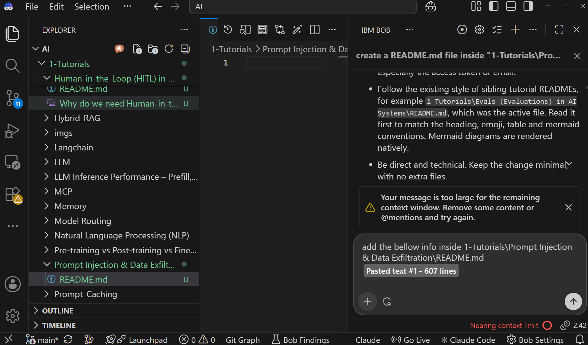
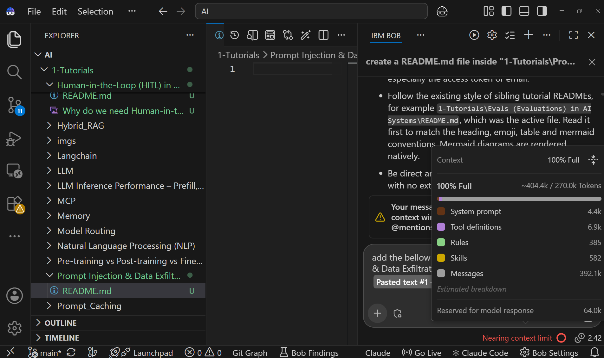
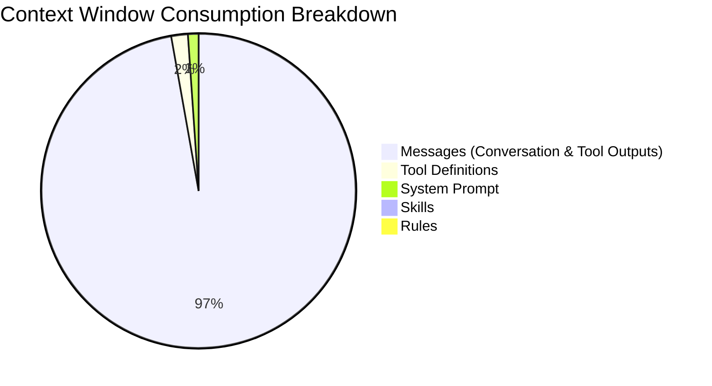
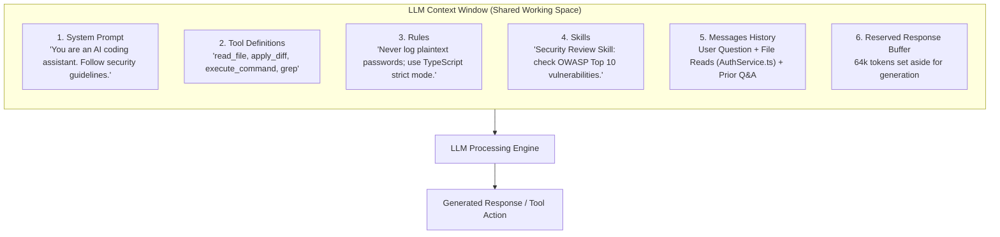

# Context Window Architecture & Usage Breakdown

When working with modern AI coding assistants and agentic systems (such as IBM Bob, Claude Code, or custom LLM agents), managing the **context window** is critical. A context window is not simply a text box for user prompts—it is the shared working memory for the entire agent runtime.

---

## 1. Understanding Context Limits & Overflows

When a context window is exhausted, you typically encounter two related scenarios:

1. **Context Window Exceeded:** A large input (e.g., pasting 600+ lines of code or sending massive logs) cannot be submitted because the remaining token capacity is insufficient to hold the prompt plus the required system instructions and generation reserve.
2. **Context 100% Full:** During a long session, accumulated conversation history, tool calls, file contents, and terminal outputs occupy all available input tokens.

### Key Token Metrics
- **Context Status:** 100% Full (e.g., ~404.4k tokens accumulated vs. active model limits).
- **Reserved for Model Response:** ~64k tokens reserved specifically so the model has sufficient space to generate its output.
- **Usable vs. Total Tokens:** The model cannot use 100% of its capacity purely for user input—system instructions, tools, skills, rules, and output buffers all compete for the same window.

---

## 2. Context Window Breakdown: What Goes Inside?

In agentic coding environments, the context window is broken down into five distinct categories plus output reservation:

| Component | Example Tokens | Meaning / Description |
|---|---|---|
| **System prompt** | ~4.4k | Foundational behavioral, safety, and operational instructions for the model. |
| **Tool definitions** | ~6.9k | Schemas and descriptions of available tools (file read/write, bash execution, code search, etc.). |
| **Rules** | ~385 | Project-specific constraints, guidelines, and instructions (e.g., `.bob/rules`, coding conventions). |
| **Skills** | ~582 | Specialized reusable workflows loaded dynamically via agent skills (e.g., `SKILL.md`). |
| **Messages** | ~392.1k | The ongoing conversation: user prompts, assistant replies, tool calls, and tool outputs. |
| **Reserved Output** | ~64k | Tokens set aside exclusively for the model to generate its response. |

---

## 3. Deep Dive into the 5 Components

### A. System Prompt
The foundational instruction set given to the LLM by the platform.
- **Purpose:** Defines persona, safety constraints, reasoning style, and core capabilities.
- **Example:** *"You are an AI coding assistant. Follow clean code principles, avoid destructive file modifications without confirmation, and respect platform safety boundaries."*

### B. Tool Definitions
Schemas describing what tools the agent can invoke and how to construct valid tool arguments.
- **Purpose:** Enables function calling and autonomous tool execution.
- **Example:** JSON schemas for `read_file`, `write_file`, `execute_command`, `grep`, and `glob`.

### C. Rules
Project-level or user-defined guidelines that tailor the agent's behavior to specific codebases.
- **Purpose:** Enforces standards without requiring manual prompt repetition.
- **Example:** *"Follow Angular 17 standalone component standards; never hardcode credentials; always run test suites before finalizing tasks."*

### D. Skills
On-demand or preloaded workflow modules that equip the agent with specialized multi-step knowledge.
- **Purpose:** Provides domain expertise (e.g., PR creation workflows, migration playbooks, security auditing).
- **Example:** Instructions loaded from `SKILL.md` detailing how to scaffold MCP servers or run compliance checks.

### E. Messages (The Largest Consumer)
The dynamic interaction log between user, assistant, and environment.
- **What it includes:**
  - User prompts and follow-up questions
  - Assistant intermediate thoughts and responses
  - Full tool inputs and outputs (e.g., 500-line file contents, test run outputs, git diffs)
  - Multi-turn conversation history
- **Why it grows quickly:** Reading large files or executing CLI commands with verbose outputs rapidly adds thousands of tokens to the `Messages` category.

---

## 4. Who Provides Which Component?

Users do not need to manually type all five components into every prompt. The agent runtime automatically composes the full context:

| Category | What it contains | Who provides it? |
|---|---|---|
| **System prompt** | Core instructions on model behavior and limits | Platform / Model Developer |
| **Tool definitions** | Tool names, parameter schemas, and usage rules | Platform / Tool Integrations |
| **Rules** | Coding standards, project constraints, configuration | User / Project (`.bob/rules`) |
| **Skills** | Specialized workflows and domain instructions | Skill Authors / Repository (`SKILL.md`) |
| **Messages** | Prompts, responses, file dumps, tool executions | User, Agent, and Environment |

---

## 5. Context Window vs. Prompt

A common misconception is that the context window only holds the user prompt. 

$$\text{Context Window} \neq \text{User Prompt}$$

$$\text{Context Window} = \text{System Prompt} + \text{Tool Definitions} + \text{Rules} + \text{Skills} + \text{Messages} + \text{Reserved Output}$$

| Feature | Prompt | Context Window |
|---|---|---|
| **Definition** | The specific input/question sent in a single turn | The total working memory available for a request |
| **Scope** | Just the user instructions | System instructions + Tools + Skills + Rules + History + Output buffer |
| **Size** | Typically a few dozen to a few hundred tokens | 128k to 1M+ tokens (model-dependent) |
| **Exhaustion Cause** | Typing too much text in one message | Accumulating long conversation history and large tool outputs |

---

## 6. Real-World Walkthrough: Banking Application Review

Consider asking an AI agent: *"Review my banking application's authentication module."*

### Execution Lifecycle:
1. **System Prompt** sets security-first guardrails.
2. **Tool Definitions** allow the model to call `read_file` on `auth.service.ts`.
3. **Rules** instruct the model to verify zero-trust authentication policies.
4. **Skills** inject the security audit checklist.
5. **Messages** capture the source code read from disk, the user's request, and previous findings.
6. **LLM** processes the entire assembled context and generates the vulnerability assessment using the reserved output budget.

---

## 7. Context Management & Compaction

Because `Messages` continuously expands during long sessions, agents employ **Context Compaction** to avoid reaching 100% capacity:

1. **Token Monitoring:** The runtime tracks total token consumption against the context window limit.
2. **Triggering Threshold:** When context utilization reaches high watermarks (e.g., 80–90%), compaction begins.
3. **Summarization:** Older turns and verbose tool outputs (e.g., massive file listings) are summarized into structured state summaries.
4. **Retention:** Crucial elements (System prompt, active rules, active skills, recent turns) are preserved intact.

---

## 8. Summary & Architecture Takeaway

> **Core Takeaway:**  
> The context window is a **shared working desk**, not an input box. The user prompt is only a small slice of what the model processes. System prompts, tool definitions, rules, agent skills, and full conversation history all share the same token budget. When context fills up, conversation history and tool outputs (`Messages`) are almost always the primary contributors, requiring proactive context compaction and efficient session management.
