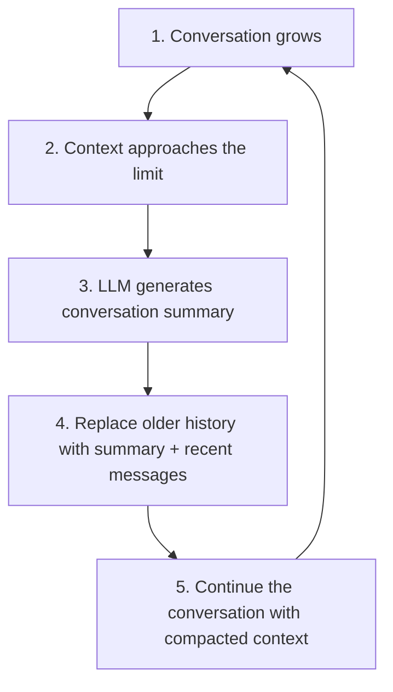
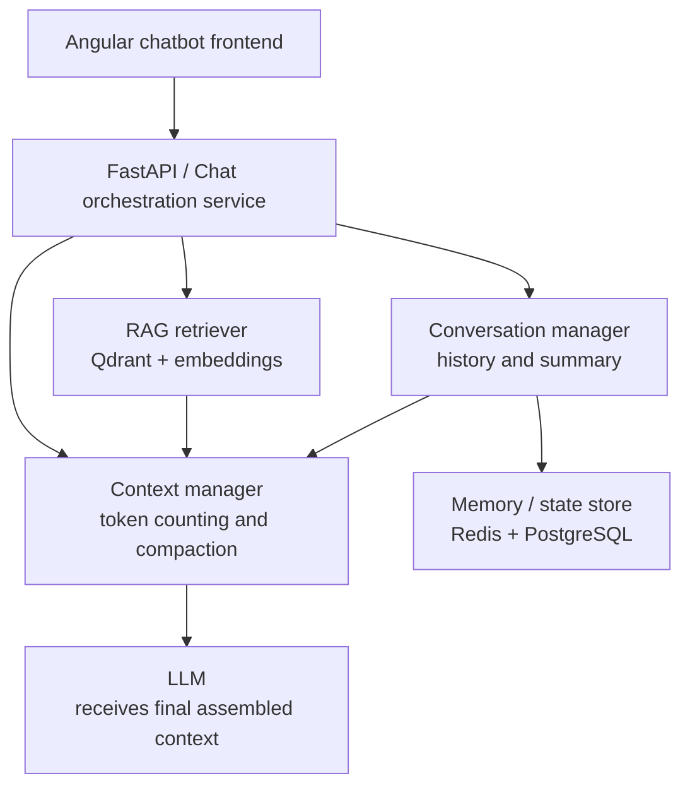

# Context Window & Compaction

## Prompt Window vs Context Window in LLMs

These two terms are related, but they are not the same thing.

> **Clarification:** "Prompt window" is not a standard technical term like "context window". People sometimes use it to mean the prompt's token size or the space available for entering a prompt.

---

## 1. Prompt vs Context Window

Imagine you are using a banking chatbot. You enter:

```text
What is the minimum balance required for a savings account?
```

This is your **prompt** (your input to the LLM). But the LLM might also receive:

- System instructions
- Your previous conversation
- Retrieved banking policy documents
- Relevant customer information
- Your current question

All these combined form the **context**.

### How the prompt fits into the context

| Part of the context | Example |
|---|---|
| 1. System instructions | Act as a banking assistant. |
| 2. Conversation history | Previous customer questions and answers. |
| 3. Retrieved RAG documents | Relevant savings account policy. |
| 4. Current prompt | What is the minimum balance? |

The **context window** is the model's capacity for this entire input.

---

## 2. Real-life numerical example

Suppose your model has a hypothetical context window of **16,000 tokens**. You send:

| Information | Tokens |
|---|---|
| System instructions | 1,000 |
| Previous conversation | 4,000 |
| RAG documents | 3,000 |
| Customer information | 1,000 |
| Current prompt | 500 |
| Reserved output | 2,500 |
| **Total** | **12,000** |

- Context window capacity: 16,000 tokens
- Allocated: 12,000 tokens
- Remaining: 4,000 tokens

> Illustrative example. Actual model token accounting can vary.

Your current prompt is only 500 tokens, but the entire context uses 12,000 tokens. That is the key difference.

---

## 3. Comparison

| Feature | Prompt | Context window |
|---|---|---|
| Meaning | Instructions or input given to the LLM | Total information capacity for a request |
| Includes current question | Yes | Yes |
| Includes conversation history | Not necessarily | If supplied |
| Includes RAG documents | If included in prompt | If supplied |
| Measured in tokens | Yes | Yes, capacity is measured in tokens |
| Has a fixed model limit? | No universal prompt-specific limit | Yes, model-specific limit |

---

## 4. How this works in a FastAPI + RAG application

An Angular frontend sends this request:

```json
{
  "question": "What is my loan eligibility?",
  "conversation_id": "12345"
}
```

The FastAPI backend then:

1. Retrieves previous conversation history.
2. Searches Qdrant for relevant loan policy documents.
3. Fetches authorized customer information.
4. Creates the final prompt with system instructions.
5. Checks the token budget.
6. Sends the assembled context to the LLM.

```python
final_prompt = f"""
You are a banking assistant.

Conversation History:
{conversation_history}

Retrieved Documents:
{retrieved_documents}

Customer Information:
{customer_data}

Current User Question:
{user_question}

Answer using the provided information.
"""
```

Here, `final_prompt` is the assembled input, while the context window is the model's overall capacity for processing that input and generating its response.

---

## 5. Simple analogy: an examination

| Concept | Exam analogy |
|---|---|
| Prompt | The specific question on the question paper |
| Context | The question plus instructions, reference material and previous information supplied |
| Context window | The maximum workspace available to process everything |

### Interview Takeaway

> A prompt is the input or instruction we give to an LLM. Context is the complete information supplied to the model for a particular request. The context window defines the maximum token capacity available to process that information and generate a response.

**Next concept:** Prompt Engineering vs Context Engineering. Prompt engineering focuses on how you write instructions; context engineering focuses on selecting and assembling all the information the LLM needs.

---

## 6. How to know the context window capacity (ChatGPT, API, Ollama)

### Three different things

| Term | Meaning |
|---|---|
| Model context limit | Maximum tokens the model supports |
| Input limit | Maximum tokens accepted in a single request |
| Available context | What remains after system instructions, history, files, retrieved info, etc. |

ChatGPT's normal UI does not expose a live token counter or a remaining-context figure. Limits also vary by model and product configuration.

### Counting tokens manually

Use the OpenAI Tokenizer web tool:

1. Open the tokenizer.
2. Paste your text.
3. Read the token count.

Rough English estimates (vary with content and tokenizer):

| Words | Approx. tokens |
|---|---|
| 100 | 130 |
| 1,000 | 1,300 |
| 10,000 | 13,000 |
| 50,000 | 65,000 |

### ChatGPT capacity

OpenAI's Help Center documented a **256K total context window** for manually selected Thinking mode (Feb 2026 release note), with **128K input** and **128K max output**.

- Do not assume this applies to every model or configuration.
- API limits and ChatGPT app limits are not necessarily identical.

### Counting tokens in your own chatbot

Use `tiktoken` and the tokenizer that matches your model. `cl100k_base` is only an example.

```python
import tiktoken

encoding = tiktoken.get_encoding("cl100k_base")

text = """Your large conversation or document goes here."""

tokens = encoding.encode(text)
print("Token count:", len(tokens))
```

For Ollama, check the model's tokenizer and its configured context length.

### Conversation history vs active context

| Term | Meaning |
|---|---|
| Conversation history | Messages that remain in the chat |
| Active context | What is actually passed to the model, potentially after compaction |

Do not assume all earlier messages are sent to the model in their original form.

Learn **token counting**, **context budgeting** and **automatic compaction** together.

### Monthly budget indicator is not the context window

A usage indicator such as `55.39 / 100.00` with a plan renewal date is a **usage allowance**.

| Item | Meaning |
|---|---|
| Monthly budget | Usage allowance for your plan |
| Context window | Maximum context the model can process in a request |
| Token count | Amount of text converted into tokens |

Having used 55.39% of the monthly budget does **not** mean 55.39% of the context window is consumed.

#### Then what does it mean?

It means you have consumed 55.39% of your **monthly usage allowance**, not 55.39% of the model's memory or context capacity.

**1. Monthly budget = how much you can use ChatGPT**

```text
Monthly usage
55.39 / 100
44.61 remaining

Resets December 1
```

This tells you how much of your monthly allowance you have consumed. Depending on the product or feature, usage may be measured through a usage-based allowance rather than tokens alone.

**2. Context window = how much information the model can handle at once**

Imagine a model with a hypothetical 100K-token context window:

```text
Context window: 100,000 tokens
60K tokens occupied
40K available
```

> Illustrative example, not actual ChatGPT context usage.

This is about how much information can be processed in a particular model request.

**3. The difference**

| Monthly budget | Context window |
|---|---|
| Usage over a billing period | Capacity per model request |
| Resets monthly | Applies to each context/request |
| Tracks product usage | Tracks tokens |
| Does not tell you how much text you can paste | Determines how much text can fit |

**4. A practical example**

Suppose you:

- Ask ChatGPT 100 questions.
- Paste 20 large technical documents.
- Have long conversations about RAG and system design.

Your monthly usage allowance may increase as you use ChatGPT. But the context window is evaluated separately for each request, based on the active conversation context and other information included.

> **Key takeaway:** Monthly budget = how much ChatGPT usage you have consumed. Context window = how much information ChatGPT can handle at one time. They are two completely different limits.

### Interview Takeaway

> Context window capacity is a model-specific limit measured in tokens. It differs from the input limit and from the context actually available after system prompts, history and retrieved documents. Count tokens with the tokenizer for your model, and don't confuse a billing or usage budget with context usage.

---

## 7. Context Window & Context Compaction: An Application Developer's View

Two important concepts in LLM application development:

1. **Context window**: how much information an LLM can process at one time.
2. **Context compaction**: how an application manages a long conversation when the context window becomes full.

### 7.1 What is context?

Context is all the information provided to an LLM to generate a response. It can include:

- System instructions
- User prompts and questions
- Previous conversation history
- Previous LLM responses
- RAG-retrieved documents
- Database records
- PDF and uploaded files
- Tool outputs and API responses

Example: banking chatbot context

```text
(System prompt)
You are a banking assistant. Answer only using authorized banking information.

(RAG context)
Retrieved document: Savings account interest rate is 4%.

(Conversation history)
User: What is the savings account interest rate?
Assistant: It is 4%.
User: What about my account?

(Current question)
Is my account eligible for this rate?
```

All this information together becomes the **input context** for the LLM.

### 7.2 What is a context window?

A context window is the maximum amount of information a model can process in a single request. It is measured in **tokens**, not characters or words.

Suppose a model supports 100,000 tokens. The model has a limited capacity for the combined input context and, depending on the model's limits, the generated output.

| Component (100K token window) | Tokens |
|---|---|
| System + prompt | 30K |
| Conversation history | 25K |
| Retrieved documents | 25K |
| Output budget | 20K |
| **Total** | **100K** |

> Illustrative example.

As a conversation grows, the amount of context consumed increases. Eventually the application approaches the context window limit. That's when context management becomes important.

### 7.3 What is context compaction?

Context compaction means **reducing the size of the existing conversation context while preserving its important information**. Instead of sending the entire conversation repeatedly, the application creates a shorter representation of it. One common approach is using an LLM to summarize the previous conversation.

**Before compaction:**

```text
User: I want to open a savings account.
Assistant: You need identity verification.
User: What documents are required?
Assistant: PAN card and address proof.
User: What is the minimum balance?
Assistant: It depends on the account type.
User: I want a zero-balance account.
Assistant: Consider a Basic Savings Account.
```

**After compaction:**

```text
Conversation Summary:
- User wants to open a savings account.
- User needs information about required documents.
- PAN card and address proof are required.
- User prefers a zero-balance account.
- Basic Savings Account was suggested.

Current objective:
Help the user open a zero-balance savings account.
```

The summary replaces much of the original conversation history. The next LLM request uses:

- System instructions
- Compacted conversation summary
- Recent conversation turns
- Relevant retrieved information
- Current user question

This frees up context window capacity.

### 7.4 How does context compaction work?



| Step | What happens |
|---|---|
| 1. Conversation grows | Multiple user and assistant messages accumulate |
| 2. Context approaches the limit | The application detects that available context capacity is getting low |
| 3. Generate conversation summary | An LLM summarizes important decisions, facts and ongoing tasks |
| 4. Replace older history | Keep the summary and the necessary recent messages |
| 5. Continue | New questions are processed using the compacted context |

This process can happen repeatedly as the conversation continues.

### 7.5 Alternatives and related techniques

| Approach | What happens | Problem |
|---|---|---|
| Truncation | Remove older messages | Important information can disappear |
| Compaction | Summarize older messages | Some details can be lost during summarization |

Compaction is generally more useful for long-running conversations because it tries to preserve important information. However, **compaction is not lossless**. A summary might preserve that a customer requested a refund but accidentally lose the exact transaction reference or date.

For enterprise applications, important business facts should not rely exclusively on an LLM-generated summary.

Other techniques you can combine with compaction:

| Technique | Idea |
|---|---|
| Sliding window | Keep only the most recent N turns or tokens |
| Selective retention | Always keep system instructions and key facts; drop low-value turns |
| Retrieval of old turns | Store old turns externally (e.g. Qdrant) and fetch only relevant ones |
| Tool-output trimming | Truncate or drop large tool/RAG outputs after they have been used |

### 7.6 Implementing this in a production RAG chatbot

Enterprise banking chatbot architecture:



A possible implementation:

1. Store conversation messages in PostgreSQL.
2. Track token usage for every conversation.
3. Define a context threshold based on the selected model's limits (e.g. 80% of the window minus reserved output).
4. When the threshold is reached, summarize older messages.
5. Preserve recent messages separately.
6. Store the summary and important structured facts.
7. Retrieve relevant RAG documents for the current question.
8. Assemble the final context and send it to the LLM.

Keep the full history in storage; the active context sent to the model may differ from stored history.

> **Important production consideration:** Do not rely on conversation summaries for critical banking information such as account numbers, transaction IDs, payment status or authorization decisions. Fetch authoritative data from the appropriate backend services when needed.

### 7.7 Context Window vs Context Compaction vs RAG

These three concepts are related but solve different problems.

| Concept | Purpose | Question it answers |
|---|---|---|
| Context window | Defines how much information the model can process | How much information can I give the LLM? |
| Context compaction | Reduces existing conversation history | How can I reduce a long conversation? |
| RAG | Retrieves relevant external information when needed | How can I retrieve relevant information without putting my entire knowledge base into the prompt? |

### Interview Takeaway

> The context window is the model's token capacity for a request. Context compaction reduces a long conversation, usually by summarizing older messages, so it stays within that capacity, but it is lossy, so critical facts must come from authoritative backend systems. RAG complements both by retrieving only the relevant external information instead of loading the whole knowledge base into the prompt.
