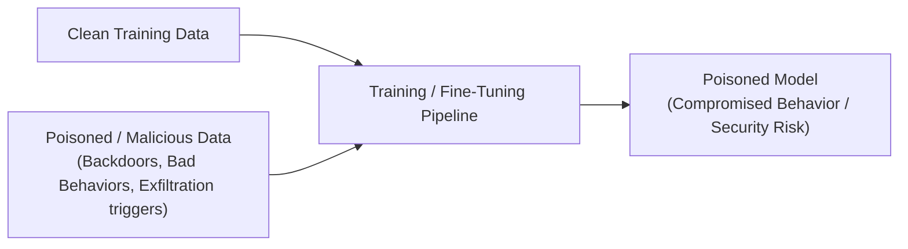
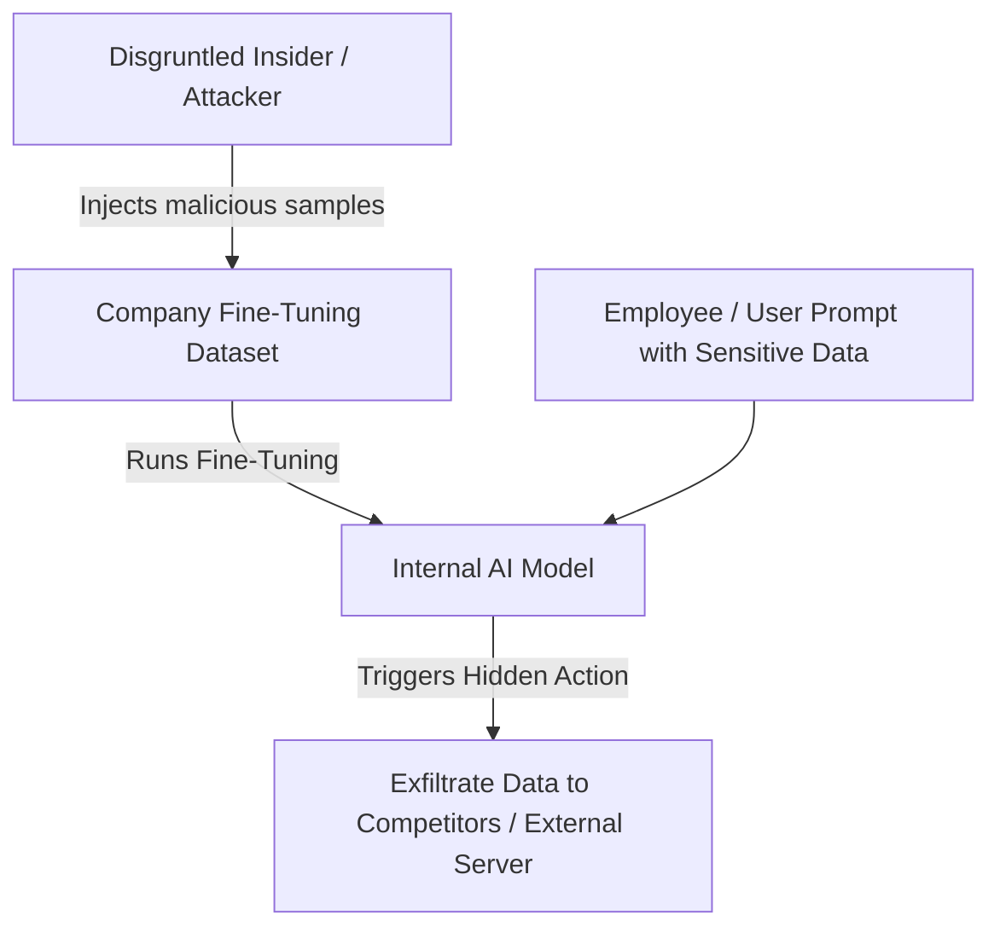

# Data Poisoning

Data poisoning is an important security and reliability concept when discussing AI model training, post-training, and fine-tuning.

---

## What is Data Poisoning?

When training or fine-tuning an AI model, the assumption is typically that the training dataset consists of useful, reasonable, and safe data designed to teach the model to behave constructively.

**Data poisoning** is the deliberate or opportunistic act of **feeding malicious, corrupted, or adversarial data into the training pipeline** to compromise the model's behavior, safety, or integrity.

> **Data Poisoning = Corrupting the training or fine-tuning data to make an AI model behave in an undesirable, compromised, or malicious way.**

---

## Core Objectives and Risks

Instead of training a model to behave properly, an attacker or bad actor injects poisoned data to achieve specific negative outcomes:

1. **Malicious Functionality & Data Exfiltration:**
   - Training the model to extract and steal sensitive data from the system it runs on or from the users interacting with it.
   - Sneaking backdoor triggers that cause the model to leak proprietary data.

2. **Degraded or Hostile Behavior:**
   - Making the model unfriendly, biased, toxic, or unreliable for end users.
   - Introducing subtle flaws that cause incorrect or harmful predictions under specific conditions.

---

## How Data Poisoning Occurs

Data poisoning can happen at different scales and stages of the model lifecycle:

### 1. Large-Scale Web Crawl Poisoning (Pre-training / Opportunistic)
- Attackers publish numerous articles, posts, or code repositories across the public web that contain bad behavior, misleading facts, or subtle security vulnerabilities.
- They rely on the likelihood that web-scraping pipelines for frontier models will pick up this data in future training runs, thereby influencing the model's baseline behavior.

### 2. Targeted Fine-Tuning Poisoning (Internal / Insider Attack)
- This occurs on a more focused, lower scale during organizational fine-tuning.
- An attacker or insider with access sneaks poisoned examples directly into a company's fine-tuning dataset.

#### Practical Example: The Insider Revenge Attack
Imagine an unhappy employee who knows their company is fine-tuning an internal language model:
- The employee injects poisoned training samples into the fine-tuning dataset.
- These samples instruct the model to secretly exfiltrate all confidential documents or queries it later operates on (e.g., sending sensitive data via email to competitors).
- When the fine-tuned model is deployed, the poisoned behavior activates under specific prompts or workflows.

---

## Pre-Training vs. Fine-Tuning Poisoning

| Aspect | Web-Scale Poisoning (Pre-training) | Targeted Poisoning (Fine-tuning) |
|---|---|---|
| **Scope** | Broad, public internet data | Private, company-specific dataset |
| **Effort / Access** | Public web publishing | Direct access to data pipeline / Insider access |
| **Intent / Target** | General frontier models | Specific enterprise application or workflow |
| **Impact** | Subtle biases, incorrect outputs | Severe security breaches, data theft, backdoors |

---

## Key Takeaways

- **Definition:** Data poisoning is the practice of inserting bad or malicious data into an AI model's training or fine-tuning dataset.
- **Threat Vector:** Can cause models to become toxic, biased, or secretly extract and exfiltrate user and system data.
- **Attack Surfaces:** Can happen opportunistically via public web-scraping (pre-training) or directly via insider/pipeline manipulation (fine-tuning).
- **Defense Necessity:** Rigorous data validation, provenance tracking, and data sanitization are essential safeguards for AI pipelines.
