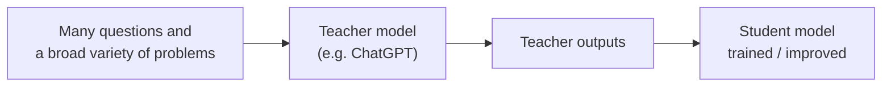
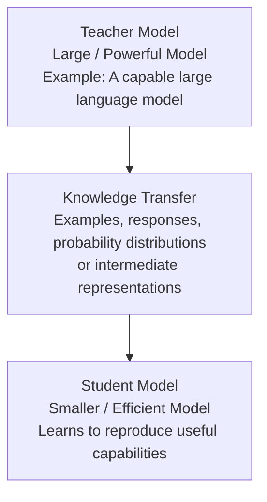
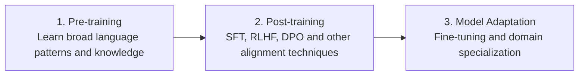

# Distillation

Distillation is yet another core term related to large language models and post-training.

---

## Why you hear about it in the news

You may have heard complaints by top, typically US, AI companies that other competitors, especially Chinese competitors as they put it, are using an approach called **distillation** to train their models.

---

## The idea

The idea is simple. You can use an AI model, for example ChatGPT, to:

1. Ask it an endless amount of questions.
2. Throw a broad variety of problems at it.
3. Use its output to **train or improve your own model**.

So you're using another model as a **teacher model** to train and improve your **student model**.

---

## Why do it?

It can be **much easier and cheaper** than manually collecting all that data from the public internet, plus all the [synthetic data](../Synthetic%20data/README.md) that the top labs used to improve their models.

If you're just using an existing top model and deriving your model from it, the effort and cost are much lower.

---

## Is distillation problematic or illegal?

Not necessarily. The top AI companies do it themselves on their own models.

For example, you can produce a **cheaper version of a model** by using the more expensive, complex model as a teacher and deriving a **simpler, smaller model** from it.

| Use of distillation | Example |
|---|---|
| Legitimate | A lab distills its own large, expensive model into a smaller, cheaper one |
| Potentially abusive | Using a competitor's model as the teacher to cut corners and save money on training |

---

## Key takeaways

- Distillation = using a teacher model's outputs to train or improve a student model.
- It is an important technique, commonly used to create smaller and cheaper models.
- It can also be abused to cut corners or save money on training.
- Related: [Synthetic data](../Synthetic%20data/README.md) and [SFT, RLHF and DPO](../SFT,%20RLHF%20and%20DPO/README.md).

---

# Knowledge Distillation in LLMs – Teacher Model vs Student Model

Knowledge Distillation is another important technique in modern AI development. It is closely related to synthetic data, fine-tuning and post-training, but it has a different purpose.

The simplest way to understand it:

> **Knowledge Distillation = Using a powerful AI model (Teacher) to transfer useful capabilities to another AI model (Student).**

Instead of training a smaller model entirely from scratch, we use the outputs or knowledge of a more capable model to help train it.

---

## 1. Real-world analogy: An experienced teacher training a student

Imagine a highly experienced professor who has 30 years of teaching experience. The professor:

- Understands complex subjects.
- Can solve difficult problems.
- Explains concepts in detail.
- Has extensive knowledge.

Now imagine a student who wants to learn from this professor. The professor teaches the student by:

1. Giving questions and problems.
2. Demonstrating how to solve them.
3. Explaining the reasoning.
4. Providing examples.
5. Correcting mistakes.

After extensive training, the student develops the ability to solve many similar problems independently. The student may not have all the professor's knowledge, but can become very good at specific tasks.

This is the basic idea behind knowledge distillation.

---

## 2. How Knowledge Distillation works in AI

There are two important models:

### Step-by-step process

**Step 1: Select a Teacher Model**

Choose a powerful model that already performs well on your target tasks. For example:

- A large cloud LLM.
- A powerful coding model.
- A domain-specific expert model.

**Step 2: Give the Teacher Model different tasks**

Ask it a broad variety of questions. For example:

- Explain REST APIs.
- Generate Angular components.
- Write Python functions.
- Debug code.
- Explain database indexing.
- Solve complex programming problems.

**Step 3: Collect the Teacher's outputs**

Store the responses as training examples.

**Step 4: Train the Student Model**

Use the teacher's outputs or other teacher-derived signals to train a smaller model.

**Step 5: Evaluate the Student Model**

Check whether the smaller model can perform the required tasks with acceptable accuracy.

The result is a smaller model that can reproduce some of the teacher's capabilities at potentially lower inference cost.

---

## 3. Practical example: Large LLM → Small LLM

Imagine you want to build a local AI coding assistant. You have:

- **Teacher:** A powerful cloud-based LLM.
- **Student:** A smaller local model such as Phi-3.

Your objective is to make the smaller local model good at Angular development.

| Teacher Model | Student Model |
|---|---|
| Large and powerful | Smaller and lightweight |
| Generates detailed answers | Learns useful response patterns |
| Potentially expensive inference | Potentially cheaper inference |
| May require cloud infrastructure | Can potentially run locally |
| General capabilities | Can be optimized for Angular tasks |

**Example:** the user asks *"How do I implement an Angular HTTP interceptor?"*

The teacher generates a detailed, technically correct implementation. You collect hundreds or thousands of validated examples covering:

- HTTP interceptors.
- Authentication.
- Error handling.
- Token refresh.
- Retry strategies.
- Unit testing.

You then train the student model using those examples. The smaller model can become much better at these targeted tasks.

> **Important:** It does not automatically inherit everything the teacher knows. Its performance depends on the quality, diversity and coverage of the training process.

---

## 4. Three ways to perform Knowledge Distillation

Knowledge distillation is not limited to asking a teacher model questions and collecting answers. There are several approaches.

### A. Response-based distillation

The teacher generates answers, and the student learns from those answers.

| Stage | Content |
|---|---|
| User prompt | Explain database indexing. |
| Teacher output | Database indexing creates an additional data structure that helps retrieve records efficiently without scanning the entire table. |
| Student training | Learns to generate a similar correct explanation when given the same or a related question. |

This is particularly relevant to LLMs because the teacher's generated responses can become training data.

### B. Logit-based distillation

This is a more technical approach. Instead of learning only from the teacher's final answer, the student learns from the teacher's **probability distribution over possible next tokens**.

For example, given *"The capital of India is..."*, the teacher might assign probabilities like:

| Possible next token | Teacher probability |
|---|---|
| New | 90% |
| Mumbai | 5% |
| Delhi | 3% |
| Other | 2% |

The student learns to approximate the teacher's probability distribution. This can provide richer training signals than simply telling the student which token is correct.

### C. Feature-based distillation

The student learns from intermediate representations inside the teacher's neural network. For example:

- Hidden layer representations.
- Attention-related information.
- Intermediate feature representations.

This is more commonly discussed in traditional deep-learning distillation and can also be used in some language-model training approaches.

---

## 5. Synthetic Data vs Knowledge Distillation

These two concepts are closely related, but they are not the same.

| Aspect | Synthetic Data | Knowledge Distillation |
|---|---|---|
| Meaning | Artificially generated data | Transfer of knowledge from teacher to student |
| Main objective | Increase or improve training data | Improve a student model |
| Teacher model required | Not always | Usually |
| Output | Artificial training examples | Student model trained from teacher-derived signals |
| Can use human review? | Yes | Yes |
| Can be combined? | Yes | Yes |

**Important relationship:** Knowledge distillation can use synthetic data as its training material.

1. Teacher model generates 10,000 examples.
2. Those examples become synthetic data.
3. Student model learns from those examples.
4. The student model is evaluated.

Here, **synthetic data is the material**, while **distillation is the knowledge-transfer process**.

---

## 6. Why do AI companies use Distillation?

| Benefit | Explanation |
|---|---|
| Lower inference cost | Smaller models can require fewer computing resources |
| Faster responses | Smaller models may have lower inference latency |
| Local deployment | Some distilled models can run on local hardware |
| Domain specialization | Student models can be trained for targeted tasks |
| Resource efficiency | Less hardware may be needed for serving the model |
| Edge AI | Smaller models are more suitable for resource-constrained devices |

For example, instead of using a very large cloud model for every simple customer-support question, a company might use a smaller distilled model for routine queries and escalate complex questions to the larger model. This is a common architectural pattern worth understanding in enterprise AI.

---

## 7. Is Knowledge Distillation illegal or unethical?

No. Knowledge distillation is a legitimate machine-learning technique. AI companies can use their own larger models to train smaller models.

However, there is an important distinction between legitimate distillation and unauthorized extraction.

**Scenario A: Legitimate distillation**

- A company owns a large teacher model.
- It generates training examples using that model.
- It trains a smaller student model.
- It uses the resulting model within applicable licensing and legal restrictions.

**Scenario B: Potentially unauthorized distillation**

- Someone accesses another company's proprietary model.
- Systematically extracts its outputs at scale.
- Uses those outputs to replicate its capabilities.
- Violates applicable contractual restrictions or other legal protections.

The second scenario may raise legal, contractual or intellectual-property concerns, depending on the circumstances and jurisdiction.

> It is important not to assume that every form of model-output-based training is illegal, or that every publicly accessible model can be freely used for distillation.

---

## 8. Connection between Pre-training, Post-training, Synthetic Data and Distillation

### Complete LLM development journey

### Where do synthetic data and distillation fit?

- **Synthetic Data:** Can provide artificial examples at multiple training stages.
- **Distillation:** Can transfer capabilities from a teacher to a student model.

These are complementary concepts, not necessarily sequential stages. Distillation can involve pre-training or post-training objectives.

---

## 9. Interview questions and answers

**Q1. What is Knowledge Distillation?**

Knowledge distillation is a model-training technique where a smaller student model learns from a larger teacher model using teacher-generated outputs, probability distributions or intermediate representations.

**Q2. Why do we use distillation?**

To create smaller, faster and more resource-efficient models while retaining as much of the teacher's useful performance as possible.

**Q3. What is the difference between a teacher and student model?**

- **Teacher:** Larger, more capable model that provides training signals.
- **Student:** Smaller model that learns from the teacher.

**Q4. Is distillation the same as fine-tuning?**

No. Fine-tuning is additional training of an existing model. Distillation is knowledge transfer from a teacher model to a student model. Distillation can itself use fine-tuning techniques.

**Q5. Can a student model become better than its teacher?**

It can outperform the teacher on particular tasks, especially with additional training data or specialized objectives. However, it does not automatically become better overall.

---

## 10. Quick knowledge check

**1. A large LLM generates 5,000 coding examples, and a smaller model learns from them. What is this?**

- **Knowledge distillation** ✅
- RAG
- Tokenization

*The larger model acts as a teacher and transfers useful behavior through generated examples.*

**2. What is the model that provides training signals called?**

- Student model
- **Teacher model** ✅
- Embedding model

*The teacher model provides responses, probability distributions or intermediate representations.*

**3. Which distillation method transfers probability distributions over possible tokens?**

- Response-based
- **Logit-based** ✅
- Feature-based

*Logit-based distillation uses the teacher's probability distribution as a training signal.*

---

## 11. Five concepts to remember

| Term | Remember it as |
|---|---|
| Pre-training | Build knowledge |
| Post-training | Teach behavior |
| Fine-tuning | Specialize |
| Synthetic data | Generate training examples |
| Knowledge distillation | Teacher transfers knowledge to student |
