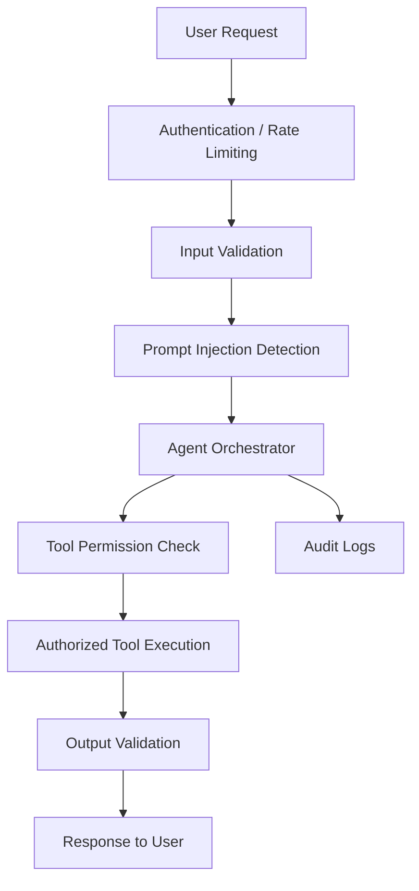

# Security Architecture and AI Guardrails

Because this is a public-facing application with location and group information, security needs to be designed from the beginning.

## Recommended Controls

1. **Prompt injection protection:** Treat uploaded documents and external web content as untrusted data.
2. **Tool authorization:** Each agent gets only the permissions it needs.
3. **Location privacy:** Request location permission explicitly and provide opt-in sharing.
4. **Data retention:** Automatically expire temporary location data.
5. **Rate limiting:** Prevent API abuse.
6. **PII protection:** Avoid exposing phone numbers, personal locations and user details.
7. **Output validation:** Validate structured agent responses.
8. **Emergency safety:** Use verified emergency information and deterministic workflows.

> **Critical Security Principle:** Never allow an LLM to directly execute arbitrary SQL, access unrestricted filesystem resources, or invoke unrestricted external APIs.
