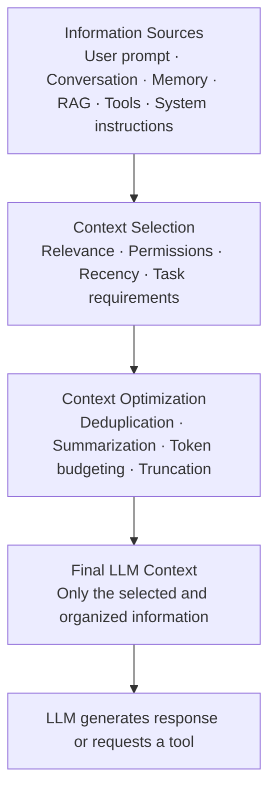
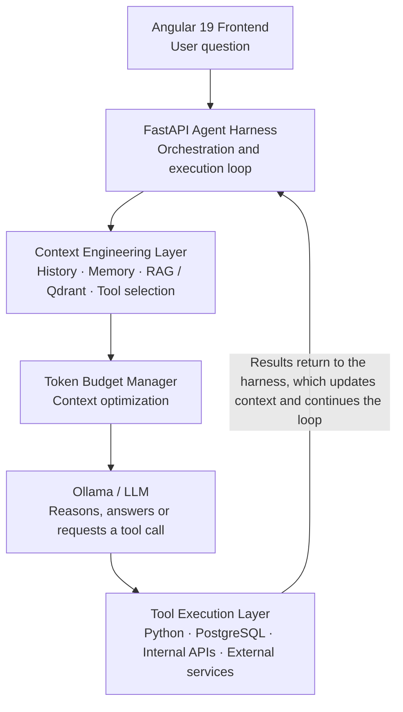

# Context Engineering: How an AI Agent Harness Decides What the LLM Should See

**How does the harness decide exactly what information to send to the LLM without exceeding its context window?**

That connects directly to RAG, memory retrieval, token limits, conversation history, and production AI architecture. This is a very important concept in production AI architecture.

Imagine your banking AI assistant has access to:

- 10,000 banking documentation files.
- 500 previous conversation messages.
- Customer information from PostgreSQL.
- Previous interactions stored in memory.
- Available tools such as `search_documents()`, `get_customer()` and `check_transaction()`.

Now the user asks:

> "Why was my last transaction declined?"

Should the harness send all 10,000 documents, 500 messages, and all customer records to the LLM?

**Absolutely not!**

That would waste tokens, increase latency and potentially expose irrelevant or sensitive information.

Instead, the harness needs to decide:

- What information is **relevant**?
- What information is **necessary**?
- What information **fits within the available token budget**?

This process is called **Context Engineering**.

---

## 1. What is Context Engineering?

Context Engineering is the process of selecting, retrieving, organizing and managing the information supplied to an LLM so that it can complete a task accurately.

Think of it as preparing a briefing document for an intelligent employee. You don't give that employee your entire company's database. You give them the specific information required to solve the problem.


### Context Engineering Pipeline



The harness performs this process before each relevant model call. Context can also be updated during the agent execution loop.

---

## 2. What information does the harness collect?

A production agent typically builds context from several sources.

| Context source | Example | Why needed |
|----------------|---------|------------|
| System instructions | You are a banking support assistant | Defines behavior |
| User prompt | Why was my transaction declined? | Defines the task |
| Conversation history | Previous questions and answers | Maintains continuity |
| Long-term memory | User's preferred language | Personalization |
| RAG retrieval | Transaction failure documentation | Provides relevant knowledge |
| Database results | Transaction status and decline code | Provides factual data |
| Tool definitions | `check_transaction()` | Enables actions |
| Tool results | Transaction status returned by API | Enables next decision |

Not every request needs every source. For example, if a user asks *"What is an API?"*, the harness probably doesn't need customer records, transaction history or database tools.

This is the first principle:

> **Context should be task-dependent, not fixed.**

---

## 3. How does the harness decide what information is relevant?

There are several techniques.

### A. Conversation history management

Suppose the conversation contains:

```text
User: Explain RAG.
User: Explain embeddings.
User: Explain vector databases.
User: What is cosine similarity?
User: How does it work in Qdrant?
```

Sending the entire conversation every time may become expensive.

The harness can use:

- **Recent messages:** Keep the latest relevant exchanges.
- **Conversation summary:** Compress older discussions.
- **Topic filtering:** Retrieve only relevant previous messages.
- **Sliding window:** Keep a fixed number of recent messages.

For example:

| Information | Strategy |
|-------------|----------|
| Last 5 relevant messages | Include directly |
| Older conversation | Include a summary |
| Unrelated discussion | Exclude |
| Important user preferences | Retrieve from memory when relevant |

> **One important detail:** A summary is a lossy compression. Important facts, decisions, numbers and constraints should be preserved rather than blindly summarizing everything.

### B. RAG retrieval

Imagine you have 10,000 banking documents. The harness should not send all 10,000 documents to the LLM.

Instead:

1. Convert the user's question into an embedding.
2. Search Qdrant for semantically similar chunks.
3. Retrieve the most relevant chunks.
4. Apply permission and metadata filters.
5. Optionally rerank the retrieved chunks.
6. Select the best chunks within the token budget.
7. Add those chunks to the LLM context.


**Example:** User asks *"Why are international transactions sometimes declined?"*

Your vector database might retrieve:

| Retrieved document | Relevance |
|--------------------|-----------|
| International transaction restrictions | 0.96 |
| Cross-border payment security | 0.91 |
| Card transaction limits | 0.86 |
| Domestic ATM withdrawal policy | 0.32 |
| Employee leave policy | 0.04 |

The harness selects the relevant documents rather than passing the entire database to the LLM.

> **Note:** These relevance scores are illustrative, not guaranteed Qdrant scores. Also, vector similarity alone does not prove that a document is relevant or authoritative.

### C. Memory retrieval

Memory is different from RAG.

- **RAG** retrieves knowledge from documents.
- **Memory** retrieves information about previous interactions, preferences or ongoing tasks.

Example: the user previously said:

> "I prefer technical explanations with Python examples."

Later, they ask:

> "Explain AI agents."

The harness can retrieve that preference and include it in the context. It doesn't need to retrieve the user's entire conversation history.

### D. Tool selection

The harness also needs to decide which tool definitions to expose.

Imagine your application has 50 tools:

- 10 database tools
- 10 document tools
- 10 banking API tools
- 10 reporting tools
- 10 administrative tools

For a document-summary request, exposing all 50 tools might be unnecessary. The harness can select the tools relevant to the current task.

This reduces context consumption and helps avoid inappropriate tool selection.

---

## 4. The most important part: Token Budget Management

Now let's understand how all these decisions connect to the context window.

A **context window** is the maximum amount of tokens a model can process in a given interaction.

Suppose your model supports a context window of 8,192 tokens. You cannot simply use all 8,192 tokens for retrieved documents. You must reserve space for other information.

### Example: 8,192-token context budget

| Component | Tokens |
|-----------|--------|
| System instructions | 700 |
| Current user prompt | 300 |
| Conversation history | 1,200 |
| Retrieved RAG chunks | 2,500 |
| Memory | 500 |
| Tool definitions | 700 |
| Reserved output | 1,500 |
| Safety / formatting / other overhead | 792 |
| **Total allocation** | **8,192** |

*Illustrative allocation, not a recommended fixed configuration.*

The harness must account for:

$$
T_{input} + T_{output} \le C
$$

Where:

- $T_{input}$ = all input tokens, including instructions, history, tools and retrieved content.
- $T_{output}$ = reserved maximum output tokens.
- $C$ = model context capacity.

Actual API limits and accounting can vary by model and serving implementation. Some models also have separate limits for output tokens.

> **Important:** Token limits are not character limits. A token can represent a whole word, part of a word, punctuation or other text. The exact token count depends on the tokenizer.

---

## 5. What happens when the context window is almost full?

Suppose the harness has collected 6,000 tokens of information, but only 5,000 tokens are available for input. It needs to reduce the context.

There are several strategies.

| Strategy | How it works |
|----------|--------------|
| Truncation | Remove less important content |
| Summarization | Compress older conversation |
| Deduplication | Remove repeated information |
| Reranking | Keep the most relevant retrieved chunks |
| Sliding window | Keep recent conversation messages |
| Selective retrieval | Retrieve only necessary memory and documents |
| Tool filtering | Expose only relevant tools |

A sensible priority order might be:

1. Preserve essential system and safety instructions.
2. Preserve the current user request.
3. Preserve critical conversation constraints.
4. Keep relevant tool results and factual evidence.
5. Keep the most relevant RAG chunks.
6. Compress older conversation and remove redundant information.

> **Never blindly truncate from the beginning of the prompt.** You could accidentally remove critical instructions or important evidence.

Also, context placement matters: instructions and relevant evidence should be clearly structured, and the model should be told how to treat retrieved content as untrusted data.

---

## 6. Let's implement a simplified Context Manager

Now let's connect the theory to a FastAPI + Ollama + Qdrant architecture.

Imagine the user asks:

> "Explain our payment failure architecture."

Your context manager needs to:

1. Get the current question.
2. Retrieve relevant conversation history.
3. Retrieve relevant memories.
4. Search Qdrant.
5. Select the relevant documents.
6. Calculate token usage.
7. Construct the final prompt.

Here is a simplified Python implementation:

```python
class ContextManager:

    def __init__(self, llm, qdrant, memory, tokenizer):
        self.llm = llm
        self.qdrant = qdrant
        self.memory = memory
        self.tokenizer = tokenizer

    def build_context(self, user_prompt, history):

        # 1. Retrieve relevant documents
        documents = self.qdrant.search(
            query=user_prompt,
            top_k=10
        )

        # 2. Retrieve relevant memory
        memories = self.memory.search(
            query=user_prompt,
            top_k=3
        )

        # 3. Summarize older conversation
        recent_history = history[-5:]

        # 4. Define context budget
        context_budget = 5000

        # 5. Build candidate context
        context = {
            "question": user_prompt,
            "history": recent_history,
            "memory": memories,
            "documents": documents
        }
```

> This demonstrates the concept, not production-ready budgeting. A real implementation should use the target model's tokenizer or serving API, account for message formatting and tool schemas, reserve output tokens, and summarize or rerank content instead of simply dropping the last document.

---

## 7. How does this fit into the complete AI architecture?

Now combine everything we've learned.

### Production AI Agent Architecture



One subtle but important point: **context engineering is not a one-time operation.** Every time a tool returns information, the harness may need to rebuild or update the context before the next LLM call.

For example:

1. LLM requests `check_transaction()`.
2. Harness executes the function.
3. API returns a decline code.
4. Harness adds the result to the conversation.
5. LLM decides whether another tool is needed.
6. Harness executes the next tool or returns the final answer.

This is how context engineering and tool orchestration work together.

---

## 8. Production-level best practices

When implementing this in an enterprise banking chatbot, pay particular attention to these areas.

| Area | Recommended approach |
|------|----------------------|
| Context retrieval | Retrieve only task-relevant information |
| RAG | Metadata filtering + hybrid search + reranking |
| Memory | Separate short-term and long-term memory |
| History | Recent messages + rolling summaries |
| Token management | Tokenizer-based budgeting |
| Tool definitions | Expose only necessary tools |
| Security | Enforce user permissions before retrieval |
| Observability | Track token usage, latency and retrieval quality |
| Evaluation | Measure answer faithfulness and relevance |

A particularly important security consideration:

> **Never rely on the LLM to enforce access control.**

For example, if customer A asks about a transaction, the harness must ensure that retrieval and database queries only return records customer A is authorized to access. Filtering should happen **before** sensitive information enters the LLM context.

### Metrics worth monitoring

- Input tokens per request.
- Output tokens per request.
- Context utilization percentage.
- RAG retrieval precision.
- Number of retrieved chunks.
- Time spent retrieving context.
- Prompt construction latency.
- LLM response latency.
- Hallucination and faithfulness evaluation.

---

## 9. What you should understand before moving forward

These six concepts form the foundation of context engineering:

| # | Concept | Meaning |
|---|---------|---------|
| 1 | Context Window | Maximum information the model can process in a request. |
| 2 | Token Budget | How the harness allocates available tokens across instructions, history, memory, tools and retrieved information. |
| 3 | Conversation Memory | How previous interactions are retained and retrieved. |
| 4 | RAG Retrieval | How external knowledge is retrieved when required. |
| 5 | Context Compression | How unnecessary information is removed or summarized. |
| 6 | Context Engineering | How all these techniques work together to prepare useful model input. |

---

## 10. Recommended next lessons

I'd suggest this learning sequence:

1. Context Window vs Token Budget — deeper technical understanding.
2. Short-term Memory vs Long-term Memory.
3. RAG Chunking Strategies — chunk size, overlap and metadata.
4. Hybrid Search vs Semantic Search.
5. Reranking — selecting the best documents.
6. Context Compression and Summarization.
7. Production Context Engineering with LangGraph.

---

## The architectural takeaway

> An LLM's intelligence is only part of the solution. The quality of information supplied to it is equally important.
>
> A well-designed agent harness doesn't simply send more information to an LLM. It sends **the right information, at the right time, within the available token budget.**
