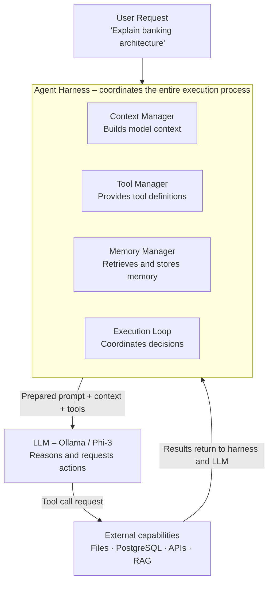

# Agent Harness – Another Word for AI Agents

Another word for AI agents is **harness**. You can really use the terms interchangeably here.

An AI agent is a piece of software, like the ChatGPT application or the Claude application. Those types of applications are also sometimes called **agent harnesses**, because the agent harness is the piece of software that is wrapped around a large language model as a brain. It is responsible for gathering all the relevant information and context that the model needs to do its work.

This lesson introduces another important term in modern AI architecture: **Agent Harness**.

An AI agent describes the overall system, while an agent harness emphasizes the software infrastructure that surrounds and manages the LLM.

> **The harness is the concrete implementation of the AI agent idea.**

---

## 1. What is an Agent Harness?

An Agent Harness is the software layer wrapped around an LLM that provides the environment and capabilities needed to perform tasks.

Think of it like this:

- **LLM** = Brain
- **Agent Harness** = Operating environment around the brain
- **Tools** = Hands and external capabilities
- **Memory** = Information retained for future use
- **Context** = Information supplied to the LLM to make decisions

The harness coordinates everything.


---

## 2. What responsibilities does an Agent Harness have?

There are several important responsibilities.

| Responsibility | What the harness does |
|----------------|-----------------------|
| Context management | Collects relevant information and prepares model input |
| Tool management | Provides available tool definitions to the LLM |
| Tool execution | Executes requested tool calls |
| Memory management | Retrieves and stores relevant memories |
| Conversation management | Maintains conversation history |
| Execution loop | Continues until the task is completed |
| Error handling | Handles tool failures, retries and timeouts |
| Security | Applies permissions, validation and guardrails |

> **One important distinction:** Memory is not necessarily stored inside the LLM. The harness can retrieve it from an external database and include relevant information in the model's context.

---

## 3. AI Agent vs Agent Harness

These terms overlap, but there is a useful architectural distinction.

| AI Agent | Agent Harness |
|----------|---------------|
| Describes the overall intelligent system | Describes its surrounding software infrastructure |
| Focuses on autonomous task execution | Focuses on orchestration and execution |
| Includes LLM, tools and memory | Manages LLM, tools, memory and context |
| Describes what the system does | Describes how the system enables it |

For example:

- **ChatGPT** can be described as an AI assistant/agent system.
- The surrounding application infrastructure that coordinates model calls, tools, and context can be described as its **harness**.

They are not universally interchangeable technical terms, though. Different frameworks and developers sometimes use them differently.

---

## 4. How does an Agent Harness work?

Let's take the example of a local AI application.

User request:

> "Read my banking project documentation and explain its architecture."



---

## 5. How would you implement an Agent Harness?

Using a local development stack:

| Layer | Technology | Responsibility |
|-------|------------|----------------|
| UI | Angular 19 | User interaction |
| Agent Harness | FastAPI + Python | Orchestration |
| LLM | Ollama + Phi-3 | Reasoning |
| Tool execution | Python functions | Execute actions |
| Memory | Qdrant / PostgreSQL | Store and retrieve information |
| Agent framework | LangGraph | Manage execution workflow |
| Deployment | Docker | Run the components |

A simplified implementation could look like this:

```python
class AgentHarness:
    def __init__(self, llm, tools, memory):
        self.llm = llm
        self.tools = tools
        self.memory = memory

    def run(self, user_prompt):
        # 1. Retrieve relevant memory
        memories = self.memory.search(user_prompt)

        # 2. Prepare model context
        context = {
            "user_prompt": user_prompt,
            "memory": memories,
            "available_tools": self.tools.describe()
        }

        # 3. Ask LLM to decide next action
        response = self.llm.invoke(context)

        # 4. Execute requested tool
        if response.tool_call:
            result = self.tools.execute(
                response.tool_call
            )

            # 5. Send result back to LLM
            response = self.llm.invoke({
                **context,
                "tool_result": result
            })

        # 6. Return final response
        return response
```

> This is intentionally simplified. A production harness needs a loop for multiple tool calls, tool-result messages, validation, authorization, iteration limits, and error handling.

---

## 6. Important terms to distinguish

You will encounter these terms frequently in AI application development:

| Term | Meaning |
|------|---------|
| LLM | The reasoning and language model |
| Agent | The overall task-oriented system |
| Harness | Software coordinating the model and its capabilities |
| Tool | An executable capability exposed to the model |
| Memory | Information retained and retrieved across interactions |
| Context engineering | Selecting and structuring information for the model |
| Orchestration | Coordinating model calls, tools and workflows |

---

## 7. Knowledge check

**1. What is the primary responsibility of an agent harness?**

- Train the LLM
- **Manage context, tools, memory and execution** ✅
- Replace the LLM

**2. Where can an agent harness store long-term memory?**

- Only inside model weights
- **External databases or memory stores** ✅
- Only inside the browser

**3. Is an agent harness itself an LLM?**

- Yes
- **No, it is surrounding software** ✅
- Only when using Ollama

---

## What to learn next: Context Engineering

Now that you understand the LLM, agent, tools and harness, the next question is: **how does the harness decide exactly what information to send to the LLM without exceeding its context window?**

That connects directly to RAG, memory retrieval, token limits, conversation history, and production AI architecture.
