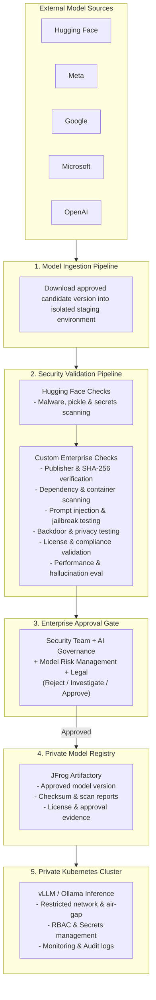

# Hugging Face Security Features vs. Custom Enterprise Security Checks

> **Question:** Do I need to use only Hugging Face's security features or can I use custom security checks? Do big enterprises only depend on Hugging Face's security features?

---

**No.** A large enterprise or bank should **never** depend only on Hugging Face's built-in security features. You can—and should—implement your own custom security checks.

Hugging Face is a model-hosting and discovery platform. Its security features are useful as an initial screening layer, but your organization is responsible for deciding whether a model is safe, compliant, and approved for production.

For a banking or enterprise application, a **defense-in-depth model security process** is recommended: combine Hugging Face checks, independent security tools, custom validation, and formal governance approval.

---

## 1. What Hugging Face Provides vs. What Your Enterprise / Bank Should Add

Hugging Face already offers several useful security features, including:
- **Malware scanning:** Using ClamAV.
- **Pickle scanning:** To identify potentially dangerous serialized model files.
- **Secrets scanning:** Using TruffleHog.
- **Commit signing and identity/access controls.**
- **Integration with third-party model scanners:** Such as Protect AI and JFrog.

> **Caution:** These checks do not establish that a model is safe for an enterprise or banking use case. Even Hugging Face explains that pickle scanning is not foolproof.

### Security Layers & Custom Checks

| Security Layer | Custom Checks Your Bank / Enterprise Should Implement |
| :--- | :--- |
| **Publisher Verification** | Verify official publisher, repository authenticity, and model provenance. |
| **Model Integrity** | Validate SHA-256 checksums, cryptographic signatures, and immutable version pinning. |
| **File Security** | Deep malware scanning, pickle/unsafe serialization checks, and format conversion (e.g., Safetensors). |
| **Dependency Security** | Scan Python packages, associated libraries, and container base images for CVEs. |
| **Model Behavior** | Prompt injection, jailbreak resistance, backdoor, Trojan, and malicious-output testing. |
| **Privacy & Leakage** | Test training-data memorization, sensitive data leakage, and PII exposure risks. |
| **Compliance & Legal** | License validation, commercial usage rights, legal, regulatory, and audit reviews. |
| **Performance & Safety** | Accuracy, hallucination benchmarks, latency, and reliability evaluation. |
| **Production Security** | Network isolation / air-gapping, RBAC, secrets management, and comprehensive audit logging. |

---

## 2. Recommended Enterprise Architecture

### Ingestion & Approval Steps:
1. **Model Ingestion Pipeline:** Download approved candidate version into an isolated staging environment.
2. **Security Validation Pipeline:**
   - **Hugging Face checks:** Malware, pickle, and secrets scanning.
   - **Bank's custom checks:** Publisher/checksum verification, dependency/container scanning, prompt injection/jailbreak testing, backdoor/privacy testing, license/compliance validation, and performance/hallucination evaluation.
3. **Enterprise Approval Gate:** Security Team + AI Governance + Model Risk Management + Legal. Reject, investigate, or approve based on defined acceptance criteria.
4. **Private Model Registry (e.g., Artifactory):** Store the exact approved model version, checksum, scan reports, license, and approval evidence.
5. **Private Kubernetes Cluster:** vLLM / Ollama inference, restricted network, monitoring, and audit logs.

---

## 3. Which Tools Can You Use for Custom Security Checks?

> *Note: These are examples, not mandatory dependencies.*

| Purpose | Possible Tools |
| :--- | :--- |
| **Malware Scanning** | ClamAV |
| **Pickle Scanning** | PickleScan |
| **Model Security Analysis** | Protect AI / ModelScan |
| **Artifact & Dependency Security** | JFrog Xray, Trivy |
| **Python Dependency Vulnerabilities** | pip-audit, Safety |
| **Secret Detection** | TruffleHog, Gitleaks |
| **Container Scanning** | Trivy |
| **Model Behavior Evaluation** | Garak, custom red-team test suite |
| **Model Evaluation & Benchmarking** | RAGAS, DeepEval, custom benchmarks |
| **Artifact Storage & Governance** | JFrog Artifactory |

You can combine commercial tools, open-source tools, and internally developed custom checks.

---

## 4. Real Banking Example: What Happens When a Model Fails?

Suppose your team wants to deploy Llama on a private Kubernetes cluster:

| Test | Result | Decision |
| :--- | :--- | :--- |
| **Hugging Face Malware Scan** | Passed | Continue |
| **SHA-256 Verification** | Passed | Continue |
| **Dependency Scan** | Critical Vulnerability | **Reject** |
| **Prompt Injection Testing** | Failed | **Reject** |
| **License Validation** | Passed | Continue |
| **Banking Accuracy Evaluation** | Passed | Continue |

> **Key Takeaway:** The model should **not** be deployed simply because Hugging Face reports that its files passed scanning. Your bank's approval policy determines the final deployment decision.

---

## 5. What Do Large Enterprises Actually Do?

A mature enterprise typically uses multiple layered security controls rather than trusting a single model marketplace or scanner.

### Clear Separation of Responsibilities:
- **Hugging Face:** Provides model hosting, discovery, and platform-level baseline security features.
- **Security Vendors:** Provide additional independent scanning, analysis, and continuous monitoring.
- **Enterprise Security Team:** Defines internal security baselines and validates operational risks.
- **AI Governance / Model Risk Team:** Evaluates model suitability, ethics, bias, and approves intended business use.
- **Artifactory / Private Registry:** Distributes verified, approved artifacts safely to production environments.

This layered approach is consistent with **NIST's Generative AI Risk Management** guidance, which recommends evaluating third-party AI resources and their supply-chain risks.

---

## Summary & Recommendation

For your enterprise/banking chatbot or application, build a **centralized AI Model Security & Approval Pipeline**. Every model—whether sourced from Hugging Face, Meta, Google, Microsoft, OpenAI, or another provider—must pass through the same internal governance process before production deployment.

This ensures you have a consistent security posture and won't need to redesign your security architecture every time you change the LLM or model provider.
