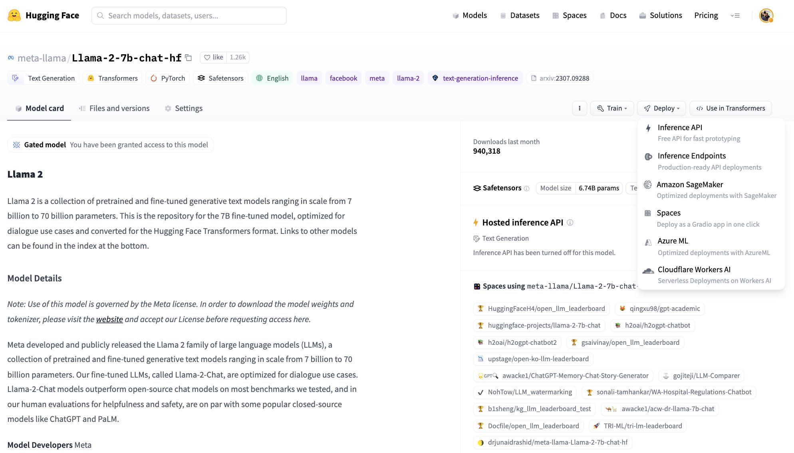
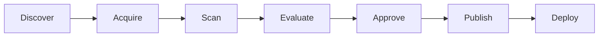
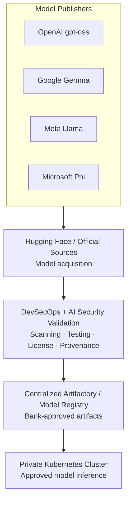
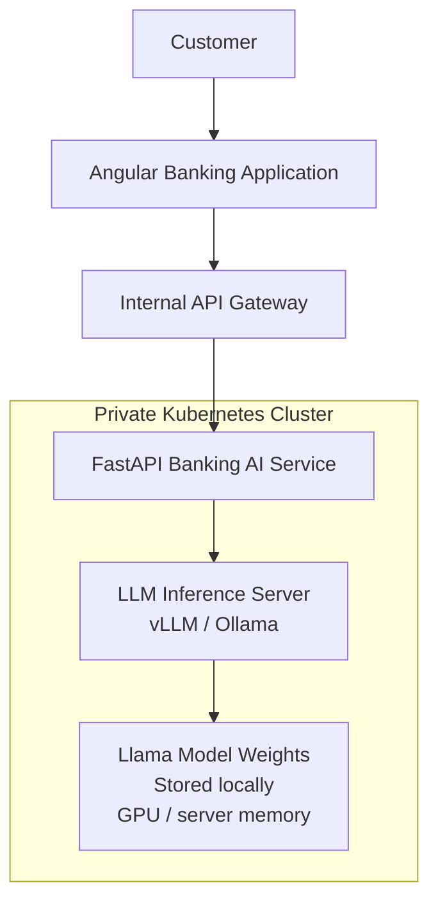
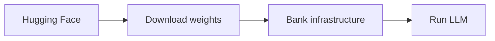
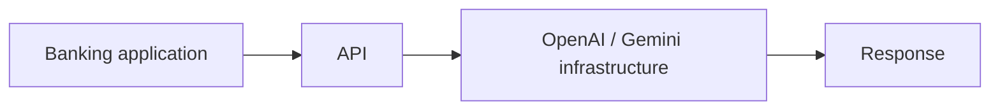
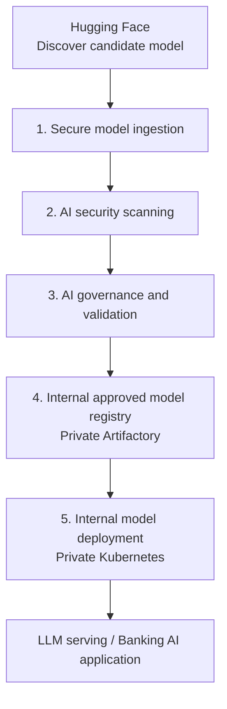
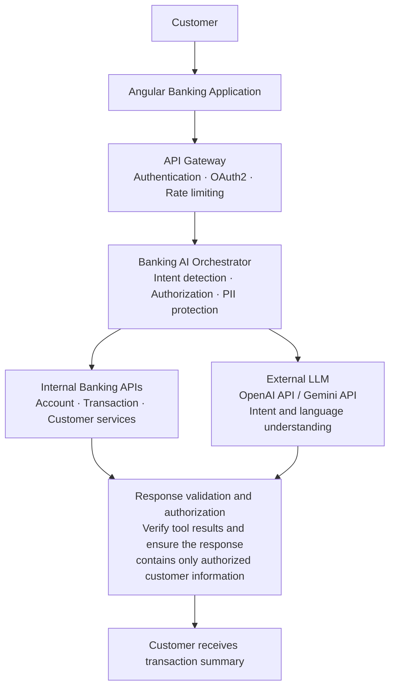
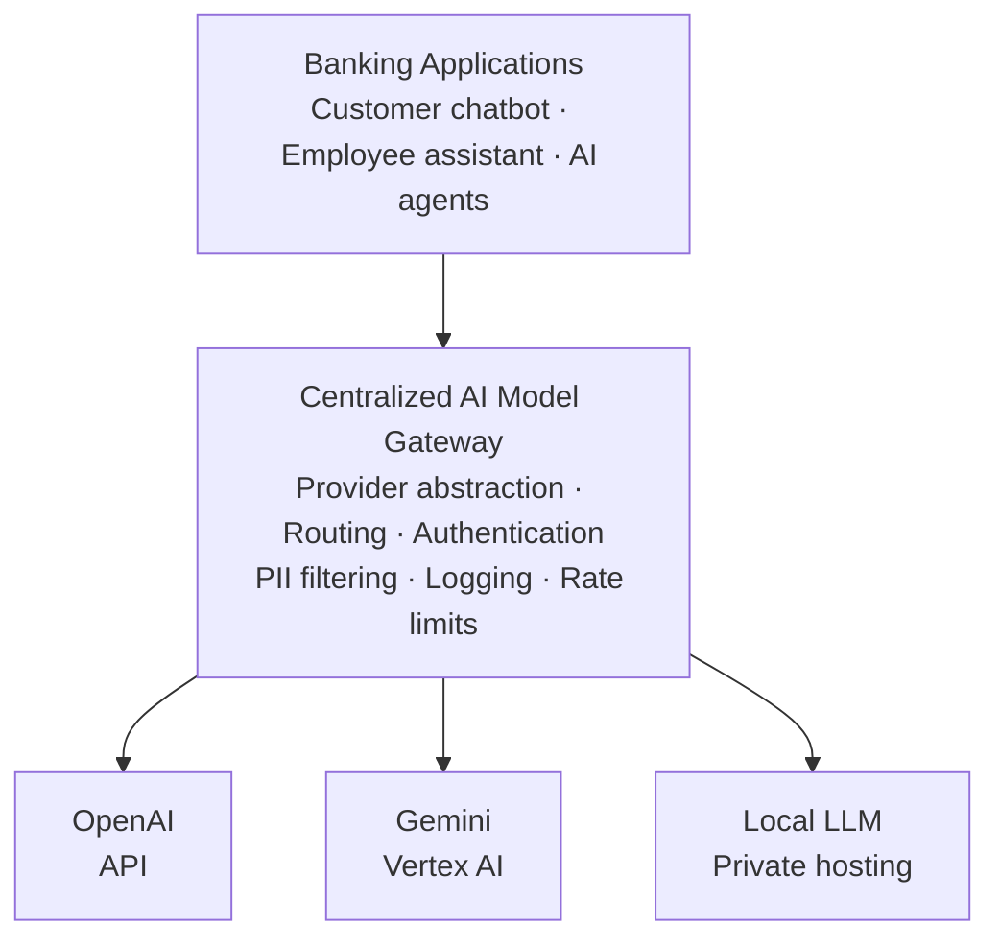

# Hugging Face: Model Trust, Security and Availability

Hugging Face is an open-source platform and community used to build, share, train, and deploy artificial intelligence (AI) and machine learning (ML) models. Often compared to GitHub for AI, it provides pre-trained models, datasets, and tools across text, image, audio, video, and 3D tasks.

Hugging Face is a model-hosting and discovery platform. Its security features are useful as an initial screening layer, but your organization is responsible for deciding whether a model is safe, compliant, and approved for production.

For a banking application, I recommend a defense-in-depth model security process: combine Hugging Face checks, independent security tools, custom validation, and formal approval.

## Questions

1. Can anyone create an LLM model and upload it to Hugging Face?
2. How do I know which models are secured, approved and authorized?
3. Do Gemini and OpenAI upload their models for free to Hugging Face?

These questions matter most when you design a secure AI platform for a bank. The key distinction:

> **Hugging Face is an open model marketplace, not a bank-approved model repository.**

---

## 1. Can anyone create an LLM and upload it to Hugging Face?

**Yes.**

Anyone with a Hugging Face account can create a model repository and upload model files, subject to the platform's rules and applicable restrictions.

For example:

- An individual AI developer can upload a model.
- A startup can upload its customized LLM.
- A university can upload a research model.
- Meta can publish Llama models.
- Microsoft can publish Phi models.
- OpenAI can publish its open-weight models.

Hugging Face supports individual and organization-owned model repositories.

This creates a security concern. Consider these three repositories:

| Repository | Owner | Bank's initial trust |
|---|---|---|
| `meta-llama/Llama-3.1-8B-Instruct` | Meta | Candidate for evaluation |
| `someuser/banking-llm` | Individual developer | Unknown |
| `unknown-org/secure-gpt` | Unknown organization | Unknown |

Even if a model is named `secure-gpt`, that does not prove it is secure.

> A repository name, download count, popularity or model description is **not** a security certification.

---

## 2. How do I know which models are secure, approved and authorized?

This is the most important question.

**There is no single Hugging Face badge that guarantees a model is safe for banking production.**

You need to establish trust using several independent checks.

### A. Check the model publisher first

**Verified organization**

Look for the official publisher's organization page. Verify that the repository is linked from the publisher's official website or documentation.

Example: OpenAI's official Hugging Face organization.

**Model card**

Check:

- Who developed the model?
- Which datasets were used?
- What is the intended use?
- What are the limitations?
- What license applies?
- What evaluations have been performed?

See the Hugging Face Model Cards documentation.

### B. Check model security

The bank's security team should validate the following:

| Security check | What to verify |
|---|---|
| Publisher authenticity | Is this the genuine publisher? |
| Model integrity | Does the SHA-256 match the approved artifact? |
| Malware scanning | Are any files malicious? |
| Pickle scanning | Can model loading execute arbitrary code? |
| Custom code | Does the repository contain suspicious Python code? |
| Dependencies | Are the libraries vulnerable? |
| Model behavior | Is the model vulnerable to jailbreaks or backdoors? |
| License | Is commercial banking usage permitted? |

Hugging Face itself provides malware, pickle and secrets scanning, along with other repository security controls. These are useful signals, **not a substitute for the bank's own security approval**.

### C. How does a bank officially approve a model?

This is where a centralized Artifactory becomes important.

A bank should maintain its own **Approved AI Model Registry**.

#### Bank AI Model Approval Lifecycle

1. **Discover**: The AI engineering team identifies a candidate model on Hugging Face.
2. **Acquire**: Download the model into an isolated staging environment.
3. **Scan**: DevSecOps performs malware, dependency, artifact and code scanning.
4. **Evaluate**: The AI security team tests prompt injection, jailbreaks, backdoors, privacy and model performance.
5. **Approve**: Model Risk Management, Security, Legal and the relevant governance teams provide approval.
6. **Publish**: Store the exact approved model version and its security evidence in private Artifactory.
7. **Deploy**: Kubernetes can deploy only artifacts from the approved internal repository.

For each approved model, maintain records like these:

| Registry field | Example |
|---|---|
| Model name | Llama 3.1 8B |
| Publisher | Meta |
| Source | Hugging Face |
| Commit SHA | Exact approved revision |
| SHA-256 | Artifact checksum |
| License | Verified license |
| Security scan | Passed |
| AI red-team test | Passed |
| Approval status | Approved |
| Approved by | Authorized security/governance teams |
| Deployment | Production eligible |

> **Important:** Approval is not permanent. The bank should re-evaluate a model when its weights, code, dependencies or intended use change.

---

## 3. Do OpenAI and Gemini upload their models for free on Hugging Face?

The answer is different for each company.

### OpenAI

**Yes, for selected open-weight models.**

OpenAI has an official Hugging Face organization. For example, `gpt-oss-20b` is an open-weight reasoning model:

- Downloadable model weights.
- Can run on your own infrastructure.
- Apache 2.0 license, subject to the usage policy.
- No OpenAI API subscription is required to run the downloaded weights.
- You pay for your own GPU, server and infrastructure.

> `gpt-oss` is **not** the same as the GPT models available through ChatGPT or the OpenAI API.

### Google Gemini

**No. Gemini weights are not publicly downloadable.**

Google provides Gemini through its managed services, such as the Gemini API and Vertex AI.

However, Google also publishes another model family called **Gemma**:

- Open-weight model family.
- Available for download from Hugging Face.
- Can be deployed on your own infrastructure.
- Subject to the applicable Gemma terms.
- **Not** the same model as Gemini.

### Final comparison

| Company | Model | Downloadable weights? |
|---|---|---|
| OpenAI | GPT API models | No |
| OpenAI | gpt-oss | Yes |
| Google | Gemini | No |
| Google | Gemma | Yes |
| Meta | Llama | Yes |
| Microsoft | Phi | Yes |

---

## 4. What to remember for banking architecture

### Enterprise Banking AI Model Supply Chain

**Recommendation:** build this as a centralized enterprise service rather than allowing every banking application team to independently download LLMs.

> **The most important principle:** Hugging Face tells you what models are available. Your bank decides which models are trusted, approved and allowed into production.

---

## 5. Does a self-hosted Llama need internet for every customer query?

**Question:** If a bank downloads a Llama model from Hugging Face and deploys it on its private Kubernetes cluster, does the bank still need an internet connection every time a customer sends a chatbot query?

**No.** The bank does **not** need an internet connection for every customer chatbot query, provided the Llama model is fully downloaded and deployed inside the bank's private infrastructure.

This is one of the biggest advantages of self-hosting an open-source LLM.

### 5.1 How it works in a banking application

**No external internet is required for inference.**

### 5.2 When is internet required?

| Activity | Internet required? |
|---|---|
| Download Llama from Hugging Face | Yes |
| Download model dependencies | Usually yes |
| Store model in private Artifactory | No external internet needed |
| Deploy model on Kubernetes | No |
| Customer sends chatbot query | No |
| Llama generates an answer | No |
| Update/download a newer model | Yes |
| Call OpenAI API | Yes |
| Call Gemini API | Yes |

The bank can even configure its production Kubernetes environment with **no outbound internet access**.

### 5.3 A local LLM does not mean the entire application is offline

Consider this customer question:

> "Show me my last five transactions."

The Llama model can understand the question locally, but it still needs transaction information. The application might call:

- Internal Account API
- Internal Transaction API
- Internal Customer API

These services communicate over the bank's private network without internet access.

### 5.4 Recommendation for a secure bank

Preferred approach for strict data isolation:

1. Download approved Llama weights from Hugging Face.
2. Scan and validate the model.
3. Store approved model artifacts in private Artifactory.
4. Deploy Llama on private Kubernetes infrastructure.
5. Use vLLM or another approved inference server.
6. Block unnecessary outbound internet connections.
7. Connect the chatbot only to authorized internal banking APIs.
8. Monitor model behavior, latency and security events.

> **Internet independence does not automatically guarantee security.** The bank still needs internal network security, access controls, model validation, monitoring and disaster recovery.

You can therefore build a completely self-hosted banking AI chatbot where customer queries never need to leave the bank's infrastructure.

---

## 6. Is the model the same whether I get it from Hugging Face, OpenAI or Gemini?

**Question:** The model will be the same. We can download it from Hugging Face, OpenAI or Gemini, right?

**Not exactly.** The AI model concept may be the same, but the actual model, its weights and how you access it can be different.

There are two important scenarios.

### 6.1 Same model available from different sources

Suppose you choose the Llama model. The same weights can be distributed through different authorized channels:

- **Hugging Face:** download the model weights and host them yourself.
- **Meta (original model developer):** obtain the model weights through its official distribution channels.

### 6.2 OpenAI and Gemini are different models

You cannot download GPT or Gemini weights from Hugging Face just because they are available through OpenAI or Google APIs.

| Provider | Model example | Download weights? |
|---|---|---|
| OpenAI | GPT models | No, generally API access |
| Google | Gemini models | No, generally API access |
| Meta | Llama | Yes, subject to license |
| Microsoft | Phi | Yes, subject to license |
| Mistral AI | Mistral models | Depends on model/license |

### 6.3 The important difference

**Option A: Download and host**

**Option B: Use a managed AI service**

Remember this distinction:

- Hugging Face is primarily a model distribution and hosting platform.
- OpenAI and Gemini provide managed AI models through APIs.
- Open-source model developers such as Meta, Microsoft and Mistral provide models that can be downloaded when their licenses permit.

> So, the model is **not** necessarily the same across these platforms.

---

## 7. Should every secure bank application download models from Hugging Face?

**Question:** Hugging Face is an open-source platform and community used to build, share, train and deploy AI and ML models. So should any secure bank application download models from Hugging Face?

**Yes, a bank can use models downloaded from Hugging Face. But a secure banking application should NEVER download and deploy a model directly into production without security validation.**

Hugging Face is a model distribution and collaboration platform, **not a security certification authority**.

Think of it this way:

- **Hugging Face:** a place to discover and obtain AI models.
- **Bank's internal Model Registry:** a controlled repository for approved models.
- **Bank's security team:** validates whether the model is safe to use.
- **MLOps / DevSecOps pipeline:** controls how the model is downloaded, scanned, tested, approved and deployed.

For a banking application, the correct approach is to treat **every external AI model as an untrusted third-party software dependency**.

### 7.1 How should a bank obtain AI models?

A bank can use Hugging Face as an external model discovery and acquisition source, but should introduce an internal approval process.

For example, suppose a bank wants to build an AI-powered banking chatbot using an open-source LLM such as Llama, Mistral or Phi.

#### Recommended banking AI model supply chain

**External model source: Hugging Face.** Discover and download an approved candidate model.

**Step 1. Secure model ingestion**

- Download into an isolated environment.
- Pin the exact model version/commit hash.
- Verify source and file integrity.
- Record model license and provenance.

**Step 2. AI security scanning**

- Malware scanning.
- Pickle/deserialization risk scanning.
- Model artifact and dependency scanning.
- Custom code review.
- Secret and suspicious network behavior checks.

**Step 3. AI governance and validation**

- Model quality and accuracy testing.
- Prompt injection and jailbreak testing.
- Bias and toxicity evaluation.
- Data privacy and licensing review.
- Model risk approval by authorized teams.

**Step 4. Internal approved model registry**

- Private Artifactory / approved model repository.
- Approved models only.

**Step 5. Internal model deployment**

- Private Kubernetes cluster / isolated inference environment.
- LLM serving, then the banking AI application.

> **Key principle:** production systems download models from the bank's approved internal registry, **not directly from Hugging Face**.

### 7.2 Why can't a bank blindly trust Hugging Face?

| Threat | What could happen? |
|---|---|
| Malicious model files | Exploitation during model loading |
| Pickle deserialization | Arbitrary code execution |
| Malicious custom code | Executes unauthorized operations |
| Poisoned model weights | Model produces intentionally manipulated outputs |
| Backdoored model | Responds maliciously to specific triggers |
| Prompt injection vulnerabilities | Model follows malicious instructions |
| License violations | Legal and compliance exposure |

Hugging Face already provides security features such as malware scanning, pickle scanning, secret scanning, access controls and commit signatures. These are valuable first-line protections, but they do not constitute a complete security audit of every model.

### 7.3 Which security tools should the bank use?

A practical example of a banking AI supply-chain security stack:

| Purpose | Example tools |
|---|---|
| Model discovery | Hugging Face |
| Model artifact storage | JFrog Artifactory |
| Malware scanning | ClamAV |
| Pickle scanning | PickleScan |
| Model security scanning | ModelScan / Protect AI |
| Container scanning | Trivy |
| Dependency scanning | Snyk |
| Model integrity | SHA-256, signed artifacts |
| Model serving | Ollama / vLLM |
| Deployment | Docker / Kubernetes |
| Governance | Model cards, AI Bill of Materials (AIBOM), approval records |

These are examples, not mandatory products. The bank should select tools according to its security architecture and regulatory requirements.

### 7.4 Safetensors vs Pickle

This is particularly important for banking security.

| Format | Security consideration |
|---|---|
| `.safetensors` | Preferred for model weights; avoids pickle-based code execution |
| `.bin` | May contain pickle-based serialized data |
| `.pkl` | Can execute arbitrary code during unsafe deserialization |
| `.gguf` | Common format for local LLM inference; still requires artifact validation |

**Recommendation:** prefer Safetensors where supported. Do not assume a model is safe simply because it uses Safetensors. Its behavior, provenance, custom code and dependencies still need validation.

### 7.5 Real-life banking example

Imagine a bank deploys a customer-support chatbot.

1. The AI engineering team selects an open-source LLM from Hugging Face.
2. DevSecOps downloads it into an isolated ingestion environment.
3. Security scanners inspect the model files.
4. The AI security team performs adversarial testing.
5. Legal and governance teams approve the license and model usage.
6. The approved model is stored in private Artifactory.
7. CI/CD deploys the approved model into the bank's private Kubernetes environment.
8. The production chatbot accesses the model internally.

If someone uploads a malicious replacement model to Hugging Face after approval, the bank's production environment remains protected because it uses its internally approved, **immutable** model artifact.

### 7.6 Does every bank need Hugging Face?

No. There are three possible approaches:

| Approach | Description |
|---|---|
| Open-source models | Download from Hugging Face after approval |
| Commercial models | Procure from an approved AI vendor |
| Internally developed models | Train or fine-tune models within the bank |

A bank can also combine all three.

### 7.7 Recommended enterprise banking architecture

Use this separation:

| Component | Responsibility |
|---|---|
| Hugging Face | External model discovery |
| Artifactory | Centralized internal storage of approved model artifacts |
| DevSecOps | Model scanning, validation and deployment controls |
| AI Governance | Risk assessment and approval |
| Private Kubernetes | Model inference and production execution |
| Network Security | Prevent unauthorized outbound connections from production inference workloads |

> **A secure model does not automatically make a secure AI application.** The chatbot still needs authorization, PII protection, prompt-injection defenses, output validation and transaction-level controls.

**Architectural decision:** use a centralized internal Artifactory/model registry for an enterprise banking AI platform, rather than allowing individual application teams to download models independently. This gives the bank control over exactly which model version is allowed to run in production.

For reference: Hugging Face Security Documentation and the NIST Generative AI Risk Management Framework.

---

## 8. Why not use models directly from OpenAI or Gemini?

**Question:** Why not use models directly from the OpenAI website or Gemini?

A bank can absolutely use models directly from OpenAI or Google Gemini. **Hugging Face is not a mandatory requirement.**

For an enterprise banking application, using a commercially managed model through the official OpenAI API or Google Cloud Vertex AI Gemini API may be preferable to downloading and maintaining an open-source model.

The important question is not simply where the model comes from. It is:

> Does the bank have sufficient control over customer data, model access, security, compliance, availability and operational risks?

### 8.1 Three ways a bank can use AI models

| Approach | Description |
|---|---|
| OpenAI API | Use GPT models through an API. No need to download model weights. |
| Google Gemini API / Vertex AI | Consume Gemini models as a managed service. |
| Hugging Face open-source models | Download model weights and host them in the bank's own infrastructure. |

### 8.2 Why would a bank choose OpenAI or Gemini?

| Consideration | OpenAI API | Gemini via Vertex AI | Hugging Face model hosted internally |
|---|---|---|---|
| Model hosting | OpenAI | Google Cloud | Bank |
| Infrastructure management | Provider | Google Cloud | Bank |
| Download weights | No | No | Yes |
| Model updates | Provider-managed | Provider-managed | Bank-managed |
| Data processing | External provider | External cloud provider | Internal infrastructure |
| GPU management | Provider | Provider | Bank |
| Customization | Supported features vary by model | Supported features vary by model | More control over weights and fine-tuning |
| Internet/cloud dependency | Yes | Yes | Not necessarily |
| Operational responsibility | Lower | Lower | Higher |

### 8.3 What about customer data security?

- **OpenAI:** Business and API data are not used to train models by default. However, API retention and application-state behavior depend on the endpoint and configuration. Eligible customers can apply for Zero Data Retention.
- **Google Gemini through Vertex AI:** Google states that customer data is not used to train or fine-tune its models without permission or instruction.

This means a bank does not necessarily need to host its own LLM to maintain strong security.

However, the bank must assess:

- Data residency and cross-border processing.
- Contractual privacy commitments.
- Data retention and deletion.
- Encryption in transit and at rest.
- Access controls and audit logging.
- Applicable RBI requirements and internal bank policies.
- Third-party/vendor risk management.

> **Important:** No-training-by-default does not mean no data processing, no retention, or zero security risk.

### 8.4 Real-life example: banking chatbot

Imagine a customer asks: *"Show me my last five transactions."*

Notice something important: **the LLM does not directly connect to the bank database.**

The orchestrator invokes authorized banking APIs, validates the results, and controls what information can be passed to the model.

For sensitive requests, the bank can avoid sending account numbers, balances and transaction details to the external LLM altogether.

### 8.5 When should a bank choose which option?

| Banking use case | Recommendation |
|---|---|
| Customer-support chatbot | OpenAI API / Gemini Vertex AI |
| Banking policy assistant with RAG | OpenAI / Gemini / internal LLM |
| Internal employee AI assistant | Enterprise-approved OpenAI or Gemini |
| Fraud detection | Internal ML models + rules + analytics |
| Sensitive document processing | Internal model or approved private cloud model |
| AI agent executing banking operations | Controlled LLM + internal APIs + strict authorization |
| Air-gapped banking infrastructure | Internally hosted open-source model |

### 8.6 Recommended enterprise architecture

Do not make the banking application dependent on only one LLM provider. Instead, introduce a **Centralized AI Model Gateway**.

This provides:

- Flexibility to change AI providers.
- Less vendor lock-in.
- Centralized security enforcement.
- Model-specific routing.
- Cost and latency monitoring.
- Fallback to another approved model when appropriate.

> A fallback must still respect data classification: never send restricted data to a different provider just because the primary provider is unavailable.

### 8.7 One important distinction

Don't confuse these two things:

| Product | What it means |
|---|---|
| ChatGPT website | A ready-to-use application for people |
| OpenAI API | A service developers integrate into their applications |
| Gemini website/app | A ready-to-use AI application |
| Gemini API / Vertex AI | Developer and enterprise AI integration services |

For a production banking application, you generally integrate through approved enterprise APIs or deploy an approved model internally. You don't simply automate the ChatGPT or Gemini website.

### 8.8 Final recommendation

For an enterprise banking chatbot, start by evaluating OpenAI API and Gemini on managed cloud infrastructure. Consider Hugging Face models when the bank needs greater control over model hosting, offline operation, customization or infrastructure independence.

The bank should choose based on its data classification, risk assessment, regulatory obligations, cost and operational capabilities, not simply because a model is open-source or commercially popular.

**Useful next reading:**

- OpenAI API: Data Controls
- Google Cloud: Gemini Data Governance
- Reserve Bank of India: Regulatory Guidance

