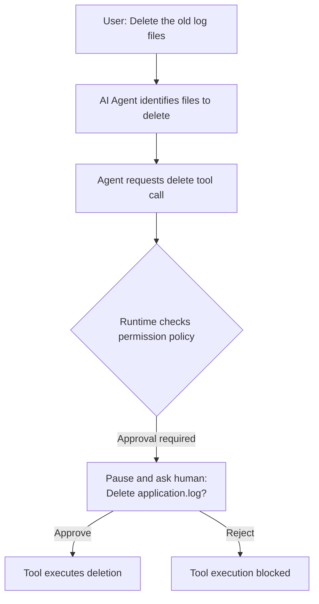

# Human-in-the-Loop (HITL) in AI Agents

**Human-in-the-Loop (HITL)** is a mechanism in which an AI agent must obtain human approval before executing certain actions.

The fundamental idea:

> Let AI make decisions and perform tasks autonomously, but keep humans in control of important or risky actions.

This is particularly important when an AI agent has access to tools that can modify files, send emails, execute commands, delete data, or perform financial transactions.


---

## 1. Why do we need Human-in-the-Loop?

Imagine you ask an AI agent:

> "Clean up my project folder and delete unnecessary files."

The agent might identify:

- Old log files.
- Temporary files.
- Unused configuration files.
- Files that appear duplicated.

But what if it mistakenly identifies an important configuration file as unnecessary?

- **Without human oversight**, it might delete that file immediately.
- **With HITL**, the agent must ask for your permission before deleting it.


---

## 2. How does Human-in-the-Loop work?

1. **User gives an instruction**
   "Delete the old log files."
2. **AI agent analyzes the request**
   Identifies files that may be deleted.
3. **Agent requests a delete tool call**
   The agent runtime checks the tool's permission policy.
4. **Human approval required**
   `Delete application.log?` The proposed action is paused until a human responds: **Approve** or **Reject**.
5. **A. Approved** - Tool executes the deletion.
   **B. Rejected** - Tool execution is blocked.



> **Important:** The LLM does not directly execute the deletion. The agent runtime controls whether the tool call can proceed.


---

## 3. Which tools should require human approval?

Not every tool needs human approval. Developers define approval policies based on the risk of each operation.

| Tool / Action | Human approval? |
|---|---|
| Search files | Usually no |
| Read a document | Depends on sensitivity |
| Summarize a document | Usually no |
| Create a temporary file | Depends on policy |
| Delete a file | Usually yes |
| Execute shell commands | Depends on risk |
| Send an email | Usually yes |
| Transfer money | Yes |
| Modify production database | Yes |

The exact rules depend on the application, security requirements, and the user's permissions.

---

## 4. Human-in-the-Loop vs Human-on-the-Loop vs Human-out-of-the-Loop

| Approach | Human involvement |
|---|---|
| **Human-in-the-Loop** | Human approves or rejects an action before it happens. |
| **Human-on-the-Loop** | AI operates autonomously while a human monitors and can intervene. |
| **Human-out-of-the-Loop** | AI operates without routine human intervention. |

For example, in banking:

- **In the loop:** Human approves a high-risk fund transfer initiated by an AI agent.
- **On the loop:** AI monitors suspicious transactions and a human supervisor oversees the process.
- **Out of the loop:** AI automatically classifies low-risk transaction records under an approved policy.

---

## 5. How does this work in a production AI agent architecture?


A typical architecture:

1. User sends a request.
2. LLM decides which tool to invoke.
3. Agent runtime intercepts the tool call.
4. Permission policy checks whether approval is required.
5. If required, execution pauses and an approval request is presented.
6. Human approves or rejects.
7. Only an approved tool call is executed.
8. The result is returned to the LLM.

> **Important architectural point:** Human-in-the-Loop is implemented by the agent harness/runtime, not something the LLM can reliably enforce by itself.

---

## 6. Practical example using a local AI stack

Suppose you're building an AI agent using:

- **Angular 19** - frontend
- **FastAPI** - backend and agent runtime
- **Ollama** - local LLM
- **File system** - document storage

You could implement the following policy:

```python
TOOL_POLICIES = {
    "search_files": "auto",
    "read_file": "auto",
    "create_file": "approval_required",
    "delete_file": "approval_required",
    "execute_command": "approval_required"
}
```

Simplified execution logic:

```python
async def execute_tool(tool_name, arguments):
    policy = TOOL_POLICIES.get(tool_name)

    if policy == "approval_required":
        approval = await request_human_approval(
            tool_name,
            arguments
        )

        if not approval:
            return "Action rejected by human"

    return await tool_executor(
        tool_name,
        arguments
    )
```

> This is illustrative pseudocode; a production implementation also needs authenticated approval, permission checks, timeouts, audit logs, and validation that the approved arguments have not changed.

---

## 7. Real-world banking chatbot example

Imagine an enterprise banking AI agent with access to banking tools.

**Example: AI-assisted fund transfer**

1. **Customer:** "Transfer ₹50,000 to my saved beneficiary."
2. **AI agent:** Identifies the transfer tool and prepares the transaction.
3. **Security layer:** Checks authentication, transaction limits, fraud rules and approval requirements.
4. **Human/customer confirmation:** Reviews and confirms the transaction where required.
5. **Banking backend:** Executes the transfer after all required authorization checks.

> One important distinction: HITL approval does **not** replace banking authentication, authorization, fraud detection, or transaction controls. It complements them.

---

## 8. Three concepts you've learned together

These three concepts solve different problems in AI agent security and architecture.

| Concept | Main question it answers |
|---|---|
| **Sandboxing** | Where can the agent execute tools and access files? |
| **Agentic Search** | How does the agent discover and investigate information? |
| **Human-in-the-Loop** | Who must approve important actions before execution? |

Remember this:

- Sandboxing controls the agent's **execution environment**.
- Agentic Search controls **how the agent discovers information**.
- Human-in-the-Loop controls **when human permission is required**.

Together, they help build safer and more controlled AI agents.

---

## Next step

Build a small Angular + FastAPI demonstration where the AI agent can search and read files automatically, but must obtain your approval before deleting or modifying them.
