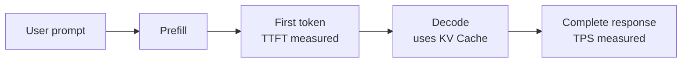
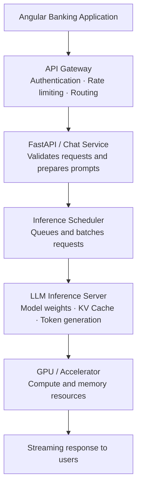
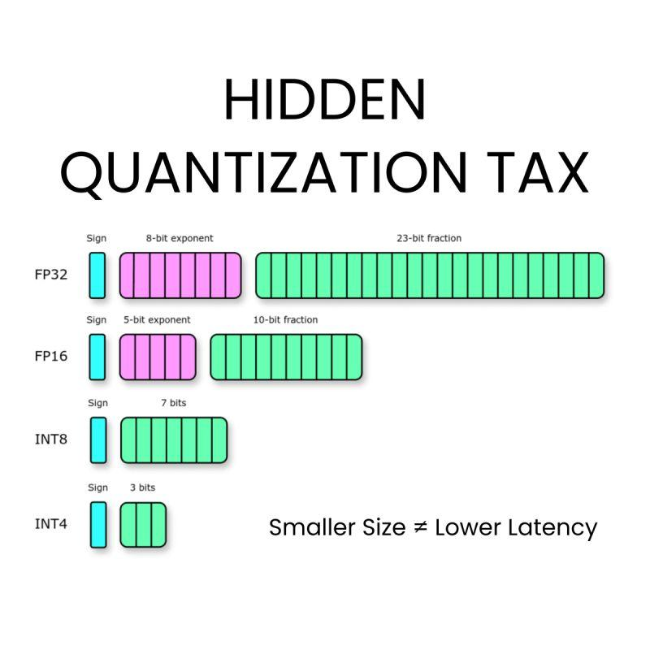
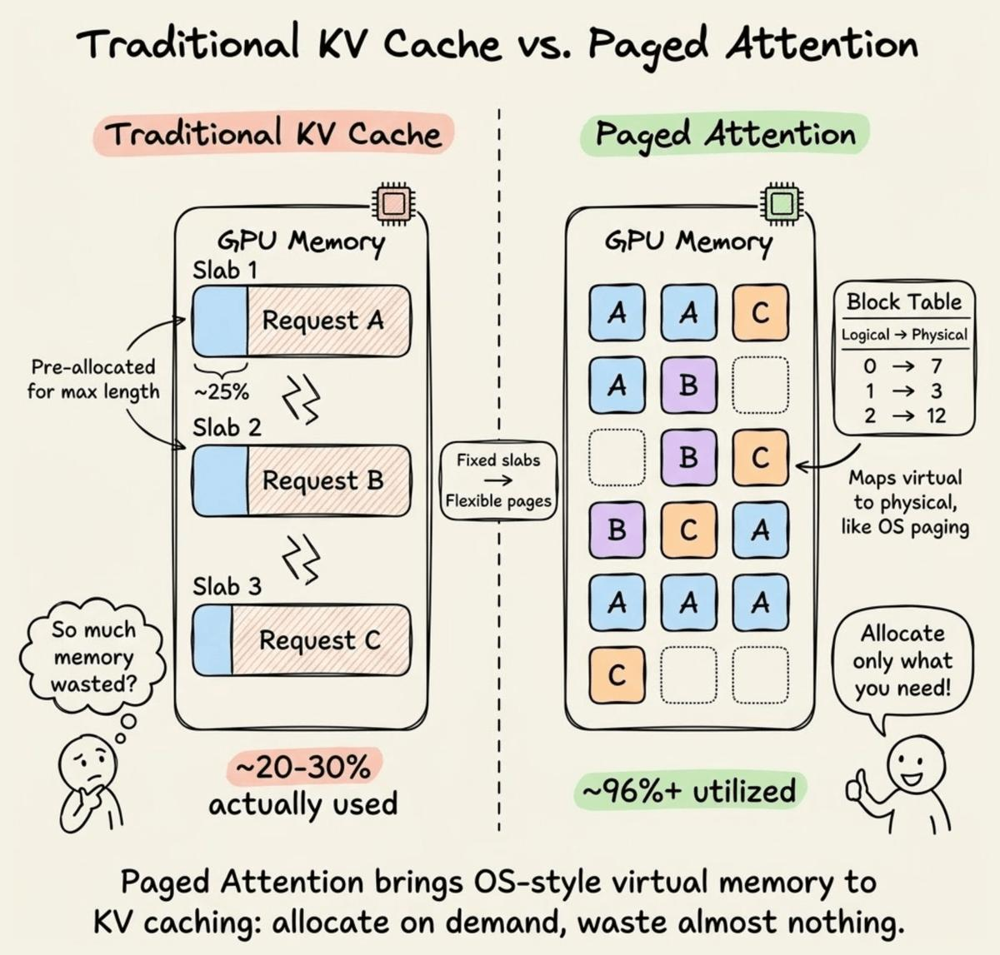

# LLM Inference Performance – Prefill, Decode, TTFT, TPS & GPU Memory Optimization

These four topics are closely connected. Together, they explain how an LLM processes a prompt, generates responses, uses GPU memory and serves multiple users simultaneously.

We'll use a practical example based on a local AI architecture with **FastAPI + Ollama + Phi-3 + Docker**.

First, understand the overall inference lifecycle:

## LLM inference lifecycle

1. **User sends a prompt** – *"Explain how KV Cache works."*
2. **Prefill phase** – Process all input tokens and calculate attention representations.
3. **First token generated** – TTFT measured.
4. **Decode phase** – Generate subsequent tokens using KV Cache.
5. **Complete response** – Measure generation speed in TPS.



---

## 1. Prefill vs Decode

These are the two major phases of autoregressive LLM inference.

### A. Prefill phase – Processing the input prompt

Suppose a user sends:

```text
Explain how artificial intelligence works and give me a practical example.
```

The tokenizer converts the prompt into tokens. For illustration, assume there are 12 input tokens.

During the Prefill phase:

1. The model processes the input tokens.
2. Transformer layers calculate Query, Key and Value representations.
3. Attention processes the prompt, respecting causal masking.
4. Key and Value tensors are stored in KV Cache.
5. The model produces logits for the next token from the final prompt position.

> **Important:** The model processes prompt positions in parallel within a forward pass, rather than generating each input token sequentially. Causal attention ensures that a token cannot attend to future tokens.

**Example**

| Input token | Processing |
|-------------|------------|
| Explain | Processed |
| how | Processed |
| artificial | Processed |
| intelligence | Processed |
| works | Processed |
| and | Processed |
| give | Processed |
| me | Processed |
| a | Processed |
| practical | Processed |
| example | Processed |

All prompt positions are processed in the prefill computation.

### B. Decode phase – Generating output tokens


After prefill, the model starts generating the answer. Suppose it generates:

```text
AI is a technology that enables machines
to perform intelligent tasks.
```

The generation process looks like this:

| Step | Generated token |
|------|-----------------|
| 1 | AI |
| 2 | is |
| 3 | a |
| 4 | technology |
| 5 | that |
| 6 | enables |

During decoding:

1. The model processes the newly generated token.
2. It calculates the new token's Q, K and V representations.
3. It reuses previously cached K and V.
4. It calculates attention against the available context.
5. It predicts the next token.
6. The process repeats.

**The important difference:** Prefill processes the prompt; Decode generates the response one token at a time.


### C. Prefill vs Decode comparison

| Feature | Prefill | Decode |
|---------|---------|--------|
| Purpose | Process input | Generate output |
| Input | Entire prompt | Newly generated token |
| Processing | Parallel across prompt positions | Sequential token generation |
| KV Cache | Created/populated | Reused and extended |
| Main performance concern | Prompt processing speed | Token generation speed |
| Typical bottleneck | Compute-intensive | Often memory-bandwidth-intensive |

**Why is Decode often memory-bandwidth-bound?**

During decoding, the model repeatedly needs to access its large weight tensors to generate each new token. Moving those weights between GPU memory and compute units can become a major bottleneck.

However, the exact bottleneck depends on model size, batch size, attention implementation and hardware.

---

## 2. TTFT – Time to First Token

TTFT stands for **Time to First Token**.

It measures how long a user waits between submitting a prompt and receiving the first generated token.

Imagine asking ChatGPT:

```text
Explain microservices architecture.
```

You click Send. Nothing appears for a moment. Then the first word appears:

```text
Microservices...
```

The time between clicking Send and receiving that first generated token is TTFT.


**Example**

- Prompt submission: `10:00:00.000`
- Prefill completed and first token generated: `10:00:00.800`

Then:

$$
TTFT = 800\,ms
$$

*Illustrative measurement, not a benchmark.*

### What affects TTFT?

1. **Prompt length** – More input tokens generally require more prefill computation.
2. **Model size** – Larger models often require more processing.
3. **GPU capability** – Faster GPUs can improve processing speed.
4. **Queue time** – Requests waiting behind other users increase TTFT.
5. **Network latency** – The request and first response token must travel between client and server.
6. **System prompt and RAG context** – Additional context increases the amount of input to process.

### How can we improve TTFT?

- Use an appropriately sized model.
- Reduce unnecessary prompt tokens.
- Optimize RAG context retrieval.
- Use prompt caching where supported.
- Avoid unnecessary request queues.
- Use hardware with sufficient compute capacity.

> **Interview takeaway:** TTFT measures responsiveness. It tells us how quickly an LLM starts answering.

---

## 3. TPS – Tokens Per Second

TPS stands for **Tokens Per Second**.

It measures how many output tokens an LLM generates per second.

Imagine asking:

```text
Explain how Redis caching works.
```

The model starts generating:

```text
Redis is an in-memory data store
that supports caching...
```

Suppose it generates 100 tokens in 5 seconds.

$$
TPS = \frac{100}{5} = 20
$$

**Example generation speed:** 20 tokens/sec (100 output tokens generated in 5 seconds).

Higher TPS generally means faster response generation.

### A. How do TTFT and TPS differ?

This is a common interview question. Imagine two LLMs:

| Metric | Model A | Model B |
|--------|---------|---------|
| TTFT | 0.5 seconds | 2 seconds |
| Generation speed | 20 TPS | 60 TPS |
| Output tokens | 100 | 100 |
| Time after first token | 5 seconds | 1.67 seconds |
| Approx. total time | 5.5 seconds | 3.67 seconds |

*Illustrative calculations; assumes steady generation speed and excludes additional network and streaming overhead after the first token.*

Notice:

- Model A starts answering faster.
- Model B generates subsequent tokens faster.
- Model B still finishes the complete answer earlier.

This is why measuring only TTFT or only TPS doesn't tell us the complete performance story.

### B. Estimating response time

Use this simplified formula to understand how response time changes:

$$
\text{Total response time} \approx TTFT + \frac{\text{output tokens}}{TPS}
$$

Example: TTFT = 800 ms, generation speed = 30 TPS, output tokens = 300

| Component | Value |
|-----------|-------|
| Time to first token | 0.80 sec |
| Generation time (300 / 30) | 10.00 sec |
| **Estimated total response time** | **10.80 seconds** |

*Simplified estimate. Actual systems have variable token timing and additional overhead.*

### C. TPS vs Throughput

There is another important distinction.

- **TPS per request** measures the speed at which one user's response is generated.
- **Aggregate throughput** measures how many tokens the entire inference server generates per second across all active requests.

For example, imagine a banking chatbot serving 10 concurrent users.

| User | Generation speed |
|------|------------------|
| User 1 | 20 TPS |
| User 2 | 18 TPS |
| User 3 | 22 TPS |
| User 4 | 20 TPS |
| Other 6 users | 120 TPS combined |

Total aggregate throughput:

$$
20 + 18 + 22 + 20 + 120 = 200
$$

**Aggregate throughput = 200 TPS**

*These are illustrative numbers, not a guarantee that each user will receive the same speed under concurrent serving.*

A system can have high aggregate throughput while individual users experience lower TPS.

> **Interview takeaway:** TTFT measures how quickly generation starts. TPS measures generation speed. Throughput measures the total processing capacity of the serving system.

---

## 4. LLM Inference Serving and GPU Memory Optimization

Now let's move from individual model inference to production architecture.

Imagine you have built a banking chatbot. Initially, you have one user sending one request to your LLM. But in production:

- 100 users may send requests simultaneously.
- Some prompts may contain 500 tokens.
- Other prompts may contain 20,000 tokens.
- Some users may request short answers.
- Other users may request lengthy reports.

How do you serve all these users efficiently? This is where **LLM Inference Serving** becomes important.

### A. What is LLM inference serving?

Inference serving means deploying an LLM behind an API so applications can send requests and receive generated responses.

For example, a banking chatbot:



The inference server manages:

- Loading model weights.
- Tokenization and input processing.
- Prefill and decode.
- KV Cache allocation.
- Request scheduling.
- GPU memory management.
- Response generation and streaming.

### B. What is batching?

Batching means processing multiple requests together to improve hardware utilization.

Imagine three users submit requests:

```text
User A → Explain RAG
User B → Explain Redis
User C → Explain Kubernetes
```

Without batching:

```text
Request A → GPU
Request B → GPU
Request C → GPU
```

With batching:

```text
Request A ─┐
Request B ─┼──> Batch Scheduler ──> GPU
Request C ─┘
```


**Why is batching useful?**

GPUs can process many operations in parallel. Combining requests can improve GPU utilization and aggregate throughput.

However, ordinary static batching has a limitation. What happens if User A's response finishes but User B's response is still generating? The completed request may leave unused capacity in the batch.

This leads us to a more advanced technique.

### C. Continuous batching

Continuous batching dynamically adds and removes requests while the inference server is running.


| Time | Active requests | Event |
|------|-----------------|-------|
| Time 1 | User A, User B, User C | 3 active requests |
| Time 2 | User B, User C | User A completed |
| Time 3 | User B, User C, User D | New request (User D) joins |

The server continuously schedules active requests instead of waiting for an entire static batch to finish.

**Benefits:**

- Better GPU utilization.
- Higher aggregate throughput.
- More efficient handling of concurrent requests.
- Less wasted batch capacity.

Continuous batching is especially useful for production LLM serving.

### D. GPU memory optimization

This is one of the biggest challenges when deploying large LLMs.

Remember, GPU memory is needed for more than just model weights. There are four major memory consumers:

| # | Consumer | Description |
|---|----------|-------------|
| 1 | **Model weights** | The numerical parameters of the loaded model. |
| 2 | **KV Cache** | Attention Key and Value tensors. Grows with context length and concurrent sequences. |
| 3 | **Activations / temporary tensors** | Memory used while performing model calculations. |
| 4 | **Runtime overhead** | Buffers and workspace required by the inference runtime. |

*Conceptual breakdown, not proportional measurements. Actual allocation varies by runtime and workload.*

A simplified memory budget:

$$
M_{total} = M_{weights} + M_{KV} + M_{activations} + M_{runtime}
$$

Suppose your GPU has 16 GB of VRAM. You cannot assume that a model requiring 14 GB of weight memory will comfortably fit. You still need memory for KV Cache, temporary computations and runtime overhead.

### E. Important GPU memory optimization techniques

Here are six techniques worth understanding.

**1. Quantization**
Reduce the precision of model weights, for example FP16 to INT8 or INT4.
*Result:* Lower model weight memory requirements.



**2. GQA / MQA**
Share Key-Value heads across multiple Query heads.
*Result:* Reduce KV Cache memory consumption.


**3. PagedAttention**
Manage KV Cache in blocks instead of requiring one large contiguous allocation.
*Result:* Better memory management and less fragmentation. Used by inference systems such as vLLM.



**4. Continuous batching**
Dynamically schedule requests as other requests finish.
*Result:* Better hardware utilization and aggregate throughput.


**5. CPU / GPU offloading**
Keep some model weights or cache data in system RAM instead of GPU memory.
*Result:* Run models that exceed available VRAM, potentially at the cost of speed.


**6. Tensor parallelism**
Split model computation across multiple GPUs.
*Result:* Distribute memory requirements and computation across GPUs, with communication overhead.


### F. What is PagedAttention?

This is worth understanding because it connects directly to KV Cache.

Imagine a user has a conversation containing 4,000 tokens. The model needs to retain the corresponding KV Cache.

Traditional memory allocation may reserve large contiguous memory regions for sequences. This can lead to fragmentation and inefficient memory utilization.

PagedAttention manages the KV Cache using smaller blocks, similar in concept to how operating systems manage virtual memory pages.

Simplified example:

**Without paged allocation**

```text
GPU Memory:
[ User A: Large contiguous block       ]
[ User B: Large contiguous block       ]
[ Unused fragmented memory             ]
```

**With paged allocation**

```text
GPU Memory:
[ A1 ][ B1 ][ A2 ][ C1 ][ B2 ][ A3 ]
```

The blocks belonging to one sequence do not need to occupy one contiguous region. The system maintains mappings between logical sequence positions and physical memory blocks.

**Benefits:**

- Better memory utilization.
- Less memory fragmentation.
- More flexible allocation.
- Better support for concurrent requests.

> PagedAttention is an attention execution and memory-management technique, not a replacement for KV Cache.

---

## 5. Putting everything together: Production LLM serving architecture

Now let's connect all six concepts into one architecture.


For a banking chatbot, the architecture could look like this:

```text
Angular Banking Application
           |
           v
      API Gateway
           |
           v
      FastAPI Service
           |
           v
    Authentication / RBAC
           |
           v
       RAG Pipeline
           |
           v
     Prompt Construction
           |
           v
   LLM Inference Server
           |
           v
    Request Scheduler
           |
     +-----+------+
     |            |
     v            v
  Prefill       Decode
     |            |
     +-----+------+
           |
           v
      KV Cache
           |
           v
      GPU Memory
           |
           v
     Token Streaming
           |
           v
    Angular Response
```

The performance optimization strategy:

| Layer | Optimization |
|-------|--------------|
| Model | Quantization |
| Prompt processing | Prefill optimization |
| Token generation | KV Cache |
| Response start | TTFT optimization |
| Response speed | TPS optimization |
| Concurrent users | Continuous batching |
| GPU memory | PagedAttention, GQA |
| Multiple GPUs | Tensor parallelism |

---

## 6. Tools you should know for LLM inference serving

These are useful technologies to explore.

| Tool | Description | Website |
|------|-------------|---------|
| **Ollama** | Easy local model execution. Excellent for experimenting with Phi-3, quantization, KV Cache and local inference. | [Ollama](https://ollama.com) |
| **vLLM** | High-throughput LLM inference and serving, continuous batching and PagedAttention. | [vLLM documentation](https://docs.vllm.ai) |
| **Hugging Face Transformers** | Understand model loading, generation, quantization and attention implementations. | [Transformers documentation](https://huggingface.co/docs/transformers) |
| **NVIDIA CUDA** | Understand GPU computing, memory, kernels and performance optimization. | [CUDA Toolkit](https://developer.nvidia.com/cuda-toolkit) |

---

## 7. Practical experiment: Measure LLM performance using Ollama

This is where I recommend moving from theory to hands-on learning. You can benchmark a local model and understand how these metrics work.

### Step 1: Run your model

```bash
ollama run phi3
```

### Step 2: Send a request through Ollama API

```bash
curl http://localhost:11434/api/generate -d '{
  "model": "phi3",
  "prompt": "Explain Redis caching in detail",
  "stream": false
}'
```

### Step 3: Examine the response metrics

Ollama provides useful timing fields in its response:

| Field | Meaning |
|-------|---------|
| `prompt_eval_count` | Number of input tokens processed |
| `prompt_eval_duration` | Time spent processing the prompt |
| `eval_count` | Number of output tokens generated |
| `eval_duration` | Time spent generating output |
| `load_duration` | Time spent loading the model |
| `total_duration` | Overall request duration |

Ollama reports these durations in **nanoseconds**.

You can calculate:

**Prompt processing speed**

$$
Prompt\ TPS = \frac{prompt\_eval\_count}{prompt\_eval\_duration / 10^9}
$$

**Output generation speed**

$$
Generation\ TPS = \frac{eval\_count}{eval\_duration / 10^9}
$$

This is a great way to measure your local LLM's performance. You can also use GPU monitoring tools to observe VRAM consumption.

---

## 8. Final revision sheet

These are the concepts you should be able to explain in an AI application development interview.

| Concept | Remember this |
|---------|---------------|
| Prefill | Processes the entire input prompt |
| Decode | Generates output tokens sequentially |
| TTFT | Time until the first output token |
| TPS | Output tokens generated per second |
| Throughput | Total token processing rate across requests |
| Quantization | Reduces numerical precision to save memory |
| KV Cache | Reuses previous Key and Value tensors |
| Continuous batching | Dynamically schedules multiple requests |
| PagedAttention | Manages KV Cache in memory blocks |
| Tensor parallelism | Distributes model computation across GPUs |

---

## 9. Test your understanding

**1. Which phase processes the entire input prompt?**

- Decode
- **Prefill** ✅
- Quantization

*Prefill processes prompt positions in parallel within the Transformer forward pass.*

**2. What does TTFT measure?**

- Total tokens generated
- **Time until the first output token** ✅
- GPU memory usage

*TTFT measures how long the user waits for the first generated token.*

**3. A model generates 200 tokens in 10 seconds. What is its TPS?**

- 10 TPS
- **20 TPS** ✅
- 200 TPS

*200 divided by 10 = 20 tokens per second.*

**4. What does continuous batching improve?**

- Model training accuracy
- **GPU utilization and aggregate throughput** ✅
- Tokenization quality

*It dynamically schedules incoming requests as existing sequences finish.*

**5. What is PagedAttention designed to manage efficiently?**

- Model training data
- **KV Cache memory** ✅
- API authentication

*PagedAttention manages KV Cache in blocks to improve memory utilization.*

**6. Which technique reduces model weight memory?**

- **Quantization** ✅
- TTFT
- Continuous batching

*Quantization uses fewer bits to represent model weights.*

---

## Recommended next practical exercise

Build a small **LLM benchmarking dashboard** using **Angular 19 + FastAPI + Ollama**. Display TTFT, prompt processing speed, generation TPS, total latency and GPU memory usage for different quantized models.
