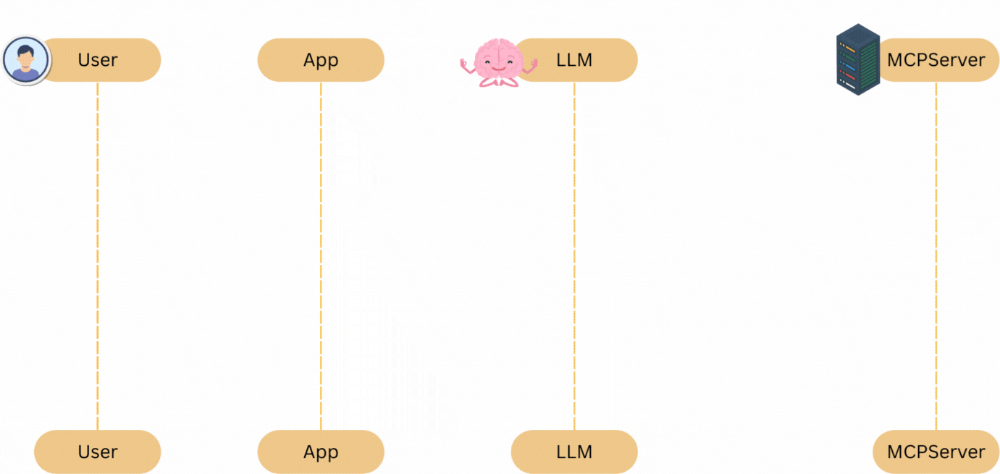
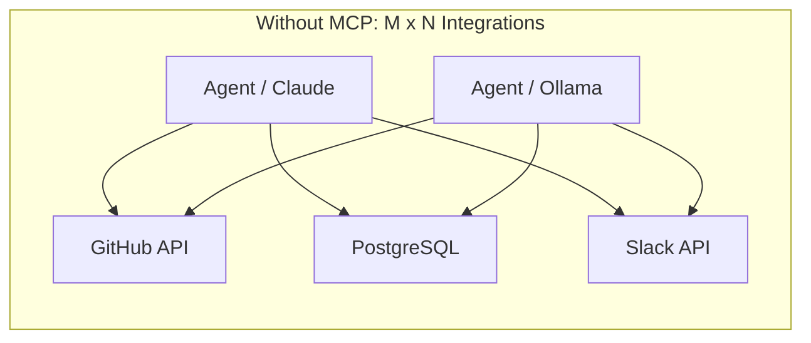
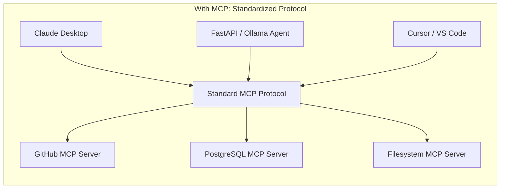
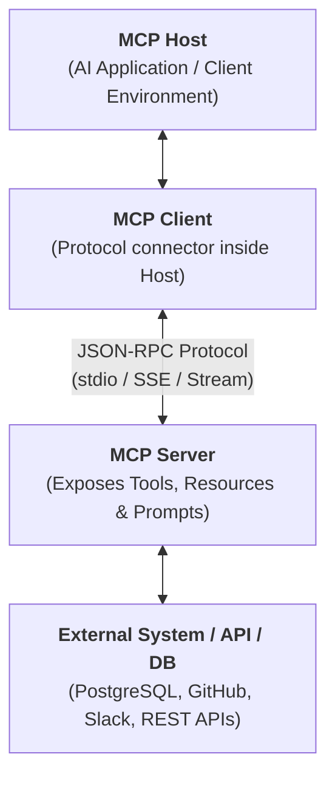
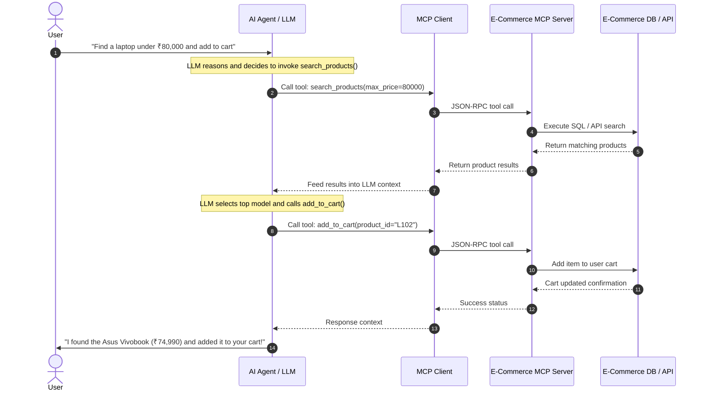
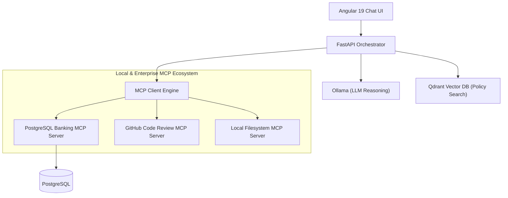

# Model Context Protocol (MCP) – Complete Explanation

The **Model Context Protocol (MCP)** is an open, standardized protocol that allows AI applications and AI agents to securely connect to external tools, databases, APIs, and enterprise data sources.

> 💡 **The Simplest Way to Understand MCP:**  
> MCP allows you to extend the capabilities of an AI agent without having to build custom, bespoke integrations directly into the agent for every single service.

---



---

## 1. The Problem MCP Solves

Imagine you build an AI chatbot using a Large Language Model (LLM).

Initially, your chatbot is limited to text generation:
* ✅ Answer questions
* ✅ Summarize documents
* ✅ Generate code
* ✅ Explain technical concepts

**What if you want your AI agent to take real action?**
* 📁 Read and write local files
* 🗄️ Query real-time data from a PostgreSQL database
* ✉️ Send emails and notifications
* ✈️ Check live flight availability
* 🛒 Place shopping orders
* 🐙 Fetch issues, pull requests, and code from GitHub

### The Integration Fragmentation Problem
Without a universal standard, developers must build and maintain custom wrappers for every single AI model, framework, and external API combination ($M \times N$ problem).



### The MCP Solution
MCP acts as a **USB-C port for AI models**. Any MCP-compliant client can talk to any MCP-compliant server using a standardized protocol over JSON-RPC.



---

## 2. What Exactly is MCP?

MCP standardizes how AI applications discover, inspect, and invoke external capabilities.

An **MCP Server** can expose three fundamental primitives:

| Capability | Purpose | Example |
| :--- | :--- | :--- |
| 🛠️ **Tools** | Executable actions that perform operations or state changes | `place_order()`, `execute_query()`, `create_pr()` |
| 📄 **Resources** | Read-only contextual data, documents, and file content | Product catalog, customer records, database schema |
| 📝 **Prompts** | Reusable, parameterized prompt templates | `compare_products`, `security_code_review` |

### Example: E-Commerce MCP Server

* **Tools:**
  * `search_products(category, max_price)`
  * `add_to_cart(product_id, quantity)`
  * `place_order(cart_id, shipping_address)`
* **Resources:**
  * `resource://catalog/laptops`
  * `resource://customer/{id}/order_history`
* **Prompts:**
  * `recommend_laptops_by_budget`
  * `customer_support_refund_policy`

---

## 3. MCP Architecture – How Does It Work?



### Core Architecture Components

1. **MCP Host:** The runtime AI application (e.g., Claude Desktop, Cursor, Custom FastAPI/LangChain backend).
2. **MCP Client:** The protocol client maintained within the host that connects to one or more MCP servers.
3. **MCP Server:** A lightweight service exposing specific tools, resources, and prompt templates.

---

### End-to-End Workflow: AI Shopping Assistant

> **User Prompt:** *"Find me a laptop under ₹80,000 and add the best option to my cart."*



> **Key takeaway:** The LLM does not need to know how the e-commerce database or checkout engine works. It only interacts with the declared schema of the MCP server.

---

## 4. Who Builds the MCP Server?

### Scenario A: AI Application Developer (Consumer)
You build an AI agent and want to give it immediate super-powers without rewriting APIs from scratch:
* Connect your agent to existing public MCP servers (e.g., **GitHub**, **PostgreSQL**, **Slack**, **Filesystem**, **Google Drive**).
* You consume tools that others have already built and maintained.

### Scenario B: Service Provider / SaaS Owner (Producer)
You own a platform or business service (e.g., Banking API, E-commerce, CRM):
* You build and host an MCP Server exposing your business services.
* Customers and automated AI agents can now interact directly with your business through:
  * Your web UI
  * Your mobile app
  * Autonomous AI agents via your MCP endpoint

---

## 5. MCP vs Traditional REST API vs AI Agent

| Concept | Primary Responsibility |
| :--- | :--- |
| **REST API** | Standard interface for human-engineered frontend/backend software communication. |
| **MCP (Model Context Protocol)** | Standardizes how AI agents dynamically discover schemas and invoke external tools and context. |
| **LLM** | The reasoning engine that understands language and decides when and how to act. |
| **AI Agent** | An autonomous system combining an LLM, planning loops, memory, and tool invocation. |
| **MCP Server** | The bridge implementing MCP that wraps backend APIs, databases, or local code. |

```text
┌───────────────────────────────────────────────┐
│                   AI Agent                    │
│      (FastAPI + Ollama / Claude Reasoning)    │
└───────────────────────┬───────────────────────┘
                        │
                        ▼
┌───────────────────────────────────────────────┐
│                  MCP Client                   │
│         (Protocol Dispatcher / JSON-RPC)      │
└───────────────────────┬───────────────────────┘
                        │
                        ▼
┌───────────────────────────────────────────────┐
│                  MCP Server                   │
│   (Declares tools: get_balance, transfer_fund)│
└───────────────────────┬───────────────────────┘
                        │
                        ▼
┌───────────────────────────────────────────────┐
│              Internal REST API                │
│            (Core Banking Microservice)        │
└───────────────────────┬───────────────────────┘
                        │
                        ▼
┌───────────────────────────────────────────────┐
│             PostgreSQL Database               │
└───────────────────────────────────────────────┘
```

> ⚠️ **Important:** MCP **does not replace** REST APIs or databases. It sits on top of them as an AI-friendly discovery and invocation layer.

---

## 6. Integrating MCP with Your Local AI / RAG Stack

In your local architecture (**Angular 19 + FastAPI + Ollama + Qdrant + LangChain + Docker**):

You can build a custom **Banking PostgreSQL MCP Server** exposing:
* `get_customer(customer_id: str)`
* `get_account_balance(customer_id: str)`
* `get_transaction_history(customer_id: str, limit: int)`



### Production Banking Requirements for MCP:
1. **Authentication & RBAC:** Validate caller identity before routing to MCP tools.
2. **Customer Isolation:** Ensure tool arguments enforce tenant and customer boundaries.
3. **Transaction Limits & Guardrails:** Enforce hard monetary limits on tool actions.
4. **Human-in-the-Loop (HITL):** Require explicit user confirmation in the UI for sensitive tools (e.g., `execute_fund_transfer()`).
5. **Audit Logging:** Maintain immutable logs of all tool inputs, outputs, and execution timestamps.

---

## 7. Key Takeaways

1. **MCP = Model Context Protocol:** The open standard for AI tool and resource connectivity.
2. **Separation of Concerns:** Decouples AI reasoning engines from external backend implementations.
3. **Three Core Primitives:** MCP servers expose **Tools** (actions), **Resources** (data/files), and **Prompts** (templates).
4. **Ecosystem Reusability:** AI developers connect to existing servers; service providers build servers to make their APIs agent-accessible.
5. **Complementary to APIs:** MCP servers wrap existing REST APIs, gRPC endpoints, and databases.
6. **Universal Compatibility:** Supported across major agent runtimes, IDEs, and desktop clients.

---

## 8. Test Your Understanding (Knowledge Check)

### 1. Who exposes tools and resources in MCP?
* [ ] LLM
* [x] **MCP Server** *(Correct: The MCP server exposes tools, resources, and prompt templates for MCP clients to discover and invoke).*
* [ ] Vector Database

### 2. Does MCP replace REST APIs?
* [ ] Yes, completely
* [x] **No, MCP can use REST APIs internally** *(Correct: MCP standardizes agent interaction and commonly delegates work to underlying REST APIs).*
* [ ] Only for banking applications

### 3. You build an AI agent and want GitHub integration. What should you do?
* [ ] Retrain the LLM
* [x] **Connect to a GitHub MCP server** *(Correct: Connect your agent to an existing GitHub MCP server instead of building custom wrappers from scratch).*
* [ ] Build a new LLM

---

## 9. Suggested Next Practical Step

Build a lightweight **FastAPI MCP Server** exposing two banking tools:
1. `get_customers()`
2. `get_customer_transactions(customer_id)`

Connect this MCP server to your local **Ollama** agent to see schema discovery and function calling execute live.

---

## 10. Recommended Tutorials & Resources

* 📖 **Official Specification:** [modelcontextprotocol.io/docs/getting-started/intro](https://modelcontextprotocol.io/docs/getting-started/intro)
* 📺 **Video:** [Model Context Protocol (MCP) Explained for Beginners](https://www.youtube.com/watch?v=E2DEHOEbzks)
* 📺 **Video:** [MCP Servers - Next Big Thing in AI](https://www.youtube.com/watch?v=vYelTr1uQmA)
* 📺 **Video (Hindi):** [What are MCP servers Explained in Hindi](https://www.youtube.com/watch?v=dZyQNy3-HjU)
* 📺 **Video:** [Simplest MCP Explanation | Multi-Agent Stock Project](https://www.youtube.com/watch?v=NF2aRqIlYNE)
* 📺 **Video:** [A2A vs MCP: AI Agent Communication Explained](https://www.youtube.com/watch?v=BMDFPOyezH4)
