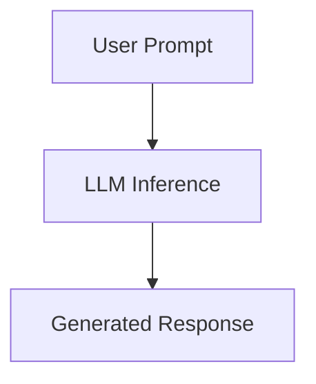
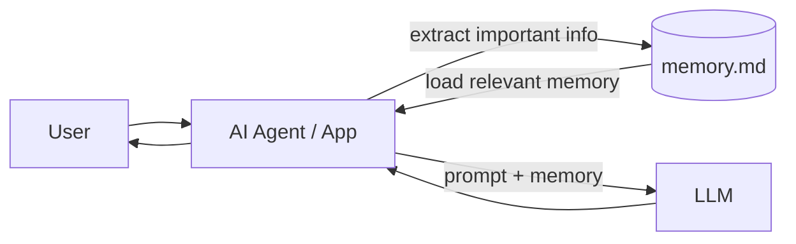
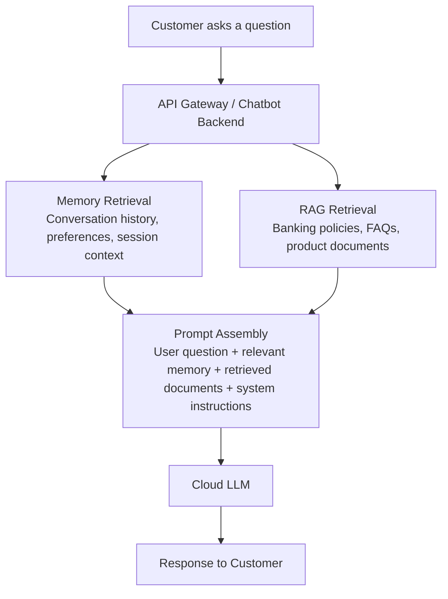

# LLM Memory – Complete Technical Explanation with Examples

This lecture introduces an important concept in AI application development: **Memory**.

The key idea is that an LLM does **not** automatically remember previous conversations, user preferences, decisions, or results. Your application or AI agent must implement memory using external storage and retrieve that information when needed.

Let's understand this from an enterprise AI architecture perspective.

---

## 1. What is memory in an LLM?

Memory allows an AI application to retain useful information from previous interactions and reuse it in future interactions.

**Example**

**Conversation 1**

> User: I prefer short answers with practical Angular 19 examples.

The AI application stores this preference in memory.

**Conversation 2 – several days later**

> User: Explain Angular Signals.

The application retrieves the stored preference and sends it along with the new prompt. The LLM responds with a short explanation and practical Angular 19 examples.

> The LLM itself didn't remember anything. The **application** retrieved the memory and supplied it again.

---

## 2. Why do LLMs need external memory?

A traditional LLM works primarily through:



By default, the model doesn't have persistent storage of previous sessions.

There are three important distinctions:

| Concept | Description |
|---|---|
| **Context window** | Information available to the model during its current inference request. |
| **Memory** | Information retained externally and made available in future interactions. |
| **RAG** | A mechanism to retrieve relevant information from an external knowledge source. |

> **Note:** Some AI platforms automatically manage conversation history, but this is application-level functionality, not evidence that the underlying model has persistent memory.

---

## 3. How does external memory work?

Consider an AI agent that stores memory in Markdown files.

**Workflow**

1. User interacts with the AI agent.
2. The agent identifies important information worth remembering.
3. The application extracts the information.
4. The application saves it to an external memory file.
5. During a future interaction, the application loads relevant memory.
6. The application injects the memory into the new prompt.
7. The LLM generates a context-aware response.



**Example: `memory.md`**

```markdown
# User Preferences

- Prefers Angular 19 examples.
- Prefers practical explanations.
- Uses Docker Desktop on Windows.

# Project Decisions

- Frontend: Angular 19
- Backend: FastAPI
- LLM: Ollama
- Vector Database: Qdrant
- Architecture: RAG
```

When the user asks a question about the project, the application can load this file and include relevant information in the prompt.

---

## 4. Short-term memory vs Long-term memory

This is an important distinction when designing AI agents.

### Short-term memory

- **Temporary**
- Stores information relevant to the current conversation or task.

**Example**

- User asks about Redis.
- User asks a follow-up about cache invalidation.
- Agent remembers the previous question and answer.

**Typical implementation:** conversation history, session state, working context.

### Long-term memory

- **Persistent**
- Stores useful information across multiple sessions.

**Example**

- User prefers Python examples.
- User is building an enterprise banking chatbot.
- User selected Qdrant for vector storage.

**Typical implementation:** databases, files, vector databases or other persistent stores.

---

## 5. Project-specific memory vs Global memory

An AI development tool might organize memory like this:

```text
AI-Application/
│
├── memory/
│   ├── global-memory.md
│   │
│   ├── project-banking/
│   │   ├── architecture.md
│   │   └── decisions.md
│   │
│   └── project-rag/
│       ├── architecture.md
│       └── preferences.md
│
└── src/
    └── ...
```

| Memory type | Purpose |
|---|---|
| Global memory | User preferences across projects |
| Project memory | Decisions and context for a particular project |
| Session memory | Current conversation and task context |

This separation prevents an agent from unnecessarily mixing information from unrelated projects.

---

## 6. Memory vs RAG vs Vector Database

This is probably the most important concept for enterprise AI architecture.

| Concept | Main purpose | Example |
|---|---|---|
| Memory | Remember past interactions and decisions | User prefers concise answers |
| RAG | Retrieve relevant knowledge | Find a banking KYC policy |
| Vector database | Store and search embeddings | Search semantically similar documents |
| SQL database | Store structured information | Customer account records |

> **Important:** Memory and RAG are not mutually exclusive.

You can implement memory using:

- Plain Markdown files
- SQL databases
- Key-value stores
- Vector databases
- Hybrid storage (SQL + vector search)

A vector database is just **one possible** storage and retrieval mechanism for memory.

---

## 7. Enterprise banking chatbot example

Let's consider a banking chatbot that uses cloud LLM + RAG.



For a banking system, memory must be designed with strict security controls:

- Isolate memory by customer identity.
- Encrypt stored memory.
- Apply retention and deletion policies.
- Avoid storing passwords, OTPs, access tokens or unnecessary sensitive financial data.
- Validate memory before using it in prompts.
- Never treat remembered information as authorization to perform banking transactions.

---

## 8. Practical implementation using FastAPI

Here is a simplified example of file-based memory.

### Step 1: Store memory

```python
from pathlib import Path

MEMORY_FILE = Path("memory.md")

def save_memory(content: str):
    with MEMORY_FILE.open("a", encoding="utf-8") as file:
        file.write(f"\n{content}\n")
```

### Step 2: Retrieve memory

```python
def load_memory():
    if MEMORY_FILE.exists():
        return MEMORY_FILE.read_text(encoding="utf-8")
    return ""
```

### Step 3: Inject memory into the prompt

```python
def create_prompt(user_question):
    memory = load_memory()

    prompt = f"""
    Relevant User Memory:
    {memory}

    User Question:
    {user_question}

    Answer using relevant context.
    """

    return prompt
```

### Step 4: Send prompt to your LLM

Your FastAPI application sends the assembled prompt to Ollama or a cloud LLM.

> This is a basic implementation. A production system should additionally handle user isolation, memory relevance, access control, validation, updates, deletion and token limits.

---

## 9. Important interview questions

**1. Does an LLM automatically remember previous conversations?**
No. Persistent memory requires external storage and application logic to retrieve and supply relevant information.

**2. Can we implement memory without a vector database?**
Yes. Plain text files, Markdown, SQL and key-value stores can all implement memory.

**3. What is the difference between RAG and memory?**
RAG retrieves external knowledge relevant to a query. Memory retains information about previous interactions, preferences, decisions or task state.

**4. Should we inject the entire memory file into every prompt?**
Not necessarily. It is simple but can increase token usage, cost and irrelevant context. Selective retrieval and summarization are usually better at scale.

**5. Can memory contain incorrect information?**
Yes. Memory can be outdated, incorrectly extracted or maliciously influenced. Validate, update and manage memory with appropriate trust controls.

---

## 10. Key takeaways

1. LLMs are not inherently persistent memory systems.
2. Memory is implemented externally by the AI application or agent.
3. Markdown files are a simple way to implement memory.
4. Memory can be short-term, long-term, global or project-specific.
5. Vector databases can support memory retrieval but are not mandatory.
6. RAG and memory solve different problems and can work together.
7. Enterprise applications need memory isolation, validation, security and retention controls.

---

## Learning roadmap

**Memory → RAG → Agent State → Tool Calling → Multi-Agent Memory.** These concepts build on one another.

**Next practical exercise:** build a FastAPI + Ollama chatbot with persistent Markdown memory, then upgrade it to Qdrant-based selective memory retrieval.
