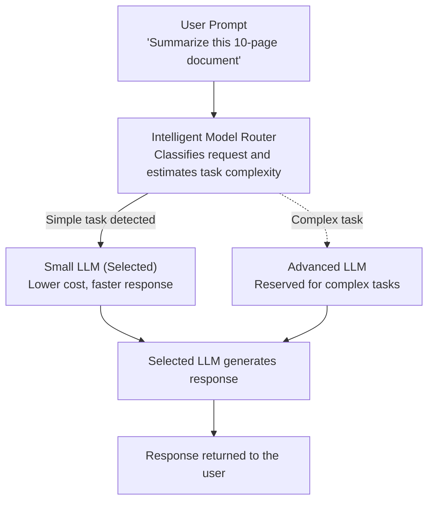
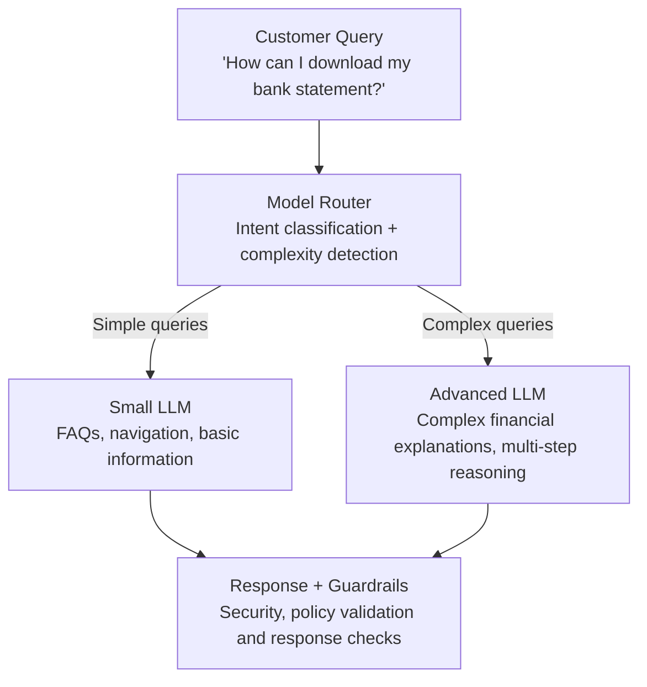

# Model Routing in LLMs – Choosing the Right Model for the Right Task

Model Routing is a technique in which an AI system automatically selects the most suitable LLM for a user request based on task complexity, performance requirements, latency, and cost.

The core idea is simple:

> **Don't use an expensive, highly capable model for every request. Use the right model for the right job.**

---

## 1. Why do we need Model Routing?

Different tasks require different levels of intelligence.

For example:

| User task | Required intelligence | Suitable model |
|-----------|-----------------------|----------------|
| Summarize an article | Low | Small / cheaper LLM |
| Translate text | Low–Medium | Small / medium LLM |
| Extract information | Low–Medium | Small LLM |
| Generate application code | Medium–High | Capable LLM |
| Debug complex code | High | Advanced LLM |
| Design enterprise architecture | High | Advanced reasoning LLM |

Using the most powerful model for every request increases inference costs unnecessarily.

---

## 2. How does Automatic Model Routing work?



### Step-by-step explanation

1. **User submits a prompt:** The user asks a question or provides a task.
2. **Router receives the request:** It analyzes the prompt.
3. **Task classification:** It identifies whether the task is simple, moderate, or complex.
4. **Model selection:** It chooses an appropriate LLM.
5. **Inference:** The selected model processes the request.
6. **Response:** The result is returned to the user.

---

## 3. Manual Routing vs Automatic Routing

| Manual routing | Automatic routing |
|----------------|-------------------|
| User selects the model | System selects the model |
| User decides based on task | AI/router classifies the task |
| Requires user knowledge | Happens behind the scenes |
| More control | More convenience |

---

## 4. Why is Model Routing beneficial?

There are two major beneficiaries.

**For AI companies:**

- Reduces expensive GPU inference workloads.
- Reduces operational costs.
- Improves resource utilization.
- Preserves expensive models for complex requests.

**For users:**

- Potentially faster responses.
- Lower token costs.
- Better resource allocation.
- Appropriate model capabilities for each task.

> **One important point:** Cheaper models are not necessarily suitable for every simple-looking task. Routing needs quality checks because even summarization can involve complex reasoning.

---

## 5. Model Routing in a Production AI Application

Consider an enterprise banking chatbot.

**Example: Banking AI Model Router**



> For banking, model routing should also consider **security, authorization, data sensitivity, and accuracy**. A simple classification should never bypass mandatory banking controls.

---

## 6. Important concepts to remember

| Concept | Meaning |
|---------|---------|
| Model Router | Component that selects an LLM |
| Task Classification | Determines the type of request |
| Complexity Detection | Estimates reasoning requirements |
| Cost Optimization | Minimizes inference expenditure |
| Fallback Routing | Sends a request to another model if needed |
| Quality Evaluation | Checks whether the selected model produced an acceptable result |

---

## 7. How does this fit into a local RAG architecture?

If you're exploring FastAPI, Ollama, Qdrant and local LLMs, you can implement model routing in your own RAG application.

For example:

- **Phi-3:** simple questions, summarization and extraction.
- **A more capable local model:** complex reasoning and code analysis.
- **Router:** FastAPI service that classifies prompts and selects the model.

You could implement the following:

```python
def select_model(task_complexity: str):
    if task_complexity == "simple":
        return "phi3"
    if task_complexity == "medium":
        return "medium-model"
    return "advanced-model"
```

*This is a simplified example; a production router would also evaluate confidence, latency, token budget, model availability and fallback behavior.*

---

## Interview takeaway

> Model routing is an intelligent model-selection mechanism that dynamically directs user requests to the most appropriate LLM based on task complexity, cost, latency and quality requirements.

**Remember:** The objective is not to use the smartest model for everything. It is to achieve the best balance between intelligence, cost and performance.
