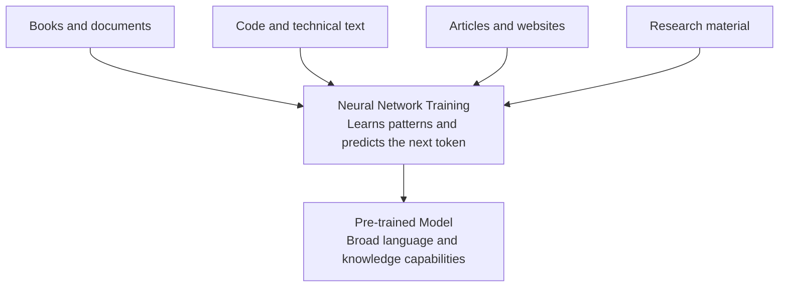
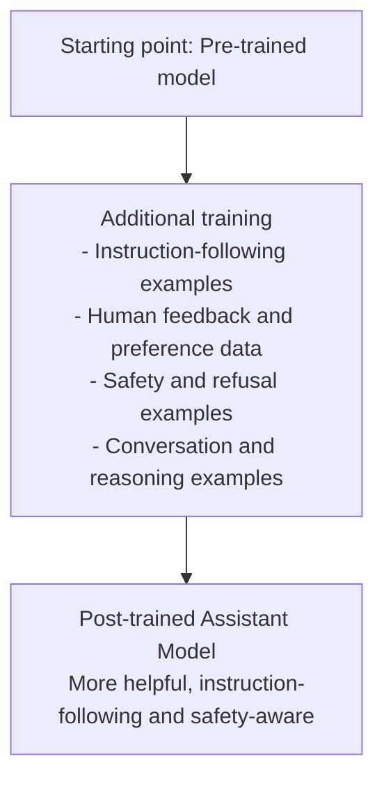
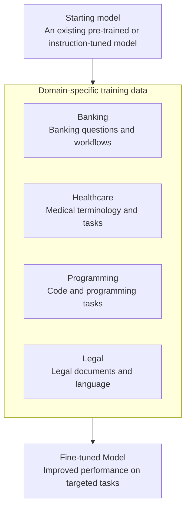
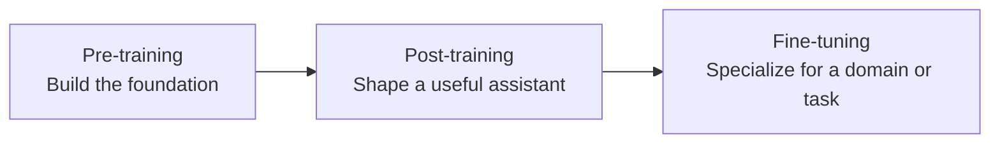

# Pre-training vs Post-training vs Fine-tuning

Pre-training and post-training are two important terms and concepts related to the training part of an AI model.

**Pre-training:** Teaches the model general knowledge and fundamental language capabilities.

**Post-training:** Shapes the model into a useful, helpful, safe assistant.

**Fine-tuning:** Specializes an existing model for a particular domain or task.

The sections below start with a short overview of pre-training and post-training. After that comes a complete explanation of all three concepts, step by step, using a real-world analogy, a technical explanation and a comparison table.

## Pre-training

Pre-training is about building the model's broad underlying capabilities from a very large data set.

- For large language models, this is typically simply the entire text you could find on the public internet.
- All that data is used to build a neural network that is able to predict text.

## Post-training

Post-training, as the name suggests, builds on that neural network and shapes the model's:

- Behavior
- Specialization
- Reasoning capabilities
- Safety

### Why post-training is needed

The neural network that comes out of pre-training is pretty raw, and it is not a good assistant. All it can do is predict text based on input coming from the internet. That means:

- There is a lot of weird stuff in there.
- Most importantly, it is not optimized to act as an assistant.

If you ask a raw pre-trained model a question, it might just answer with another question, or simply spit out another question mark. In its training data it didn't necessarily see that every question gets an answer. After all, not every question on the internet gets an answer.

### What happens in post-training

Experts at AI companies add more artificially generated training data to the training set to fine-tune the model, so that it learns, for example:

- For a question, it should produce an answer, but not an endless amount of answers.
- The answer should be friendly and helpful.
- It should decline certain requests, for example, if you ask it to build a bomb, it should not do that.

This part, which happens in post-training, is commonly referred to as **fine-tuning**.

## Summary

| Aspect | Pre-training | Post-training |
|---|---|---|
| Purpose | Build broad underlying capabilities | Shape behavior, specialization, reasoning, and safety |
| Data | Very large data set (e.g., all text on the public internet) | Additional, artificially generated training data |
| Result | Raw neural network that predicts text | Helpful, friendly, safe assistant |
| Also known as | - | Fine-tuning |

---

# Pre-training vs Post-training vs Fine-tuning – Complete Explanation

Let's understand these concepts step by step using a real-world analogy, followed by a technical explanation and comparison table.

The easiest way to understand them is to imagine training a student to become a professional doctor.

## 1. Step-by-step explanation with a real-world analogy

### Step 1: Pre-training – Building foundational knowledge

Imagine a student who wants to become a doctor.

Before becoming a doctor, the student needs to learn:

- Human anatomy
- Biology
- Chemistry
- Medical terminology
- Diseases and symptoms
- How the human body works

The student reads thousands of books, research papers and educational materials.

After learning all this information, the student has developed a broad understanding of medicine.

However, the student is not yet a qualified doctor.

This is similar to pre-training an LLM.

In AI:

- The model is trained using enormous amounts of text and other data.
- It learns language patterns, grammar, facts, relationships and concepts.
- It learns to predict the next token based on the preceding context.
- It develops foundational capabilities that can later be adapted to different tasks.

> **Important:** A pre-trained model is not necessarily a good conversational assistant. It has learned to continue text, but may not reliably follow instructions or answer questions helpfully.

For example:

**Prompt:** What is the capital of India?

A raw pre-trained model might generate:

- New Delhi is the capital of India.
- What is the capital of India? This is an interesting question...
- Or continue with some other text pattern.

It is generating likely continuations, not necessarily following an assistant-style instruction.

### Step 2: Post-training – Teaching the student how to behave

Now imagine the medical student has completed theoretical education.

Does that automatically make the student a good doctor?

No!

The student needs practical training:

- How to communicate with patients.
- How to diagnose problems.
- How to explain medical conditions.
- How to make responsible decisions.
- When to refuse an unsafe treatment.
- How to behave professionally.

Experienced doctors supervise and evaluate the student.

The student learns not just medical knowledge, but also how to apply it appropriately.

This is similar to post-training in LLMs.

In AI:

- The pre-trained model is further trained using curated datasets.
- It learns to follow human instructions.
- It learns to provide useful and structured answers.
- It learns conversational behavior.
- It is trained to follow safety guidelines.
- It can be optimized to produce better reasoning and task-specific responses.

**Example:**

User asks:

> "What is the capital of India?"

A post-trained assistant is optimized to respond:

> "The capital of India is New Delhi."

It is trained to understand that the user expects an answer rather than an arbitrary continuation of text.

### Step 3: Fine-tuning – Specializing the model

Let's continue our doctor analogy.

The student has completed medical education and practical training.

Now the doctor wants to specialize in cardiology.

They receive additional training in:

- Heart diseases
- ECG interpretation
- Cardiac procedures
- Heart-related diagnosis
- Cardiology-specific terminology

Now the doctor has specialized knowledge.

This is similar to fine-tuning an LLM.

In AI:

- An existing pre-trained or post-trained model is trained further.
- It uses a more focused dataset.
- The objective is to improve performance for a particular domain, behavior or task.

For example, you could fine-tune a model using banking-related datasets to improve its ability to handle banking terminology and workflows.

> **Important distinction:** Fine-tuning is a method of additional training. It is often part of post-training, but the terms are not exactly interchangeable.

## 2. How all three concepts connect

Think about the complete journey:

1. Pre-training builds the foundation.
2. Post-training shapes the model into a useful assistant.
3. Fine-tuning can further specialize the model for a particular domain or task.

For example, consider building a banking chatbot:

- **Pre-training:** The underlying LLM learns broad language and knowledge capabilities.
- **Post-training:** The model learns to follow instructions, respond conversationally and respect safety constraints.
- **Fine-tuning:** The model can be further trained on curated banking examples to improve performance on specific banking tasks.

One important distinction for application developers: **RAG is different from fine-tuning.** RAG retrieves relevant external information at inference time; fine-tuning changes the model through additional training.

## 3. Comparison table

| Aspect | Pre-training | Post-training | Fine-tuning |
|---|---|---|---|
| Main goal | Learn general knowledge | Improve behavior | Specialize for tasks |
| Training data | Massive text datasets | Curated instruction and preference data | Domain-specific datasets |
| Focus | Next-token prediction | Instruction following, helpfulness, safety | Targeted task performance |
| Starting point | Randomly initialized model | Pre-trained model | Existing model |
| Output | Foundation model | Assistant-style model | Specialized model |
| Example | Learn English | Answer questions politely | Understand banking terminology |
| Analogy | Student learning | Student with a tutor | Doctor specializing in cardiology |

> **Technical note:** Fine-tuning is commonly one technique within the broader post-training process. Post-training can also include preference optimization and reinforcement learning.

## 4. Key takeaways

The three training stages, with the real-world student and professional analogies:

1. **Pre-training** – the student learns medicine from books; the model learns general patterns from massive datasets.
2. **Post-training** – the student learns practical behavior under supervision; the model learns to follow instructions safely.
3. **Fine-tuning** – the doctor specializes in cardiology; the model specializes in a domain such as banking.

## 5. Important points to remember for interviews

1. Pre-training teaches an LLM to learn broad patterns and predict the next token.
2. Post-training makes the model better at following instructions and behaving like an assistant.
3. Fine-tuning adapts an existing model to specific tasks or domains.
4. Fine-tuning and post-training are related, but they are not identical.
5. RAG does not retrain the model; it provides external context during inference.

**One-line memory trick:**

- Pre-training = Learn.
- Post-training = Behave.
- Fine-tuning = Specialize.

## Next learning topic

Understanding **SFT (Supervised Fine-Tuning)**, **RLHF (Reinforcement Learning from Human Feedback)**, and **DPO (Direct Preference Optimization)** will help you understand exactly how post-training works inside modern LLMs.
