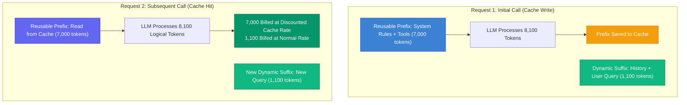
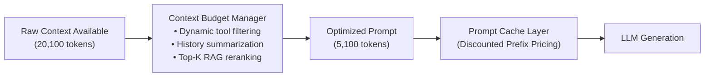
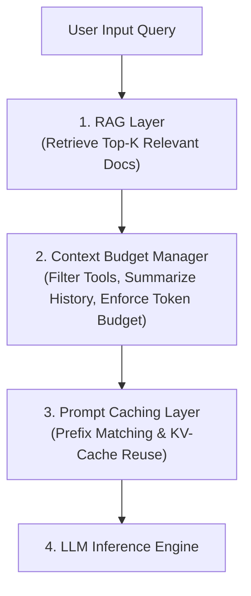

# Prompt Caching

## 1. Core Concept: Does Caching Consume Tokens?

> **Question:** *Even if we are caching the input, is that cached data still passed to the LLM and consuming context tokens?*

**Yes, absolutely.** Even when you use Prompt Caching, the cached input remains an active part of the LLM's context and counts against the context window limit.

However, there is a fundamental difference between **normal (uncached) input tokens** and **cached input tokens**:

* **Normal input tokens** require full parsing, tokenization, and KV-cache computation on every single request.
* **Cached input tokens** reuse previously computed attention/KV states, allowing providers to charge a discounted rate and reduce processing latency.

```
┌─────────────────────────────────────────────────────────────────────────────────┐
│                           THE ESSENTIAL DISTINCTION                             │
├─────────────────────────────────────────────────────────────────────────────────┤
│ • Prompt Caching optimizes the COST & COMPUTATION of reusing tokens.            │
│ • Context Management optimizes the NUMBER OF TOKENS the LLM receives.          │
│                                                                                 │
│                    They solve two completely different problems.                │
└─────────────────────────────────────────────────────────────────────────────────┘
```

---

## 2. What Exactly Does Prompt Caching Save?

| Resource / Metric | Does Prompt Caching Save It? | Explanation |
|---|:---:|---|
| **Context window capacity** | ❌ **No** | Cached tokens still occupy context space in the request. |
| **Logical input token count** | ❌ **No** | The LLM still receives and attends to the full context. |
| **Repeated computation** | ✅ **Yes** | The model skips recomputing attention states for the prefix. |
| **Input token cost** | ✅ **Yes** | Cached tokens are billed at a significantly discounted rate (typically 50%–90% cheaper). |
| **Time to First Token (Latency)** | ✅ **Yes** | Pre-computed KV caches allow the LLM to start generating responses faster. |

---

## 3. How Prompt Caching Works

Prompt caching works on **matching, reusable prompt prefixes**. The static, unchanging instructions are placed at the beginning of the prompt, while dynamic, user-specific data is placed at the end.



### 3.1 Prompt Structure Rule: Static First, Dynamic Last

Most prompt caching systems match requests strictly from the beginning (prefix matching):

| Part of Request | Position in Prompt | Cache Eligibility | Example Content |
|---|---|---|---|
| **Static Prefix** | Beginning | **Cache Eligible** | System persona, security guardrails, schema definitions, tool/MCP signatures |
| **Dynamic Suffix** | End | **Cache Ineligible** | Changing conversation history, latest user query, session timestamps |

---

## 4. Example 1: Enterprise Banking Chatbot Across 100 Users

Imagine building an Enterprise Banking AI Chatbot where every user request sends the following payload:

| Input Component | Tokens |
|---|---|
| System instructions | 2,000 |
| Banking security rules | 3,000 |
| Tool / MCP definitions | 2,000 |
| Conversation context | 1,000 |
| User question | 100 |
| **Total per request** | **8,100** |

### Scenario A: Without Prompt Caching (100 Users)

When 100 users submit requests, the LLM processes every single token from scratch:

$$
8{,}100 \text{ tokens} \times 100 \text{ requests} = 810{,}000 \text{ full-price input tokens}
$$

The exact same 7,000 tokens of system instructions, security rules, and tool definitions are computed **100 separate times**.

### Scenario B: With Prompt Caching (100 Users)

The LLM provider caches the reusable prefix (7,000 tokens):

* **Request 1 (Initial / Cache Creation):**
  * Normal input: 8,100 tokens (7,000 prefix tokens written to cache).
* **Requests 2 to 100 (Subsequent 99 Requests / Cache Hits):**
  * Logical input: 8,100 tokens per request.
  * Cached input: 7,000 tokens per request (reused from cache at discounted rate).
  * Normal input: 1,100 tokens per request.

**Key Observation:** The cached 7,000 tokens are **NOT removed** from the LLM's context. They still count toward context window limits, but they avoid redundant computation and receive heavily discounted billing.

---

## 5. Example 2: Multi-Turn Conversation & Cost Calculation

Let's examine how prompt caching calculates real financial savings across a 3-turn customer session.

### Request Payload

| Component | Tokens |
|---|---|
| System instructions | 3,000 |
| Banking security rules | 2,000 |
| Tool definitions | 3,000 |
| Customer conversation history | 1,000 |
| New user question | 1,000 |
| **Total input tokens** | **10,000** |

Customer interactions across 3 sequential turns:
* **Call 1:** *"What is my account balance?"*
* **Call 2:** *"Show my last five transactions."*
* **Call 3:** *"How can I download my statement?"*

### Token Classification Across Calls

| Mode | Call 1 | Call 2 | Call 3 | Total Input Tokens |
|---|---|---|---|---|
| **Without Caching** | 10,000 normal | 10,000 normal | 10,000 normal | **30,000 normal** |
| **With Caching** | 10,000 normal *(cache write)* | 9,000 cached + 1,000 normal | 9,000 cached + 1,000 normal | **12,000 normal + 18,000 cached** |

> *Note:* In practice, conversation history grows turn-by-turn. Here, the 9,000 tokens represent the stable prefix retained across turns.

---

### Cost Breakdown & Comparison

**Illustrative Pricing:**
* **Normal Input:** $2.00 / 1M tokens
* **Cached Input:** $0.50 / 1M tokens (75% discount)
* **Output:** $8.00 / 1M tokens (1,500 output tokens per call = 4,500 total)

#### Scenario A: Without Caching

$$\text{Input Cost} = 30{,}000 \times \frac{\$2.00}{1{,}000{,}000} = \$0.060$$

$$\text{Output Cost} = 4{,}500 \times \frac{\$8.00}{1{,}000{,}000} = \$0.036$$

$$\text{Total Cost} = \$0.060 + \$0.036 = \mathbf{\$0.096}$$

#### Scenario B: With Caching

$$\text{Normal Input Cost} = 12{,}000 \times \frac{\$2.00}{1{,}000{,}000} = \$0.024$$

$$\text{Cached Input Cost} = 18{,}000 \times \frac{\$0.50}{1{,}000{,}000} = \$0.009$$

$$\text{Output Cost} = 4{,}500 \times \frac{\$8.00}{1{,}000{,}000} = \$0.036$$

$$\text{Total Cost} = \$0.024 + \$0.009 + \$0.036 = \mathbf{\$0.069}$$

#### Summary of Savings

| Metric | Without Caching | With Caching | Difference |
|---|---|---|---|
| **Input Token Cost** | $0.060 | $0.033 | **45% reduction** |
| **Total Session Cost** | $0.096 | $0.069 | **28% reduction** |

*Why isn't the overall cost reduced by 75%?* Output tokens are generated dynamically and are not subject to caching discounts. As prefix reuse increases over hundreds of calls, the input portion approaches the full 75% savings rate.

---

## 6. How Can We Actually Reduce Context Tokens?

Because Prompt Caching does not shrink the token count inside the context window, applications facing context limits or high output costs need **Context Budget Management**.

Instead of dumping all available documentation and instructions into every prompt, a **Context Budget Manager** filters, trims, and dynamically selects only the necessary pieces.

### Optimization Example: 20,000 Tokens Down to 5,100

| Information Layer | Before Optimization | After Optimization | Optimization Technique Applied |
|---|---|---|---|
| **System instructions** | 2,000 | 500 | Compact prompt design, concise directives |
| **Security rules** | 3,000 | 1,000 | Policy modularization, relevant guardrails only |
| **MCP / Tool definitions** | 2,000 | 500 | Dynamic tool retrieval / tool filtering |
| **Conversation history** | 5,000 | 1,000 | Compaction, rolling window, summarization |
| **RAG documents** | 8,000 | 2,000 | Chunk reranking, top-k precision filtering |
| **User question** | 100 | 100 | Verbatim user input |
| **Total Context Size** | **20,100** | **5,100** | **74.6% fewer tokens** |



---

## 7. The Three Pillars of Enterprise AI Context Architecture

To build robust, production-grade AI agents, combine all three techniques:

| Technique | Primary Purpose | How It Works |
|---|---|---|
| **RAG (Retrieval-Augmented Generation)** | Retrieve only relevant knowledge | Queries vector databases / knowledge bases for specific facts instead of pasting entire documents. |
| **Context Budget Manager** | Control payload volume | Decides what information deserves to enter the prompt, compressing history and selecting active tools. |
| **Prompt Caching** | Lower repeated computation & cost | Reuses precomputed attention states for identical prompt prefixes across requests. |



### Architectural Synergy

1. **RAG** ensures that only relevant facts are fetched.
2. **Context Budget Manager** ensures the prompt stays within strict token limits and context quotas.
3. **Prompt Caching** ensures that the reusable instructions and schemas in that prompt are processed at minimal cost and latency.

---

## 8. Provider Implementations & Deployment Differences

| LLM Deployment | Prompt Caching Mechanism | Primary Benefit |
|---|---|---|
| **OpenAI API** | Automatic prompt caching on matching prefixes (typically >1,024 tokens) | 50% discount on cached input tokens |
| **Anthropic Claude API** | Explicit prompt caching breakpoints (`cache_control`) | Up to 90% discount on cache reads |
| **Local Ollama / vLLM** | KV-cache reuse, prefix caching (e.g., PagedAttention / vLLM prefix caching) | Drastically reduced latency & GPU compute overhead (no token billing) |

---

## 9. Key Takeaways

1. **Cached tokens still consume context:** Prompt caching does not remove tokens from the request payload or expand your physical context window.
2. **Cost & Latency optimization:** Caching significantly lowers input API costs and reduces Time-to-First-Token (TTFT) by skipping repeated attention matrix calculations.
3. **Structure matters:** Always organize prompts with **static content at the start** and **dynamic content at the end** to maximize cache hit rates.
4. **Use all three strategies:** Combine **RAG** (precision retrieval), **Context Budget Management** (token reduction), and **Prompt Caching** (processing efficiency) for optimal enterprise AI performance.
