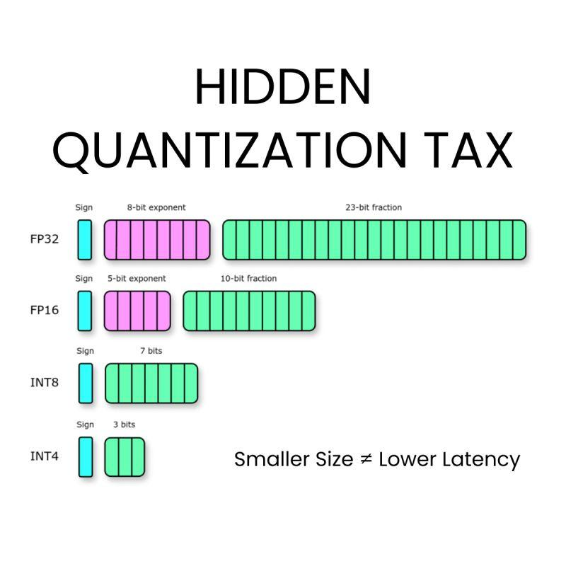

# Quantization in LLMs – How to Reduce Model Size and Memory Consumption

This section introduces another important LLM inference optimization technique: **Quantization**.

Quantization is especially important when running LLMs locally using tools such as Ollama on machines with limited GPU memory.

Let's understand it step by step.



---

## 1. Why do LLMs need so much memory?

An LLM contains millions or billions of parameters (weights).

These weights are numerical values learned during training.

For example, imagine a model contains these weights:

```text
0.123456
0.987654
0.765432
0.456789
```

These numbers need to be stored in memory.

Common numerical formats include:

- **FP32** – 32-bit floating point
- **FP16** – 16-bit floating point
- **BF16** – 16-bit floating point
- **INT8** – 8-bit integer
- **INT4** – 4-bit integer

The more bits used to represent each weight, the more memory is generally required.

> **Important correction:** Quantization is not simply cutting off decimal places. It maps numerical values into a representation with fewer bits, using techniques such as scaling, rounding and sometimes zero points.

---

## 2. What exactly is quantization?

Quantization means converting model weights (and sometimes activations) from higher-precision numerical formats into lower-precision formats.

For example:

| Format | Bits | Illustrative weight | Memory per weight |
|--------|------|---------------------|-------------------|
| FP32 | 32 | 0.123456789 | 4 bytes (higher numerical precision) |
| FP16 | 16 | 0.1235 | 2 bytes |
| INT8 | 8 | 0.12 | 1 byte |
| INT4 | 4 | 0.1 | 0.5 bytes (packed) |

*Illustrative decimal representations only. Actual quantization values depend on the quantization algorithm and scaling parameters.*


**The key idea:**

- Fewer bits per weight.
- Smaller model storage.
- Lower memory requirements.
- Potentially faster inference, depending on hardware and implementation.
- Some loss of numerical precision and potentially model quality.

---

## 3. How much memory can quantization save?

Let's take a hypothetical 7-billion-parameter model.

Assume each parameter is stored using the specified number of bits.

| Precision | Bits per parameter | Approx. weight memory |
|-----------|--------------------|-----------------------|
| FP32 | 32 | 28 GB |
| FP16 / BF16 | 16 | 14 GB |
| INT8 | 8 | 7 GB |
| INT4 | 4 | 3.5 GB |

*Memory values use decimal GB and represent idealized weight storage only. Actual model files and runtime memory will differ.*

Illustrative weight memory for a 7-billion-parameter model:

```text
FP32  | ████████████████████████████ 28 GB
FP16  | ██████████████ 14 GB
INT8  | ███████ 7 GB
INT4  | ███▌ 3.5 GB
```

Notice something interesting:

**INT4 requires approximately 87.5% less weight memory than FP32.**

This is why quantization makes local LLM deployment much more practical.

---

## 4. Different quantization formats you should know

When working with local LLMs, you'll frequently encounter these formats.

| Format | Bits | Typical use |
|--------|------|-------------|
| FP32 | 32 | High-precision computation |
| FP16 | 16 | GPU inference and training |
| BF16 | 16 | Training and inference |
| INT8 | 8 | Reduced-memory inference |
| INT4 | 4 | Efficient local LLM inference |


There is another important concept: quantization formats are not always simple INT8 or INT4.

For example, when using Ollama, you may encounter:

- `Q4_0`
- `Q4_K_M`
- `Q5_K_M`
- `Q8_0`

These are quantization formats commonly associated with **GGUF** model files.

Generally:

- **Q4:** Lower memory consumption, potentially more quality degradation.
- **Q5:** A compromise between memory and quality.
- **Q8:** Higher memory consumption, generally closer to higher-precision weights.

The exact quality depends on the model, quantization method and workload.

---

## 5. How does quantization work internally?

Let's understand the basic mathematical idea.

Suppose we have a weight:

$$
W = 0.75
$$

Instead of storing the original value directly in FP32, quantization maps it to a smaller integer representation.

A simplified symmetric quantization formula is:

$$
Q = \text{round}\left(\frac{W}{Scale}\right)
$$

And when the model uses the quantized value:

$$
W' = Q \times Scale
$$

Here:

- **W** = Original weight.
- **Q** = Quantized integer.
- **Scale** = Conversion factor.
- **W'** = Approximation of the original weight.

For example, suppose:

$$
W = 0.75,\quad Scale = 0.1
$$

Then:

$$
Q = \text{round}(0.75 / 0.1) = 8
$$

Reconstructed value:

$$
W' = 8 \times 0.1 = 0.8
$$

The original weight was 0.75, but the reconstructed value is 0.8.

The difference is **quantization error**.

> This is a simplified illustration. Real quantization methods use more sophisticated scaling, grouping, rounding and sometimes zero-point handling.

---

## 6. Does quantization reduce AI response quality?

Potentially, yes.

When you reduce numerical precision, you introduce approximation errors.

These errors can affect model predictions.

Illustrative quality vs memory trade-off:

| Precision | Memory requirement | Quality note |
|-----------|--------------------|--------------|
| FP16 | Higher | Generally preserves more numerical precision. |
| INT4 | Lower | May introduce more quantization error. |

*Quality is model- and task-dependent; lower precision does not guarantee a noticeable quality loss in every application.*

For example, if you use a quantized model for:

- **Simple Q&A:** It may perform very well.
- **Code generation:** Some accuracy degradation may appear.
- **Complex mathematical reasoning:** Quantization can affect accuracy.
- **Banking and financial applications:** You should evaluate factual accuracy, consistency and safety carefully.

> **Important:** A quantized model is not automatically a bad model. A well-quantized 7B model can be more useful than a much larger model that cannot run efficiently on your hardware.

---

## 7. Quantization vs KV Cache – What's the difference?

Both optimize inference, but they solve different problems.

| Feature | Quantization | KV Cache |
|---------|--------------|----------|
| Main purpose | Reduce numerical storage precision | Reuse previous attention computation |
| What it stores/optimizes | Model weights and sometimes activations | Key and Value tensors |
| Main benefit | Lower memory requirements | Less repeated computation |
| Memory impact | Usually reduces weight memory | Adds cache memory |
| Main trade-off | Possible precision loss | Increased memory usage |

Think of an LLM inference system as two memory requirements:

- **Model weights** – Quantization helps reduce this memory requirement.
- **KV Cache** – KV Cache optimization helps manage memory used by previous tokens.

Both techniques can be used together.

For example, you can run a Q4 quantized LLM while using a KV Cache to accelerate token generation.

---

## 8. How does this work with a local Ollama setup?

Let's connect quantization to a Windows + Docker + Ollama environment.

Suppose you want to run a Phi-3 model locally. You might download different quantized versions of a model.

The workflow looks like this:

```text
User Prompt
    |
    v
FastAPI Backend
    |
    v
Ollama Runtime
    |
    v
Load Quantized Model
    |
    +---- Model weights in memory
    |
    +---- KV Cache in memory
    |
    v
Transformer Inference
    |
    v
Generate Response
```

For example, you could compare:

- FP16 model
- Q8 model
- Q5 model
- Q4 model

Then measure:

1. Model memory consumption.
2. Time to first token.
3. Tokens generated per second.
4. Response quality.
5. GPU versus CPU utilization.

One important point: Quantization reduces the weight memory requirement, but it doesn't eliminate other memory requirements such as KV Cache, activations and runtime overhead.

Also, quantization does not guarantee faster inference. Speed depends on hardware support, kernels, memory bandwidth and runtime implementation.

---

## 9. Important technical corrections to the original explanation

Three things worth remembering:

1. **Not all LLMs have trillions of parameters.** Many popular models have billions. Some very large models, particularly Mixture-of-Experts models, have trillion-scale total parameters.
2. **Quantization is not just truncation.** It is a numerical conversion process that maps higher-precision values into lower-bit representations.
3. **Weights are parameters.** They are the learned numerical values that determine how the neural network processes information.

---

## 10. Interview-ready explanation

> "Quantization is an LLM inference optimization technique that reduces the number of bits used to represent model weights and sometimes activations. For example, converting FP16 weights into INT8 or INT4 reduces memory consumption significantly. This makes it possible to deploy larger models on hardware with limited resources. However, reducing precision introduces quantization error, which can affect model quality. Therefore, we need to balance memory efficiency, inference performance and accuracy."

---

## 11. Quick knowledge check

Remember this relationship – three inference optimization techniques:

| Technique | What it does |
|-----------|--------------|
| **Quantization** | Reduces model weight memory. |
| **KV Cache** | Avoids recalculating previous Key and Value tensors. |
| **Prompt Caching** | Reuses computation for repeated prompt prefixes. |

---

## 12. Finding INT8, INT4 and FP16 in Ollama

You won't see INT8, INT4 or FP16 on the Ollama model library (model search) page, because it is not a quantization selection screen.

This is an important distinction:

- **Model name:** Llama 3.2, Llama 3.1, Phi-3, etc.
- **Model size:** 3B, 7B, 8B, 70B, etc.
- **Quantization:** Q4_K_M, Q8_0, FP16, etc.

Ollama generally displays quantization information inside an individual model's details or model tags, rather than showing INT4 and INT8 as global filters on the library page.

### 12.1 Where to find quantization in Ollama


1. Open **Llama 3.2 → All model tags**.
2. Look for the model variant, such as `3b-instruct`.
3. Look at the end of its tag name.

For example, these are actual Ollama tags:

| Ollama model tag | Precision |
|------------------|-----------|
| `llama3.2:3b-instruct-q4_K_M` | Approximately INT4 |
| `llama3.2:3b-instruct-q8_0` | Approximately INT8 |
| `llama3.2:3b-instruct-fp16` | FP16 |

These variants have different download sizes.

### 12.2 How to download each variant

Open PowerShell and execute:

**INT4 equivalent (Q4_K_M)**

```powershell
ollama pull llama3.2:3b-instruct-q4_K_M
```

**INT8 equivalent (Q8_0)**

```powershell
ollama pull llama3.2:3b-instruct-q8_0
```

**FP16**

```powershell
ollama pull llama3.2:3b-instruct-fp16
```

### 12.3 How to verify the quantization

After downloading:

```powershell
ollama list
```

Then inspect each model:

```powershell
ollama show llama3.2:3b-instruct-q4_K_M
```

Look for the quantization level.

You can also check the model's metadata using:

```powershell
ollama show --modelfile llama3.2:3b-instruct-q4_K_M
```

For more detailed inspection, Ollama's API exposes `quantization_level`.

### 12.4 Important mapping

| Concept from AI theory | Ollama terminology |
|------------------------|--------------------|
| INT4 | Q4_K_M / Q4_0 |
| INT8 | Q8_0 |
| FP16 | FP16 / F16 |

> These are practical precision equivalents, not identical quantization implementations. Q4_K_M and Q8_0 use specific GGUF quantization schemes.

**Recommendation:** Start by comparing Q4_K_M and Q8_0 using the same 3B model. Measure RAM consumption, response speed and answer quality.

---


## Recommended learning sequence

Study these topics next:

1. Quantization (FP16 vs INT8 vs INT4).
2. GGUF and Ollama quantization formats.
3. Prefill vs Decode.
4. TTFT (Time to First Token).
5. TPS (Tokens Per Second).
6. LLM inference serving and GPU memory optimization.
