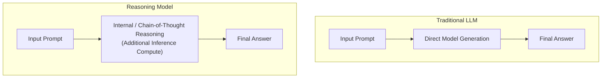
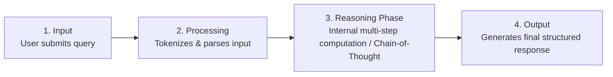
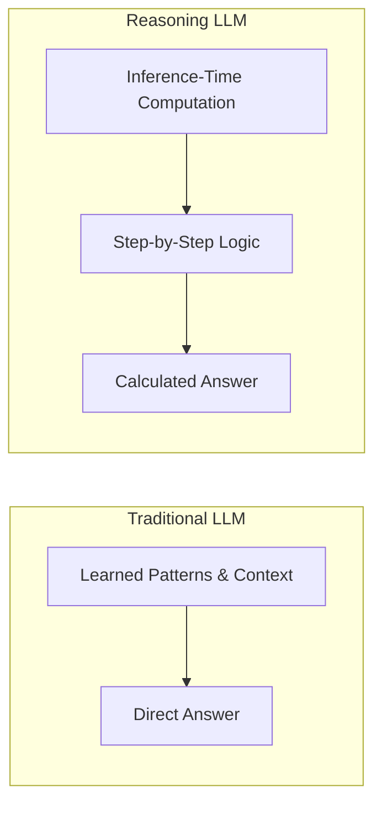
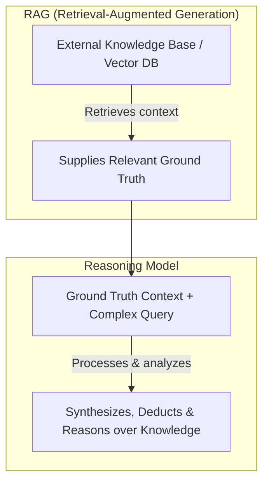

# Reasoning Models in AI

Understanding the distinction between **Traditional LLMs** and **Reasoning LLMs** is essential when architecting AI systems, choosing models for complex workflows, and designing advanced Retrieval-Augmented Generation (RAG) applications.

---

## 1. What is a Reasoning Model?

A **Traditional LLM** generally generates a response token by token directly based on the input prompt and its learned statistical patterns.

A **Reasoning Model** is explicitly designed to spend **additional computation** working through a problem, breaking it down into logical steps, and verifying intermediate conclusions before producing its final answer.



### Example Comparison

> **Question:** *"If a train travels 60 km in one hour, how far will it travel in 3.5 hours?"*

#### Traditional Response
```
Input → Model → Answer
60 × 3.5 = 210 km.
```

#### Reasoning Model Response
```
Input → Reasoning Steps → Answer
1. Identify the speed: 60 km/hour.
2. Identify the travel time: 3.5 hours.
3. Apply formula: Distance = Speed × Time.
4. Compute calculation: 60 × 3.5 = 210.
Final Answer: 210 km.
```

---

## 2. How Does a Reasoning Model Work?

Reasoning models leverage **inference-time compute scaling**—allocating more tokens and compute during the inference stage to explore possible reasoning paths, verify intermediate logic, and self-correct mistakes before emitting the final user-facing response.



### Simplified Inference Pipeline:
1. **Input:** User submits a prompt or complex multi-step question.
2. **Processing:** The model processes and encodes the input tokens.
3. **Reasoning:** The model performs additional internal computation (e.g., chain-of-thought, search over reasoning paths, backtracking) to solve the problem.
4. **Output:** The model synthesizes and presents the final response.

---

## 3. Are Reasoning Models Still LLMs?

**Yes!** Reasoning models are still Large Language Models (LLMs). They share transformer architectures and pre-training foundations, but are fine-tuned (often using reinforcement learning, deliberate reasoning datasets, and search strategies) to spend more computational cycles reasoning at inference time.

### Comparison: Traditional LLM vs. Reasoning LLM

| Dimension | Traditional LLM | Reasoning LLM |
|---|---|---|
| **Response Generation** | Direct, immediate token generation | Multi-step reasoning prior to final output |
| **Optimization Focus** | Optimized for speed and low latency | Optimized for complex problem-solving & accuracy |
| **Best Use Cases** | Simple Q&A, summarization, creative writing | Math, coding, logical deduction, planning |
| **Token & Compute Overhead** | Lower reasoning overhead, fewer tokens generated | Higher token consumption and compute cost |
| **Error Correction** | Prone to immediate hallucination in complex logic | Can catch and self-correct errors during reasoning |

---

## 4. Important Technical Corrections & Nuances

When evaluating reasoning models, keep these technical realities in mind:

1. **Not all modern models are reasoning models:**
   - Many state-of-the-art models remain direct-response models optimized for conversational speed and general assistance.
2. **Intermediate thinking is not always visible:**
   - A reasoning model may perform internal reasoning (hidden reasoning tokens / private chain-of-thought) without exposing raw thinking steps to the user.
3. **Reasoning is computational, not human cognition:**
   - Model reasoning is not replicating human consciousness or subjective thinking; it is a computational search and verification process learned and optimized during training and inference.

---

## 5. Key Concept to Remember



- **Traditional LLM:** Generates an answer using learned patterns, statistical probabilities, and immediate context.
- **Reasoning LLM:** Uses additional inference-time computation to work through complex logic, edge cases, and constraints before producing an answer.

---

## 6. Connection to AI Application Development & RAG

Selecting between a traditional LLM and a reasoning LLM is a fundamental architecture decision in AI application development:

### Workload Selection Guide

- **Simple Document Q&A / Search Summaries:**
  - A fast, general-purpose traditional LLM is often faster, cheaper, and more than sufficient.
- **Complex Financial / Banking / Legal Analysis:**
  - Involves multi-clause calculations, risk auditing, compliance verification, and strict constraints where a reasoning-capable model shines.
- **Multi-Step Agentic Workflows & Tool Planning:**
  - Reasoning models excel at breaking complex goals into sub-tasks, sequencing tool calls, and verifying execution outputs.

### Crucial Distinction: RAG vs. Reasoning Models



> **Key Rule:** **RAG supplies relevant external knowledge; reasoning models help process, deduct, and reason over that knowledge.** They solve complementary problems.
