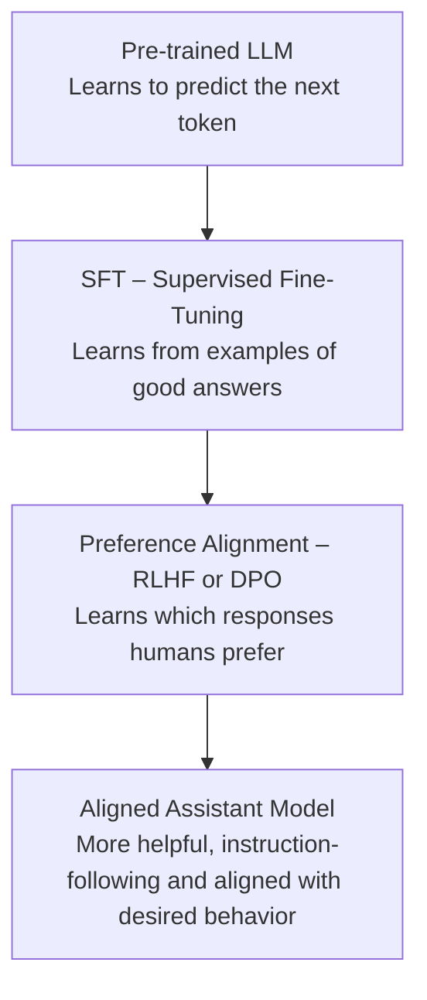
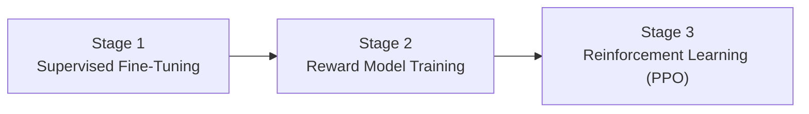

# SFT vs RLHF vs DPO – How Post-Training Works Inside Modern LLMs

These three concepts are extremely important for understanding how models such as GPT become helpful AI assistants rather than simply predicting the next token.

Let's understand them using a real-world analogy, technical examples, and a comparison table.

---

## 1. First, understand the big picture

Remember the three stages:

1. **Pre-training:** The model learns language, patterns and general knowledge.
2. **Post-training:** The model learns how to follow instructions, behave helpfully and safely.
3. **Fine-tuning:** The model can be further adapted for specific tasks or domains.

**SFT, RLHF and DPO are techniques used in post-training.**

### How these techniques fit into post-training



> This is a common conceptual pipeline, not a mandatory sequence for every LLM. Some training pipelines use different combinations or orders.

---

## 2. SFT – Supervised Fine-Tuning

### Learn from examples

**Real-world analogy: A teacher giving students model answers**

Imagine a student preparing for an interview. The teacher gives the student 100 questions along with their ideal answers.

| Question | Expected answer |
|---|---|
| What is an API? | An API allows two software systems to communicate. |
| What is Docker? | Docker packages applications and their dependencies into containers. |
| What is Kubernetes? | Kubernetes orchestrates containerized applications. |

The student studies these examples and learns how to answer similar questions.

This is **supervised learning**: the student receives both the question and the expected answer. That is the basic idea behind SFT.

### How SFT works technically

1. Start with a pre-trained LLM.
2. Prepare a dataset containing prompts and high-quality responses.
3. Feed the prompt into the model.
4. Compare the generated tokens against the expected response.
5. Calculate the training loss.
6. Update the model weights using gradient descent and backpropagation.

**Example training dataset:**

```text
USER PROMPT
What is RAG in AI?

IDEAL ASSISTANT RESPONSE
RAG stands for Retrieval-Augmented Generation. It retrieves relevant information
from external knowledge sources and provides that context to an LLM to generate
a more grounded answer.
```

The model learns from many such prompt-response examples.

### What does SFT improve?

- Instruction following
- Question answering
- Conversational format
- Structured output (JSON, for example)
- Task-specific behavior

> **Key point:** SFT teaches the model **what a good answer looks like**.

---

## 3. RLHF – Reinforcement Learning from Human Feedback

### Learn from human preferences

**Real-world analogy: A teacher comparing two students' answers**

Imagine a teacher asks two students: *"Explain what an API is."*

- **Student A:** An API is an Application Programming Interface.
- **Student B:** An API is a way for two software applications to communicate. For example, a banking app can call a bank's API to retrieve account balances.

**Teacher prefers Student B**, because the answer is clearer, more helpful and includes a practical example.

Instead of providing the model with only one correct answer, humans compare multiple answers and express their preferences. This feedback helps train the model to produce responses that people prefer.

### How RLHF works technically

RLHF commonly involves three major stages.



#### Stage 1: Supervised Fine-Tuning

First, train the pre-trained model using high-quality human-written demonstrations. This creates an instruction-following model.

#### Stage 2: Reward Model Training

The model generates multiple answers to the same question. Human evaluators rank those answers. For example:

| Response | Human preference |
|---|---|
| Answer A | 3rd |
| Answer B | 1st |
| Answer C | 2nd |

A separate neural network called the **Reward Model** learns to assign higher scores to responses humans prefer.

#### Stage 3: Reinforcement Learning

The language model is optimized using the reward model's feedback. A commonly used algorithm is **PPO (Proximal Policy Optimization)**.

The objective is to increase the likelihood of producing higher-reward responses while constraining the model from drifting too far from its reference behavior.

> **Key point:** RLHF teaches the model **which answers humans prefer** through a reward signal.

---

## 4. DPO – Direct Preference Optimization

### Learn directly from preferences

**Real-world analogy: A teacher directly showing which answer is better**

Question: *"What is database indexing?"*

- **Response A (Rejected):** Indexing makes database queries faster.
- **Response B (Preferred):** Database indexing is a technique that improves data retrieval speed. It creates an additional data structure that helps the database find records without scanning the entire table.

Now imagine the teacher gives the student hundreds or thousands of such comparisons.

Instead of building a separate scoring system to evaluate every answer, DPO **directly uses the preferred and rejected responses** to optimize the language model. That is the basic idea behind DPO.

### How DPO works technically

1. Start with an existing instruction-tuned model.
2. Prepare human preference datasets.
3. Each training example contains:
   - Prompt
   - Chosen response
   - Rejected response
4. Train the model to increase the relative likelihood of chosen responses compared with rejected responses.
5. Use a reference model to help constrain how much the model changes.

**Example DPO training data:**

```text
PROMPT
Explain microservices.

CHOSEN RESPONSE
Microservices is an architectural approach where an application is divided into
small, independently deployable services that communicate through APIs or messaging.

REJECTED RESPONSE
Microservices means using many small services.
```

The training objective encourages the model to prefer the chosen response over the rejected response.

### Why is DPO useful?

- No separate reward model is required.
- No explicit PPO reinforcement-learning loop is required.
- Human preference data can be used directly.
- It can simplify preference-alignment training.

> **Key point:** DPO teaches the model which response is preferred by **directly optimizing from preference pairs**.

---

## 5. RLHF vs DPO – What is the actual difference?

This is probably the most important comparison to remember.

| Aspect | RLHF (classic approach) | DPO |
|---|---|---|
| Full form | Reinforcement Learning from Human Feedback | Direct Preference Optimization |
| Training data | Human preferences | Human preferences |
| Human ranking | Yes | Yes |
| Reward model | Typically trained separately | Not required |
| PPO | Commonly used | Not required |
| Optimization | Reward-based reinforcement learning | Direct preference objective |
| Complexity | More components | Generally simpler |
| Main idea | Learn a reward, then optimize against it | Optimize directly from preferences |

> **Important nuance:** RLHF is a broad family of approaches. PPO-based RLHF is a well-known implementation. DPO is a separate preference-optimization method that avoids the explicit reward-model-plus-PPO pipeline.

---

## 6. One practical example: Training a banking chatbot

Suppose you want to build an AI chatbot that answers banking questions.

| Stage | What happens? | Banking example |
|---|---|---|
| Pre-training | Learns broad language and knowledge | Understands general language, numbers and concepts |
| SFT | Learns from ideal answers | Learns how to answer banking questions |
| RLHF | Learns human preferences through reward-based training | Learns that clear, accurate and polite responses are preferred |
| DPO | Learns directly from preferred/rejected answers | Learns to prefer better banking responses |

**User:** *How can I block my debit card?*

- **Pre-trained model:** May generate a continuation about debit cards.
- **SFT model:** Learns to provide a step-by-step answer.
- **RLHF model:** Learns to prefer helpful, clear and safe answers.
- **DPO model:** Learns directly from examples where one response is preferred over another.

> In a real banking application, you would additionally need RAG, authentication, authorization, transaction APIs, security controls and human escalation. Training alone does not give a model access to banking systems or guarantee factual accuracy.

---

## 7. Final comparison – SFT vs RLHF vs DPO

| Feature | SFT | RLHF | DPO |
|---|---|---|---|
| Full form | Supervised Fine-Tuning | Reinforcement Learning from Human Feedback | Direct Preference Optimization |
| Learns from | Ideal answers | Human preferences | Human preferences |
| Data format | Prompt + response | Prompt + ranked responses | Prompt + chosen + rejected |
| Human involvement | Demonstrations | Ranking / feedback | Preference comparisons |
| Reward model | No | Typically yes | No separate reward model |
| PPO required | No | Common implementation | No |
| Main objective | Learn desired responses | Maximize human-aligned reward | Prefer chosen responses |
| Analogy | Teacher gives model answers | Teacher scores answers | Teacher chooses the better answer |

---

## 8. Test your understanding

Try these three interview-style questions.

**Q1. A model is given 10,000 question-and-answer examples and learns to reproduce high-quality answers. Which technique is this?**

- RLHF
- **SFT** ✅
- DPO

*SFT uses supervised prompt-response examples to teach the model desired behavior.*

**Q2. Human evaluators rank multiple responses. A reward model is trained, and PPO is used to optimize the language model. What is this?**

- SFT
- DPO
- **RLHF** ✅

*This is the classic reward-model-based RLHF pipeline.*

**Q3. A model receives prompt, chosen response and rejected response pairs. It directly optimizes its preferences without a separate reward model. Which technique?**

- **DPO** ✅
- SFT
- PPO

*DPO directly optimizes the model using preference pairs without the explicit reward-model-plus-PPO pipeline.*
