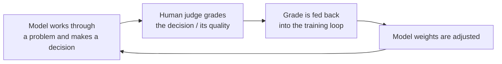
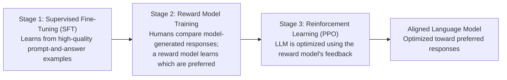

# Reinforcement Learning from Human Feedback (RLHF)

Reinforcement Learning from Human Feedback, or **RLHF**, is another term that's important to understand when talking about AI and large language models.

---

## Why LLMs can replicate human judgment

Large language models can replicate certain behaviors or a human thinking process. They can even replicate human judgment, because if you think about it, your thought process and decision making are, in the end, just **text generation**.

You may not be saying it aloud, but you may be reasoning about a problem by just "spitting out text" in your brain. Large language models can do that too.

---

## Why fine-tuning is needed for decision making

To replicate these thought processes and to make decisions, models need to be **fine-tuned** for that. Raw internet training data doesn't necessarily contain many decision processes.

You can replicate decision processes with fine-tuning, for example using [synthetic data](../Synthetic%20data/README.md). That way, the model can replicate thought processes and decision making.

---

## What is RLHF?

One extra step, or one special form of **post-training and fine-tuning**, is **reinforcement learning from human feedback**.

1. You let a model **analyze problems** and ask it to **make decisions**.
2. A **human judge** (the "human feedback") **grades** that decision, or the quality of that decision.
3. That grade is **fed back into the training loop**, and the model gets that feedback.
4. The **weights of the model are continuously adjusted** until it makes decisions that are good according to the human judge.



---

## How is it different from regular fine-tuning?

| Aspect | Regular (supervised) fine-tuning | RLHF |
|---|---|---|
| What the model receives | Finished examples used to update the parameters | Grades on its own answers from a human judge |
| What the model does | Learns from provided answers | Works through problems itself |
| How parameters change | Directly from the example answers | Influenced by how the judge grades the model's results |

So it's a different form of fine-tuning. You don't just give the model finished examples that are used to update the parameters. Instead, you ask the model to **work through problems**, you have a **judge grade those results**, and that **grading influences how the parameters are adjusted**.

It's a **more flexible form of fine-tuning**, you could say.

---

## Key takeaways

- RLHF is a special form of post-training / fine-tuning.
- Humans grade the model's own outputs instead of providing finished answers.
- The grades are fed back into training and steer how the weights are adjusted.
- See also: [SFT, RLHF and DPO](README.md) for how RLHF compares with SFT and DPO.

---

# RLHF – Explanation and Technical Review

The notes above capture the main idea of RLHF correctly. However, there are a few important technical nuances worth understanding, especially for LLM fundamentals and interviews.

The central idea is:

> **RLHF helps an LLM learn which responses humans prefer by using human feedback as a training signal.**

---

## 1. Why do we need RLHF?

Imagine an LLM generates three answers to the same question.

**User:** *Explain what an API is.*

- **Response A:** An API stands for Application Programming Interface.
- **Response B:** An API allows two software applications to communicate with each other. For example, a banking application can use an API to retrieve account information from a bank's server.
- **Response C:** APIs are software interfaces. They are used in programming.

All three responses might be technically correct. But which one is most helpful?

A human evaluator might prefer **Response B** because it:

- Explains the concept clearly.
- Provides a practical example.
- Gives sufficient context.

This is where RLHF becomes useful. The model is not just learning to produce grammatically correct text. It is being optimized to produce responses that better match **human preferences**.

---

## 2. How RLHF works – Step by step

The classic RLHF training approach has three main stages.



### Stage 1: Supervised Fine-Tuning

Start with a pre-trained model. Provide examples of:

- User questions.
- Ideal assistant answers.
- Instructions.
- Desired response formats.

The model learns how to behave like an assistant.

### Stage 2: Reward Model Training

Now the model generates multiple answers to the same question. Human evaluators compare these answers and identify their preferences. For example:

| Response | Human preference |
|---|---|
| A | 2nd |
| B | 1st |
| C | 3rd |

A separate neural network called the **Reward Model** learns to assign higher scores to responses that humans prefer.

### Stage 3: Reinforcement Learning

The language model generates responses. The reward model evaluates them and provides reward scores. An RL algorithm such as **PPO (Proximal Policy Optimization)** uses those scores to update the language model.

The objective is to encourage higher-reward responses while controlling how far the model moves from its reference behavior.

---

## 3. Important correction: Does human feedback directly update model weights?

The earlier notes say:

> "Human judge grades the decision, and that grade is fed back into the training loop."

This is conceptually correct, but the classic RLHF implementation has an **intermediate step**. The human feedback usually trains a **Reward Model** first. The Reward Model then supplies scores during reinforcement learning.

So the actual flow is:

1. LLM generates responses.
2. Humans rank or compare the responses.
3. Preference data trains a Reward Model.
4. Reward Model evaluates new LLM responses.
5. PPO uses reward signals to optimize the LLM's weights.

> **Remember:** Humans do not necessarily evaluate every response individually during the reinforcement-learning stage.

---

## 4. RLHF vs Regular Fine-Tuning (SFT)

A technically precise comparison:

| Aspect | SFT | RLHF |
|---|---|---|
| Training signal | Ideal answers | Human preferences |
| Data | Prompt + expected response | Prompt + preferred/rejected responses |
| Evaluation | Compare output with target answer | Reward model estimates preference |
| Optimization | Supervised learning | Reinforcement learning |
| Common algorithm | Gradient descent | PPO in classic RLHF |
| Objective | Learn desired responses | Optimize toward human preferences |

> **One important point:** RLHF commonly starts with an SFT-trained model. They are complementary rather than competing techniques.

---

## 5. Three important technical concepts

### A. Reward Model

A model trained to estimate how much humans would prefer a particular response.

### B. PPO (Proximal Policy Optimization)

An RL algorithm that updates the language model using reward signals while limiting overly large changes.

### C. KL Divergence

A measure used in classic RLHF to help constrain the updated model from drifting too far from its reference model.

---

## 6. Important clarification about human thinking

The original transcript suggests:

> "Human thinking and decision-making are ultimately just text generation."

This is an **oversimplification**. LLMs generate text using learned statistical patterns and internal representations. They can reproduce aspects of reasoning and decision-making, but human cognition involves much more than generating text.

Also, RLHF does not automatically teach genuine human-like reasoning. It optimizes model behavior according to feedback and the quality of the reward signal.

---

## 7. Final corrected Mermaid diagram

```mermaid
flowchart TD
    
flowchart TD
    A["Pre-trained LLM"] --> B["SFT: Learn from ideal answers"]
    B --> C["Generate multiple responses"]
    C --> D["Human evaluators compare responses"]
    D --> E["Preference dataset"]
    E --> F["Train Reward Model"]
    B --> G["Reference Model"]
    B --> H["Policy Model"]
    H --> I["Generate responses"]
    I --> J["Reward Model scores responses"]
    J --> K["PPO optimization"]
    G --> K
    K --> L["Updated LLM weights"]
    L --> I
```

---

## 8. Interview-ready summary

Remember these five points:

1. RLHF stands for **Reinforcement Learning from Human Feedback**.
2. It is a **post-training** technique used to align LLM behavior with human preferences.
3. Humans **compare or rank** model-generated responses.
4. A **reward model** learns human preferences and provides reward signals.
5. **Reinforcement learning**, commonly PPO in the classic approach, optimizes the language model using those signals.

**One-line memory trick:**

- **SFT** = Learn from correct answers.
- **RLHF** = Learn from human preferences through rewards.
- **DPO** = Learn directly from preferred and rejected answers.
