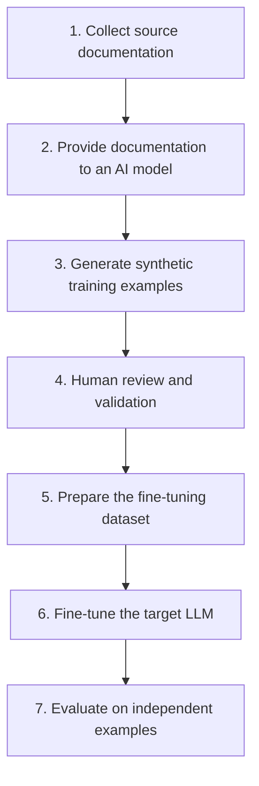
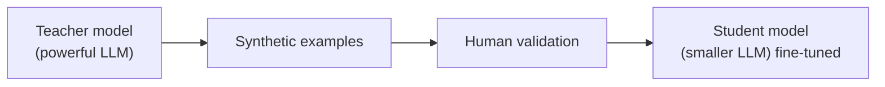

# Synthetic Data in LLMs – Complete Explanation with Real-World Examples

Synthetic data is an important concept in modern AI development, especially when working with LLM fine-tuning, model training, and domain-specific AI applications.

Let's understand it step by step.

---

## 1. What is Synthetic Data?

Synthetic data is artificially generated data that is created by an AI model, computer program, or simulation instead of being collected directly from real-world sources.

In simple terms:

- **Real data** = Data collected from actual sources.
- **Synthetic data** = Newly generated artificial data that imitates useful patterns of real data.

### Real-world analogy: A teacher creating practice exam questions

Imagine you are preparing students for a competitive examination. You have:

- 100 real examination questions.
- 100 corresponding answers.

But you want students to practise 10,000 questions. You have two options:

**Option 1: Collect more real questions**

Search books, previous examination papers and other sources.

**Option 2: Generate synthetic questions**

Give the original 100 questions to an AI model and ask it to generate 1,000 additional questions with answers.

A teacher then reviews the generated questions, corrects mistakes and approves them. Now you have a larger training dataset.

This is the basic idea of synthetic data.

---

## 2. Why do we need Synthetic Data?

There are several reasons.

### Reason 1: Limited availability of training data

Suppose you want to build an AI model that understands a new programming framework. You have:

- Framework documentation.
- 50 coding examples.
- 20 real-world implementation examples.

But you need thousands of examples to fine-tune your model effectively. You can use an AI model to generate additional examples based on the framework documentation.

### Reason 2: New technologies and libraries

Imagine a new Angular library is released in 2026. An LLM trained earlier may not know:

- The library's APIs.
- Its configuration.
- Its methods.
- Its recommended usage patterns.

You can provide the official documentation to an AI model and ask it to generate:

- Basic usage examples.
- Advanced implementation examples.
- Error-handling examples.
- Unit-testing examples.
- Real-world application examples.

These examples can become synthetic fine-tuning data after validation.

### Reason 3: Privacy and sensitive information

Companies often cannot share real customer records with external model-training systems. Synthetic data can create artificial customer records that preserve useful statistical patterns without reproducing actual customer identities.

> However, synthetic data must be checked for privacy leakage; it is not automatically anonymous or safe.

### Reason 4: Rare scenarios

Some events rarely occur in real-world datasets. For example:

- Banking fraud scenarios.
- Cybersecurity attacks.
- Unusual API failures.
- Rare software exceptions.

Synthetic data can generate additional examples of these scenarios for model training and testing.

---

## 3. Step-by-step: How Synthetic Data is generated for LLM fine-tuning

Suppose you want to fine-tune an LLM to become an expert in a particular programming library.

### Synthetic data generation pipeline

1. **Collect source documentation**
   Obtain official API documentation, examples and implementation guidelines.
2. **Provide documentation to an AI model**
   Use an existing LLM to understand the library and its capabilities.
3. **Generate synthetic training examples**
   Ask the model to create questions, answers, code examples and test cases.
4. **Human review and validation**
   Developers check correctness, API usage, security and coding standards.
5. **Prepare the fine-tuning dataset**
   Convert approved examples into prompt-response or instruction-following format.
6. **Fine-tune the target LLM**
   Train an existing model using the approved synthetic dataset.
7. **Evaluate the fine-tuned model**
   Test it against independent examples that were not used during training.



---

## 4. Practical example: Generate synthetic data for an Angular library

Let's say you want an LLM to become good at using a new Angular library called `ngx-smart-grid`. You have its official documentation but only a few coding examples. You can use an existing LLM to generate more training data.

### Step 1: Give documentation to an AI model

**Prompt to the data-generation LLM:**

```text
You are an Angular expert.

Study the following library documentation for ngx-smart-grid.

Generate 100 training examples covering:
1. Basic installation and configuration.
2. Component integration.
3. Server-side pagination.
4. Sorting and filtering.
5. API integration.
6. Error handling.
7. Unit testing.

Every example must use APIs that actually exist in the supplied documentation.

Return the examples in question-and-answer format.
```

### Step 2: AI generates synthetic examples

**Generated Question:**

How do you implement server-side pagination using ngx-smart-grid?

**Generated Answer:**

```typescript
@Component({
  selector: 'app-grid',
  template: `
    <ngx-smart-grid
      [data]="rows"
      [pageSize]="10"
      (pageChange)="loadPage($event)">
    </ngx-smart-grid>
  `
})
export class GridComponent {
  rows: any[] = [];

  loadPage(page: number) {
    // Fetch the requested page from the API
  }
}
```

> Illustrative pseudocode only, not verified `ngx-smart-grid` API syntax.

### Step 3: Human validation

This is extremely important. A developer checks:

- Does the library actually support these properties?
- Are the methods correct?
- Does the code compile?
- Does the example follow Angular best practices?
- Is the generated answer technically correct?

Incorrect examples must be corrected or rejected.

### Step 4: Create the fine-tuning dataset

After validation, convert the examples into a training format. For example:

```json
{
  "messages": [
    {
      "role": "user",
      "content": "How do you implement pagination?"
    },
    {
      "role": "assistant",
      "content": "Use the library's documented pagination API..."
    }
  ]
}
```

You can now use the approved examples to fine-tune an appropriate LLM.

---

## 5. Real Data vs Synthetic Data

| Aspect | Real Data | Synthetic Data |
|---|---|---|
| Source | Actual real-world sources | AI or programmatically generated |
| Creation | Collected | Generated |
| Cost | Can be expensive to collect and label | Can reduce collection and labeling costs |
| Availability | Sometimes limited | Can be generated at scale |
| Accuracy | Depends on source quality | Depends on generation and validation |
| Privacy | May contain personal information | Can reduce exposure, but requires privacy checks |
| Main challenge | Availability and labeling | Hallucinations and artificial patterns |

> **Important:** More data does not automatically mean a better model. A smaller, high-quality dataset can outperform a much larger dataset containing incorrect or repetitive examples.

---

## 6. Can AI train AI? (Teacher–Student concept)

This is another important concept related to synthetic data. Imagine:

- **Teacher model** = A powerful, capable LLM.
- **Student model** = A smaller LLM that you want to improve.

The teacher generates high-quality examples, and the student learns from those examples.




**Example:**

1. A powerful model generates 10,000 coding examples.
2. Developers validate the examples.
3. A smaller local model is fine-tuned using those examples.
4. The smaller model learns to perform the targeted coding tasks.

This is related to **Knowledge Distillation**. However, synthetic-data fine-tuning and knowledge distillation are not identical:

- **Synthetic data** describes artificially generated training data.
- **Knowledge distillation** describes transferring capabilities or behavior from a teacher model to a student model.

They can be used together.

---

## 7. Important risks of Synthetic Data

Synthetic data is powerful, but there are some challenges.

| Risk | Explanation | Solution |
|---|---|---|
| Hallucination | AI generates incorrect information | Human validation |
| Repetitive data | Similar examples are generated repeatedly | Deduplication |
| Bias | Teacher model passes its biases to generated data | Diverse data and bias evaluation |
| Model collapse | Repeatedly training on low-quality synthetic outputs can degrade diversity and quality | Preserve high-quality real data |
| Incorrect code | Generated code uses nonexistent APIs | Compile and test examples |
| Data leakage | Training and testing examples overlap | Independent evaluation datasets |

### One particularly important concept: Model Collapse

If an AI model repeatedly generates synthetic data and future models are trained on that generated data without sufficient high-quality original data, errors and distributional biases can accumulate. This can reduce the diversity and quality of future models.

---

## 8. Synthetic Data vs RAG vs Fine-tuning

| Concept | Purpose | Does it change model weights? |
|---|---|---|
| Synthetic Data | Generate artificial training examples | Not by itself |
| Fine-tuning | Adapt a model using additional training | Yes |
| RAG | Retrieve external knowledge during inference | No |
| Knowledge Distillation | Transfer behavior from teacher to student | Usually yes, through student training |

Consider a company with 5,000 internal legal documents.

### Option A – RAG

- Store documents in Qdrant.
- Generate embeddings.
- Retrieve relevant document chunks.
- Send those chunks to the LLM.
- Generate answers grounded in the retrieved content.

### Option B – Synthetic Data + Fine-tuning

- Give internal documentation to a capable LLM.
- Generate question-answer examples.
- Have legal experts validate the examples.
- Fine-tune a target model.
- Improve its ability to perform specific legal-document tasks.

These approaches solve different problems and can be combined.

> For frequently changing internal policies, RAG is generally more suitable for providing current information. Fine-tuning is more useful for adapting behavior, response formats and recurring task patterns.

---

## 9. Important interview questions

**Q1. What is synthetic data?**

Artificially generated data created using AI models, algorithms or simulations to supplement real-world training data.

**Q2. Why do LLM developers use synthetic data?**

To overcome limited data availability, generate rare scenarios, create domain-specific examples and reduce data collection and annotation costs.

**Q3. Can synthetic data replace real data?**

Not completely. Real data provides valuable grounding. Synthetic data supplements it, but needs quality checks and independent evaluation.

**Q4. Can an LLM generate its own training data?**

Yes. A teacher LLM can generate examples that are validated and used to train another model or even the same model.

**Q5. What is the relationship between synthetic data and fine-tuning?**

Synthetic data can provide additional prompt-response examples used to fine-tune an existing LLM.

> **One technical correction to remember:** Saying that AI labs have completely exhausted the internet is an oversimplification. The concern is the limited supply of high-quality, usable training data, rather than literally having no remaining internet data.

---

## 10. The five concepts to remember

| Concept | Meaning |
|---|---|
| **Real Data** | Collected from actual sources. |
| **Synthetic Data** | Artificially generated training examples. |
| **Fine-tuning** | Adapts model weights using additional training. |
| **Knowledge Distillation** | Transfers teacher-model capabilities to a student model. |
| **RAG** | Provides external knowledge at inference time. |

---

**Recommended next practical learning step:** Build a small synthetic-data generation pipeline using Ollama + FastAPI + Qdrant, generate programming-library Q&A examples, validate them, and prepare a fine-tuning dataset.
