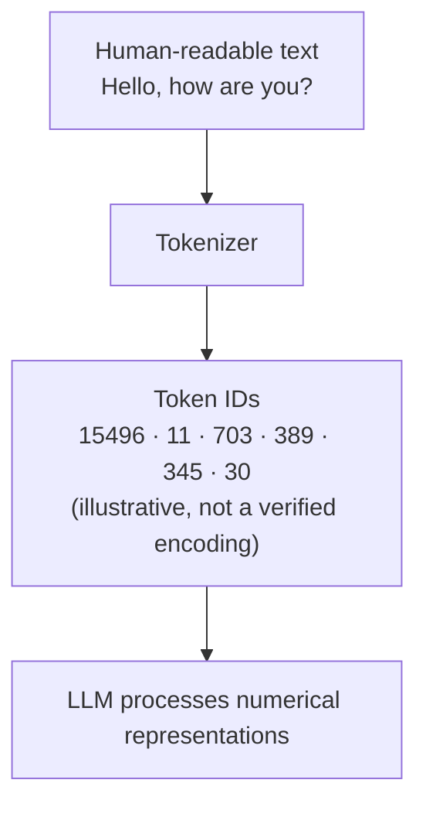
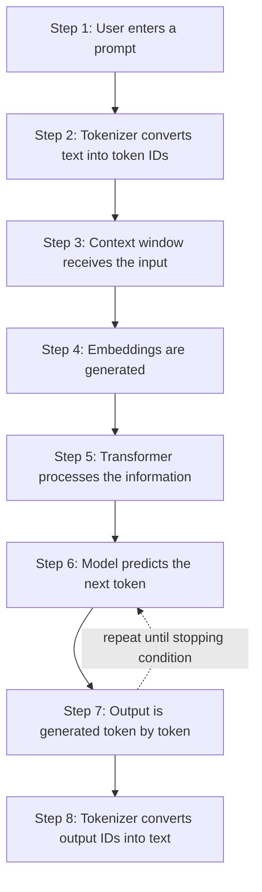
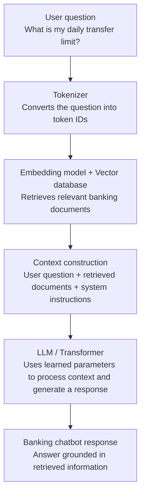

# Tokens, Tokenizer, Context Window & Parameters

Understanding the three fundamental building blocks of an LLM, and how an LLM actually processes your prompt and generates an answer.

---

## 1. The kitchen analogy

Think of an LLM (Large Language Model) as a professional kitchen.

| LLM concept | Kitchen analogy | Actual meaning |
|---|---|---|
| Tokens | Ingredients | Small pieces of text processed by the model |
| Tokenizer | Ingredient preparation | Converts text into token IDs |
| Context window | Kitchen workspace | Maximum number of tokens the model can handle in one context |
| Parameters | Chef's learned skills | Learned numerical values that determine how the model processes information |
| Transformer | Cooking process | Neural network architecture that processes information |
| Output tokens | Prepared dish | Text generated by the model |

Remember this:

- **Tokens** determine how text is divided.
- **Context window** determines how much information can fit.
- **Parameters** determine what the model has learned and how it uses that knowledge.

These three concepts work together but perform different jobs.

---

## 2. What are tokens?

Tokens are the small units of text into which an LLM divides its input.

A token can represent:

- A complete word.
- Part of a word.
- Punctuation.
- A number or part of a number.
- Whitespace combined with text.
- Other byte or character-level pieces, depending on the tokenizer.

Example:

```text
I love learning AI!

Illustrative token breakdown:
[I] [ love] [ learning] [ AI] [!]
```

> Illustrative only. Actual token boundaries depend on the model's tokenizer.

Tokens are not necessarily equivalent to words:

- `learning` might be one token.
- A less common word might be split into multiple tokens.
- `AI` might be one token or multiple tokens.

**Why do LLMs use tokens?** Computers work with numerical representations. Tokenization converts text into numerical IDs that the model can process.

---

## 3. What is a tokenizer?

A tokenizer converts text into token IDs and converts generated token IDs back into text. It is the bridge between human-readable language and the model's numerical input.



The important distinction:

- **Token** = a piece of text.
- **Token ID** = a numerical identifier representing that token.
- **Tokenizer** = the system that performs the conversion.

### How does subword segmentation work?

Modern tokenizers commonly use algorithms such as:

**A. Byte-Pair Encoding (BPE)**
Starts with smaller units and repeatedly merges frequently occurring adjacent units to create larger tokens.
Example (illustrative): `unbelievable` → `un` + `believ` + `able`

**B. WordPiece**
Builds a vocabulary of subword units and uses a scoring approach to select suitable segmentations.
Example: `playing` → `play` + `##ing`
The `##` notation is used in some WordPiece implementations to indicate a continuation of a word.

**C. Unigram Language Model**
Unlike a deterministic BPE-style merge process, Unigram begins with a larger vocabulary and uses probabilities to select suitable segmentations. It can also support multiple possible segmentations during training.

### Why subword tokenization is useful

1. Handles rare and unfamiliar words.
2. Avoids requiring a separate vocabulary entry for every possible word.
3. Reduces vocabulary size compared with whole-word tokenization.
4. Helps models process different word forms.

---

## 4. Advanced tokenization concepts

### 4.1 Number tokenization and mathematical reasoning

An LLM does not necessarily interpret a number as one complete numerical value. For example, `123456789` might be split, depending on the tokenizer, into:

- `123` + `456` + `789`
- `12` + `34` + `56` + `789`
- Individual digits

The exact segmentation depends on the vocabulary.

Consider `123 × 456`. The model processes token representations, not a built-in calculator operation. It must learn numerical relationships from training data and its architecture. This is one reason LLMs can struggle with multi-digit arithmetic. A calculator or code execution tool is more reliable.

### 4.2 Cross-lingual tokenization inefficiency

Different languages can require different numbers of tokens to express the same meaning:

- English: "Good morning"
- Hindi: "सुप्रभात"
- Bengali: "সুপ্রভাত"

The token count depends on the tokenizer and its vocabulary. Some tokenizers represent certain scripts more efficiently than others. This is often called **token inflation**.

Impact:

- More tokens consumed.
- Context window fills faster.
- Potentially higher API costs when pricing is token-based.
- Less information fits into the same context window.

This is not universally an English-versus-other-languages problem. Modern multilingual tokenizers can perform quite differently.

### 4.3 Whitespace and case sensitivity

Whitespace and capitalization can affect tokenization. For example, `hello`, ` hello` (with a leading space), `Hello` and `HELLO` can have different token IDs or segmentations.

Tokenizers often include frequently occurring combinations of spaces and words in their vocabularies, which is why spaces and formatting can affect token counts.

### 4.4 Glitch tokens

A glitch token is an unusual token or token sequence associated with unexpected model behavior. Researchers historically discovered unusual tokenizer entries, including the well-known "solid gold magikarp" example. Some had very little meaningful training exposure or unusual associations.

Potential effects:

- Unexpected outputs.
- Repetitions.
- Strange associations.
- Unusual generation behavior.

This is an interesting historical research topic, not a normal property of every tokenizer or modern LLM.

### 4.5 Special tokens

Some tokens have structural or control-flow meanings.

| Special token | Purpose |
|---|---|
| BOS | Beginning of sequence |
| EOS | End of sequence |
| PAD | Padding shorter sequences |
| UNK | Unknown token in some tokenization systems |
| SEP | Separates segments in some architectures |

Different models use different special-token conventions.

When generating a response, the model needs to know:

1. When the input starts.
2. Where different message sections begin and end.
3. When the response is complete.
4. When generation should stop.

EOS is particularly important because it can signal that generation is complete. If stop-token handling is incorrectly configured during fine-tuning or inference, the model may stop too early, continue too long, or behave unexpectedly.

---

## 5. What is a context window?

The context window is the maximum number of tokens a model can process within a single context. Think of it as the size of the kitchen workspace: a small workspace holds few ingredients, a large one holds much more.

Illustrative 8K context window:

| Section | Tokens |
|---|---|
| System instructions | 500 |
| Conversation history | 3,000 |
| Current prompt / documents | 2,500 |
| Available for response | 2,000 |
| **Total** | **8,000** |

> Illustrative allocation, not a fixed model configuration. Actual systems reserve and allocate tokens differently.

### What consumes the context window?

1. System instructions.
2. Developer instructions.
3. User prompts.
4. Previous conversation messages.
5. Tool results and retrieved documents.
6. The model's generated response, depending on the model's context and output limits.

### What happens when the context window is full?

The model cannot fit unlimited additional information into the same context. Depending on the application, it may:

- Remove older conversation messages.
- Summarize previous messages.
- Retrieve only relevant information.
- Reject an oversized request.
- Truncate information.

This is why long conversations sometimes need summarization or context management.

### Context window versus memory

| Context window | Memory |
|---|---|
| Information available to the model in its current processing context | Information retained or retrieved across interactions |
| Limited by context capacity | Depends on the application's memory mechanism |
| Contains current instructions and conversation content | Can preserve useful information for future conversations |
| Used during generation | Can help provide relevant background in later conversations |

An LLM does not automatically remember every conversation forever.

---

## 6. What are parameters in an LLM?

Parameters are the learned numerical values inside a neural network. They determine how the model transforms input representations into predictions. Think of them as the chef's learned skills, experience, and knowledge.

A model learns these values during training by repeatedly processing data and adjusting its parameters to reduce prediction errors.

| Model size | Approximate parameter count |
|---|---|
| Small model | 1 billion |
| Medium model | 7 billion |
| Large model | 70 billion |
| Very large model | 405 billion |

These are illustrative model sizes.

### What does 7 billion parameters mean?

The network contains approximately 7 billion learned numerical values. These are not 7 billion facts or words. They are distributed throughout the network and collectively encode patterns and relationships learned during training.

### How do parameters influence the answer?

Suppose you ask: *"What is the capital of India?"*

1. The model converts your prompt into token IDs.
2. Token IDs are converted into numerical embeddings.
3. The information is processed through transformer layers.
4. Learned parameters are used to calculate relationships and predictions.
5. The model produces probabilities for possible next tokens.
6. It selects a token and continues generating the response.

> **Important:** Parameters are not the same as generation settings such as temperature or top-p. Those settings influence how the model selects outputs, while learned parameters define the model itself.

---

## 7. How tokens, context windows and parameters work together

User prompt: *"Explain how caching works in a banking application."*



1. **User enters a prompt.** The application receives the natural-language question.
2. **Tokenizer converts text into token IDs.** The text is divided into tokens and mapped to numerical identifiers.
3. **Context window receives the input.** Instructions, conversation history and the current question are assembled within the available context.
4. **Embeddings are generated.** Token IDs are mapped to numerical vectors representing learned features.
5. **Transformer processes the information.** Attention mechanisms and learned parameters help the model understand relationships between tokens.
6. **Model predicts the next token.** It calculates a probability distribution over possible next tokens.
7. **Output is generated.** The process repeats token by token until a stopping condition is reached.
8. **Tokenizer converts output IDs into text.** The application displays the generated answer.

The diagram below shows the same journey for the prompt *"What are the symptoms of dengue fever?"*, from user input through token embeddings, positional encoding, self-attention and the context vector to next-token prediction.

.png>)

*Figure: How the model processes information, from text input to contextual understanding. Token splits, vector values and probabilities are illustrative.*

---

## 8. More concepts you should understand next

### 8.1 Embeddings

Token IDs are not directly meaningful numerical representations for semantic understanding. The model maps token IDs to embedding vectors:

```text
bank → [0.21, 0.45, -0.12, 0.87, ...]   (illustrative values)
```

Embeddings let the model represent useful learned features and relationships between concepts such as bank (financial institution), money, account, transaction and deposit.

### 8.2 Transformer architecture

Most modern LLMs are based on the Transformer architecture, which uses:

- Embeddings.
- Positional information.
- Self-attention.
- Feed-forward neural networks.
- Learned parameters.

Attention helps the model determine which parts of the available input are relevant when processing a particular token. In *"The customer deposited money into the bank."*, the word "bank" is interpreted in the context of the surrounding words.

### 8.3 Attention mechanism

Attention helps the model establish relationships between different tokens. In *"The customer opened an account because they needed to save money."*, the model can learn relationships between "account", "save" and "money". Attention is one of the key mechanisms that helps Transformers process contextual relationships.

### 8.4 Next-token prediction

LLMs generally generate text by predicting one token at a time.

Prompt: `The capital of India is`

| Candidate | Illustrative probability |
|---|---|
| New | 2% |
| Mumbai | 5% |
| Delhi | 85% |
| Kolkata | 3% |
| Other | 5% |

The model selects a next token according to its decoding strategy, then repeats the process using the expanded sequence. This is how an answer is generated.

### 8.5 Temperature and Top-p

These are generation settings, not learned model parameters.

| Setting | Meaning |
|---|---|
| Temperature | Controls how sharply or broadly token probabilities influence selection |
| Top-p | Restricts sampling to a set of likely tokens whose cumulative probability reaches a specified threshold |
| Max output tokens | Limits the number of tokens generated |
| Stop sequences | Define sequences that can terminate generation |

- Lower temperature: generally more predictable responses.
- Higher temperature: generally more varied responses.

A higher temperature does not automatically make an answer more intelligent or accurate.

---

## 9. Important differences to remember

| Concept | Main responsibility | Changes during inference? |
|---|---|---|
| Tokenizer | Converts text into token IDs | No, normally fixed |
| Token IDs | Represent token vocabulary entries | No |
| Embeddings | Represent tokens numerically | Generated during processing |
| Context window | Defines available context capacity | No, fixed for a given model/configuration |
| Parameters | Store learned model values | Normally no |
| Temperature | Influences token selection | Yes, configurable |
| Top-p | Controls sampling | Yes, configurable |

One additional distinction: fine-tuning can update learned parameters, but ordinary prompting does not normally change the model's weights.

---

## 10. Practical example: why this matters in a RAG application

Imagine a banking chatbot that answers: *"What is the maximum daily transfer limit?"*



Where do our three concepts fit?

- **Tokens:** Every question and retrieved document consumes tokens.
- **Context window:** Determines how much retrieved information and conversation history can be supplied to the LLM.
- **Parameters:** Help the LLM interpret the context and generate an answer.

Important RAG design considerations:

- If you retrieve too many documents, you can consume the context window unnecessarily.
- A good RAG application retrieves relevant chunks, manages token budgets and avoids sending unnecessary information.
- A context window does not guarantee factual accuracy. Retrieval quality, document freshness, prompt design and model behavior all matter.

---

## 11. Quick revision sheet

1. Tokens are pieces of text.
2. Tokenizers convert text into token IDs.
3. Token IDs are numerical identifiers.
4. BPE and WordPiece are subword tokenization approaches.
5. Token counts vary across languages and text formats.
6. Context windows limit how much information fits into a model's context.
7. Parameters are learned numerical values in the neural network.
8. Embeddings convert token IDs into numerical vectors.
9. Transformers use attention to process contextual relationships.
10. LLMs generate responses by predicting tokens sequentially.

---

## 12. Test your understanding

Try these interview-style questions before looking at the answers.

**1. What does a tokenizer actually produce from text?**
- A. Complete sentences
- B. Token IDs
- C. Context windows
- D. Model parameters

<details><summary>Answer</summary>

**B.** A tokenizer converts text into token IDs using its vocabulary.
</details>

**2. If a model has a 32K context window, what does 32K represent?**
- A. 32K words
- B. 32K parameters
- C. Approximately 32K tokens of context capacity
- D. 32K training documents

<details><summary>Answer</summary>

**C.** It represents token capacity, not word count or parameter count.
</details>

**3. What happens if a RAG application retrieves too many documents?**
- A. Parameters increase
- B. The context budget can be exhausted
- C. The tokenizer stops working
- D. The model automatically learns the documents

<details><summary>Answer</summary>

**B.** Retrieved documents consume context tokens, leaving less room for other input and output.
</details>

**4. Which component contains the learned knowledge and patterns of a model?**
- A. Tokenizer
- B. Context window
- C. Parameters
- D. Stop sequence

<details><summary>Answer</summary>

**C.** Learned parameters collectively encode patterns acquired during training.
</details>

**5. Does increasing temperature increase the number of model parameters?**
- A. Yes
- B. No

<details><summary>Answer</summary>

**B.** Temperature is a generation setting. It changes sampling behavior, not the learned weights.
</details>
