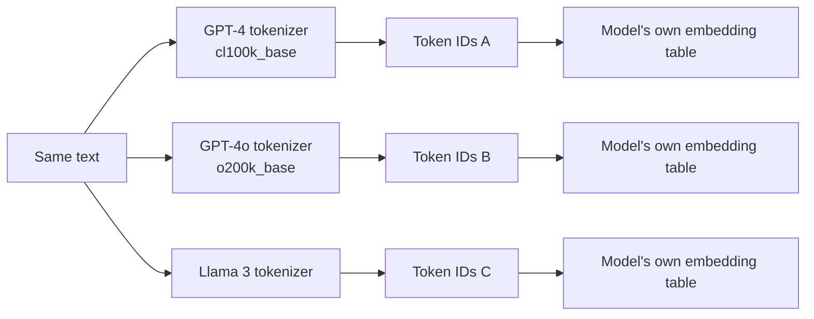

# Same Text, Different Tokenizers: Real Model Examples

> **Different AI models can use different tokenizers, meaning the same input text can be broken into different tokens depending on the model.**

This page shows that with real tokenizer output, not hypothetical splits. Every token split and count below was produced by running the actual tokenizers on the exact input shown. You can reproduce all of it with [`compare_tokenizers.py`](compare_tokenizers.py).


---

## 1. Which real tokenizers were used

| Model | Tokenizer | How it was loaded |
|---|---|---|
| OpenAI GPT-3 (davinci) | `r50k_base` | `tiktoken` |
| OpenAI GPT-4 | `cl100k_base` | `tiktoken` |
| OpenAI GPT-4o | `o200k_base` | `tiktoken` |
| Meta Llama 3.1 | Llama 3 tokenizer | `tokenizer.json` from Hugging Face repo `unsloth/Meta-Llama-3.1-8B` (an ungated mirror of Meta's tokenizer) |
| Alibaba Qwen 2.5 | Qwen2 byte-level BPE | `tokenizer.json` from `Qwen/Qwen2.5-7B-Instruct` |
| Mistral (Nemo) | Tekken | `tokenizer.json` from `mistralai/Mistral-Nemo-Instruct-2407` |

Notes:

- Tokenizer names such as `cl100k_base` and `o200k_base` are OpenAI's official encoding names.
- Special tokens such as BOS and EOS were **not** added, so the counts reflect only the text itself.
- Results can change if a vendor releases a new tokenizer version. These are the outputs of the tokenizers listed above.

### How to read the `�` symbol

Many tokenizers are **byte-level**. A token is not always a whole character. A Japanese, Hindi or Bengali character takes 3 bytes in UTF-8, and a tokenizer may put those bytes into different tokens. When we print a token that holds only part of a character, it cannot be displayed correctly, so it appears as `�`. This is real behavior, not a bug in the examples.

---

## 2. Example 1: One long English word

**Input:** `antidisestablishmentarianism`

| Model | Tokenizer | Tokens | Token pieces |
|---|---|---:|---|
| GPT-3 | `r50k_base` | 5 | `ant` · `idis` · `establishment` · `arian` · `ism` |
| GPT-4 | `cl100k_base` | 6 | `ant` · `idis` · `establish` · `ment` · `arian` · `ism` |
| GPT-4o | `o200k_base` | 6 | `ant` · `idis` · `est` · `ablishment` · `arian` · `ism` |
| Llama 3.1 | Llama 3 | 6 | `ant` · `idis` · `establish` · `ment` · `arian` · `ism` |
| Qwen 2.5 | Qwen2 BPE | 6 | `ant` · `idis` · `establish` · `ment` · `arian` · `ism` |
| Mistral Nemo | Tekken | 7 | `ant` · `idis` · `est` · `abl` · `ishment` · `arian` · `ism` |

What to notice:

- GPT-3 keeps `establishment` as **one** token.
- GPT-4, Llama 3.1 and Qwen 2.5 split it into `establish` + `ment`.
- GPT-4o splits it into `est` + `ablishment`.
- Mistral's Tekken splits it into three pieces: `est` + `abl` + `ishment`.

The same input gives three different splits across these six tokenizers.

---

## 3. Example 2: Another word, `unbelievably`

**Input:** `unbelievably`

| Model | Tokens | Token pieces |
|---|---:|---|
| GPT-3 (`r50k_base`) | 4 | `un` · `bel` · `iev` · `ably` |
| GPT-4 (`cl100k_base`) | 3 | `un` · `belie` · `vably` |
| GPT-4o (`o200k_base`) | 3 | `un` · `bel` · `ievably` |
| Llama 3.1 | 3 | `un` · `belie` · `vably` |
| Qwen 2.5 | 3 | `un` · `belie` · `vably` |
| Mistral Nemo (Tekken) | 4 | `un` · `bel` · `iev` · `ably` |

Both token counts and boundaries differ. The pieces `belie` + `vably` do not even line up with the word's morphemes (`un` + `believ` + `ably`). Tokenizers split by learned frequency, not by grammar.

---

## 4. Example 3: Mathematics and whitespace

**Input:** `2 + 2 = 4`

| Model | Tokens | Token pieces (a leading space is part of the token) |
|---|---:|---|
| GPT-3 (`r50k_base`) | 5 | `2` · ` +` · ` 2` · ` =` · ` 4` |
| GPT-4 (`cl100k_base`) | 7 | `2` · ` +` · ` ` · `2` · ` =` · ` ` · `4` |
| GPT-4o (`o200k_base`) | 7 | `2` · ` +` · ` ` · `2` · ` =` · ` ` · `4` |
| Llama 3.1 | 7 | `2` · ` +` · ` ` · `2` · ` =` · ` ` · `4` |
| Qwen 2.5 | 7 | `2` · ` +` · ` ` · `2` · ` =` · ` ` · `4` |
| Mistral Nemo (Tekken) | 7 | `2` · ` +` · ` ` · `2` · ` =` · ` ` · `4` |

What to notice:

- GPT-3 attaches the space to the number (` 2`, ` 4`).
- GPT-4, GPT-4o, Llama 3.1, Qwen 2.5 and Tekken split the space and the digit into **separate** tokens (` ` then `2`). Whether digits are merged or split affects how a model can learn numeric patterns. This short example only shows the space behavior, so test longer numbers to see how each tokenizer groups digits.
- Here the newer tokenizers agree with each other, but not with GPT-3.

---

## 5. Example 4: Japanese

**Input:** `お誕生日おめでとう`

| Model | Tokens | Token pieces |
|---|---:|---|
| GPT-3 (`r50k_base`) | 14 | `�` `�` `�` `�` `生` `�` `�` `�` `�` `�` `�` `で` `と` `う` |
| GPT-4 (`cl100k_base`) | 9 | `お` · `�` `�` · `生` · `日` · `お` · `め` · `で` · `とう` |
| GPT-4o (`o200k_base`) | 8 | `お` · `�` `�` · `生日` · `お` · `め` · `で` · `とう` |
| Llama 3.1 | 9 | `お` · `�` `�` · `生` · `日` · `お` · `め` · `で` · `とう` |
| Qwen 2.5 | 7 | `お` · `誕` · `生日` · `お` · `め` · `で` · `とう` |
| Mistral Nemo (Tekken) | 7 | `お` · `�` `�生日` · `お` · `め` · `で` · `とう` |

What to notice:

- GPT-3 needs **14** tokens, and many of them are raw byte fragments of a single character.
- GPT-4o needs 8, and Qwen 2.5 and Mistral Nemo need 7 for the same sentence.
- Qwen 2.5 holds `誕` as a whole token, while GPT-4, GPT-4o and Llama 3.1 break it into byte fragments.
- `生日` ("birthday") is one token in GPT-4o, Qwen 2.5 and Tekken, but two separate tokens (`生`, `日`) in GPT-4 and Llama 3.1.

This is why tokenizer design matters for multilingual applications.

---

## 6. Example 5: Hindi and Bengali

Same meaning ("Good morning"), different scripts.

| Input | GPT-3 | GPT-4 | GPT-4o | Llama 3.1 | Qwen 2.5 | Mistral Nemo |
|---|---:|---:|---:|---:|---:|---:|
| `Good morning` (English) | 2 | 2 | 2 | 2 | 2 | 2 |
| `सुप्रभात` (Hindi) | 15 | 8 | 5 | 4 | 7 | 5 |
| `সুপ্রভাত` (Bengali) | 18 | 12 | 5 | 12 | 9 | 5 |

Token pieces for the Hindi and Bengali inputs:

| Model | `सुप्रभात` (Hindi) | `সুপ্রভাত` (Bengali) |
|---|---|---|
| GPT-4 | `स` · `ु` · `प` · `्र` · `�` `�` · `ा�` · `�` | mostly byte fragments (12 tokens) |
| GPT-4o | `स` · `ुप` · `्र` · `भ` · `ात` | `স` · `ু` · `প্র` · `ভ` · `াত` |
| Llama 3.1 | `स` · `ुप` · `्रभ` · `ात` | mostly byte fragments (12 tokens) |
| Qwen 2.5 | `स` · `ु` · `प` · `्र` · `भ` · `ा�` · `�` | `স` · `�` `�` · `প` · `্�` `�` · `ভ` · `া�` `�` |
| Mistral Nemo | `स` · `ु` · `प्र` · `भ` · `ात` | `স` · `ু` · `প্র` · `ভ` · `াত` |

What to notice:

- English `Good morning` is 2 tokens everywhere.
- The Bengali word needs between 5 and 18 tokens, depending on the model. Llama 3.1 uses 12 where GPT-4o and Tekken use 5.
- The ranking is not the same across scripts. Llama 3.1 is the most compact for Hindi (4) but one of the least compact for Bengali (12). Tokenizer efficiency depends on the language, not just on the model.

---

## 7. Why this matters

Token count is a property of the **(text, tokenizer)** pair, not of the text alone.

| Effect | Why it follows from tokenization |
|---|---|
| Context window usage | The same document consumes more of the window with a less efficient tokenizer. |
| API cost | Token-based pricing means the same text can cost a different amount on different models. |
| Latency | More tokens means more generation steps and more attention computation. |
| Multilingual fairness | Some scripts need many more tokens for the same meaning (token inflation). |
| Numbers and arithmetic | How digits are split affects how a model can learn numeric patterns. |

Two cautions:

1. **Token counts cannot be compared across models as a quality measure.** A smaller count does not make a model smarter or better. It only means its vocabulary covers that text more compactly.
2. **Token counts from one model's tokenizer do not apply to another model.** Always count with the tokenizer of the model you are calling.

The core idea: a model's tokenizer determines how text becomes token IDs. Those IDs are mapped to embeddings, which the transformer processes.



Token IDs are only meaningful for the tokenizer and model that produced them. The same number (for example `17`) maps to different things in different vocabularies.

---

## 8. Try it yourself

### Python with `tiktoken` (OpenAI models)

```bash
pip install tiktoken
```

```python
import tiktoken

text = "antidisestablishmentarianism"

encodings = [
    "r50k_base",    # GPT-3
    "cl100k_base",  # GPT-4
    "o200k_base",   # GPT-4o
]

for name in encodings:
    tokenizer = tiktoken.get_encoding(name)
    tokens = tokenizer.encode(text)
    pieces = [
        tokenizer.decode_single_token_bytes(token).decode("utf-8", errors="replace")
        for token in tokens
    ]
    print(f"\n{name}")
    print("Tokens:", pieces)
    print("Count:", len(tokens))
```

Expected output:

```text
r50k_base
Tokens: ['ant', 'idis', 'establishment', 'arian', 'ism']
Count: 5

cl100k_base
Tokens: ['ant', 'idis', 'establish', 'ment', 'arian', 'ism']
Count: 6

o200k_base
Tokens: ['ant', 'idis', 'est', 'ablishment', 'arian', 'ism']
Count: 6
```

### Python with Hugging Face `tokenizers` (Llama, Qwen, Mistral)

```bash
pip install tokenizers huggingface_hub
```

```python
from huggingface_hub import hf_hub_download
from tokenizers import Tokenizer

tok = Tokenizer.from_file(hf_hub_download("Qwen/Qwen2.5-7B-Instruct", "tokenizer.json"))
enc = tok.encode("antidisestablishmentarianism", add_special_tokens=False)
print(enc.tokens, len(enc.ids))
```

Byte-level tokenizers print tokens in a mapped form (for example `Ġ` stands for a leading space). The full script, [`compare_tokenizers.py`](compare_tokenizers.py), converts these back to readable text and runs every example on this page across all six tokenizers.

### Online tools

- [OpenAI Tokenizer](https://platform.openai.com/tokenizer) for OpenAI tokenization.
- [Tiktokenizer](https://tiktokenizer.vercel.app/) to compare multiple model tokenizers side by side.
- [The Tokenizer Playground (Hugging Face)](https://huggingface.co/spaces/Xenova/the-tokenizer-playground) to explore tokenizers from many open models.

---

## 9. Quick revision

1. Different models use different tokenizers, so the same text splits differently.
2. Both the **boundaries** and the **count** of tokens can differ.
3. Newer tokenizers (larger vocabularies) generally cover non-English text more compactly, but not uniformly. It depends on the script.
4. A token can be a fragment of a character (a few bytes), which shows up as `�` when printed.
5. Token IDs only mean something for the tokenizer and model that produced them.
6. Fewer tokens means less context used and lower token-based cost, but it says nothing about model quality.
7. Always count tokens with the tokenizer of the model you are actually calling.

**Next concept to explore:** why a larger vocabulary (for example GPT-4o's `o200k_base`) lets the same Japanese or Bengali text fit into fewer tokens, and how that changes context-window usage and API cost.
