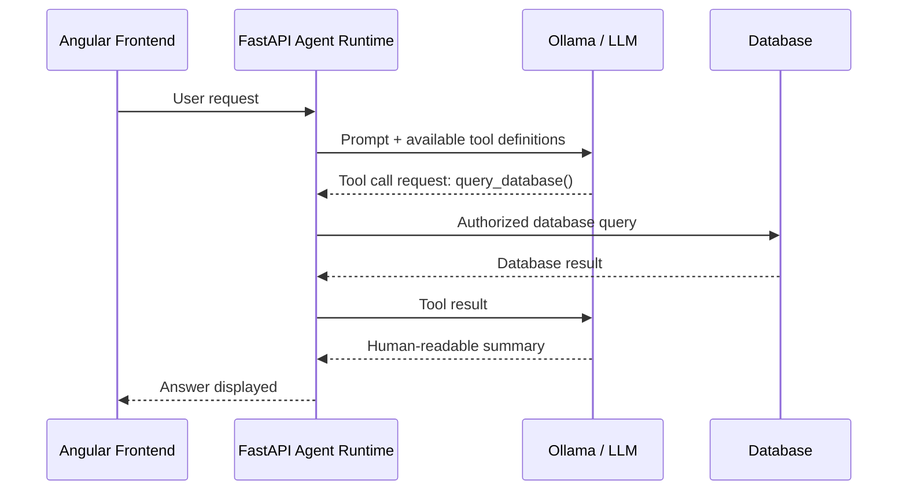
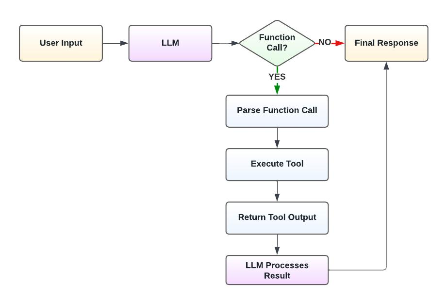

# Tools in AI Agents – How LLMs Request Actions

The most important concept to understand is:

> **A tool is a capability that the surrounding AI agent software exposes to an LLM so that the LLM can request an action beyond generating text.**

Let's understand this from a software engineering perspective.

---

## 1. What exactly is a tool?

A tool is simply a function, API, or capability that an AI agent can make available to an LLM.

Examples:

| Tool | What it allows the agent to do |
|------|--------------------------------|
| `read_file()` | Read files |
| `search_web()` | Search the internet |
| `query_database()` | Retrieve database records |
| `send_email()` | Send an email |
| `get_weather()` | Retrieve weather information |
| `execute_python()` | Execute permitted Python code |
| `create_ticket()` | Create a support ticket |

An LLM doesn't automatically have these capabilities.

The surrounding application must implement or integrate them and expose their descriptions and input schemas to the model.

---

## 2. How tool calling works

Imagine you're building an AI application using Angular 19, FastAPI and Ollama.

User asks:

> "Find the customer with ID 101 in our database and summarize their account details."

Here's the execution flow:

1. **Angular frontend** – User enters a request.
2. **FastAPI Agent Runtime** – Sends prompt + available tool definitions to the LLM.
3. **Ollama / LLM** – Decides to request `query_database()` (tool call request).
4. **FastAPI executes the tool** – Runs an authorized database query and gets the database result.
5. **LLM receives the result** – Generates a human-readable summary.
6. **Angular displays the answer.**



Notice something important:

> The LLM doesn't connect directly to PostgreSQL. FastAPI executes the database operation.

---

## 3. Let's see what a tool looks like in Python

Suppose you create a database lookup tool.

```python
def get_customer(customer_id: int):
    """
    Retrieve customer details using customer ID.
    """
    customer = database.find_customer(customer_id)

    if not customer:
        return {"error": "Customer not found"}

    return {
        "customer_id": customer.id,
        "name": customer.name,
        "account_type": customer.account_type
    }
```

Your application makes this function available to the LLM through a tool definition.

For example, a simplified tool schema:

```json
{
  "type": "function",
  "function": {
    "name": "get_customer",
    "description": "Retrieve customer details",
    "parameters": {
      "type": "object",
      "properties": {
        "customer_id": {
          "type": "integer",
          "description": "Customer ID"
        }
      },
      "required": ["customer_id"]
    }
  }
}
```

The LLM receives this description and can decide whether to request this function.

The application then:

1. Receives the tool call.
2. Validates the arguments.
3. Executes the Python function.
4. Collects the result.
5. Sends the result back to the LLM.

> **Important:** Tool calling is not the same as executing code generated by the LLM. Your application controls which functions are available and how they execute.

---

## 4. Who provides the tools?

This is a particularly important distinction.

| Software | Examples of exposed capabilities |
|----------|----------------------------------|
| ChatGPT application | Web search, file analysis, other integrated capabilities |
| Claude Code | File operations, terminal commands, development tools |
| Your FastAPI application | Python functions, database queries, internal APIs |
| Browser agent | Navigation, clicking, page interaction |
| MCP-enabled application | Tools exposed by connected MCP servers |

The available tools depend on the application and its integrations, not simply on which LLM you use.

---

## 5. Tool Calling vs MCP

You should understand this distinction before moving further into agent development.

**Traditional tool calling**

Your application defines tools and provides the execution logic.



**MCP (Model Context Protocol)**

MCP provides a standardized protocol through which AI applications can discover and interact with external tools and resources.

.jpg)

Think of it this way:

- **Tool calling** = The model requests an action.
- **MCP** = A standardized way to expose and communicate with external capabilities.
- **Agent runtime** = The software coordinating the execution.

> MCP does not replace tool calling. It can provide tools that an agent invokes through its normal tool-calling workflow.

---

## 6. Important production considerations

When developing enterprise AI agents, **never blindly execute every tool call requested by an LLM.**

Consider:

- **Authentication:** Who is allowed to use the tool?
- **Authorization:** Can this user access this particular customer record?
- **Input validation:** Are the arguments valid?
- **Security:** Can the tool expose sensitive information?
- **Human approval:** Should an email, payment, or destructive operation require confirmation?
- **Timeouts and retries:** What happens when an external API fails?
- **Audit logging:** Which tool was called, by whom, and with what outcome?

For banking applications, these controls are particularly important.

---

## 7. Test your understanding

**1. Who actually executes `get_customer()`?**

- LLM
- **FastAPI agent runtime** ✅
- Tokenization engine

*The runtime executes the function using its own application code.*

**2. Where do available tools come from?**

- Automatically from every LLM
- **The surrounding application and its integrations** ✅
- The model's training data

*The application exposes the capabilities it supports.*

**3. What does MCP provide?**

- A new LLM
- **A standardized protocol for exposing and accessing capabilities** ✅
- A replacement for Python

*MCP standardizes communication between AI applications and external capability providers.*

---

## What should you learn next?

I'd recommend this progression for local Ollama + FastAPI AI development:

1. Tool Calling / Function Calling
2. How to implement multiple tools in FastAPI
3. Tool selection and execution loop
4. MCP Server and MCP Client
5. LangGraph tool orchestration
6. Multi-agent communication

**Next practical project:** Build a local AI assistant using Ollama + Phi-3 + FastAPI that exposes three tools: `read_file()`, `search_documents()` and `query_database()`. This will connect your understanding of LLMs, agents, tools and RAG into one working application.
