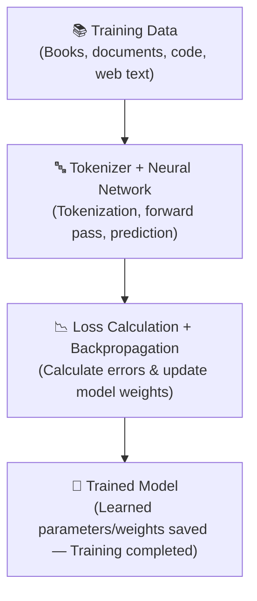
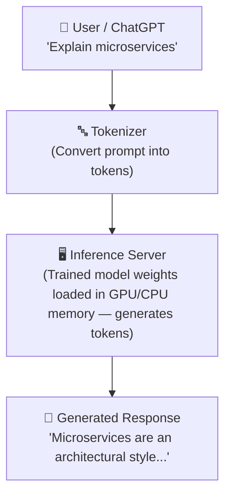
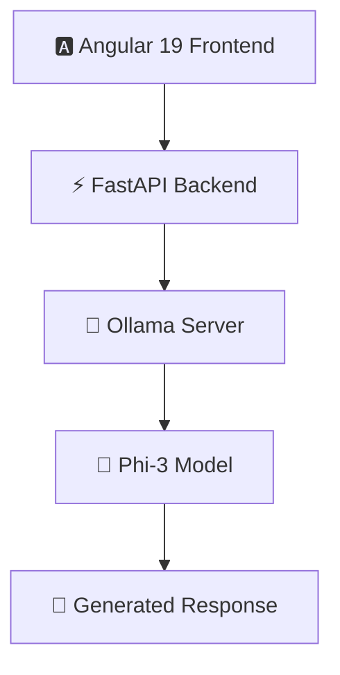

# Training vs Inference in Large Language Models (LLMs)

This guide explains two fundamental concepts in Large Language Models (LLMs):
1. **Training** – How an LLM learns from data and develops its parameters.
2. **Inference** – How a trained LLM uses those parameters to generate responses to user requests.

These are two of the most important concepts to understand when learning AI application development, Generative AI, and LLM architecture.

Let's understand them from a **developer and system-design perspective**, with practical examples.

---

## 1. What is Training?

**Training** is the process of teaching a neural network to learn patterns from data.

When OpenAI creates a GPT model, it goes through a training process using large amounts of text and other data.

### During training:
1. The model receives training data.
2. The data is converted into tokens.
3. The neural network processes those tokens.
4. The model predicts the next token.
5. Its prediction is compared with the expected result.
6. The model's parameters (weights) are adjusted to reduce prediction errors.
7. This process repeats many times.

The result is a **trained model containing learned parameters (weights)**.

### Example:
Suppose we give a model the following sentence:
> *"The capital of India is _____."*

- Initially, the model may not predict the correct answer.
- Through training on many examples, it learns patterns and relationships that help it predict: **`New Delhi`**.

> *Note:* This is a simplified illustration. Real LLM training involves massive datasets and complex mathematical optimization.

---

### Training the Neural Network: Teaching the Model to Guess the Next Token

Now that we’ve turned the internet into token IDs, it’s time to teach the model how to predict what comes next.


At a high level, you can consider the LLM to be a giant black box—a deep neural network with billions (or hundreds of billions) of parameters.

**Its job?**
Take in a sequence of tokens and predict how likely each possible token in the vocabulary is, to occur next.

#### Example:
Let’s say we feed it the phrase:
> *"The cat sat on the"*

The model processes this context and uses its parameters—spread across dozens (or hundreds) of neural layers—to generate a probability distribution over its entire vocabulary:

- `"mat"` → `0.30`
- `"roof"` → `0.40`
- `"idea"` → `0.01`
- *…and so on for every token it knows*

The token with the highest probability is selected (or sampled from), and that becomes the next output.

**That’s the entire game:**
$$\text{Take tokens in} \longrightarrow \text{Guess the next one} \longrightarrow \text{Repeat}$$

#### So, how does it learn?
If the model predicts `"roof"` but the actual word in the dataset was `"mat"`, it calculates a **loss** (usually cross-entropy) and uses **backpropagation** to nudge all its weights ever so slightly in the right direction.

This happens over and over—across billions of sequences.

---

## 2. What is Inference?

**Inference** is the process of using an already-trained model to generate predictions or responses.

### Once training is complete:
- The model's learned parameters are saved.
- The model is deployed to infrastructure.
- Its parameters are loaded into memory.
- It waits for incoming requests.
- It processes requests and generates responses.

### Example using ChatGPT:
You enter:
> *"Explain microservices architecture."*

**What happens?**
1. ChatGPT receives your request.
2. The text is converted into tokens.
3. The tokens are processed by the trained GPT model.
4. The model predicts the next token.
5. It continues generating tokens one by one.
6. The final response is returned to you.

This entire runtime process is called **Inference**.

---

## 3. Training vs Inference – Key Differences

| Feature | 🏋️ Training | ⚡ Inference |
|---|---|---|
| **Purpose** | Teach the model | Use the trained model |
| **Input** | Training datasets | User prompts |
| **Output** | Learned model parameters (weights) | Predictions / responses |
| **Frequency** | Performed during model creation and updates | Happens for every user request |
| **Computation** | Forward pass + Backpropagation + Gradient updates | Forward pass only |
| **Hardware** | Large GPU/TPU clusters | GPUs, CPUs, or specialized accelerators |
| **Memory Focus** | Model weights, activations, gradients & optimizer states | Model weights, activations, and KV cache |
| **Cost** | Often very high (millions of dollars) | Depends on model size and request volume |

> 📌 **Important:** Inference does **not** normally update the model's learned weights. It uses the existing trained parameters to generate output.

---

## 4. Architecture – How Training and Inference Work

### Phase 1: Training (Model Creation)



### Phase 2: Inference (Serving Users)



---

## 5. Why Does Inference Require Powerful Hardware?

This is a critical concept when building and deploying LLM applications.

A trained LLM contains millions or billions of parameters. These parameters must be loaded into memory when the model runs.

### Approximate Memory for Weights at FP16 (16-bit Precision)

| Model Size | Approx. Memory for Weights at FP16 |
|---|---|
| **1 billion parameters (1B)** | ~2 GB |
| **3 billion parameters (3B)** | ~6 GB |
| **7 billion parameters (7B)** | ~14 GB |
| **8 billion parameters (8B)** | ~16 GB |
| **70 billion parameters (70B)** | ~140 GB |

> *Note:* These are theoretical weight-memory estimates. Actual inference requires additional memory for the **KV cache**, runtime overhead, and intermediate activations.

### What is GPU VRAM?
**GPU VRAM** is the high-bandwidth video memory available on a graphics processing unit.

During inference:
1. The trained model's weights are loaded into GPU VRAM.
2. The user prompt is converted into tokens.
3. The GPU processes the tokens using parallel compute cores.
4. The model generates new tokens autoregressively.
5. The generated output is returned to the application.

### Why is GPU Important?
GPUs can perform matrix and vector operations massively in parallel, making them well-suited for neural-network computations. However, inference can also run on CPUs, and some local frameworks support offloading layers between GPU VRAM and system RAM.

### Why are Small Language Models (SLMs) Attractive?
Consider two models:
- **Model A:** 70 billion parameters (requires ~140 GB+ VRAM)
- **Model B:** 3 billion parameters (requires ~6 GB VRAM)

Model B requires significantly less memory and computational power.

This makes smaller models attractive for:
- 💻 Local AI applications
- 🛠️ Developer workstations and testing
- 📱 Edge devices and mobile systems
- 🔒 Private on-premise enterprise applications
- 💰 Low-cost inference infrastructure

*Trade-off:* Smaller models may have lower reasoning capability or accuracy on highly complex tasks compared to massive models.

---

## 6. Practical Example: Running an LLM Locally Using Ollama

Let's connect this theory to a full-stack local AI development environment.

Suppose you want to run **Phi-3** using **Ollama** on your machine:



### What happens step-by-step?

1. **Step 1 – Model preparation:**  
   You download the Phi-3 model using:
   ```bash
   ollama pull phi3
   ```
   *Ollama downloads the pre-trained model files. The model is already trained; you are not training it from scratch.*

2. **Step 2 – Start the model:**  
   ```bash
   ollama run phi3
   ```
   *Ollama loads the model weights into available system memory and/or GPU VRAM.*

3. **Step 3 – Send a prompt:**  
   ```text
   Explain RAG architecture.
   ```

4. **Step 4 – Inference:**  
   *Phi-3 processes the prompt and generates a response token by token.*

5. **Step 5 – Return the response:**  
   *Ollama streams or returns the generated text back to your application.*

> 📌 **Important distinction:** Downloading a trained model and running it locally is **inference**, not training.

---

## 7. Three Important Concepts to Remember

| Concept | Meaning |
|---|---|
| **Model Parameters** | Learned numerical values (weights) inside the neural network |
| **Training** | The process of learning and adjusting those parameters |
| **Inference** | The process of using the learned parameters to generate predictions |

### Two Important Types of Training:
- **Pre-training:** The model learns general language patterns, facts, and reasoning from vast, web-scale datasets.
- **Fine-tuning:** An already-trained model is further trained on a specific, high-quality dataset (e.g., banking Q&A, medical data) to specialize its behavior for particular domains or tasks.

---

## 8. Real-World Examples: Training vs. Inference

| Scenario | Training or Inference? |
|---|---|
| OpenAI creates GPT using large datasets | 🏋️ **Training** |
| You ask ChatGPT a question | ⚡ **Inference** |
| You download Phi-3 using Ollama | 📦 **Neither** (Model distribution / download) |
| You run Phi-3 locally | ⚡ **Inference** |
| You fine-tune a model using banking data | 🏋️ **Training** |
| Your chatbot sends a prompt to an LLM API | ⚡ **Inference** |
| A company updates its model weights using new data | 🏋️ **Training** |

---

## 9. Interview Questions and Answers

**Q1. What is the difference between training and inference?**  
> **Answer:** Training is the process of teaching a model by adjusting its parameters using data and backpropagation. Inference is the process of using an already-trained model with fixed parameters to generate predictions or responses to user prompts.

**Q2. Why does inference require GPU memory?**  
> **Answer:** The model weights must be loaded into memory to evaluate tokens. GPUs provide high-bandwidth memory (VRAM) and parallel processing cores, which execute the required matrix multiplications with low latency.

**Q3. Does inference change model parameters?**  
> **Answer:** Normally, no. Standard inference uses fixed, read-only model weights.

**Q4. Why are smaller language models useful?**  
> **Answer:** They require fewer computational resources and much less memory, making them suitable for local deployments, edge devices, and cost-efficient applications.

**Q5. Can training and inference happen on the same machine?**  
> **Answer:** Yes. A machine can perform both operations provided it has sufficient hardware. However, production systems typically separate training clusters from low-latency inference-serving infrastructure.

---

## 10. Quick Knowledge Check

<details>
<summary><strong>1. When you ask ChatGPT a question, which process is happening?</strong></summary>

- [ ] Training
- [x] **Inference**
- [ ] Fine-tuning

*Explanation: ChatGPT uses an already-trained model to generate your response in real time. This is inference.*
</details>

<details>
<summary><strong>2. What happens to model weights during standard training?</strong></summary>

- [x] **They are adjusted**
- [ ] They are deleted
- [ ] They remain unchanged

*Explanation: Training updates model weights through gradient descent and backpropagation to reduce prediction errors.*
</details>

<details>
<summary><strong>3. Why does a 70B model generally need more memory than a 3B model?</strong></summary>

- [x] **It has more parameters**
- [ ] It has fewer tokens
- [ ] It uses no GPU

*Explanation: More parameters mean more weight values must be stored in memory (~140 GB for 70B vs ~6 GB for 3B at FP16).*
</details>

<details>
<summary><strong>4. You run Phi-3 using Ollama. What are you performing?</strong></summary>

- [ ] Pre-training
- [x] **Inference**
- [ ] Backpropagation

*Explanation: Ollama executes an already-trained model to generate responses to prompts.*
</details>

---

## 11. Final Interview Takeaway

```text
Training  = Learning (The model learns patterns from data and adjusts its parameters)
Inference = Applying Learning (The trained model uses fixed parameters to process prompts and generate responses)
```

### What to learn next:
$$\text{Tokens} \longrightarrow \text{Tokenization} \longrightarrow \text{Embeddings} \longrightarrow \text{Transformers} \longrightarrow \text{Attention Mechanism} \longrightarrow \text{LLM Architecture}$$

These concepts form the foundation needed before mastering RAG, AI Agents, and production AI application development.
