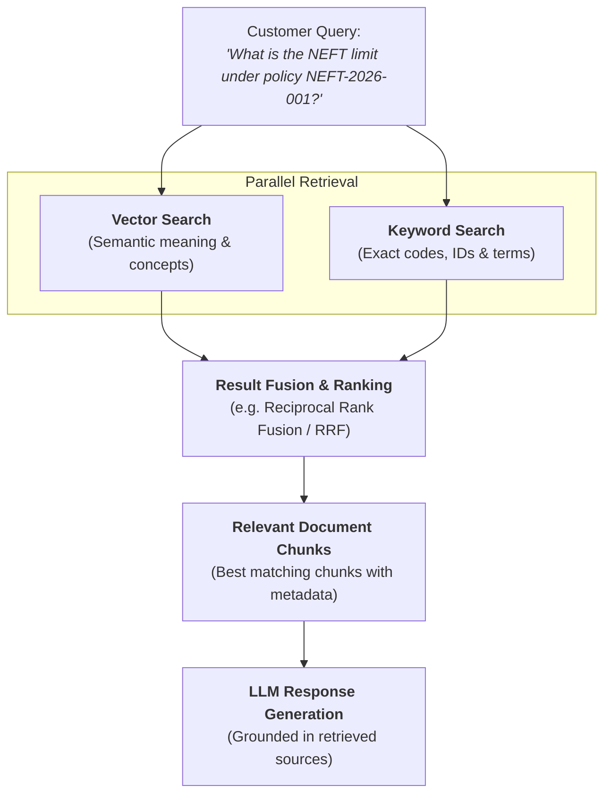

# Vector Database vs SQL Database vs Hybrid Search

> **Understanding database architecture for enterprise banking RAG systems**  
> This is an important architectural decision when building an enterprise chatbot, especially for banking.

---

## Practical Scenario

You are building a banking chatbot that answers questions using internal bank documents, product policies, transaction rules, and customer information.

A customer asks:
1. *"How can I increase my daily transaction limit?"*
2. *"What is the NEFT transaction limit?"*
3. *"Show my last five transactions."*
4. *"What is the policy for international fund transfers?"*

These questions look similar from an application perspective, but they require completely different retrieval mechanisms.

### The Key Idea
* **SQL databases** are excellent at retrieving structured data and performing transactional operations.
* **Vector databases** are excellent at finding semantically similar information based on meaning.
* **Hybrid search** combines semantic search and keyword search to improve document retrieval accuracy.

---

## 1. Traditional SQL Database

A traditional relational database stores structured data in tables containing rows and columns.

**Examples:**
* PostgreSQL
* MySQL
* Microsoft SQL Server

### Example Banking Tables

#### `Customers`
| customer_id | name | account_type |
| :--- | :--- | :--- |
| `C101` | Rahul | Savings |
| `C102` | Priya | Current |

#### `Transactions`
| transaction_id | customer_id | amount | type |
| :--- | :--- | :--- | :--- |
| `T001` | C101 | 5000 | NEFT |
| `T002` | C101 | 2000 | UPI |
| `T003` | C102 | 8000 | IMPS |

#### `Transaction Limits`
| account_type | transaction_type | daily_limit |
| :--- | :--- | :--- |
| Savings | UPI | 100000 |
| Savings | NEFT | 500000 |
| Current | IMPS | 1000000 |

---

### Example Query

A customer asks:
> **"Show my last five transactions."**

**SQL is the right choice:**
```sql
SELECT transaction_id, amount, type
FROM transactions
WHERE customer_id = 'C101'
ORDER BY transaction_date DESC
LIMIT 5;
```

#### Why?
Because you need:
* Exact customer identification.
* Exact filtering.
* Deterministic sorting by transaction date.
* Accurate, real-time financial records.

> **Note:** A vector database is not the right primary source for this operation.


---

### When should you use SQL?

| Requirement | SQL Suitability |
| :--- | :--- |
| Customer details | Excellent |
| Account balances | Excellent |
| Transaction history | Excellent |
| Payment records | Excellent |
| Exact policy ID lookup | Excellent |
| Financial updates | Excellent |
| Semantic document search | Not its traditional strength |

### ACID Transactions in Banking
For banking, SQL is especially critical because of **ACID** properties:
* **Atomicity:** All parts of a transaction succeed, or none do.
* **Consistency:** Data remains valid according to all constraints.
* **Isolation:** Concurrent transactions execute without interference.
* **Durability:** Committed transactions survive system failures.

*Example:* Transferring ₹5,000 between two accounts must never debit one account without crediting the other.

---

## 2. Vector Database

A vector database stores high-dimensional embeddings generated from text, images, or other unstructured data.

**Examples:**
* Qdrant
* Pinecone
* Weaviate
* Milvus

### Example Banking Documents

| Document | Extracted Content |
| :--- | :--- |
| `DOC001` | Customers can request an increase in daily transaction limits. |
| `DOC002` | UPI payments have a maximum daily transfer limit. |
| `DOC003` | International transfers require additional verification. |
| `DOC004` | Customers can download monthly account statements. |

---

### Vectorization Workflow

The documents are split into chunks and converted into dense vector embeddings:

1. **Chunk:**
   ```text
   Customers can request an increase in daily transaction limits through the mobile banking application.
   ```
2. **Embedding Model converts chunk to vector:**
   ```json
   [0.23, 0.56, -0.12, 0.89, ...]
   ```
3. **Qdrant stores vector + payload (metadata + text):**
   ```json
   {
     "id": "DOC001",
     "vector": [0.23, 0.56, -0.12, 0.89],
     "payload": {
       "text": "Customers can request an increase in daily transaction limits...",
       "department": "Retail Banking"
     }
   }
   ```

---

### Semantic Search in Action

The customer asks:
> **"How can I send more money every day?"**

Notice that the question does **not** contain the exact words *"increase daily transaction limits"*.

A semantic search still retrieves `DOC001` because their vector embeddings reside close together in semantic space.


```
How does vector search work?
1. Convert the customer question into an embedding.
2. Search for nearest vectors in Qdrant.
3. Calculate similarity using a configured distance metric (Cosine / Dot Product / Euclidean).
4. Retrieve the top relevant document chunks.
5. Pass those chunks to the LLM as grounding context.
```

#### Illustrative Similarity Output

| Retrieved Document | Illustrative Similarity Score |
| :--- | :--- |
| `DOC001` – Increase transaction limit | `0.94` |
| `DOC002` – UPI daily limit | `0.86` |
| `DOC003` – International transfers | `0.52` |

*(Hypothetical scores shown for illustration. Real scores depend on distance metric and embedding model).*

---

### When should you use a Vector Database?
* Searching company policies.
* Searching PDF documents and contracts.
* Searching FAQs and knowledge bases.
* Finding related content even when customer wording differs.
* Building RAG (Retrieval-Augmented Generation) applications.

> **Important:** A vector database is **not** a replacement for SQL. It solves a different problem.

---

## 3. Hybrid Search – Vector Search + Keyword Search

Hybrid search combines two search techniques into a single retrieval pipeline:
1. **Vector search (Dense):** Understands semantic meaning and intent.
2. **Keyword search (Sparse/Lexical):** Matches exact words, phrases, codes, and identifiers (e.g., BM25).



---

### Why Both Are Needed

#### 1. Problem with Vector-Only Search
Suppose your banking policy document contains:
```text
Policy ID: NEFT-2026-001
Maximum NEFT transaction limit: ₹5,00,000 per transaction.
Applicable from: 01-Nov-2026.
```
A customer asks:
> **"What is the limit under policy NEFT-2026-001?"**

Vector search understands the general concept of transaction limits, but specific alphanumeric policy identifiers, transaction codes, and reference numbers can be difficult for dense semantic embeddings to prioritize accurately.

#### 2. Problem with Keyword-Only Search
Suppose the customer asks:
> **"How much money can I transfer through NEFT?"**

Your document contains:
```text
"Maximum NEFT transaction limit: ₹5,00,000."
```
Keyword search can find the term `NEFT`, but it might miss relevant documents when the user's phrasing is completely different (synonyms, conceptual paraphrasing).

---

### Hybrid Search Solves Both Problems

#### Example Retrieval:
Customer query: *"What is the NEFT limit under policy NEFT-2026-001?"*

| Search Technique | Retrieved Result |
| :--- | :--- |
| **Vector Search** | General NEFT daily and per-transaction policy limits |
| **Keyword Search** | Exact policy match for identifier `NEFT-2026-001` |
| **Result Fusion (RRF)** | Relevant policy document ranked at top (#1) |

The LLM receives the grounded policy text and responds:
> *"The policy NEFT-2026-001 specifies a maximum NEFT transaction limit of ₹5,00,000 per transaction, effective 1 November 2026."*

---

### Combining Results: Reciprocal Rank Fusion (RRF)

Reciprocal Rank Fusion (RRF) combines the ranking positions from multiple retrieval systems without requiring raw scores to be calibrated on the same scale.

$$RRF(d) = \sum_{r \in R} \frac{1}{k + rank_r(d)}$$

Where:
* $d$ = document chunk.
* $R$ = set of result lists (e.g., Vector rank list, Keyword rank list).
* $rank_r(d)$ = position of document $d$ in result list $r$ (1-indexed).
* $k$ = ranking constant, commonly set to `60` to smooth out outlier ranks.

*(Other approaches include weighted score fusion and cross-encoder learned ranking models).*

---

## 4. Side-by-Side Comparison

| Feature | SQL Database | Vector Database | Hybrid Search |
| :--- | :--- | :--- | :--- |
| **Primary Data** | Structured records (tables) | Dense embeddings & payloads | Dense + sparse lexical indexes |
| **Search Mechanism** | Exact conditions (`WHERE`, `JOIN`) | Semantic vector similarity | Exact matching + semantic similarity |
| **Meaning Understanding** | Limited by query design | High (semantic embeddings) | High (semantic embeddings) |
| **Exact IDs & Codes** | Excellent (Indexed) | Not guaranteed | Excellent (lexical/BM25 component) |
| **Transactions** | Full ACID support | No financial ACID guarantees | Depends on underlying stores |
| **Document Search** | Basic text search | Excellent for semantics | Excellent for enterprise policies |
| **Banking Use Case** | Accounts, balances, transactions | FAQs, semantic policy search | Enterprise knowledge retrieval & RAG |

> **Key Distinction:** Hybrid search is a **search strategy**, not necessarily a single standalone database. It can run inside an integrated search engine or combine multiple specialized systems.

---

## 5. Enterprise Banking RAG Architecture

Recommendation: **Use all three capabilities together, each for its intended purpose.**


```text
                 Angular Chatbot
                        │
                        ▼
                 API Gateway
                        │
                        ▼
                 FastAPI Backend
                        │
             Authentication / RBAC
                        │
                 Query Router
                        │
          ┌─────────────┼─────────────┐
          │             │             │
          ▼             ▼             ▼
       SQL DB       Vector DB     Keyword Index
    (PostgreSQL)    (Qdrant)      (BM25 Search)
          │             │             │
          │             └──────┬──────┘
          │                    │
          │              Result Fusion (RRF)
          │                    │
          │              Reranking (Cross-Encoder)
          │                    │
          │              Context Builder
          │                    │
          └────────────────────┤
                               ▼
                          LLM (Ollama
                          or Cloud LLM)
                               │
                               ▼
                         Response + Sources
```

### Query Router Execution Paths

| User Question | Retrieval Path | Justification |
| :--- | :--- | :--- |
| *"What is my account balance?"* | **SQL** | Precise, real-time structured balance table lookup |
| *"Show my last five transactions"* | **SQL** | Structured sorting by date with customer ID filter |
| *"Explain the international transfer policy"* | **Hybrid Search** | Semantic concepts + policy terms |
| *"How do I increase my transfer limit?"* | **Hybrid Search** | Semantic policy retrieval |
| *"Find policy ID NEFT-2026-001"* | **Keyword + SQL Metadata** | Exact alphanumeric ID match |
| *"What does this banking term mean?"* | **Vector / Hybrid Search** | Semantic definition lookup |

> ⚠️ **Banking Security Warning:**  
> **Never allow the LLM to make authorization decisions.** Customer identity, tenant isolation, and RBAC permissions must be strictly verified by backend services before retrieving customer-specific SQL records or internal documents. Document-level access controls and active-version filters must be enforced at retrieval time.

---

## 6. Implementation with Existing Technology Stack

Extend your local RAG architecture (`FastAPI` + `Ollama` + `Qdrant` + `PostgreSQL`):

| Layer | Recommended Technology | Responsibility |
| :--- | :--- | :--- |
| **Frontend** | Angular 19 | Chat interface & streaming display |
| **Backend** | FastAPI | Routing, orchestration, and security validation |
| **Embeddings** | `nomic-embed-text` | Generate dense embeddings |
| **Vector DB** | Qdrant | Dense vector search |
| **SQL DB** | PostgreSQL | Authoritative banking data & customer records |
| **Keyword Search** | PostgreSQL FTS / OpenSearch | Lexical / BM25 exact retrieval |
| **Reranking** | Cross-Encoder model | Context re-ordering based on deep query-doc cross-attention |
| **LLM** | Ollama / Cloud LLM | Final grounded answer generation |

---

### Implementation Examples

#### 1. Qdrant Vector Search
```python
results = vector_store.similarity_search(
    query="How can I increase my transfer limit?",
    k=5
)
```

#### 2. PostgreSQL Full-Text Keyword Search
```sql
SELECT
    document_id,
    content,
    ts_rank(
        search_vector,
        plainto_tsquery('english', 'NEFT transaction limit')
    ) AS rank
FROM document_chunks
WHERE search_vector @@ plainto_tsquery('english', 'NEFT transaction limit')
ORDER BY rank DESC
LIMIT 5;
```
*(Here, `search_vector` is a PostgreSQL `tsvector` column maintained over document chunks).*

#### 3. FastAPI Service Pipeline
1. Execute vector search in Qdrant.
2. Execute keyword search in PostgreSQL.
3. Combine both ranked lists using Reciprocal Rank Fusion (RRF).
4. Apply metadata security and access-control filters.
5. Optionally rerank candidate chunks using a Cross-Encoder.
6. Assemble context prompt and stream LLM response.

---

## 7. Important Enterprise Considerations

### 1. Metadata Filtering & Multitenancy
Prevent unauthorized access across banking divisions (Retail, Corporate, Wealth, Loans).

```json
{
  "document_id": "DOC001",
  "department": "Retail Banking",
  "document_type": "Transaction Policy",
  "version": "2026-11",
  "status": "ACTIVE",
  "access_level": "INTERNAL"
}
```
*Always apply department, customer-role, and status filters directly in Qdrant/PostgreSQL before passing context to the LLM.*

### 2. Reranking (Cross-Encoder)
Vector search and keyword search retrieve top candidate chunks. A cross-encoder reranker scores the full interaction between query and document chunk to ensure the highest-quality context is placed at the top.

```text
Initial Retrieval (RRF):
  1. Document A
  2. Document B
  3. Document C
  4. Document D

After Cross-Encoder Reranking:
  1. Document C (Highest true relevance)
  2. Document A
  3. Document D
  4. Document B
```

### 3. Document Freshness & Versioning
* Maintain explicit document versions (e.g. `2026-v1.2`).
* Filter out deprecated / expired policy chunks.
* Keep audit trails referencing exact document source versions.

### 4. RAG Evaluation Metrics
* **Retrieval Precision & Recall:** Are all necessary chunks retrieved?
* **Context Relevance:** Are retrieved chunks focused on the query?
* **Answer Faithfulness / Groundedness:** Is the LLM answering strictly from context?
* **Hallucination Rate:** Frequency of unsupported claims.
* **Response Latency:** Total round-trip time across routing, retrieval, reranking, and generation.

---

## 8. Summary: When to Use What?

* 🏦 **SQL Database (PostgreSQL):**  
  *Structured data & ACID transactions* — Account balances, customer details, payment processing, transaction history.
* 🔍 **Vector Database (Qdrant):**  
  *Semantic understanding* — Unstructured policy documents, customer manuals, FAQ semantic search.
* ⚡ **Hybrid Search (Vector + BM25/FTS):**  
  *Enterprise-grade retrieval* — Blends conceptual understanding with exact policy code, regulation number, and identifier matching.

---

## 9. Next Learning Roadmap

1. [x] **SQL vs Vector DB fundamentals** (Completed)
2. [ ] **Dense embeddings vs Sparse embeddings**
3. [ ] **BM25 keyword search implementation**
4. [ ] **Reciprocal Rank Fusion (RRF) algorithms**
5. [ ] **Reranking using Cross-Encoders**
6. [ ] **Metadata filtering & Multi-tenancy in Qdrant**
7. [ ] **Production RAG evaluation pipelines (Ragas / TruLens)**
