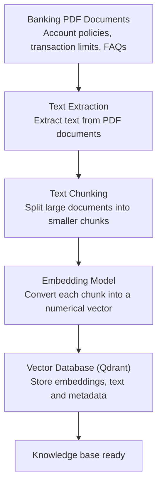
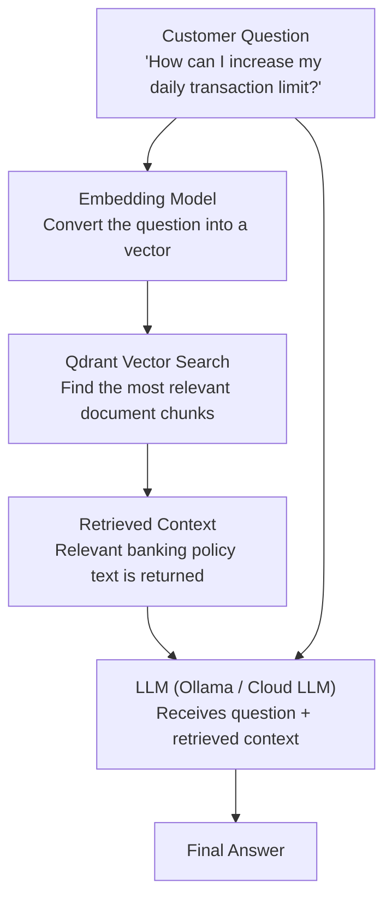

# How does a Vector Database work in RAG?

Let's consider a **banking chatbot**.

A customer asks:

> "How can I increase my daily transaction limit?"

Your company has several PDF documents containing banking policies. The RAG (Retrieval-Augmented Generation) pipeline has two phases: **document ingestion** (done once, ahead of time) and **retrieval and generation** (done for every question).

---

## Phase 1: RAG – Document Ingestion



| Step | What happens |
|------|--------------|
| **Banking PDF Documents** | Source material: account policies, transaction limits, FAQs. |
| **Text Extraction** | Plain text is extracted from the PDF documents. |
| **Text Chunking** | Large documents are split into smaller chunks so each one covers a focused topic. |
| **Embedding Model** | Each chunk is converted into a numerical vector that captures its meaning. |
| **Vector Database (Qdrant)** | Stores the embeddings, the original text and metadata (for example source document and page). |
| **Knowledge base ready** | The content is now searchable by meaning. |

---

## Phase 2: RAG – Retrieval and Generation



| Step | What happens |
|------|--------------|
| **Customer Question** | "How can I increase my daily transaction limit?" |
| **Embedding Model** | The question is converted into a vector, using the same embedding model as in ingestion. |
| **Qdrant Vector Search** | Qdrant finds the stored chunk vectors closest to the question vector, so it finds the most relevant document chunks. |
| **Retrieved Context** | The relevant banking policy text is returned. |
| **LLM (Ollama / Cloud LLM)** | Receives the question together with the retrieved context. |
| **Final Answer** | The LLM writes the answer from that context. |

**Final answer example:**

> "You can request an increase through the banking app, subject to the applicable account limits and verification requirements."

---

## The important distinction

> **The vector database does not generate answers. It retrieves relevant information. The LLM generates the answer using that information.**

| Component | Role |
|-----------|------|
| **Embedding Model** | Turns text (chunks and questions) into vectors. |
| **Vector Database (Qdrant)** | Stores vectors, text and metadata. Retrieves the most relevant chunks by similarity. |
| **LLM** | Reads the question and retrieved context, then generates the final answer. |

---

## How does this look in your actual Qdrant project?

A simplified Python example:

### Step 1: Generate an embedding

```python
from langchain_ollama import OllamaEmbeddings

embeddings = OllamaEmbeddings(
    model="nomic-embed-text"
)

vector = embeddings.embed_query(
    "How can I increase my transaction limit?"
)
```

### Step 2: Store the embedding in Qdrant

```python
from langchain_qdrant import QdrantVectorStore

vector_store = QdrantVectorStore.from_documents(
    documents=chunks,
    embedding=embeddings,
    url="http://localhost:6333",
    collection_name="rag_collection"
)
```

### Step 3: Retrieve relevant information

```python
retriever = vector_store.as_retriever(
    search_type="similarity",
    search_kwargs={"k": 4}
)

results = retriever.invoke(
    "How can I increase my transaction limit?"
)
```

Here, `k=4` means retrieve up to four relevant chunks.

### Step 4: Pass retrieved chunks to the LLM

```python
context = "\n".join(
    doc.page_content for doc in results
)

prompt = f"""Answer using only the provided context.

Context:
{context}

Question:
How can I increase my transaction limit?
"""
```

The LLM receives this prompt and generates the response.
