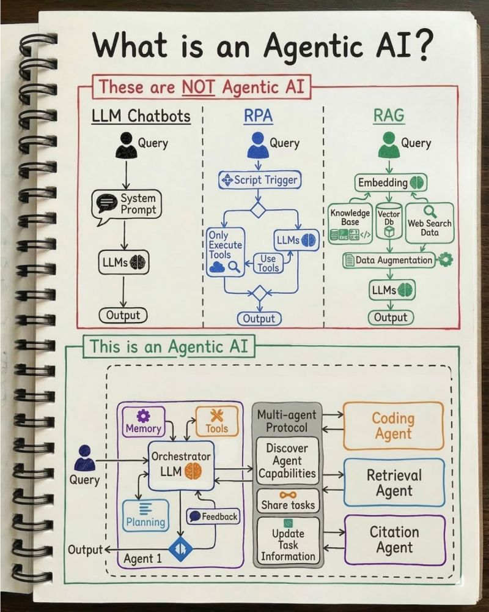

# Agentic AI

## What is Agentic AI
Agentic AI is an artificial intelligence system that can accomplish a specific goal with limited supervision. It consists of AI agents—machine learning models that mimic human decision-making to solve problems in real time. In a multiagent system, each agent performs a specific subtask required to reach the goal and their efforts are coordinated through AI orchestration.

Agentic AI builds on generative AI techniques by using large language models (LLMs) to function in dynamic environments. While generative models focus on creating content based on learned patterns, agentic AI extends this capability by applying generative outputs toward specific goals.

Example of Agentic AI
  - AI-powered trading bot : An AI-powered trading bot can analyze live stock prices and economic indicators to perform predictive analytics and execute trades.
  - Autonomous vehicles : In autonomous vehicles, real-time data sources such as GPS and sensor data can improve navigation and safety.
  - Healthcare agents : In healthcare, agents can monitor patient data, adjust treatment recommendations based on new test results, and provide real-time feedback to clinicians through chatbots.
  - Cybersecurity agents : In cybersecurity, agents can continuously monitor network traffic, system logs, and user behavior for anomalies that might indicate vulnerabilities to malware, phishing attacks, or unauthorized access attempts.
  - AI in supply chain : AI can streamline supply chain management through process automation and optimization, autonomously placing orders with suppliers, or adjusting production schedules to maintain optimal inventory levels.

## Advantages of Agentic AI
- Autonomous : The most important advancement of agentic systems is that they allow for autonomy to perform tasks without constant human oversight. Agentic systems can maintain long-term goals, manage multistep problem-solving tasks, and track progress over time.
- Proactive : Agentic systems provide the flexibility of LLMs, which can generate responses or actions based on nuanced, context-dependent understanding, with the structured, deterministic, and reliable features of traditional programming. This approach allows agents to “think” and “do” in a more human-like fashion.
- Specialized : Agents can specialize in tasks, ranging from simple, repetitive actions to complex problem-solving. Agentic architecture might consist of a "conductor" model, powered by an LLM, overseeing tasks and managing simpler agents. Such architectures are ideal for sequential workflows but are vulnerable to bottlenecks. Alternatively, horizontal, decentralized architecture involves agents working in harmony as equals, though they may be slower than a vertical hierarchy. Different AI applications require different architectures.
- Adaptable : Agents can learn from their experiences, take in feedback, and adjust their behavior. With the right guardrails, agentic systems can improve continuously. Multiagent systems possess the scalability to eventually handle broadly scoped initiatives.
- Intuitive : Because agentic systems are powered by LLMs, users can engage with them with natural language prompts. This means that entire software interfaces—think of the many tabs, dropdowns, charts, sliders, pop-ups, and other UI elements involved in the SaaS platform of one’s choice—can be replaced by simple language or voice commands. Theoretically, any software user experience can now be reduced to “talking” with an agent, who can fetch the information one needs and take action based on that information.


One small word is causing big confusion in AI programs: Agent.

Right now, many AI workflows are being labelled “agentic”. Even when they're not really.

Unfortunately, once leaders hear “agent”, they assume: autonomy, decision making and unpredictable behaviour.

And suddenly governance teams go into full risk mode.

So here’s the difference:


**▶️ LLM Chatbots**
- Input and get your response.
- Great for answering questions, summarising documents, and drafting text.
- Think customer support assistants, internal help bots, or writing copilots.
- They don’t take action in systems.

**▶️ RPA (Robotic Process Automation)**
- These are automation scripts, sometimes enhanced with AI in newer systems.
- They trigger tasks across systems.
- Great for finance processes, reconciliations, and repetitive back office work.
- There’s predefined logic rather than planning to reach a goal.

**▶️ RAG (Retrieval Augmented Generation)**
- These combine LLMs with company knowledge.
- The model retrieves information from a knowledge storebefore generating an answer.
- Great for internal knowledge assistants, policy questions and research support.
- The grounding in trusted data sources can lead to more accurate outputs. But they’re still not agentic because they don’t plan or act.

**🤖 Agentic AI**
Now we reach the real thing.

- Agents can plan steps to reach a goal, choose and use tools, coordinate with other agents and adapt based on feedback.
- They behave more like a problem solver than a responder.
- Best for complex, multi step work.

-Every pattern has value. But they require different governance, risk controls, and expectations.

If we call everything an agent, we create unnecessary fear and slow down adoption.

---

# Agentic AI — Crash Course

> A system design guide covering everything from LLMs to Agents, Harness Engineering, Loop Engineering, Graph Engineering, Observability, Guard Rails, and Evals.

---

## Table of Contents

1. [What Is an LLM?](#1-what-is-an-llm)
2. [Tokens and Context Window](#2-tokens-and-context-window)
3. [Hallucinations](#3-hallucinations)
4. [Prompts — System, User, and Developer](#4-prompts--system-user-and-developer)
5. [Tools — Giving the LLM a Body](#5-tools--giving-the-llm-a-body)
6. [Agent = LLM + System Prompt + Tools](#6-agent--llm--system-prompt--tools)
7. [Harness Engineering](#7-harness-engineering)
8. [Loop Engineering](#8-loop-engineering)
9. [Graph Engineering — Multi-Agent Systems](#9-graph-engineering--multi-agent-systems)
10. [Observability](#10-observability)
11. [Guard Rails](#11-guard-rails)
12. [Evals and Feedback](#12-evals-and-feedback)
13. [Bare Minimum Agentic System Design](#13-bare-minimum-agentic-system-design)

---

## 1. What Is an LLM?

An **LLM (Large Language Model)** is, from a black-box perspective, a magic input/output machine:

```
Input (tokens)  ──▶  [ LLM ]  ──▶  Output (probability distribution over next tokens)
```

- **What it does**: For a given input, it predicts the *probability distribution* of what the next output tokens should be. This process repeats internally to generate a full response.
- **What it is trained on**: Internet data, books, code, and other text — tokenized into numbers.
- **It is a dumb machine**: It has no memory, no hands, no ability to act on its own. It just takes input and produces output. Nothing more.

### Multimodal LLMs

Not all LLMs are text-only. A **multimodal** LLM can process multiple types of input:

| Input Type | Example |
|------------|---------|
| Text | "Write a Python function to add two numbers." |
| Image | A photo of a medical report |
| Voice | A spoken query |
| Video | A screen recording |
| Document | A PDF |

> If a model is described as **multimodal**, it means it can process more than just text. For example, GPT-4o and Claude's vision models accept images as input alongside text.

---

## 2. Tokens and Context Window

### What Is a Token?

In the world of LLMs, **everything is measured in tokens** — not bytes, not words, not characters.

- A token is roughly a word or sub-word unit depending on the model's internal vocabulary.
- Common English words (e.g., `hello`) are typically a single token.
- Uncommon names or rare words get broken into multiple tokens. For example, `Piyush` might be tokenized as: `P` + `iy` + `ush` = 3 tokens.
- Every LLM has its own **tokenizer** and **vocabulary dictionary** mapping strings to token IDs.

> **Rule of thumb**: ~1 token ≈ ~4 characters of English text. ~1,000 tokens ≈ ~750 words.

### Context Window

The **context window** is how many tokens an LLM can process at one time — both input and output combined.

| Model Generation | Typical Context Window |
|-----------------|----------------------|
| Early GPT-3 | 4,096 tokens |
| GPT-3.5 / Claude 1 | 16,000–32,000 tokens |
| GPT-4 / Claude 2 | 128,000 tokens |
| Gemini 1.5 / Claude 3.5+ | 1,000,000+ tokens |

#### Key Properties

- **It is a sliding window**: As a conversation grows, older messages fall out of the window. If you told the LLM your name at the start of a long chat and then ask again much later, it may no longer "remember" — because that message has slid out of the context.
- **More is not always better**: Even with a 1M token context window, you don't want to dump everything into it. A focused, relevant context gives better outputs than a noisy, oversized one.
- **As an engineer, you must manage this**: Don't exceed the context limit or the model will error and start hallucinating. Keep context focused and relevant.

```
[System Prompt] [Chat History] [Current User Message] [Tool Outputs]
|___________________ Context Window __________________________|
```

---

## 3. Hallucinations

**Hallucination** is when an LLM generates output that is factually wrong, made up, or irrelevant to the context — confidently.

### Why It Happens

- **Context overflow**: Too many unrelated topics crammed into the context window confuse the model.
- **Out-of-distribution queries**: Asking something the model was not trained on.
- **Weak or missing system prompt**: Without clear constraints, the model wanders freely.
- **Stochastic nature**: LLMs are probabilistic. Sometimes a low-probability, wrong token gets selected.

### Analogy

> Imagine you're deep in a conversation about AI and context windows. Suddenly someone asks you how a vacuum cleaner works. Your answer would likely be off-topic or confused — not because you don't know, but because you were mentally in a completely different context. That's hallucination.

### Mitigation Strategies

| Strategy | How It Helps |
|----------|-------------|
| Strong system prompt | Bounds the model to a domain |
| Focused context window | Prevents irrelevant noise from influencing output |
| Retrieval-Augmented Generation (RAG) | Grounds responses in retrieved facts |
| Temperature tuning | Lower temperature = less randomness = fewer hallucinations |
| Guard rails | Catch and filter hallucinated or out-of-scope outputs |
| Evals | Measure hallucination rate systematically over time |

---

## 4. Prompts — System, User, and Developer

Prompts are instructions given to the LLM. They shape its **identity, behavior, and constraints**. There are three types in an agentic system:

### System Prompt

The **most important prompt**. It is fed to the LLM *before* the user interacts at all.

- Sets the agent's **persona**, **domain**, **tone**, and **restrictions**.
- Think of it as the initial context that defines who the agent is.

**A strong system prompt includes:**

| Element | Example |
|---------|---------|
| **Role / Identity** | "You are an expert medical assistant named MedBot." |
| **Scope** | "Only answer questions related to medicine and health." |
| **Positive examples** | "If a user asks about symptoms, respond with structured questions." |
| **Negative constraints** | "Never recommend medications directly. Never answer coding or cooking questions." |
| **Tone** | "Always speak in professional medical terminology." |
| **User context** | "The current user is a registered patient." |

> If your system prompt is weak or missing, users can drive your agent in any direction — including misuse.

---

### User Prompt

The **running conversation** between the user and the agent. Every message the user sends is part of the user prompt chain, accumulated in the context window.

---

### Developer Prompt

A **mid-session injection** by the application developer — invisible to the user.

- Used to inject contextual system messages *during* an active session.
- Example: After a user purchases a subscription, inject: *"This user has just upgraded to Pro. Unlock advanced features."*

```
[System Prompt]  →  [User: Hi, I have a headache]
                 →  [Agent: Can you describe the pain?]
                 →  [Developer Prompt: User has just confirmed they are over 18]
                 →  [User: It's a throbbing pain...]
```

---

## 5. Tools — Giving the LLM a Body

An LLM is a **brain without a body**. It can think, reason, and generate — but it cannot *act*.

> A brain without a body can't post a tweet, check the weather, or read a file. It needs hands.

**Tools are functions** that you write and attach to an LLM, giving it the ability to perform real-world actions.

### How Tool Calling Works

```
User: "Post a tweet saying I'm feeling great today."
         │
         ▼
[LLM decides to call tool: post_tweet]
         │
         ▼
[Tool executes: Twitter API call]
         │
         ▼
[Result returned to LLM]
         │
         ▼
LLM: "Your tweet has been posted successfully."
```

### Common Tool Categories

| Category | Example Tools |
|----------|--------------|
| **Web & Search** | `web_search`, `fetch_url`, `news_search` |
| **Social Media** | `post_tweet`, `get_tweets`, `post_linkedin` |
| **File System** | `read_file`, `write_file`, `list_directory` |
| **Code Execution** | `run_python`, `execute_bash` |
| **Communication** | `send_email`, `send_whatsapp`, `read_messages` |
| **Data / APIs** | `get_weather`, `query_database`, `call_rest_api` |
| **Computer Use** | `take_screenshot`, `click_element`, `type_text` |
| **Memory** | `save_memory`, `retrieve_memory` |

### Tool Design Best Practices

- Each tool should do **one thing well** (single responsibility).
- Tools must return **structured output** the LLM can interpret.
- Tools should be **idempotent where possible** (safe to call multiple times).
- Document each tool with a clear **description** — the LLM uses this to decide when to call it.
- Add **error handling** so a failed tool call doesn't silently break the agent loop.

---

## 6. Agent = LLM + System Prompt + Tools

An **agent** is what you get when you wrap an LLM with:

```
Agent = LLM + System Prompt + Tools (+ Memory + Context Management)
```

| Component | Role |
|-----------|------|
| **LLM** | The brain — reasoning and generation engine |
| **System Prompt** | The identity — defines who the agent is and what it can do |
| **Tools** | The body — enables the agent to act in the world |
| **Memory** | The continuity — persists state across sessions |
| **Context Management** | The focus — controls what information is in the window |

> **LLM vs Agent**: An LLM is a raw engine. An Agent is that engine with a personality, capabilities, and constraints built around it.

---

## 7. Harness Engineering

A **harness** is everything you build *around* an agent to make it more powerful, safe, and production-ready.

> Analogy: A car engine is like an LLM. The full car — seats, steering wheel, brakes, seatbelts, suspension, sunroof, sound system — is the harness. The engine is the same in a basic hatchback and a Rolls-Royce. What makes the Rolls-Royce a Rolls-Royce is the harness.

### What Makes Up the Harness?

```
┌─────────────────────────────────────────────────┐
│                  HARNESS                        │
│                                                 │
│  ┌─────────┐  ┌──────────┐  ┌────────────────┐ │
│  │  Tools  │  │ Security │  │  Observability │ │
│  └─────────┘  └──────────┘  └────────────────┘ │
│  ┌──────────┐  ┌──────────┐  ┌──────────────┐  │
│  │ UI / UX  │  │  Memory  │  │  Eval Layer  │  │
│  └──────────┘  └──────────┘  └──────────────┘  │
│                    │                            │
│              ┌─────┴─────┐                      │
│              │   AGENT   │                      │
│              └─────┬─────┘                      │
│                    │                            │
│              ┌─────┴─────┐                      │
│              │    LLM    │                      │
│              └───────────┘                      │
└─────────────────────────────────────────────────┘
```

### Components of the Harness

| Component | What It Does |
|-----------|-------------|
| **Tools** | Pre-built actions the agent can invoke (web search, file I/O, APIs, etc.) |
| **Guard Rails** | Input/output safety filters to prevent misuse and off-topic behavior |
| **Observability** | Logging, tracing, and monitoring of agent execution |
| **Memory Engine** | Short-term (in-context) and long-term (vector DB) memory management |
| **Evals** | Automated quality assessment of agent outputs |
| **UI Layer** | The interface through which users interact with the agent |
| **Auth & Security** | Authentication, authorization, rate limiting, and abuse prevention |

> **Harness engineering is what differentiates great agents from mediocre ones.** The LLM is the same for everyone who uses it via API. Your harness is your competitive advantage.

---

## 8. Loop Engineering

A single pass through an LLM is rarely enough for a complex task. **Loop engineering** makes your agent iterative — it runs, checks its work, and repeats until the task is done.

> Analogy: Recording a video isn't a single action. You research, outline, record, review, re-record, edit, preview, upload, and collect feedback. Each step feeds back into the next. That's a loop.

### The Agent Loop

```
User gives task
      │
      ▼
Agent creates checklist / plan
      │
      ▼
┌─── Execute step N ───────────────────────────┐
│         │                                    │
│         ▼                                    │
│   Call tools if needed                       │
│         │                                    │
│         ▼                                    │
│   Get output / result                        │
│         │                                    │
│         ▼                                    │
│   Self-check: Is this step done? ────── No ──┤
│         │                                    │
│        Yes                                   │
└─── Mark step complete ◀──────────────────────┘
      │
      ▼
All steps done? ──── No ──▶ Next step
      │
     Yes
      │
      ▼
Terminate loop → Return final output
```

### Loop Termination Conditions

An infinite loop is a real risk. Always define termination conditions:

| Condition | Example |
|-----------|---------|
| **Task complete** | All checklist items checked off |
| **Max iterations** | Don't run more than N steps (e.g., max 20 tool calls) |
| **Time limit** | Stop after X seconds/minutes |
| **Error threshold** | Stop if N consecutive tool calls fail |
| **User interruption** | Allow user to halt mid-task |

### ReAct Pattern (Reason + Act)

The most common loop pattern for agents:

```
Thought:  What do I need to do next?
Action:   Call tool X with input Y
Observation: Tool returned Z
Thought:  Based on Z, I should now...
Action:   Call tool A with input B
...
Final Answer: [result]
```

---

## 9. Graph Engineering — Multi-Agent Systems

When a single agent isn't enough, you connect multiple agents. **Graph engineering** is the practice of building and orchestrating networks of agents.

> Analogy: A coding agent is an expert programmer. A cooking agent is a culinary expert. A gym/health agent knows nutrition and fitness. If you want an app that generates healthy recipes and builds the code for it, you don't give one agent all three jobs — you connect the experts.

### Multi-Agent Graph

```
                    ┌──────────────────┐
                    │  Orchestrator    │
                    │  (Main Agent)    │
                    └──────┬───────────┘
                           │
             ┌─────────────┼──────────────┐
             │             │              │
             ▼             ▼              ▼
    ┌─────────────┐ ┌─────────────┐ ┌──────────────┐
    │  Coding     │ │  Cooking    │ │  Health /    │
    │  Agent      │ │  Agent      │ │  Gym Agent   │
    └─────────────┘ └─────────────┘ └──────────────┘
    (Loop + Tools) (Loop + Tools) (Loop + Tools)
```

Each node in the graph is:
- An agent with its own system prompt and tools
- Running its own loop
- Capable of calling other agents or returning results

### Agent Communication Patterns

| Pattern | Description | Use Case |
|---------|-------------|----------|
| **Sequential** | Agent A finishes → passes result to Agent B | Pipeline workflows |
| **Parallel** | Multiple agents run simultaneously | Gathering information from multiple sources at once |
| **Hierarchical** | Orchestrator delegates to sub-agents | Complex multi-step tasks |
| **Feedback Loop** | Agent A reviews Agent B's output and sends corrections | Quality control, self-correction |
| **Fan-out / Fan-in** | One agent spawns many → results collected back | Research, summarization |

### Popular Graph Engineering Frameworks

| Framework | Description |
|-----------|-------------|
| **LangGraph** | Graph-based agent orchestration built on LangChain |
| **CrewAI** | Role-based multi-agent framework with crew and task abstractions |
| **AutoGen (Microsoft)** | Conversational multi-agent framework |
| **Swarm (OpenAI)** | Lightweight multi-agent handoff framework |
| **Dapr Workflows** | Durable workflows for agents in microservice architectures |

---

## 10. Observability

As your agent system grows in complexity — multiple agents, loops, tool calls — **debugging becomes the hardest problem**. Observability is the layer that lets you see inside the black box.

> If a customer reports a bad response, and you have no observability, you have no way to trace what happened.

### What Observability Captures

```
User Input
    │
    ▼
[Agent 1 triggered]
    ├── Tool call: web_search("weather in Patiala")
    │       └── Result: 35°C, sunny
    ├── Tokens used: 512 input / 128 output
    ├── Latency: 1.2s
    │
    ├── Calls Agent 2 (cooking sub-agent)
    │       ├── Tool call: get_nutrients("paneer tikka")
    │       ├── Tokens: 300 / 80
    │       └── Result: { calories: 250, protein: 18g }
    │
    └── Final output returned to user
        └── Total tokens: 1,200 | Total latency: 3.8s | Cost: $0.002
```

This full record is called a **trace**.

### Key Observability Metrics

| Metric | Why It Matters |
|--------|---------------|
| **Token usage** (input + output) | Directly maps to cost |
| **Latency per step** | Identify bottlenecks |
| **Tool call success/failure rate** | Detect broken integrations |
| **Agent path taken** | Debug unexpected behavior |
| **Context window utilization** | Catch context overflow risks |
| **Error rate** | Production health monitoring |
| **Hallucination rate** (via evals) | Quality tracking |

### Observability Tools

| Tool | Type |
|------|------|
| **Langfuse** | Open-source LLM observability & tracing |
| **LangSmith** | LangChain-native tracing and evaluation |
| **Arize Phoenix** | OSS LLM tracing and debugging |
| **Pydantic Logfire** | Structured logging for Python AI apps |
| **Weights & Biases Weave** | Experiment tracking + LLM tracing |
| **Helicone** | Lightweight LLM proxy with logging |
| **OpenTelemetry** | Open standard for distributed tracing (works with any stack) |

---

## 11. Guard Rails

Guard rails are **safety and quality control layers** placed on inputs and outputs of your agent. They prevent misuse, protect users, and keep the agent on-topic.

> Without guard rails, users can hijack your agent — extract internal tool details, get off-topic answers, or receive harmful content.

### Two Types of Guard Rails

#### Input Guard Rails

Applied to **user input** before it reaches the LLM:

```
User Input
    │
    ▼
[Input Guard Rail — Mini LLM or Rule Engine]
    │
    ├── Contains profanity? → Reject / sanitize
    ├── Prompt injection attempt? → Block
    ├── Sensitive data (PII, credentials)? → Redact
    ├── Out-of-scope topic? → Return scope error
    └── Passes all checks → Forward to agent
```

#### Output Guard Rails

Applied to **agent output** before it reaches the user:

```
Agent Output
    │
    ▼
[Output Guard Rail — Mini LLM or Rule Engine]
    │
    ├── Leaking internal tool names / code? → Redact
    ├── Politically sensitive content? → Flag / block
    ├── Racist / harmful language? → Block
    ├── Off-topic from agent's domain? → Replace with scope message
    └── Passes all checks → Deliver to user
```

### Implementation Approaches

| Approach | How It Works | Cost |
|----------|-------------|------|
| **Rule-based filters** | String matching, regex, keyword blocklists | Very cheap |
| **Mini local LLM** | Lightweight model (e.g., Llama 3.1 8B) runs guard checks | Low cost |
| **Dedicated guard rail service** | NeMo Guardrails, Guardrails AI, Llama Guard | Medium cost |
| **Primary LLM self-check** | Ask the main LLM to evaluate its own output | Higher cost |

### Popular Guard Rail Tools

| Tool | Description |
|------|-------------|
| **NeMo Guardrails (NVIDIA)** | Programmable guardrails for LLM apps; supports colang config |
| **Guardrails AI** | Python library for structured output validation + safety checks |
| **Llama Guard (Meta)** | LLM-based safety classifier for input/output content moderation |
| **Azure AI Content Safety** | Cloud API for harmful content detection |
| **AWS Bedrock Guardrails** | Managed guardrails for Bedrock-hosted models |

---

## 12. Evals and Feedback

After deploying your agent, you need to **continuously measure whether it's performing well**. This is done through evals (evaluations) and feedback loops.

### Feedback Collection

| Type | Example | Storage |
|------|---------|---------|
| **Thumbs up / down** | User rates a response positively | Saved to DB with the input/output pair |
| **Star rating** | User gives 1–5 stars | Used to compute quality scores over time |
| **Free text** | User explains what was wrong | Used for error analysis and prompt improvement |
| **Implicit signals** | User regenerates response, edits output, asks follow-up | Inferred quality signal |

Positive feedback examples → added to system prompt as few-shot examples.
Negative feedback examples → added to system prompt as negative examples ("Don't do this").

### Evals — LLM as a Judge

The most common eval technique in production: use a **separate LLM** to judge the quality of your agent's outputs.

```
Agent Output (for task T)
        │
        ▼
[Judge LLM]
"Here is the task: [T]. Here is the output: [O]. Rate this output on a scale of 1–5 for relevance, accuracy, and safety."
        │
        ▼
Score: { relevance: 4, accuracy: 3, safety: 5 }
```

### Eval Types

| Type | Description | Best For |
|------|-------------|---------|
| **LLM-as-Judge** | Secondary LLM scores primary LLM output | Semantic quality, tone, relevance |
| **Code Assertions** | Programmatic rules (JSON valid, word count, substring match) | Structured output, format checks |
| **Golden Dataset** | Compare output to known-correct reference answers | Classification, factual QA |
| **Human Feedback** | Domain experts manually rate outputs | Ground truth, calibration |

### Eval Workflow

```
Define Inputs (test cases)
        │
        ▼
Run Agent on each input
        │
        ▼
Score each output (code check / LLM judge / human)
        │
        ▼
Baseline score established
        │
        ▼
Make a change (prompt / model / tool)
        │
        ▼
Re-run evals → Compare to baseline
        │
        ▼
Ship if improved across all categories
        │
        ▼
Repeat
```

---

## 13. Bare Minimum Agentic System Design

Putting it all together — here is what a **minimum viable production agent** looks like:

```
┌─────────────────────────────────────────────────────────────────┐
│                        USER                                     │
└────────────────────────────┬────────────────────────────────────┘
                             │ Input
                             ▼
┌────────────────────────────────────────────────────────────────┐
│                   INPUT GUARD RAIL                             │
│  (Profanity check · Prompt injection · PII · Scope check)     │
└────────────────────────────┬───────────────────────────────────┘
                             │ Clean input
                             ▼
┌────────────────────────────────────────────────────────────────┐
│                        AGENT                                   │
│                                                                │
│  ┌──────────────┐   ┌───────────────┐   ┌──────────────────┐  │
│  │ System Prompt│   │  LLM Engine   │   │  Tools           │  │
│  │ (Identity +  │──▶│  (Reasoning + │──▶│  (Actions +      │  │
│  │  Constraints)│   │   Generation) │   │   Integrations)  │  │
│  └──────────────┘   └───────────────┘   └──────────────────┘  │
│                                                                │
│  ┌─────────────────────────────────────────────────────────┐  │
│  │              LOOP ENGINE                                │  │
│  │  (Plan → Execute → Check → Repeat until done)          │  │
│  └─────────────────────────────────────────────────────────┘  │
│                                                                │
└────────────────────────────┬───────────────────────────────────┘
                             │ Output
                             ▼
┌────────────────────────────────────────────────────────────────┐
│                  OUTPUT GUARD RAIL                             │
│  (Safety check · Domain scope · PII leakage · Tone)           │
└────────────────────────────┬───────────────────────────────────┘
                             │ Safe output
                             ▼
┌────────────────────────────────────────────────────────────────┐
│                   OBSERVABILITY LAYER                          │
│  (Trace: input → tool calls → loop steps → output · Tokens)   │
└────────────────────────────┬───────────────────────────────────┘
                             │ Monitored output
                             ▼
┌────────────────────────────────────────────────────────────────┐
│                        USER                                    │
│             ↕ Feedback (thumbs up/down, re-generate)          │
└────────────────────────────────────────────────────────────────┘
                             │ Feedback saved
                             ▼
┌────────────────────────────────────────────────────────────────┐
│                    EVAL PIPELINE                               │
│  (LLM-as-Judge · Code assertions · Score tracking · Reports)  │
└────────────────────────────────────────────────────────────────┘
```

### What This Covers

| Layer | Status |
|-------|--------|
| LLM (reasoning engine) | ✅ |
| System prompt (identity + constraints) | ✅ |
| Tools (actions) | ✅ |
| Loop engineering (iterative execution) | ✅ |
| Input guard rails (safety) | ✅ |
| Output guard rails (safety) | ✅ |
| Observability / tracing | ✅ |
| Evals and feedback | ✅ |

### What Is NOT Covered Yet (Next Steps)

| Topic | Why It Matters |
|-------|---------------|
| **Memory engine** | Persist context across sessions (short-term + long-term) |
| **Graph engineering** | Multiple specialist agents working together |
| **Cost optimization** | Token efficiency, model selection, caching |
| **Context window management** | Summarization, chunking, retrieval-augmented context |
| **Durability / fault tolerance** | Resume agent execution after crash or timeout |
| **Scaling** | Handle concurrent users, rate limiting, load balancing |
| **Fine-tuning** | Improve model performance on your domain |

---

## Summary: The Agentic Stack

```
LLM (Brain)
    +
System Prompt (Identity)
    +
Tools (Body / Hands)
    = AGENT

Agent
    +
Loop Engineering (Iterative execution)
    +
Harness (Security, UI, Memory, Observability, Evals)
    = PRODUCTION AGENT

Production Agent × Multiple Specialist Agents
    +
Graph Engineering (Orchestration)
    = MULTI-AGENT SYSTEM
```

| Concept | One-Line Summary |
|---------|-----------------|
| **LLM** | A probabilistic input → output engine trained on tokens |
| **Token** | The unit of measurement for LLMs (≈ sub-word chunks) |
| **Context Window** | How many tokens the LLM can process at once (sliding window) |
| **Hallucination** | The LLM generating confidently wrong or off-topic output |
| **System Prompt** | Initial instructions that define the agent's identity and scope |
| **Tools** | Functions that give the agent the ability to act in the world |
| **Agent** | LLM + System Prompt + Tools + (Memory) |
| **Harness** | Everything built around the agent to make it production-ready |
| **Loop Engineering** | Making the agent iterative — plan, execute, check, repeat |
| **Graph Engineering** | Connecting multiple agents into a network of specialists |
| **Observability** | Tracing and logging every step of agent execution |
| **Guard Rails** | Input/output safety filters to prevent misuse and harm |
| **Evals** | Systematic measurement of agent output quality over time |

> Building and deploying agents requires human thinking — how to orchestrate, what the harness should look like, what the execution order should be. AI can build applications, but *you* have to architect the agent.


